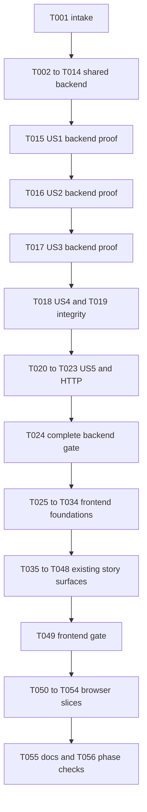

# Tasks: Quality, Packing, Rejection, and Reinspection

**Roadmap Phase**: P06 — Quality, packing, rejection, and reinspection\
**Feature Directory**: `specs/006-quality-packing-reinspection`\
**Generated**: 2026-11-11\
**Source Baseline**: `c8d9e778f8240bc65d15196e2a9258685a0dedcd`, actual Git branch `main`\
**Input**: [spec.md](spec.md), [plan.md](plan.md), [contracts](contracts/quality.md), [data model](data-model.md), [backend design](backend-design.md), [frontend design](frontend-design.md)\
**Authorized Scope**: TASKS generation only. No task execution, application test, migration, checklist approval, commit, push or deployment is performed now.

**Scoped amendment, 2026-11-11**: The owner authorized resolving ANALYZE findings
through PLAN, CHECKLIST reuse, TASKS amendment and a fresh read-only ANALYZE. C1 is
addressed by the explicit operation-aware lock-helper design and the T011/T014 briefs
below; D1's canonical-table presentation is corrected. Preserve all 56 task IDs,
checkboxes, accepted product decisions and dependency ordering. This sequence
authorizes artifact remediation only; task execution remains pending.

Apply the root [constitution](../../.specify/memory/constitution.md), [phase delivery](../../docs/workflow/phase-delivery.md), [engineering index](../../docs/engineering/README.md) and [implementation handoff](../../docs/workflow/implementation-handoff.md). These are delivery groups within one P06 feature. All 56 tasks begin unchecked. Accepted artifacts, decisions, IDs and existing edits remain preserved.

## Task Format and Generation Rules

Summaries use `- [ ] T### [P?] [US#?]` and an exact path. Story labels identify primary US1–US5 ownership; common foundations/review have no story label and retain cross-story references in their briefs. [P] permits concurrency only after actual predecessor acceptance and a disjoint-writer check. It grants no external-action permission.

Only a future IMPLEMENT request authorizes task execution. Its pre-code requirements review covers the still-unchecked [38-item custom checklist](checklists/quality-packing-reinspection.md); the [built-in checklist](checklists/requirements.md) retains its existing 16/16 markers. TASKS does not evaluate or approve either checklist. During code work requirement markers remain read-only.

### Shared execution context C0

Every brief includes C0 plus its exact read bundle. At fresh intake read all nine core engineering guides; later batches reopen applicable sections and actual source/callers. Apply code-review's separate requirements/engineering verdicts and matching installed guards to future changed code/tests. No guard, build or application suite has run during this task generation.

- Paths are repository-relative. CREATE means a proposed output absent at generation; MODIFY dependency output means an earlier task creates it; MODIFY existing means current source exists. Reopen source and prerequisite outputs before editing. Absence of a future dependency is not permission to invent another interface.
- Preserve stable identities, frozen commercial terms, actual paid/receipt/cancellation facts, retained actors/history, exact whole-selection failure and untouched companions. No QUALITY manufacturing pointer, widened P05 enum, fixture fallback, guard disabling or unrelated provider/screen.
- Follow the fixed operation/authority/transaction/error/UI/cache decisions. Routine syntax is free; material drift returns to its proper authorized owner and blocks dependent work. A failing prerequisite is corrected only within the actual selected scope, not by silently rewriting accepted design.
- Run meaningful discovered checks at their claimed boundary and inspect actual outputs/freshness. Real persisted/race/HTTP/browser claims require owned real infrastructure/cleanup. Missing Docker/Chromium leaves the corresponding acceptance incomplete; never use developer/production data.
- Backend checks before T024 are contracts/database/API-scoped. Additive activity-union web consumers finish at T048; full web checks occur at T049 and full root checks at T056. Avoid circular acceptance that requires dependent UI before its backend.
- Canonical field definitions and escaped union alternatives remain owned by Contracts §§3–6.3. CHK035's earlier table presentation concern was corrected in the authorized PLAN amendment. Reopen the canonical descriptions before editing; any new material ambiguity returns to its proper authorized design owner.
- All brief commands/done conditions describe future work. Record actual later commands, discovered tests, fresh/cached status, cleanup and both reviews in [Implementation Evidence](#implementation-evidence). No task is marked complete before its own verified outcome.

## Group 1: Scoped Intake and Actual Prerequisites

Reuse existing foundations and resolve the exact later execution scope; no setup reinitialization.

- [x] T001 Record P06 scope, preserved state and pre-code requirements review in specs/006-quality-packing-reinspection/tasks.md

## Group 2: Required Backend, Tests and Acceptance

Shared contracts/data/authority/producers precede labelled story proofs. No dependent frontend before T024.

- [x] T002 Define strict quality command and primitive event contracts in `packages/contracts/src/quality/quality-command.schema.ts`
- [x] T003 Define quality read schemas and shared activity union exports in `packages/contracts/src/quality/quality.schema.ts`
- [x] T004 Add Prisma quality models and draft forward SQL tables/enums in `packages/database/prisma/schema.prisma`
- [x] T005 Complete new quality foreign keys, retained history and graph guards in `packages/database/prisma/migrations/20261111000200_p06_quality_workspaces/migration.sql`
- [x] T006 Finish narrow P04/P05 witness compatibility and populated backfill in `packages/database/prisma/migrations/20261111000200_p06_quality_workspaces/migration.sql`
- [x] T007 Extend guarded owned cleanup and schema inventory assertions in `apps/api/src/test-support/reset-test-data.ts`
- [x] T008 [P] Prove fresh/populated migration and exact database constraints in `packages/database/tests/integration/migration.integration.test.ts`
- [x] T009 Create real upstream quality-incoming fixtures in `apps/api/src/test-support/quality.fixture.ts`
- [x] T010 [P] Define quality mapper records, pure rules and safe errors in `apps/api/src/modules/quality/quality.types.ts`
- [x] T011 Implement protected quality relationship, context and root-lock queries in `apps/api/src/modules/quality/quality.queries.ts`
- [x] T012 [P] Extract reusable P04 issue, command persistence and lock/version writers in `apps/api/src/modules/approval/approval-issue-report.writer.ts`
- [x] T013 Add quality lifecycle helpers and real P04 interruption/cancellation seams in `apps/api/src/modules/quality/quality-work.lifecycle.ts`
- [x] T014 Implement the complete cohesive quality command executor in `apps/api/src/modules/quality/quality-command-executor.ts`

### Backend story proofs — US1 to US4

Use the complete real producer and actual upstream state; individual proofs do not close the full backend gate.

- [x] T015 [US1] Prove real quality start, colleague continuation and own-result recovery in `apps/api/src/modules/quality/quality-command-executor.integration.test.ts`
- [x] T016 [US2] Prove exact acceptance subsets and immutable optional packing in `apps/api/src/modules/quality/quality-command-executor.integration.test.ts`
- [x] T017 [US3] Prove live correction routes, repeated reinspection and P04 cancellation in `apps/api/src/modules/quality/quality-command-executor.integration.test.ts`
- [x] T018 [US4] Prove mixed inspections and atomic +N report batches at the maximum bound in `apps/api/src/modules/quality/quality-command-executor.integration.test.ts`

### Cross-operation backend integrity

Controlled races and complete required-save rollback require real persisted state.

- [x] T019 Verify controlled races and whole-graph failures with real persistence in `apps/api/src/modules/quality/quality-command-executor.integration.test.ts`

### Backend story work — US5

Current and retained views/history share authoritative physical pieces and safe projections.

- [x] T020 [US5] Implement authorized quality dashboard, queues, detail and safe paper in `apps/api/src/modules/quality/quality.queries.ts`
- [x] T021 [US5] Implement immutable quality history and shared order activity projections in `apps/api/src/modules/quality/quality.queries.ts`
- [x] T022 [US5] Complete QualityService protected read and command delegation boundary in `apps/api/src/modules/quality/quality.service.ts`

### Complete HTTP boundary and backend acceptance

T024 requires all backend behavior/reviews/evidence before any T025–T049 work.

- [x] T023 Expose complete quality HTTP routes and aligned OpenAPI in `apps/api/src/modules/quality/quality.controller.ts`
- [x] T024 Accept the complete required backend before frontend wiring in `specs/006-quality-packing-reinspection/tasks.md`

## Group 3: Dependent Existing-Frontend Integration

Every task explicitly depends on accepted T024. Shared API/scope/models/hooks precede story-labelled current surfaces.

- [x] T025 [P] Create the quality API adapters and exact command-result binder in `apps/web/src/features/manufacturing/api/quality.api.ts`
- [x] T026 [P] Extend current operational scope with fixed QUALITY authority and private-cache cleanup in `apps/web/src/shared/query/operational-scope.ts`
- [x] T027 [P] Create safe quality rows, exact target resolvers and tracking projections in `apps/web/src/features/manufacturing/model/quality-view.model.ts`
- [x] T028 [P] Define immutable quality command-session states and failure classification in `apps/web/src/features/manufacturing/model/quality-command-state.ts`
- [x] T029 Create quality form schemas, canonical shaping and localized field-error mapping in `apps/web/src/features/manufacturing/model/quality-form.model.ts`
- [x] T030 Create exact quality selection and inspection-partition capture in `apps/web/src/features/manufacturing/model/quality-selection.model.ts`
- [x] T031 Create quality query keys, guarded read hooks and bounded group detail hydration in `apps/web/src/features/manufacturing/hooks/quality.hooks.ts`
- [x] T032 Create the sole quality command slot, receipt recovery and synchronization owner in `apps/web/src/features/manufacturing/hooks/quality-commands.hooks.ts`
- [x] T033 Create the shared quality command recovery notice in `apps/web/src/features/manufacturing/components/quality-command-recovery.tsx`
- [x] T034 [P] Create cycle-free quality event and operation summaries in `apps/web/src/features/manufacturing/model/quality-event.model.ts`

### Frontend story work — exact controls and existing surfaces

Labels identify primary story ownership. Shared-file dependencies require some interleaving; no independent-delivery fiction or redesign.

- [x] T035 [US4] Add closed quality table action contracts and exact selection controls in `apps/web/src/features/manufacturing/screens/department-piece-table-types.ts`
- [x] T036 [US5] Add authoritative quality grouped cards and flat piece tables in `apps/web/src/features/manufacturing/screens/department-order-table.tsx`
- [x] T037 [P] [US1] Add factory-safe quality task summaries, specifications and rail projection in `apps/web/src/features/manufacturing/screens/factory-task-summary.tsx`
- [x] T038 [P] [US1] Add exact quality receive/start and colleague-continuation confirmation in `apps/web/src/features/prototype/components/receive-and-start-dialog.tsx`
- [x] T039 [P] [US2] Convert grouped quality inspection to explicit per-piece outcomes and optional packing in `apps/web/src/features/prototype/components/quality-inspection-dialog.tsx`
- [x] T040 [P] [US3] Convert per-piece quality inspection without inventing packing inputs in `apps/web/src/features/manufacturing/screens/quality-inspect-piece-modal.tsx`
- [x] T041 [US4] Add quality single/batch approval-issue reporting through one atomic intent in `apps/web/src/features/manufacturing/screens/piece-report-problem-modal.tsx`
- [x] T042 [US1] Integrate exact quality task context and reached inspection actions in `apps/web/src/features/manufacturing/screens/factory-task-detail-view.tsx`
- [x] T043 [US5] Integrate quality order tracking, factory paper and immutable paged history in `apps/web/src/features/manufacturing/screens/manufacturing-order-detail-view.tsx`
- [x] T044 [US1] Integrate quality dashboard and authoritative shared sidebar counts in `apps/web/src/features/manufacturing/screens/quality-workspace.tsx`
- [x] T045 [US4] Integrate exact quality queues, bounded preparation and inspection confirmation in `apps/web/src/features/manufacturing/screens/quality-workspace.tsx`
- [x] T046 [US5] Integrate quality activity, original-result discovery and immutable lifecycle history in `apps/web/src/features/manufacturing/screens/quality-workspace.tsx`
- [x] T047 [US3] Refresh permitted quality reads after actual P04/P05 changes in `apps/web/src/features/manufacturing/hooks/manufacturing-commands.hooks.ts`
- [x] T048 [US5] Extend existing sales and approval activity consumers for safe quality events in `apps/web/src/features/sales/model/order-view.model.ts`

### Frontend acceptance gate

This gate leaves browser/whole-phase acceptance open.

- [x] T049 Review and verify the complete dependent frontend group before browser acceptance in `specs/006-quality-packing-reinspection/tasks.md`

## Group 4: Cross-Layer and Phase Exit

Five story-labelled browser slices extend one file sequentially, followed by docs and full checks. P07 receipt/delivery and release remain outside P06.

- [x] T050 [US1] Verify ordinary quality work, colleagues and packing in the real browser in `apps/web/e2e/quality-packing-reinspection.spec.ts`
- [x] T051 [US3] Verify both correction routes, repeated cycles and terminal history in `apps/web/e2e/quality-packing-reinspection.spec.ts`
- [x] T052 [US4] Verify exact mixed outcomes and whole-selection stale rejection in `apps/web/e2e/quality-packing-reinspection.spec.ts`
- [x] T053 [US5] Verify quality authority, aliases and retained safe history in `apps/web/e2e/quality-packing-reinspection.spec.ts`
- [x] T054 [US4] Verify delayed real commands and read-only reload recovery in `apps/web/e2e/quality-packing-reinspection.spec.ts`
- [x] T055 Update implemented P06 runtime and verification documentation in `README.md`
- [x] T056 Complete full P06 verification and separate acceptance verdicts in `specs/006-quality-packing-reinspection/tasks.md`

**Gate:** all backend tasks through T024 must be implemented, reviewed and accepted before any frontend task. Partial services, fixtures, mocked persistence and historical P05 results are insufficient. T049 accepts only the dependent frontend group; T050–T056 retain browser/full-phase obligations.

### Primary task counts

| Label                          | Task count |
| ------------------------------ | ---------: |
| US1                            |          6 |
| US2                            |          2 |
| US3                            |          4 |
| US4                            |          6 |
| US5                            |          8 |
| Shared foundations/review/exit |         30 |
| **Total**                      |     **56** |

Shared tasks support multiple stories; these counts describe primary checklist labels, not exclusive requirement coverage. Twelve tasks have a conditional parallel marker.

## Dependencies and Safe Execution

The exact predecessor table is authoritative. T001 is pre-code intake; T002–T014 produce the shared backend; T015–T019 prove transitions/integrity; T020–T023 complete reads/history/HTTP; T024 accepts the whole backend. T025–T034 are frontend foundations; T035–T048 integrate actual surfaces/consumers; T049 accepts that group. T050–T054 are sequential browser slices, T055 docs and T056 final checks.

| Task | Required predecessors                                      | Parallel condition                                            |
| ---- | ---------------------------------------------------------- | ------------------------------------------------------------- |
| T001 | None; later pre-code authorization required                | One writer; respect exact prerequisites                       |
| T002 | T001                                                       | One writer; respect exact prerequisites                       |
| T003 | T002                                                       | One writer; respect exact prerequisites                       |
| T004 | T003                                                       | One writer; respect exact prerequisites                       |
| T005 | T004                                                       | One writer; respect exact prerequisites                       |
| T006 | T005                                                       | One writer; respect exact prerequisites                       |
| T007 | T006                                                       | One writer; respect exact prerequisites                       |
| T008 | T007                                                       | After prerequisites, disjoint files and stable interfaces [P] |
| T009 | T008                                                       | One writer; respect exact prerequisites                       |
| T010 | T007                                                       | After prerequisites, disjoint files and stable interfaces [P] |
| T011 | T009, T010                                                 | One writer; respect exact prerequisites                       |
| T012 | T007                                                       | After prerequisites, disjoint files and stable interfaces [P] |
| T013 | T011, T012                                                 | One writer; respect exact prerequisites                       |
| T014 | T003, T008, T011, T012, T013                               | One writer; respect exact prerequisites                       |
| T015 | T014, T009                                                 | One writer; respect exact prerequisites                       |
| T016 | T015                                                       | One writer; respect exact prerequisites                       |
| T017 | T016                                                       | One writer; respect exact prerequisites                       |
| T018 | T017                                                       | One writer; respect exact prerequisites                       |
| T019 | T018                                                       | One writer; respect exact prerequisites                       |
| T020 | T019                                                       | One writer; respect exact prerequisites                       |
| T021 | T020                                                       | One writer; respect exact prerequisites                       |
| T022 | T021                                                       | One writer; respect exact prerequisites                       |
| T023 | T022                                                       | One writer; respect exact prerequisites                       |
| T024 | T008, T015, T016, T017, T018, T019, T020, T021, T022, T023 | One writer; respect exact prerequisites                       |
| T025 | T024                                                       | After prerequisites, disjoint files and stable interfaces [P] |
| T026 | T024                                                       | After prerequisites, disjoint files and stable interfaces [P] |
| T027 | T024                                                       | After prerequisites, disjoint files and stable interfaces [P] |
| T028 | T024, T025                                                 | After prerequisites, disjoint files and stable interfaces [P] |
| T029 | T024, T028                                                 | One writer; respect exact prerequisites                       |
| T030 | T024, T027, T029                                           | One writer; respect exact prerequisites                       |
| T031 | T024, T025, T026, T027, T029                               | One writer; respect exact prerequisites                       |
| T032 | T024, T025, T026, T028, T031                               | One writer; respect exact prerequisites                       |
| T033 | T024, T029, T032                                           | One writer; respect exact prerequisites                       |
| T034 | T024                                                       | After prerequisites, disjoint files and stable interfaces [P] |
| T035 | T024, T027, T030                                           | One writer; respect exact prerequisites                       |
| T036 | T024, T035                                                 | One writer; respect exact prerequisites                       |
| T037 | T024, T027                                                 | After prerequisites, disjoint files and stable interfaces [P] |
| T038 | T024, T027, T029                                           | After prerequisites, disjoint files and stable interfaces [P] |
| T039 | T024, T027, T029, T030                                     | After prerequisites, disjoint files and stable interfaces [P] |
| T040 | T024, T027, T029, T030                                     | After prerequisites, disjoint files and stable interfaces [P] |
| T041 | T024, T027, T029, T030, T032                               | One writer; respect exact prerequisites                       |
| T042 | T024, T031, T033, T037, T038, T039, T040, T041             | One writer; respect exact prerequisites                       |
| T043 | T024, T031, T033, T034, T037                               | One writer; respect exact prerequisites                       |
| T044 | T024, T031, T033, T035                                     | One writer; respect exact prerequisites                       |
| T045 | T024, T036, T038, T039, T040, T041, T042, T044             | One writer; respect exact prerequisites                       |
| T046 | T024, T031, T033, T034, T043, T045                         | One writer; respect exact prerequisites                       |
| T047 | T024, T032, T046                                           | One writer; respect exact prerequisites                       |
| T048 | T024, T034, T043, T046, T047                               | One writer; respect exact prerequisites                       |
| T049 | T024–T048 (complete listed groups)                         | One writer; respect exact prerequisites                       |
| T050 | T049                                                       | One writer; respect exact prerequisites                       |
| T051 | T050                                                       | One writer; respect exact prerequisites                       |
| T052 | T051                                                       | One writer; respect exact prerequisites                       |
| T053 | T052                                                       | One writer; respect exact prerequisites                       |
| T054 | T053                                                       | One writer; respect exact prerequisites                       |
| T055 | T049, T054                                                 | One writer; respect exact prerequisites                       |
| T056 | T001–T055 (every prior ID)                                 | One writer; respect exact prerequisites                       |

### Condensed dependency graph

The table above owns per-ID predecessors and parallel branches; this graph summarizes completion gates inside the same P06 feature.



### Story dependencies and independent acceptance criteria

| Story                       | Actual dependencies                                                                           | Independently observable acceptance slice                                                                                                |
| --------------------------- | --------------------------------------------------------------------------------------------- | ---------------------------------------------------------------------------------------------------------------------------------------- |
| US1 — Find/start/continue   | P01–P05 and common backend; T024 before UI; shared US5 safe reads are required for screens.   | A starts P1, B continues, P2 remains incoming; original start/actual actors persist in another eligible session.                         |
| US2 — Accept/pack           | US1 inspection preconditions and common exact outcome machinery.                              | Explicit accepted subset and ordinary no-issue piece; optional entered packing/notes, independent groups and unchanged physical receipt. |
| US3 — Correct/reinspect     | US1/US2 machinery plus actual P05 correction and P04 cancellation consumers.                  | Both normal target routes, failed prior cycle plus only one next, later acceptance/cancellation with retained cycle IDs/history.         |
| US4 — Mixed outcomes/issues | US2/US3 exact decisions plus real P04 issue rules.                                            | Exact accepted/rejected/untouched pieces, complete cross-order failure, real +N child chain and original result recovery.                |
| US5 — Safe views/history    | Authoritative state and all relevant producers; read scope does not grant downstream actions. | Same scoped counts/search/aliases/details after onward transfer; one grouped report, original history groups and no forbidden data.      |

### Parallel examples by story

- Backend foundation: after T007, T008 database tests, T010 pure rules/mappers and T012 P04 extraction have disjoint ownership; broad package checks wait for peer writes to settle.
- US1: after T024/T027/T029, T037 safe task summaries and T038 receipt/continue dialog are disjoint. T042 still waits for all named read/recovery/modal dependencies.
- US2/US3: after T024/T027/T029/T030, T039 group inspection and T040 per-piece inspection are disjoint; the shared form/selection interface must already be stable.
- US4: supporting T025 API and T028 command-state foundation are independent after T024. Actual batch/queue/shared-executor/browser writers remain sequential.
- US5: supporting T025 API and T034 cycle-free event labels are independent after T024. Shared workspace T044→T045→T046 and dependent T047→T048 remain sequential.

### Implementation strategy / first acceptance slice

Use small dependency-safe batches under the actual future selected scope. Suggested first future batch: T001–T003, with pre-code requirements review completed before contract edits. This suggestion is not authorization to run it. Complete the full backend gate before frontend integration. The first useful acceptance slice is US1 plus ordinary US2 acceptance/packing with required shared read/presentation/recovery prerequisites. It is not phase completion; all correction/issue/history requirements and every SC remain required for full P06. Backend story proofs may establish their isolated real producer boundary earlier without bypassing the whole-backend-before-UI gate.

## Task Briefs

C0 is part of every brief. Spec/Plan/Contracts/Data/Backend/Frontend refer to the linked feature artifacts. Read actual immediate callers and cited tests/harnesses before editing. Proposed predecessor outputs must be implemented by their producing tasks before consumers start; no brief authorizes a new architecture or temporary fake-success protocol.

### T001

**Outcome**: Record P06 scope, preserved state and pre-code requirements review in specs/006-quality-packing-reinspection/tasks.md.

**Requirements / dependencies**: All stories; Spec Scope and Baseline/D-001–D-007; Plan Q01–Q09; constitution I/X/XI. Required predecessor IDs: None.

**Allowed file actions**:

- **MODIFY task evidence only** `specs/006-quality-packing-reinspection/tasks.md`.

- **MODIFY existing** `specs/006-quality-packing-reinspection/checklists/quality-packing-reinspection.md`.

**Read-before-edit bundle**: C0 plus:

- Root AGENTS.md; .specify/memory/constitution.md; docs/workflow/phase-delivery.md §§1–4; docs/workflow/implementation-handoff.md §§3–4; all nine docs/engineering core guides at fresh intake.

- specs/006-quality-packing-reinspection/spec.md, plan.md, contracts/quality.md, data-model.md, backend-design.md and frontend-design.md; checklists/requirements.md plus every CHK001–038 in checklists/quality-packing-reinspection.md.

- Root plan.md P06/dependencies/client-input rows; actual Git state and .specify/feature.json/environment selection; package manifests/test configurations and current source/callers named by the selected brief.

**Current boundary versus target**: No P06 producer is implemented at generation; this is later pre-code scope/requirements review only.

**Ordered steps**:

1. Resolve exact P06→specs/006-quality-packing-reinspection and selected IDs from the actual future IMPLEMENT request; capture current Git revision/status, preserve all unrelated edits and reuse P01–P05. Record intake in this task file’s Implementation Evidence section only.

2. Before any code outline/edit, perform the requirements-quality review authorized by that future IMPLEMENT request. Only then may supported custom checklist markers be updated with item-specific evidence; no marker is approved by TASKS generation. The built-in checklist remains owned by SPECIFY/CLARIFY; requirements/design corrections go to the proper authorized owner.

3. Review canonical field descriptions, optionality and outcome alternatives (CHK035), including the corrected table presentation. If a new material ambiguity exists, record its exact owning section and stop only dependent work for authorized PLAN correction. Do not edit accepted specifications/designs from this task.

4. Verify selected brief/source agreement and dependencies. Record actual tooling/Docker/Chromium limitations against the applicable later evidence gate; never install a new architecture, reset data, or substitute developer/production services. During subsequent code work all requirement-checklist markers are read-only.

**Preserve / failure unchanged**: Current authorized command is TASKS only. Future preflight is not phase/release approval. Preserve root roadmap/status/client gates, all accepted IDs/decisions, existing edits, migration bytes and feature selection; no application or external mutation belongs to this intake.

**Tests / verification**:

- From repository root: git status --short --untracked-files=all; git branch --show-current; bash .specify/scripts/bash/check-prerequisites.sh --json --paths-only; git diff --check. Expected: actual branch separated from script feature context and exact P06 paths, with all prior edits retained.

- Inspect both checklists and selected brief dependencies; before code require evidence-based requirements disposition, not fabricated execution evidence. Any missing runtime resource leaves its later persistence/browser acceptance unperformed; no fallback database.

**Done when**: Future intake evidence names exact permitted IDs, current source/selection, preserved edits, requirements-quality disposition and real dependency/runtime limits. All selected implementation briefs agree with current source; unresolved material gaps block their dependent work. No product/code change is performed by T001. C0 review/evidence rules apply; no execution result is claimed by this brief.

### T002

**Outcome**: Define strict quality command and primitive event contracts.

**Requirements / dependencies**: FR-005–020/022; Q02–08; V03/V05/V09/V12 Required predecessor IDs: T001.

**Allowed file actions**:

- **CREATE proposed** `packages/contracts/src/quality/quality-command.schema.ts`.

- **CREATE proposed** `packages/contracts/src/quality/quality-event.schema.ts`.

- **CREATE proposed** `packages/contracts/src/quality/quality.schema.test.ts`.

**Read-before-edit bundle**: C0 plus:

- specs/006-quality-packing-reinspection/contracts/quality.md §§1/3–5/6.3

- packages/contracts/src/manufacturing/manufacturing-command.schema.ts

- packages/contracts/src/manufacturing/manufacturing-event.schema.ts

- packages/contracts/src/approval/approval-command.schema.ts

- packages/contracts/src/http/http.schema.ts: nonEmptyBoundedString

- docs/engineering/code-style.md: ownership/types/reuse

- docs/engineering/backend-standard.md: canonical module/use-case recipe

- docs/engineering/testing.md: evidence, discovery and owned cleanup

- docs/workflow/implementation-handoff.md: bounded task briefs

**Current boundary versus target**: Quality schemas/activity kind are proposed and absent; current P05 department and old wire contracts remain closed.

**Ordered steps**:

1. Create the proposed command owner with all four strict branches, canonical null/text handling, distinct exact IDs, 200-member budget and operation-specific outcome/version refinements.

2. Create the leaf event owner, packing/inspection summaries and immutable correctionLinks; preserve full per-order event membership and primitive-only imports.

3. Add direct-owner schema tests covering mixed results, +N reports, packing absence, cycle links, unsupported authority fields and rejected bounds; defer read schemas/index changes to T003.

**Preserve / failure unchanged**: Never infer identities from quantities, deduplicate invalid selections, import full sales/approval/manufacturing wrappers into the leaf, or turn carton text into numeric business authority. These are proposed contracts, not implemented endpoints.

**Tests / verification**:

- pnpm --filter @template/contracts test src/quality/quality.schema.test.ts

- pnpm --filter @template/contracts check-types

- Assert omitted/null/blank versus original nonblank text, 4000/4001, duplicate/cross-order/overlap rejection, actual carton-only packing and +1/+N outcomes. No database/provider required.

**Done when**: Focused discovered contract tests and contracts types pass; record exact cases/results. All planned primitives exist without producer or execution claims. C0 review/evidence rules apply; no execution result is claimed by this brief.

### T003

**Outcome**: Define quality read schemas and shared activity union exports.

**Requirements / dependencies**: FR-001–004/017/021–023; Q01/Q08; V01/V07/V09/V12 Required predecessor IDs: T002.

**Allowed file actions**:

- **CREATE proposed** `packages/contracts/src/quality/quality.schema.ts`.

- **MODIFY dependency output from T002** `packages/contracts/src/quality/quality.schema.test.ts`.

- **MODIFY existing** `packages/contracts/src/index.ts`.

- **MODIFY existing** `packages/contracts/src/sales-orders/sales-orders.schema.ts`.

- **MODIFY existing** `packages/contracts/src/sales-orders/sales-orders.schema.test.ts`.

- **MODIFY existing** `packages/contracts/src/manufacturing/manufacturing.schema.test.ts`.

**Read-before-edit bundle**: C0 plus:

- specs/006-quality-packing-reinspection/contracts/quality.md §§1/6–7

- specs/006-quality-packing-reinspection/backend-design.md B02/B08

- packages/contracts/src/sales-orders/sales-orders.schema.ts: salesActivityItemSchema

- packages/contracts/src/manufacturing/manufacturing.schema.ts: safe read refinements

- docs/engineering/code-style.md: ownership/types/reuse

- docs/engineering/backend-standard.md: canonical module/use-case recipe

- docs/engineering/testing.md: evidence, discovery and owned cleanup

- docs/workflow/implementation-handoff.md: bounded task briefs

**Current boundary versus target**: Quality schemas/activity kind are proposed and absent; current P05 department and old wire contracts remain closed.

**Ordered steps**:

1. Add exact quality read/query/context/page schemas and inferred raw/parsed types; reuse existing safe factory/header/pagination owners.

2. Export every canonical quality symbol and add kind:quality to the existing shared order activity union using only the leaf event import.

3. Extend read/union regressions for legacy nullable starts, independent current cycle/latest decision, packing registries, real P05 event departments and whole immutable history groups.

**Preserve / failure unchanged**: Keep P05 department/view enums unchanged, all outputs strict, explicit nulls, no financial/private/proposed fields and no import cycle. Additive union consumers are later frontend work; this task does not claim web acceptance.

**Tests / verification**:

- pnpm --filter @template/contracts test src/quality/quality.schema.test.ts src/sales-orders/sales-orders.schema.test.ts src/manufacturing/manufacturing.schema.test.ts

- pnpm --filter @template/contracts check-types

- pnpm --filter @template/contracts build

- Inspect malformed nested IDs, scope/count/page mismatch, correctionResolution cancellation bindings and retained old union branches. Run contracts checks only.

**Done when**: All canonical read/export/union contracts pass focused tests and types; frontend exhaustiveness updates remain explicitly pending. C0 review/evidence rules apply; no execution result is claimed by this brief.

### T004

**Outcome**: Add Prisma quality models and draft forward SQL tables/enums.

**Requirements / dependencies**: FR-005–021; Q02–08; V11 Required predecessor IDs: T003.

**Allowed file actions**:

- **MODIFY existing** `packages/database/prisma/schema.prisma`.

- **CREATE proposed** `packages/database/prisma/migrations/20261111000200_p06_quality_workspaces/migration.sql`.

**Read-before-edit bundle**: C0 plus:

- specs/006-quality-packing-reinspection/data-model.md M01–02 and root-embedded exact constraint snapshot

- specs/006-quality-packing-reinspection/backend-design.md B01–02

- packages/database/prisma/schema.prisma: SalesDraft/SalesOrderPiece/ManufacturingIssue/ManufacturingWorkVisit

- packages/database/prisma/migrations/20261111000100_p05_manufacturing_workspaces/migration.sql

- docs/engineering/code-style.md: ownership/types/reuse

- docs/engineering/backend-standard.md: canonical module/use-case recipe

- docs/engineering/testing.md: evidence, discovery and owned cleanup

- docs/workflow/implementation-handoff.md: bounded task briefs

**Current boundary versus target**: New quality persistence is absent; authored P04/P05 guards require exact forward compatibility. No incomplete migration is applied or counted as accepted.

**Ordered steps**:

1. Verify the proposed new migration name is unused and preserve prior migration hashes from T001.

2. Add the eight exact M02 Prisma models, five mapped enums, scalar fields, relation names and declared indexes; reuse existing physical state and actor enums.

3. Create only draft SQL enum/table/base-index definitions in the new migration. Reserve FKs/graph/witness/backfill completion for T005–T006; generate types without applying this draft.

**Preserve / failure unchanged**: Do not edit old SQL/checksums or generated code; quality visits never use currentWorkVisitId. Inspector note has one command-order owner; carton groups and child report links have the exact M02 identities.

**Tests / verification**:

- pnpm --filter @template/database db:validate

- pnpm --filter @template/database db:generate

- git diff --check

- Compare proposed model/enum/column/relation/index names against M02 and the embedded snapshot. No migration apply, db:push/reset/seed, runtime query or real-data change is allowed in this draft task.

**Done when**: Schema validates and generated client types agree with the ledger; draft SQL is explicitly incomplete and unapplied. Record preserved historical hashes and exact changed paths. C0 review/evidence rules apply; no execution result is claimed by this brief.

#### Verbatim field constraints for T004–T006

Quoted verbatim excerpt: Data M02. Canonical `data-model.md` **complete-file** SHA-256 at generation: `4d22e6b181b5b25f06a92c2d8fd5cb937b4dc197ecff35650051e60290bd28e5`. Every constrained model field is included in this task description. Data remains canonical; T005/T006 consume these same constraints plus their exact M03–M06 algorithms. Reopen the source before implementation and reconcile authorized design drift rather than treating this excerpt as a competing schema.

> Every UUID uses `@db.Uuid`, instant `@db.Timestamptz(6)`, text limits noted below;
> server timestamps/actors come from authenticated command execution. Prisma owns
> declared models/indexes; authored SQL owns partial/deferred/check/history constraints.
> Composite foreign keys establish piece/order identity, not just globally valid IDs.
>
> Freeze Prisma names and SQL mappings as follows; these are new, not extensions of
> P05's department/operation enums:
>
> | Proposed Prisma enum    | `@@map` SQL type       | Exact values                                        |
> | ----------------------- | ---------------------- | --------------------------------------------------- |
> | `QualityOperation`      | `quality_operation`    | RECEIVE_AND_START, CONTINUE, INSPECT, REPORT_ISSUES |
> | `QualityVisitOrigin`    | `quality_visit_origin` | PRODUCTION_ARRIVAL, LEGACY_BASELINE                 |
> | `QualityVisitEndReason` | `quality_visit_end`    | INSPECT_ACCEPTED, INSPECT_REJECTED, ISSUE_REPORTED  |
> | `QualityDecision`       | `quality_decision`     | ACCEPT, REJECT                                      |
> | `QualityCycleState`     | `quality_cycle_state`  | OPEN, ACCEPTED, REJECTED, CANCELLED                 |
>
> ### QualityCommand / `quality_commands`
>
> | Column                                                          | Type / invariant                                                                                                                                                                       |
> | --------------------------------------------------------------- | -------------------------------------------------------------------------------------------------------------------------------------------------------------------------------------- |
> | `command_id`                                                    | UUID PK `quality_commands_pkey`; the client parent intent identity.                                                                                                                    |
> | `operation`                                                     | New `quality_operation`: RECEIVE_AND_START, CONTINUE, INSPECT, REPORT_ISSUES.                                                                                                          |
> | `actor_id`, `actor_full_name`, `actor_role`, `actor_department` | User FK plus action-time snapshot, full name varchar150 nonblank; role ADMIN or captured department QUALITY.                                                                           |
> | `payload_hash`                                                  | char64 lowercase SHA-256 of canonical intent, server-only.                                                                                                                             |
> | `outcome`                                                       | JSONB validated immutable `QualityCommandOutcome`, finite 1..200 selected pieces, ≤262144 serialized UTF-8 bytes. This is a transport/storage budget, not a new order-capacity policy. |
> | `occurred_at`                                                   | Authoritative instant for the complete parent.                                                                                                                                         |
>
> Index `quality_commands_actor_time_idx(actor_id,occurred_at DESC,command_id DESC)`.
> All updates/deletes rejected by retained-history trigger.
>
> ### QualityCommandOrder / `quality_command_orders`
>
> | Column                            | Type / invariant                                                                                                                                 |
> | --------------------------------- | ------------------------------------------------------------------------------------------------------------------------------------------------ |
> | `command_id`, `order_id`          | Composite PK; deferred parent command and SalesOrder FKs.                                                                                        |
> | `event_id`                        | UUID unique `quality_command_orders_event_key`, per-order activity identity.                                                                     |
> | `before_version`, `after_version` | int, positive bounded. Non-report after=before+1; report after=before+cardinality(piece_ids). Parent graph fixes operation-dependent expression. |
> | `piece_ids`                       | UUID[] sorted, unique, nonempty, ≤200; exact selected membership.                                                                                |
> | `inspector_note`                  | nullable varchar4000, nonblank when present, original text retained. INSPECT only; no duplicate packing-note owner.                              |
>
> Unique `(order_id,after_version)` within quality group rows
> `quality_command_orders_order_version_key`; index `(order_id,event_id)`.
> Different domain witness tables are checked together by M05, not assumed unique by
> this local index. Every command's total selection across groups is ≤200.
>
> ### QualityWorkVisit / `quality_work_visits`
>
> | Column                                            | Type / invariant                                                                                                                                                                                                                                      |
> | ------------------------------------------------- | ----------------------------------------------------------------------------------------------------------------------------------------------------------------------------------------------------------------------------------------------------- |
> | `id`, `order_id`, `piece_id`                      | UUID PK and composite FK to physical piece; unique `(id,order_id,piece_id)`.                                                                                                                                                                          |
> | `sequence`                                        | int≥1, unique `(piece_id,sequence)`; no skipped accepted visits.                                                                                                                                                                                      |
> | `origin_kind`                                     | New `quality_visit_origin`: PRODUCTION_ARRIVAL or LEGACY_BASELINE. The open correction link independently identifies correction return.                                                                                                               |
> | `source_production_event_id`                      | nullable composite FK to actual ManufacturingPieceEvent with operation COMPLETE_TRANSFER, PRODUCTION→QUALITY for this same piece/order.                                                                                                               |
> | `source_correction_id`                            | nullable same-piece/order FK to the OPEN cycle being reinspected; unchanged original link after cycle closure.                                                                                                                                        |
> | `entered_at`                                      | nullable actual source manufacturing command instant; null when unknown, not a fabricated arrival.                                                                                                                                                    |
> | `received_at`, `started_at`, `started_command_id` | Real start uses the same authoritative time for receipt/start and actual QualityCommand RECEIVE_AND_START. Legacy baseline may have all null with `legacy_unknown_start=true`. No second received-command owner is needed for combined receive/start. |
> | `ended_at`, `end_reason`                          | nullable together. New `quality_visit_end`: INSPECT_ACCEPTED, INSPECT_REJECTED, ISSUE_REPORTED.                                                                                                                                                       |
> | `end_quality_event_id`, `end_approval_command_id` | Exactly one appropriate witness when ended; quality inspection event or real P04 report command.                                                                                                                                                      |
> | `legacy_unknown_start`                            | false for all runtime-created visits; true only migration-only legacy in-progress baseline.                                                                                                                                                           |
>
> Partial unique `quality_work_visits_one_open_piece_key(piece_id) WHERE ended_at IS
NULL`; order/piece sequence-desc index. Original origin/start fields immutable once
> known; ending happens once and becomes immutable. Actor snapshots are read through
> retained start/event commands, never a mutable worker field.
>
> Runtime source-arrival may be unknown for an accepted legacy quality incoming row;
> such a new started visit uses LEGACY_BASELINE origin with **real** current start and
> `legacy_unknown_start=false`. `legacy_unknown_start=true` remains migration-only;
> the runtime guard forbids it. Source identity/time stays honest without making old
> data invent a production event. A current witnessed transfer always uses
> PRODUCTION_ARRIVAL; no caller can supply a synthetic origin.
>
> ### QualityPieceEvent / `quality_piece_events`
>
> | Column                                                                 | Type / invariant                                                                                                                          |
> | ---------------------------------------------------------------------- | ----------------------------------------------------------------------------------------------------------------------------------------- |
> | `id`                                                                   | UUID PK; unique `(id,order_id,piece_id)` and `(command_id,order_id,piece_id)` for exact membership foreign keys.                          |
> | `command_id`, `order_id`, `piece_id`                                   | Deferred FK `(command_id,order_id)`→QualityCommandOrder and composite piece/order FK; unique `(command_id,piece_id)`.                     |
> | `visit_id`                                                             | nullable composite QualityWorkVisit FK; null only REPORT_ISSUES from incoming with no visit.                                              |
> | `decision`                                                             | nullable enum ACCEPT/REJECT; required exactly for INSPECT.                                                                                |
> | `correction_id`                                                        | nullable same-piece/order cycle FK: newly opened cycle for REJECT, resolved/current cycle for ACCEPT/start/continue/report if applicable. |
> | `issue_id`, `approval_command_id`                                      | nullable matched P04 issue/child command; required exactly REPORT_ISSUES.                                                                 |
> | `before_stage`, `before_work_state`, `after_stage`, `after_work_state` | Existing stable enums; operation graph fixes legal transition, not arbitrary caller input.                                                |
>
> Unique partial `quality_piece_events_one_inspection_key(visit_id) WHERE decision IS
NOT NULL`; indexed `(order_id,piece_id,command_id)` and `(visit_id,id)`. CONTINUE can
> append multiple different-actor events; one physical inspection decision per visit.
> Event is immutable. Receipt/cancellation facts are not copied as new authority;
> operation graph requires unchanged null receipt/cancellation and exact issue rules.
>
> ### QualityCorrectionCycle / `quality_correction_cycles`
>
> | Column                                                          | Type / invariant                                                                                                                  |
> | --------------------------------------------------------------- | --------------------------------------------------------------------------------------------------------------------------------- |
> | `id`, `order_id`, `piece_id`                                    | UUID PK, composite piece/order FK; unique `(id,order_id,piece_id)`.                                                               |
> | `cycle`                                                         | positive int; unique `(piece_id,cycle)`, contiguous accepted rejections.                                                          |
> | `rejection_event_id`                                            | unique same-piece/order QualityPieceEvent FK with decision REJECT; inspector/time inherited from its immutable parent.            |
> | `target`                                                        | Existing Department limited CUTTING/PRODUCTION.                                                                                   |
> | `reason`, `instructions`                                        | varchar4000 nonblank; original entered text retained.                                                                             |
> | `state`                                                         | New `quality_cycle_state`: OPEN, ACCEPTED, REJECTED, CANCELLED.                                                                   |
> | `resolved_at`                                                   | null iff OPEN; otherwise authoritative resolving event/approval instant.                                                          |
> | `resolution_quality_event_id`, `resolution_approval_command_id` | Exactly one resolver when closed: ACCEPTED/REJECTED use matching actual reinspection; CANCELLED uses existing P04 CANCEL command. |
>
> Partial unique `quality_correction_cycles_one_open_piece_key(piece_id) WHERE
state='OPEN'`; index `(order_id,piece_id,cycle DESC)` and `(state,order_id,piece_id)`.
> Original rejection facts immutable. OPEN may terminalize once, then no changes.
> An event rejecting reinspection can resolve cycle k REJECTED and create k+1 OPEN;
> links are distinct original-vs-resolution roles. A piece never has two OPEN cycles.
> Cancellation at any subsequent department closes the current quality cycle only
> through real P04 authority; the original rejected target remains historical truth.
>
> ### QualityPackingGroup / `quality_packing_groups`
>
> | Column                           | Type / invariant                                                                                                                            |
> | -------------------------------- | ------------------------------------------------------------------------------------------------------------------------------------------- |
> | `id`, `command_id`, `order_id`   | UUID PK plus deferred QualityCommandOrder FK, unique `(command_id,order_id)` and `(id,command_id,order_id)`. INSPECT only.                  |
> | `carton_count`, `carton_numbers` | nullable varchar4000 free text, nonblank when present, original-language/spacing retained; no numeric, uniqueness or generated-carton rule. |
>
> Inspector note is read through the command/order row; a registry's inspectorNote is
> a derived projection, not a separately stored packing note. Create a group only if the
> inspection has accepted pieces and some nonblank carton text exists; absent
> packing stays absent. No updating existing groups. `QualityPackingPiece` /
> `quality_packing_pieces` uses PK `(group_id,piece_id)` and the same `command_id,
order_id,piece_id` composite event FK; it must match that event's ACCEPT decision.
> Store each physical member once. Carton count is group text, never multiplied by
> membership count. The group graph requires membership equal to **all** accepted
> events in its command/order and none rejected. Unique `(command_id,piece_id)` prevents
> two packing groups for one accepted event. A rejected-only note creates no group.
>
> ### QualityApprovalReport / `quality_approval_reports`
>
> | Column                               | Type / invariant                                                                            |
> | ------------------------------------ | ------------------------------------------------------------------------------------------- |
> | `command_id`, `order_id`, `piece_id` | Parent REPORT_ISSUES order/member link; PK `(command_id,piece_id)` with composite event FK. |
> | `approval_command_id`                | unique UUID FK to the real per-piece P04 REPORT_ISSUE command.                              |
> | `ordinal`                            | int1..200, unique `(command_id,order_id,ordinal)`; sorted piece order.                      |
>
> The graph validates `child.expectedVersion = child.beforeVersion = parent.beforeVersion + ordinal - 1`
> and `child.afterVersion = parent.beforeVersion + ordinal`, exact actor/time,
> piece/issue/source/reason/notes and final parent.afterVersion. The application computes
> each child's hash using existing `hashApprovalCommandIntent` before persistence;
> SQL preserves its existing hash-format check and exact semantic bindings. Do not
> claim PostgreSQL recomputes JavaScript's canonical serialized intent hash or add a
> crypto extension to make that claim.
> No child can belong to two parents or cover a different piece. Every selected parent
> member has exactly one child and every linked child has exactly one matching event.
> Parent outcome may expose child issue IDs, not server private facts/hash.
>
> Prisma relation names used by B02 are fixed: `QualityCommandOrder.command`,
> `QualityCommandOrder.events`, `QualityPieceEvent.commandOrder`,
> `QualityWorkVisit.startedCommand`, `.endQualityEvent`, `.endApprovalCommand`,
> `.sourceProductionEvent`, `.sourceCorrection`, `QualityCorrectionCycle.rejectionEvent`,
> `.resolutionQualityEvent`, `.resolutionApprovalCommand`,
> `QualityPackingGroup.commandOrder` / `.pieces`, and `QualityPackingPiece.event`.
> The event's parent actor path is `event.commandOrder.command`; do not invent a direct
> `event.command` relation/FK absent from this ledger just to fit a mapper expression.

### T005

**Outcome**: Complete new quality foreign keys, retained history and graph guards.

**Requirements / dependencies**: FR-011–021; Q02–08; V06/V11 Required predecessor IDs: T004.

**Allowed file actions**:

- **MODIFY dependency output from T004** `packages/database/prisma/migrations/20261111000200_p06_quality_workspaces/migration.sql`.

**Read-before-edit bundle**: C0 plus:

- specs/006-quality-packing-reinspection/data-model.md M02–04 and embedded constraint snapshot

- specs/006-quality-packing-reinspection/backend-design.md B03–07

- packages/database/prisma/migrations/20261106000400_p04_approval_piece_issues/migration.sql: existing retained/graph pattern

- packages/database/prisma/migrations/20261111000100_p05_manufacturing_workspaces/migration.sql: deferred graph pattern

- docs/engineering/code-style.md: ownership/types/reuse

- docs/engineering/backend-standard.md: canonical module/use-case recipe

- docs/engineering/testing.md: evidence, discovery and owned cleanup

- docs/workflow/implementation-handoff.md: bounded task briefs

**Current boundary versus target**: New quality persistence is absent; authored P04/P05 guards require exact forward compatibility. No incomplete migration is applied or counted as accepted.

**Ordered steps**:

1. In the same new unapplied migration add exact composite/deferred FKs, partial unique keys and finite shape/time/version checks.

2. Implement check_p06_quality_command, check_p06_quality_order_graph, new-head, retained-history and runtime-visit guards with M03's actual event/source/resolver bindings.

3. Bind exact accepted packing membership, one current visit/cycle, immutable endpoints and real P04 children; keep history checks independent of later mutable piece state. Leave legacy compatibility/backfill to T006.

**Preserve / failure unchanged**: Preserve all old guards. No permissive unlinked FK, blanket hash-recomputation claim, arbitrary multiple head witness, history deletion or runtime migration-only start is allowed. All required cyclic records must agree at commit.

**Tests / verification**:

- pnpm --filter @template/database db:validate

- git diff --check

- Perform source/design review against every M02/M03 check, source relation and retained field. Do not apply or test-deploy this still incomplete migration; real final SQL evidence belongs to T008 after T006/T007.

**Done when**: Every new constraint/graph/retention owner is implemented in the one draft forward migration and reviewed against the exact snapshot, with no claim of migrated acceptance. C0 review/evidence rules apply; no execution result is claimed by this brief.

### T006

**Outcome**: Finish narrow P04/P05 witness compatibility and populated backfill.

**Requirements / dependencies**: FR-013–020; Q02/Q04–08; V05/V06/V11 Required predecessor IDs: T005.

**Allowed file actions**:

- **MODIFY dependency output from T004** `packages/database/prisma/migrations/20261111000200_p06_quality_workspaces/migration.sql`.

**Read-before-edit bundle**: C0 plus:

- specs/006-quality-packing-reinspection/data-model.md M05–07 and embedded constraint snapshot

- specs/006-quality-packing-reinspection/backend-design.md B03/B06/B07

- packages/database/prisma/migrations/20261111000100_p05_manufacturing_workspaces/migration.sql: enforce_p05_root_head/enforce_p05_piece_transition/enforce_p05_new_visit

- packages/database/prisma/migrations/20261106000400_p04_approval_piece_issues/migration.sql: enforce_p04_command_head

- docs/engineering/code-style.md: ownership/types/reuse

- docs/engineering/backend-standard.md: canonical module/use-case recipe

- docs/engineering/testing.md: evidence, discovery and owned cleanup

- docs/workflow/implementation-handoff.md: bounded task briefs

**Current boundary versus target**: New quality persistence is absent; authored P04/P05 guards require exact forward compatibility. No incomplete migration is applied or counted as accepted.

**Ordered steps**:

1. Preserve original guard branches and add only M05's exact canonical quality witness and positively linked correction fallback exclusion.

2. Add validated parent-linked REPORT_ISSUES child exceptions to P04 final-head equality and P05 piece transitions; keep each actual root UPDATE +1, parent report nonwitness and exact contiguous child chain.

3. Implement M06 contradiction preflight, honest legacy in-progress backfill, deferred-event drain and final graph validation. Finalize SQL; first real deployment remains isolated T008 after cleanup adaptation.

**Preserve / failure unchanged**: Never globally relax head equality or replace an exact witness with existence of any quality parent. Unlinked legacy correction seams remain valid; no invented actor/time or imported browser history, and no prior migration edits.

**Tests / verification**:

- pnpm --filter @template/database db:validate

- git diff --check

- Review mixed-reject single-witness and report v→v+n equations against source functions; compare all prior migration hashes. No developer/production apply, reset or seed.

**Done when**: Final forward SQL has complete exact compatibility/backfill logic and passes source/design review; database execution evidence remains pending T008. C0 review/evidence rules apply; no execution result is claimed by this brief.

### T007

**Outcome**: Extend guarded owned cleanup and schema inventory assertions.

**Requirements / dependencies**: FR-017–020; Q02–08; V11 Required predecessor IDs: T006.

**Allowed file actions**:

- **MODIFY existing** `apps/api/src/test-support/reset-test-data.ts`.

- **MODIFY existing** `apps/api/src/test-support/reset-test-data.test.ts`.

- **MODIFY existing** `apps/api/src/test-support/reset-test-data.integration.test.ts`.

- **MODIFY existing** `packages/database/tests/schema-contract.test.ts`.

**Read-before-edit bundle**: C0 plus:

- specs/006-quality-packing-reinspection/data-model.md M07

- specs/006-quality-packing-reinspection/plan.md: Infrastructure, fixtures and cleanup

- apps/api/src/test-support/reset-test-data.ts: resetOwnedIdentityTestData

- packages/database/tests/schema-contract.test.ts

- packages/database/tests/integration/global-setup.ts

- docs/engineering/code-style.md: ownership/types/reuse

- docs/engineering/backend-standard.md: canonical module/use-case recipe

- docs/engineering/testing.md: evidence, discovery and owned cleanup

- docs/workflow/implementation-handoff.md: bounded task briefs

**Current boundary versus target**: New quality persistence is absent; authored P04/P05 guards require exact forward compatibility. No incomplete migration is applied or counted as accepted.

**Ordered steps**:

1. Add all eight new tables to the existing explicit single TRUNCATE statement and exact statement expectation in FK-safe owned cleanup.

2. Preserve NODE_ENV, owned URL equality and current_database checks and extend denial tests as needed.

3. Extend schema/model/enum/migration inventory assertions while retaining old invariant expectations; prepare generated dependency builds once before parallel test/source peers.

**Preserve / failure unchanged**: No guard/retention trigger removal or disable, CASCADE widening, developer URL fallback or cleanup endpoint. Fault tests may own only their temporary fault triggers. This task does not certify migration correctness.

**Tests / verification**:

- pnpm --filter @template/contracts build

- pnpm --filter @template/database build

- pnpm --filter @template/database test tests/schema-contract.test.ts

- pnpm --filter @template/api test src/test-support/reset-test-data.test.ts

- Run only unit inventory/cleanup-shape tests here; T008 uses actual migrated containers. Record generated artifacts as ignored tooling output.

**Done when**: Guarded cleanup and inventory unit assertions pass, prior safeguards remain intact and stable generated dependencies are ready for isolated integration work. C0 review/evidence rules apply; no execution result is claimed by this brief.

### T008

**Outcome**: Prove fresh/populated migration and exact database constraints.

**Requirements / dependencies**: FR-011–021; Q02–08; V06/V11 Required predecessor IDs: T007.

**Allowed file actions**:

- **MODIFY existing** `packages/database/tests/integration/migration.integration.test.ts`.

- **CREATE proposed** `packages/database/tests/integration/p06-quality-constraints.integration.test.ts`.

- **MODIFY existing** `packages/database/tests/integration/p04-approval-constraints.integration.test.ts`.

- **MODIFY existing** `packages/database/tests/integration/p05-manufacturing-constraints.integration.test.ts`.

- **MODIFY existing** `apps/api/src/test-support/p05-legacy-upgrade.fixture.ts`; only the explicit historical P05 migration boundary and its assertions, preserving other modes' current-schema upgrades.

**Read-before-edit bundle**: C0 plus:

- specs/006-quality-packing-reinspection/data-model.md M03–07

- specs/006-quality-packing-reinspection/plan.md V06/V11

- packages/database/tests/integration/global-setup.ts

- packages/database/tests/integration/migration.integration.test.ts

- packages/database/tests/integration/p05-manufacturing-constraints.integration.test.ts: withUpgradeDatabase, p05Migration and the populated upgrade/future-source consumer case

- apps/api/src/test-support/p05-legacy-upgrade.fixture.ts: priorMigrations, runOwnedPrisma, createP05LegacyUpgradeFixture and PRE_P05_QUALITY_SOURCE

- apps/api/src/modules/manufacturing/manufacturing.service.integration.test.ts: isolated future quality-source consumer; read-only caller here, extended by T017

- docs/engineering/code-style.md: ownership/types/reuse

- docs/engineering/backend-standard.md: canonical module/use-case recipe

- docs/engineering/testing.md: evidence, discovery and owned cleanup

- docs/workflow/implementation-handoff.md: bounded task briefs

**Current boundary versus target**: New quality persistence is absent; authored P04/P05 guards require exact forward compatibility. The historical API quality-source fixture and P05 populated-upgrade constraint case currently end in unrestricted `migrate deploy`. After T006 this would apply P06, backfill an open quality visit, then make the isolated old correction consumer violate the strict current graph. These historical consumer tests must stop explicitly at P05; real P06 migration and live producer evidence remain separate. No incomplete migration is applied or counted as accepted.

**Ordered steps**:

1. Extend real fresh and representative pre-P06 populated upgrade coverage with actual P05 incoming, legacy unknown starts, P04 holds and preserved old history/terms.

2. Add isolated raw negative constraint fixtures for exact quality graphs, immutable original facts, packing membership, cycle endpoints, linked child chains and malformed witnesses.

3. Bound the existing API fixture's `PRE_P05_QUALITY_SOURCE` mode to `20261111000100_p05_manufacturing_workspaces`. After its existing prior-migration/seed loop, apply exactly that unchanged SQL with the existing owned Prisma `db execute --file` helper and register it with `migrate resolve --applied`; do not call unrestricted `migrate deploy` in this mode. Preserve the current-schema deployment path for every other existing mode and its callers.

4. Give the P05 populated-upgrade/isolated correction-consumer case the same explicit cutoff. Its local boundary runner checks the completed P05 ledger entry, applies/registers exactly the P05 SQL only when absent and skips an already completed entry; reject a failed/incomplete entry. Exercise the runner twice and assert unchanged rows/ledger on the second call, that the final applied migration is P05 and that P06 quality tables are absent. Keep this labelled historical migration/consumer evidence; current-schema fresh/populated deployment and repeated `migrate deploy` remain required in the separate P06 migration cases from step 1.

5. Prove legacy seam compatibility and rejection of contradictory backfill without partial migration. Raw fixture manipulation is confined to explicitly labelled constraint/migration cases, not runtime happy-flow proof. T017 must prove the actual P06 rejection producer and normal P05 consumer on the full current schema; an isolated historical fixture cannot satisfy it.

**Preserve / failure unchanged**: All application guards stay enabled; no unrelated data/URL/SQLite fallback, altered old migration or fabricated legacy evidence. Missing/misaligned child or source link must not bypass original guards.

**Tests / verification**:

- pnpm --filter @template/database test:integration tests/integration/migration.integration.test.ts tests/integration/p06-quality-constraints.integration.test.ts tests/integration/p04-approval-constraints.integration.test.ts tests/integration/p05-manufacturing-constraints.integration.test.ts

- pnpm --filter @template/api test:integration src/modules/manufacturing/manufacturing.service.integration.test.ts -t "consumes an isolated future quality source"

- Assert the API `PRE_P05_QUALITY_SOURCE` database ends at P05 with no quality tables and that its unchanged real `openQualityCorrectionVisit` consumer still produces its two distinct cycles/one root witness. Other API fixture modes must continue through the full current schema; their existing regression suites remain required at T024. Do not weaken P06 graph constraints or skip the historical test.

- Docker/image access and owned migrated containers are required; assert final rollback state and exact constraint classifications, then remove only owned resources. Run independently of disjoint API source peers after T007 builds.

**Done when**: Fresh/populated and negative real-PostgreSQL cases pass with observed prior-history preservation, exact constraints, rollback and owned cleanup; both isolated P05 historical consumers pass at their explicit cutoff without applying P06, while current-schema deployment remains covered separately. Runtime producer acceptance is still pending. C0 review/evidence rules apply; no execution result is claimed by this brief.

### T009

**Outcome**: Create real upstream quality-incoming fixtures.

**Requirements / dependencies**: FR-005–007/015; Q01–06; V02–05 Required predecessor IDs: T008.

**Allowed file actions**:

- **CREATE proposed** `apps/api/src/test-support/quality.fixture.ts`.

- **CREATE proposed** `apps/api/src/test-support/quality.fixture.integration.test.ts`.

**Read-before-edit bundle**: C0 plus:

- specs/006-quality-packing-reinspection/backend-design.md B10

- specs/006-quality-packing-reinspection/plan.md: fixtures policy

- apps/api/src/test-support/manufacturing.fixture.ts: createManufacturingFixture/appendManufacturingOrder/advanceManufacturingReportFixture

- apps/api/src/modules/staff/staff.service.ts: approveStaff

- apps/api/src/modules/manufacturing/manufacturing-command-executor.ts: execute

- docs/engineering/code-style.md: ownership/types/reuse

- docs/engineering/backend-standard.md: canonical module/use-case recipe

- docs/engineering/testing.md: evidence, discovery and owned cleanup

- docs/workflow/implementation-handoff.md: bounded task briefs

**Current boundary versus target**: P04/P05 foundations exist; quality helpers/executor are dependency-proposed. The correction consumer is not a live quality producer. No partial protocol is published.

**Ordered steps**:

1. Create proposed createQualityFixture and appendQualityOrder helpers by composing existing actual submission/approval/manufacturing fixture services.

2. Create distinct synthetic quality colleagues through existing staff approval rules and advance exact pieces through cutting and production to saved QUALITY incoming.

3. Add one fixture-boundary integration proving persisted arrival/source/actors and unchanged physical receipt. Do not import the not-yet-created QualityCommandExecutor or manufacture starts/inspections.

**Preserve / failure unchanged**: Fixtures remain owned/synthetic; no new production endpoint, demo import, stage/history patch or credentials in logs. Current P04/P05 flows and all-seven-type support remain the prerequisite truth.

**Tests / verification**:

- pnpm --filter @template/api test:integration src/test-support/quality.fixture.integration.test.ts

- Use the real migrated API harness and guarded reset. Assert exact incoming piece IDs, actual production transfer events and null receivedAt; disconnect clients and remove only owned fixture/container resources.

**Done when**: Discovered fixture integration passes and produces reusable actual quality incoming without claiming inspection, packing or P06 producer behavior. C0 review/evidence rules apply; no execution result is claimed by this brief.

### T010

**Outcome**: Define quality mapper records, pure rules and safe errors.

**Requirements / dependencies**: FR-001–008/016/021–023; Q01–08; V01/V02/V09/V12 Required predecessor IDs: T007.

**Allowed file actions**:

- **CREATE proposed** `apps/api/src/modules/quality/quality.types.ts`.

- **CREATE proposed** `apps/api/src/modules/quality/quality.mapper.ts`.

- **CREATE proposed** `apps/api/src/modules/quality/quality.rules.ts`.

- **CREATE proposed** `apps/api/src/modules/quality/quality.errors.ts`.

- **CREATE proposed** `apps/api/src/modules/quality/quality.rules.test.ts`.

**Read-before-edit bundle**: C0 plus:

- specs/006-quality-packing-reinspection/backend-design.md B02 exact interface/select ledger

- specs/006-quality-packing-reinspection/data-model.md M02

- specs/006-quality-packing-reinspection/contracts/quality.md §§3/5–7

- apps/api/src/modules/manufacturing/manufacturing.mapper.ts: physical/order selects
- packages/database/prisma/schema.prisma: ManufacturingPieceEvent.commandOrder and ManufacturingCommandOrder.command; generated ManufacturingPieceEventSelect (read-only).

- apps/api/src/modules/manufacturing/manufacturing.rules.ts

- apps/api/src/modules/manufacturing/manufacturing.errors.ts

- docs/engineering/code-style.md: ownership/types/reuse

- docs/engineering/backend-standard.md: canonical module/use-case recipe

- docs/engineering/testing.md: evidence, discovery and owned cleanup

- docs/workflow/implementation-handoff.md: bounded task briefs

**Current boundary versus target**: P04/P05 foundations exist; quality helpers/executor are dependency-proposed. The correction consumer is not a live quality producer. No partial protocol is published.

**Ordered steps**:

1. Add proposed Prisma-derived aliases and exact bounded QUALITY_* selects, reusing existing meaningful physical/order selects rather than copying private DTOs. QUALITY_ARRIVAL_SELECT follows existing commandOrder.command to select occurredAt; map commandOrder.command.occurredAt into the unchanged flat QualityArrivalRecord. Do not add a direct ManufacturingPieceEvent.command relation or FK.

2. Implement pure canonical selection, current-work/action hints and queue membership rules plus safe mapper/error primitives with strict output parsing.

3. Cover partition/count/hash-input normalization, overlap, different-actor continuation, historical hints, nullable legacy evidence and named errors with focused pure tests.

**Preserve / failure unchanged**: No API routes, database writes, broad any/assertion casts, fabricated actors, financial/contact/proposal fields or widened P05 enums. Parallel work is limited to these disjoint new files; shared generation/build waits for settled peers.

**Tests / verification**:

- pnpm --filter @template/api test src/modules/quality/quality.rules.test.ts

- Record pure-boundary accepted/rejected cases only; do not claim persistence/concurrency from records or doubles. Full API lint/types occur after parallel peers settle and again at T024.

**Done when**: Focused pure tests pass; every proposed record/select/rule/error has the exact B02/contract shape, without unimplemented protocol or data-authority claims. C0 review/evidence rules apply; no execution result is claimed by this brief.

### T011

**Outcome**: Implement protected quality relationship, context and root-lock queries.

**Requirements / dependencies**: FR-001–004/007/016/018–020/022–023; Q01/Q02–08; V01/V06/V07/V12 Required predecessor IDs: T009, T010.

**Allowed file actions**:

- **CREATE proposed** `apps/api/src/modules/quality/quality.queries.ts`.

- **MODIFY dependency output from T010** `apps/api/src/modules/quality/quality.mapper.ts`.

- **CREATE proposed** `apps/api/src/modules/quality/quality.queries.integration.test.ts`.

**Read-before-edit bundle**: C0 plus:

- specs/006-quality-packing-reinspection/backend-design.md B02/B03/B08

- specs/006-quality-packing-reinspection/data-model.md M04

- apps/api/src/modules/manufacturing/manufacturing.queries.ts: lockManufacturingOrders/loadManufacturingPieceContexts

- apps/api/src/modules/approval/approval.queries.ts: lockApprovalOrder/findIssueInstructions

- apps/api/src/modules/approval/approval.queries.integration.test.ts: rejected exhausted-version transaction; permitted synthetic-head checks require the exact rollback sentinel from Backend B10

- apps/api/src/modules/auth/account-authority.ts

- docs/engineering/code-style.md: ownership/types/reuse

- docs/engineering/backend-standard.md: canonical module/use-case recipe

- docs/engineering/testing.md: evidence, discovery and owned cleanup

- docs/workflow/implementation-handoff.md: bounded task briefs

**Current boundary versus target**: P04/P05 foundations exist; quality helpers/executor are dependency-proposed. The correction consumer is not a live quality producer. No partial protocol is published.

**Ordered steps**:

1. Implement fixed-alias parameterized qualityPieceRelationSql and bounded bulk context loading of actual arrivals/visits/latest actions/current cycles/safe issues.

2. Implement the exact B02 interface `lockQualityOrders(tx,{actor,operation,orders})`, importing `QualityCommandOperation` from the shared contract. The executor supplies parsed `body.operation`; canonical groups retain their existing shape. Under ascending root locks, establish every selected relationship before version disclosure, require exact expected versions, and compute each order's delta as its selected piece count for REPORT_ISSUES or 1 otherwise. Reject the whole selection with `OrderVersionConflictError` if any `root.version + delta > 2147483647`, before any effect. Never infer the operation or use the command-wide count for each root.

3. Add real query-boundary integrations using T009 incoming and explicit isolated legacy cases. Follow Backend B10's rollback-only version-boundary matrix below; defer full list/history endpoints to T020–T021.

**Preserve / failure unchanged**: Historical relation never grants current writes; no wrong-order fallback, private version leak, unbounded nested include/N+1 backlog or currentWorkVisitId reuse. Callers own account locks/transaction; helpers never open a nested transaction.

**Tests / verification**:

- pnpm --filter @template/api test:integration src/modules/quality/quality.queries.integration.test.ts

- Assert foreign/mismatched IDs denied before stale-version facts, exact selected contexts and safe fields. Use owned migrated PostgreSQL, scoped reset and client teardown.

- For the same two incoming members at synthetic version `2147483646`, assert RECEIVE_AND_START helper preflight permits +1 and REPORT_ISSUES rejects +2 with `ORDER_VERSION_CONFLICT`. One-member reporting at that version is permitted; any ordinary operation at `2147483647` is rejected. Include two orders with different selected counts to prove per-order deltas and whole-selection failure when either overflows.

- Set synthetic versions only inside owned rollback-only transactions under normal actor/sorted-root locks, using the current P04 exhausted-version test as the source pattern. For permitted helper calls, assert the returned locked context and then throw/require a dedicated sentinel by identity. For denied calls, require the exact conflict code. Compare complete persisted graphs after every rollback; never commit an unwitnessed high-version root, weaken a guard or substitute this boundary proof for normal producer acceptance.

**Done when**: Real lock/context/scope and operation-aware overflow tests pass for current/retained relationships, with all synthetic heads rolled back and complete persisted graphs unchanged. Fixed helper inputs exist for executor/service consumers with no endpoint acceptance claim. C0 review/evidence rules apply; no execution result is claimed by this brief.

### T012

**Outcome**: Extract reusable P04 issue, command persistence and lock/version writers.

**Requirements / dependencies**: FR-015/017–020; Q06/Q07; V05/V06 Required predecessor IDs: T007.

**Allowed file actions**:

- **CREATE proposed** `apps/api/src/modules/approval/approval-issue-report.writer.ts`.

- **CREATE proposed** `apps/api/src/modules/approval/approval-command.writer.ts`.

- **MODIFY existing** `apps/api/src/modules/approval/approval.types.ts`.

- **MODIFY existing** `apps/api/src/modules/approval/approval.service.ts`.

- **MODIFY existing** `apps/api/src/modules/approval/approval-command-executor.ts`.

- **MODIFY existing** `apps/api/src/modules/approval/approval-command-executor.test.ts`.

- **MODIFY existing** `apps/api/src/modules/approval/approval-command-executor.integration.test.ts`.

- **MODIFY existing** `apps/api/src/modules/approval/approval.service.integration.test.ts`.

- **MODIFY existing** `apps/api/src/modules/approval/approval.http.integration.test.ts`.

**Read-before-edit bundle**: C0 plus:

- specs/006-quality-packing-reinspection/backend-design.md B02/B03/B07

- apps/api/src/modules/approval/approval.service.ts: reportIssue/advanceApprovalOrderVersion

- apps/api/src/modules/approval/approval-command-executor.ts: execute/observe

- apps/api/src/modules/approval/approval.mapper.ts: mapApprovalFacts/mapApprovalCommandResult

- docs/engineering/code-style.md: ownership/types/reuse

- docs/engineering/backend-standard.md: canonical module/use-case recipe

- docs/engineering/testing.md: evidence, discovery and owned cleanup

- docs/workflow/implementation-handoff.md: bounded task briefs

**Current boundary versus target**: P04/P05 foundations exist; quality helpers/executor are dependency-proposed. The correction consumer is not a live quality producer. No partial protocol is published.

**Ordered steps**:

1. Extract callback-free ApprovalCommandIntent, transaction-local writeApprovalIssueReport and existing result validation/create/map persistence block exactly as B02/B07.

2. Extract shared lockApprovalCommandIds and conditional advanceApprovalOrderVersion; keep public P04 executor transaction/authority/replay and route contracts unchanged.

3. Update original callers and meaningful regression assertions. Do not import future quality lifecycle helpers until T013; preserve existing source-faithful root refresh.

**Preserve / failure unchanged**: No nested executor/transaction, generic framework, changed P04 +1 outcome or fake child callback. Full private before/after facts stay server-only. Disjoint from T008/T010 files; package-wide checks wait for peers to settle.

**Tests / verification**:

- pnpm --filter @template/api test src/modules/approval/approval-command-executor.test.ts

- pnpm --filter @template/api test:integration src/modules/approval/approval-command-executor.integration.test.ts src/modules/approval/approval.service.integration.test.ts src/modules/approval/approval.http.integration.test.ts

- Owned migrated PostgreSQL only; prove old single-piece report/replay/decision/contact/cancel contracts and actual unchanged denied state.

**Done when**: Original P04 focused/regression tests pass using extracted writers, with current public behavior preserved and exact transaction-local signatures available. C0 review/evidence rules apply; no execution result is claimed by this brief.

### T013

**Outcome**: Add quality lifecycle helpers and real P04 interruption/cancellation seams.

**Requirements / dependencies**: FR-005–007/013–015/017–020; Q02/Q03/Q05/Q06; V02/V04/V05 Required predecessor IDs: T011, T012.

**Allowed file actions**:

- **CREATE proposed** `apps/api/src/modules/quality/quality-work.lifecycle.ts`.

- **CREATE proposed** `apps/api/src/modules/quality/quality-work.lifecycle.test.ts`.

- **MODIFY dependency output from T012** `apps/api/src/modules/approval/approval-issue-report.writer.ts`.

- **MODIFY dependency output from T012** `apps/api/src/modules/approval/approval.service.ts`.

- **MODIFY dependency output from T012** `apps/api/src/modules/approval/approval.service.integration.test.ts`.

**Read-before-edit bundle**: C0 plus:

- specs/006-quality-packing-reinspection/backend-design.md B02/B04/B06/B07

- specs/006-quality-packing-reinspection/data-model.md M02–05

- apps/api/src/modules/manufacturing/manufacturing-work.lifecycle.ts: existing interruption/cancellation/correction seam

- apps/api/src/modules/approval/approval.service.ts: cancelIssuePiece

- docs/engineering/code-style.md: ownership/types/reuse

- docs/engineering/backend-standard.md: canonical module/use-case recipe

- docs/engineering/testing.md: evidence, discovery and owned cleanup

- docs/workflow/implementation-handoff.md: bounded task briefs

**Current boundary versus target**: P04/P05 foundations exist; quality helpers/executor are dependency-proposed. The correction consumer is not a live quality producer. No partial protocol is published.

**Ordered steps**:

1. Implement exact startQualityVisit, endQualityVisitForIssue and cancelQualityCorrection signatures using caller transaction/root locks and named graph predicates.

2. Add interruption after the real P04 physical hold and cycle cancellation after actual P04 cancellation; incoming/no-cycle cases remain legitimate no-ops without fictitious starts.

3. Add meaningful helper orchestration tests plus unchanged real P04 reporting/cancellation regressions; positive live quality-producer cases follow T015/T017, not fake preexisting executor imports.

**Preserve / failure unchanged**: No root-version increment, client actor/time authority or transaction opening in helpers. Original starts/cycles remain immutable; contradictory graphs fail instead of repair. Ordinary helper tests do not claim real producer persistence.

**Tests / verification**:

- pnpm --filter @template/api test src/modules/quality/quality-work.lifecycle.test.ts

- pnpm --filter @template/api test:integration src/modules/approval/approval.service.integration.test.ts

- Verify exact helper predicates/one-time endpoints and actual incoming/no-cycle P04 compatibility; use owned DB teardown. Live start/end/cycle proof remains required by T015/T017.

**Done when**: All lifecycle helpers and existing P04 seams are implemented with focused helper/regression evidence; no stub quality protocol or premature live-inspection acceptance. C0 review/evidence rules apply; no execution result is claimed by this brief.

### T014

**Outcome**: Implement the complete cohesive quality command executor.

**Requirements / dependencies**: FR-005–020/024–026; Q02–07; V02–06/V12 Required predecessor IDs: T003, T008, T011, T012, T013.

**Allowed file actions**:

- **CREATE proposed** `apps/api/src/modules/quality/quality-command-executor.ts`.

- **CREATE proposed** `apps/api/src/modules/quality/quality-command-executor.test.ts`.

- **MODIFY dependency output from T010** `apps/api/src/modules/quality/quality.mapper.ts`.

- **MODIFY dependency output from T010** `apps/api/src/modules/quality/quality.rules.ts`.

- **MODIFY dependency output from T010** `apps/api/src/modules/quality/quality.errors.ts`.

**Read-before-edit bundle**: C0 plus:

- specs/006-quality-packing-reinspection/backend-design.md B02–07/B09

- specs/006-quality-packing-reinspection/data-model.md M03–05

- specs/006-quality-packing-reinspection/contracts/quality.md §§3–5/7

- apps/api/src/modules/manufacturing/manufacturing-command-executor.ts

- apps/api/src/modules/approval/approval-command.writer.ts: proposed T012 output

- apps/api/src/modules/quality/quality-work.lifecycle.ts: proposed T013 output

- docs/engineering/code-style.md: ownership/types/reuse

- docs/engineering/backend-standard.md: canonical module/use-case recipe

- docs/engineering/testing.md: evidence, discovery and owned cleanup

- docs/workflow/implementation-handoff.md: bounded task briefs

**Current boundary versus target**: P04/P05 foundations exist; quality helpers/executor are dependency-proposed. The correction consumer is not a live quality producer. No partial protocol is published.

**Ordered steps**:

1. Implement the entire fixed executor/hash/observe envelope: current account, parent intent lock/replay, sorted child locks/roots, full-selection validation, bounded actual transaction/retry and immutable safe result. After canonicalizing groups, call `lockQualityOrders(tx,{actor,operation:body.operation,orders})` with the unchanged runtime-parsed operation. The helper owns each root's operation-aware overflow precheck before all mutation, child-report or receipt writers.

2. Implement all four branches in this task: start/continue; exact mixed inspection/packing/accept; new/terminal correction cycles and existing manufacturing return seam; real P04 +N report children in one transaction.

3. Add unit tests for normalization/hash/result-binding/error classification and orchestration branches. Explicitly verify operation forwarding for identical canonical two-piece groups under RECEIVE_AND_START and REPORT_ISSUES; helper overflow rejection invokes no mutation, child-report or receipt writer. T011 owns the real rollback-only high-version helper matrix; T015–T019 retain real ordinary-version commit/rollback acceptance. Expose no routes until all branches exist.

**Preserve / failure unchanged**: No partial switch stubs, fake supported operation, nested public P04 call, partial commit, automatic new intent, physical receipt write or private payload. Keep source-faithful bounded report refresh and unchanged 10-second transaction budget.

**Tests / verification**:

- pnpm --filter @template/api test src/modules/quality/quality-command-executor.test.ts src/modules/quality/quality.rules.test.ts src/modules/quality/quality-work.lifecycle.test.ts

- pnpm --filter @template/api check-types

- Unit evidence proves its actual boundary only; all real migrated operation/race checks remain mandatory before backend gate.

**Done when**: Complete compile-valid executor implements every canonical operation and own-result path with passing focused unit/types; no unimplemented branch or route/protocol acceptance is claimed. C0 review/evidence rules apply; no execution result is claimed by this brief.

### T015

**Outcome**: Prove real quality start, colleague continuation and own-result recovery.

**Requirements / dependencies**: FR-001/005–007/017–020/024–026; Q02/Q03/Q07; V01/V02/V06 Required predecessor IDs: T014, T009.

**Allowed file actions**:

- **CREATE proposed** `apps/api/src/modules/quality/quality-command-executor.integration.test.ts`.

**Read-before-edit bundle**: C0 plus:

- specs/006-quality-packing-reinspection/backend-design.md B03–04/B10

- specs/006-quality-packing-reinspection/contracts/quality.md §§4.1/5

- apps/api/src/test-support/quality.fixture.ts: T009 output

- apps/api/src/modules/quality/quality-command-executor.ts: complete T014 output

- apps/api/src/modules/staff/staff.service.ts

- docs/engineering/code-style.md: ownership/types/reuse

- docs/engineering/backend-standard.md: canonical module/use-case recipe

- docs/engineering/testing.md: evidence, discovery and owned cleanup

- docs/workflow/implementation-handoff.md: bounded task briefs

**Current boundary versus target**: Behavior under proof comes from earlier producing tasks, not current acceptance. Preserve every old upstream invariant while proving the stated real boundary.

**Ordered steps**:

1. Use real upstream incoming to prove A starts selected P1/P2, B continues P1, original A start and actual B action retained with P2 unchanged.

2. Prove duplicate/stale/held/foreign selection rejects whole batch, same-last actor unchanged and current account/department checks through actual writes.

3. Observe/replay exact committed original intent after state advances; changed payload/actor conflicts and another actor's result is private. Extend assertions, not mocked persistence.

**Preserve / failure unchanged**: No fabricated original starter or second receipt/start; legacy null evidence stays honest. Lost responses never imply rollback/new intent, and all failures leave selected/unselected roots/pieces/history unchanged.

**Tests / verification**:

- pnpm --filter @template/api test:integration src/modules/quality/quality-command-executor.integration.test.ts

- Use migrated owned PostgreSQL and actual executor/services; inspect persisted visits/events/receipts/versions and null warehouse receivedAt. Reset only owned fixtures and disconnect all clients.

**Done when**: Discovered real start/continue/authority/replay cases pass with final persisted-state assertions; HTTP/browser and full race acceptance remain later gates. C0 review/evidence rules apply; no execution result is claimed by this brief.

### T016

**Outcome**: Prove exact acceptance subsets and immutable optional packing.

**Requirements / dependencies**: FR-007–011/017–021; Q04/Q07; V03/V06/V12 Required predecessor IDs: T015.

**Allowed file actions**:

- **MODIFY dependency output from T015** `apps/api/src/modules/quality/quality-command-executor.integration.test.ts`.

**Read-before-edit bundle**: C0 plus:

- specs/006-quality-packing-reinspection/backend-design.md B05/B10

- specs/006-quality-packing-reinspection/data-model.md M02–04

- specs/006-quality-packing-reinspection/contracts/quality.md §§4.2/5/6.1

- apps/api/src/modules/sales-orders/sales-orders.rules.ts: deriveOrderCounts

- docs/engineering/code-style.md: ownership/types/reuse

- docs/engineering/backend-standard.md: canonical module/use-case recipe

- docs/engineering/testing.md: evidence, discovery and owned cleanup

- docs/workflow/implementation-handoff.md: bounded task briefs

**Current boundary versus target**: Behavior under proof comes from earlier producing tasks, not current acceptance. Preserve every old upstream invariant while proving the stated real boundary.

**Ordered steps**:

1. Extend real executor cases for ordinary no-issue inspection and exact P1/P3 acceptance from three started pieces; P2 remains inspecting.

2. Save original-language carton text once per accepted group; prove per-piece no-packing and note-only inspections create no carton group, while inspector notes persist independently.

3. Save later groups without changing earlier membership/text; replay original result and induce required packing/event save failure with complete rollback.

**Preserve / failure unchanged**: Acceptance is WAREHOUSE/INCOMING only; receivedAt/completion/readiness, frozen terms, paid amounts and companions remain unchanged. No numeric/unique carton validation, defaults, per-piece multiplication or group on rejected-only input.

**Tests / verification**:

- pnpm --filter @template/api test:integration src/modules/quality/quality-command-executor.integration.test.ts

- Compare real pieces, group links, command-order notes, receipt/outcome and counts before/after reload. Use owned migrated DB, temporary owned fault triggers only and unconditional teardown.

**Done when**: Acceptance/subset/packing/rollback cases pass with real saved identities and unchanged physical receipt; no P07 integration or delivery acceptance is inferred. C0 review/evidence rules apply; no execution result is claimed by this brief.

### T017

**Outcome**: Prove live correction routes, repeated reinspection and P04 cancellation.

**Requirements / dependencies**: FR-012–015/017–021; Q05/Q06/Q08; V04/V06/V07 Required predecessor IDs: T016.

**Allowed file actions**:

- **MODIFY dependency output from T015** `apps/api/src/modules/quality/quality-command-executor.integration.test.ts`.

- **MODIFY existing** `apps/api/src/modules/manufacturing/manufacturing.service.integration.test.ts`.

- **MODIFY dependency output from T012** `apps/api/src/modules/approval/approval.service.integration.test.ts`.

**Read-before-edit bundle**: C0 plus:

- specs/006-quality-packing-reinspection/backend-design.md B06/B07/B10

- specs/006-quality-packing-reinspection/data-model.md M02–05

- specs/006-quality-packing-reinspection/contracts/quality.md §§6.1/6.3

- apps/api/src/modules/manufacturing/manufacturing-work.lifecycle.ts: openQualityCorrectionVisit

- apps/api/src/modules/approval/approval.service.ts: reportIssue/resolveIssue/cancelIssuePiece

- docs/engineering/code-style.md: ownership/types/reuse

- docs/engineering/backend-standard.md: canonical module/use-case recipe

- docs/engineering/testing.md: evidence, discovery and owned cleanup

- docs/workflow/implementation-handoff.md: bounded task briefs

**Current boundary versus target**: Behavior under proof comes from earlier producing tasks, not current acceptance. Preserve every old upstream invariant while proving the stated real boundary.

**Ordered steps**:

1. Produce actual P06 rejection to cutting and production, then actual P05 receive/start/complete through each normal route; reinspect using real P06 start/inspection.

2. Reject reinspection again to close prior cycle REJECTED/open only next cycle; accept latest cycle with prior facts/start actors retained.

3. Exercise P04 hold/release and cancellation during each correction department and quality; verify exact resolutionApprovalCommandId and honest cancelled-cycle history. Preserve all-seven-type normal routing.

**Preserve / failure unchanged**: No cutting-to-quality shortcut, overwriting previous rejection, multiple current cycles, direct quality cancellation or unapproved proposal execution. Existing isolated P05 seam cases remain labelled consumer-only evidence.

**Tests / verification**:

- pnpm --filter @template/api test:integration src/modules/quality/quality-command-executor.integration.test.ts src/modules/manufacturing/manufacturing.service.integration.test.ts src/modules/approval/approval.service.integration.test.ts

- Inspect real visit/cycle/source/resolver links and unchanged companions/money/receipt using isolated migrated PostgreSQL; clean owned resources only.

**Done when**: Live producer→P05 consumer→reinspection and real P04 cancellation cases pass; stable immutable links support later paged history, with no unresolved cycle or pointer drift. C0 review/evidence rules apply; no execution result is claimed by this brief.

### T018

**Outcome**: Prove mixed inspections and atomic +N report batches at the maximum bound.

**Requirements / dependencies**: FR-008/015/018–020; Q04–07; V03/V05/V06 Required predecessor IDs: T017.

**Allowed file actions**:

- **MODIFY dependency output from T015** `apps/api/src/modules/quality/quality-command-executor.integration.test.ts`.

- **MODIFY dependency output from T012** `apps/api/src/modules/approval/approval-command-executor.integration.test.ts`.

**Scoped remediation authority**: Owner-requested recommended finding resolution;
B07a/M05a are the controlling 2026-11-12 correction. Preserve prior completed markers
as historical evidence; T018 owns the changed dependency outputs and revalidation.

**Additional allowed MODIFY dependency outputs / existing owners**:

- apps/api/src/modules/approval/approval.types.ts: ApprovalIssueReportResult only.
- apps/api/src/modules/approval/approval-issue-report.writer.ts: return command/fresh root.
- apps/api/src/modules/approval/approval.service.ts: unwrap report command only.
- apps/api/src/modules/approval/approval.mapper.ts: mapApprovalFacts shared fact projection.
- apps/api/src/modules/sales-orders/sales-orders.mapper.ts: deriveSalesOrderFinancialFacts.
- apps/api/src/modules/quality/quality-command-executor.ts: consume actual refreshed root.
- packages/database/prisma/migrations/20261111000200_p06_quality_workspaces/migration.sql: only M05a/M05b validator bodies.
- apps/api/src/modules/approval/approval.service.integration.test.ts and approval.http.integration.test.ts: affected regressions if needed.
- apps/api/src/modules/sales-orders/sales-orders.rules.test.ts: discovered money/count boundary assertions if needed.
- packages/database/tests/integration/p06-quality-constraints.integration.test.ts: equivalent-guard regressions if needed.

**Read-before-edit bundle**: C0 plus:

- backend-design.md B07a and data-model.md M05a/M05b, including exact response and set predicate ledgers.
- apps/api/src/modules/sales-orders/sales-orders.mapper.ts: submittedHeader/physicalPiece/mapSalesOrder monetary/count checks.
- apps/api/src/modules/approval/approval.mapper.ts: mapApprovalFacts and all actual report callers.
- packages/database/prisma/migrations/20261111000100_p05_manufacturing_workspaces/migration.sql: check_p05_manufacturing_order_graph/check_p05_manufacturing_command (read-only original).
- packages/database/prisma/migrations/20261106000400_p04_approval_piece_issues/migration.sql: check_approval_order_graph (read-only original, M05a step 4).
- The new P06 migration: check_p06_quality_command/check_p06_quality_order_graph and retained trigger callers.

- specs/006-quality-packing-reinspection/backend-design.md B03/B05–07

- specs/006-quality-packing-reinspection/data-model.md M05

- specs/006-quality-packing-reinspection/contracts/quality.md §§4.2–5

- apps/api/src/modules/approval/approval-issue-report.writer.ts: T012 output

- docs/engineering/code-style.md: ownership/types/reuse

- docs/engineering/backend-standard.md: canonical module/use-case recipe

- docs/engineering/testing.md: evidence, discovery and owned cleanup

- docs/workflow/implementation-handoff.md: bounded task briefs

**Current boundary versus target**: Behavior under proof comes from earlier producing tasks, not current acceptance. Preserve every old upstream invariant while proving the stated real boundary.

**Ordered steps**:

1. Before further producer acceptance, implement B07a's exact private result/fact projection
   and M05a's equivalent validator bodies. Preserve all old migration bytes, triggers,
   source refreshes, child versions, frozen terms, named failures and full parent checks.
   Implement M05a step 5's exact metadata/ordinal/member/key/type/null receipt
   checks while preserving every event/witness check and all revalidation calls.
   Add its malformed-receipt matrix to p06-quality-constraints.integration.test.ts
   before the comparator replacement, using both actual quality inspection and
   P05 cutting receive/start after valid P06 rejection. Preserve the historical
   P05-only fixture/cutoff and named rollback constraints. Run affected P04/P05/P06
   regressions and directly compare shared financial/count facts.
   Before maximum acceptance, implement M05b's precise unchanged-manufacturing dispatch
   proof in the new P06 migration only; preserve its original full fallback and all
   trigger registrations. Add and run its three named manufacturing-proof tamper
   cases before/after that change, alongside standalone P04 and malformed parent
   regressions. No current or other manufacturing mutation may use the omission.
   Then prove explicit mixed outcomes over exact subsets and multiple orders, with disjoint identities and unselected companions untouched.

2. Report two same-order pieces plus another order: retain actual P04 children with contiguous +1 versions, parent +N ranges and one original recovery result.

3. Execute a real 200-member report under unchanged 10000ms transaction timeout; induce a late-child required-write failure and assert all selected orders, prior children/holds/visits and parent effects roll back.

**Preserve / failure unchanged**: No browser/request loops, nested transaction, parent report extra witness/version, eligible-subset save, increased timeout/limit or automatic split. Common reason/notes apply only to explicit selected pieces; zero/missing/duplicate/stale members reject all.

**Tests / verification**:

- pnpm --filter @template/api test:integration src/modules/quality/quality-command-executor.integration.test.ts src/modules/approval/approval-command-executor.integration.test.ts

- Use actual migrated PostgreSQL services and complete snapshots. Own temporary fault trigger/barriers and teardown; maximum-case success is compatibility evidence, not a throughput claim.

**Measured failure to retain**: /tmp/p06-g2-maximum-budget.log records runtime expiry
at 10539 ms, after upstream setup. This is not successful maximum-batch acceptance.
The case's explicit 600000 ms setup/test allowance never changes the 10000 ms runtime
or independent execute-through-COMMIT timing assertion. Failed attempts compare the
complete persisted selected graph before rethrowing. Recheck this brief/design/source
and read-only ANALYZE before writing the correction; do not silently split or relax.

**Done when**: The scoped correction and fresh regressions plus mixed, multi-order +N, maximum selected-report and late-child rollback cases pass with exact retained audit chains and no partial effects; no unresolved backend batch failure remains. C0 review/evidence rules apply; no execution result is claimed by this brief.

### T019

**Outcome**: Verify controlled races and whole-graph failures with real persistence.

**Requirements / dependencies**: FR-001/013/018–021; Q02–07; V06/V11 Required predecessor IDs: T018.

**Allowed file actions**:

- **MODIFY dependency output from T015** `apps/api/src/modules/quality/quality-command-executor.integration.test.ts`.

- **MODIFY dependency output from T008** `packages/database/tests/integration/p06-quality-constraints.integration.test.ts`.

- **MODIFY dependency output from T012** `apps/api/src/modules/approval/approval.service.integration.test.ts`.

**Read-before-edit bundle**: C0 plus:

- specs/006-quality-packing-reinspection/backend-design.md B03/B10

- specs/006-quality-packing-reinspection/data-model.md M03–07

- specs/006-quality-packing-reinspection/plan.md V06/V11

- apps/api/src/modules/auth/account-authority.ts: account locks

- apps/api/src/modules/sales-commands/sales-command.errors.ts: recognized transaction conflicts

- docs/engineering/code-style.md: ownership/types/reuse

- docs/engineering/backend-standard.md: canonical module/use-case recipe

- docs/engineering/testing.md: evidence, discovery and owned cleanup

- docs/workflow/implementation-handoff.md: bounded task briefs

**Current boundary versus target**: Behavior under proof comes from earlier producing tasks, not current acceptance. Preserve every old upstream invariant while proving the stated real boundary.

**Ordered steps**:

1. Add independent-connection/barrier races for accept-versus-reject, report-versus-inspect/start, overlapping cross-order selections and account/department withdrawal.

2. Prove same/different intent duplicates, lock/exhausted recognized conflicts and actual complete rollback after immediate/deferred required failures.

3. Exercise malformed canonical/legacy correction witness and child-chain bypass attempts against all enabled SQL guards; inspect winner/loser complete graphs.

**Preserve / failure unchanged**: No arbitrary sleeps/retries, weakened constraints, sequential-replay-as-race claim or changed transaction budget. One winner's effects may persist; every losing or failed operation has no orphan/duplicate/partial effect and private data stays protected.

**Tests / verification**:

- pnpm --filter @template/api test:integration src/modules/quality/quality-command-executor.integration.test.ts src/modules/approval/approval.service.integration.test.ts

- pnpm --filter @template/database test:integration tests/integration/p06-quality-constraints.integration.test.ts

- Owned migrated containers and independent clients required; remove only own fault triggers/barriers/resources and inspect complete final rows, versions, history and frozen terms.

**Done when**: Controlled concurrency and real full-state failure evidence pass with no unexplained loser effects, duplicate visits/cycles/packing/issues or guard bypass. C0 review/evidence rules apply; no execution result is claimed by this brief.

### T020

**Outcome**: Implement authorized quality dashboard, queues, detail and safe paper.

**Requirements / dependencies**: FR-001–004/017/021–024; Q01; V01/V07 Required predecessor IDs: T019.

**Allowed file actions**:

- **MODIFY dependency output from T011** `apps/api/src/modules/quality/quality.queries.ts`.

- **MODIFY dependency output from T010** `apps/api/src/modules/quality/quality.mapper.ts`.

- **MODIFY dependency output from T011** `apps/api/src/modules/quality/quality.queries.integration.test.ts`.

**Read-before-edit bundle**: C0 plus:

- specs/006-quality-packing-reinspection/backend-design.md B02/B08

- specs/006-quality-packing-reinspection/contracts/quality.md §§6.1–6.2

- specs/006-quality-packing-reinspection/data-model.md M01–04

- apps/api/src/modules/manufacturing/manufacturing.queries.ts: queue/count pattern

- apps/api/src/modules/manufacturing/manufacturing.mapper.ts: safe paper mapping

- docs/engineering/code-style.md: ownership/types/reuse

- docs/engineering/backend-standard.md: canonical module/use-case recipe

- docs/engineering/testing.md: evidence, discovery and owned cleanup

- docs/workflow/implementation-handoff.md: bounded task briefs

**Current boundary versus target**: Behavior under proof comes from earlier producing tasks, not current acceptance. Preserve every old upstream invariant while proving the stated real boundary.

**Ordered steps**:

1. Complete findQualityDashboard/Orders/Pieces/Order using one authorized physical-piece relation for count/page results, bounded contexts and canonical search/type/pagination/order.

2. Return exact safe paper/context/packing registries, current versus historical hints and explicit correction phase; retain safe detail after all pieces move onward.

3. Extend actual query integrations for grouped/flat parity, overlapping queues, empty/out-of-range pages, literal search and two-session reload.

**Preserve / failure unchanged**: No fixture fallback, private contacts/finance/raw snapshots/proposals, additive stock total from overlapping queues or history-only action authority. Quality acceptance never changes received counts; exact requested order/piece is never replaced.

**Tests / verification**:

- pnpm --filter @template/api test:integration src/modules/quality/quality.queries.integration.test.ts

- Assert all-seven-type/search/scope/page/count ties, full nested allowlists and null/known legacy starts on real migrated data. Query helpers run in caller-owned read transactions and clean only owned resources.

**Done when**: Real queue/detail/dashboard projections pass exact membership/privacy/count/history tests and match canonical read schemas before service/HTTP publication. C0 review/evidence rules apply; no execution result is claimed by this brief.

### T021

**Outcome**: Implement immutable quality history and shared order activity projections.

**Requirements / dependencies**: FR-002–004/013/017/022–023; Q08; V04/V07/V09 Required predecessor IDs: T020.

**Allowed file actions**:

- **MODIFY dependency output from T011** `apps/api/src/modules/quality/quality.queries.ts`.

- **MODIFY dependency output from T010** `apps/api/src/modules/quality/quality.mapper.ts`.

- **MODIFY dependency output from T011** `apps/api/src/modules/quality/quality.queries.integration.test.ts`.

- **MODIFY existing** `apps/api/src/modules/sales-orders/order-activity.queries.ts`.

- **MODIFY existing** `apps/api/src/modules/sales-orders/sales-orders.queries.integration.test.ts`.

- **MODIFY existing** `apps/api/src/modules/approval/approval.queries.integration.test.ts`.

- **MODIFY existing** `apps/api/src/modules/manufacturing/manufacturing.queries.integration.test.ts`.

**Read-before-edit bundle**: C0 plus:

- specs/006-quality-packing-reinspection/backend-design.md B08

- specs/006-quality-packing-reinspection/contracts/quality.md §6.3

- specs/006-quality-packing-reinspection/data-model.md M02–03

- apps/api/src/modules/sales-orders/order-activity.queries.ts: findOrderActivity

- apps/api/src/modules/manufacturing/manufacturing.mapper.ts: manufacturingSummarySql

- docs/engineering/code-style.md: ownership/types/reuse

- docs/engineering/backend-standard.md: canonical module/use-case recipe

- docs/engineering/testing.md: evidence, discovery and owned cleanup

- docs/workflow/implementation-handoff.md: bounded task briefs

**Current boundary versus target**: Behavior under proof comes from earlier producing tasks, not current acceptance. Preserve every old upstream invariant while proving the stated real boundary.

**Ordered steps**:

1. Complete safe qualitySummarySql, findQualityActivity and findQualityOrderHistory with actual source/correction movements and allowed P04 issue outcomes.

2. Derive immutable correctionLinks/cancellation resolution by exact persisted FKs; qualify piece-filtered history but return original complete quality groups.

3. Add quality parents to shared sales/approval order history and suppress only positively linked REPORT children in identical counts/pages; preserve standalone reports, later decisions and own approval decision history.

**Preserve / failure unchanged**: No duplicate grouped action, mutable-current-cycle claim on old events, truncated packing partition, guessed temporal join or private generic approval DTO. Keep original event IDs, actual P05 departments and unrelated P05 department history unchanged.

**Tests / verification**:

- pnpm --filter @template/api test:integration src/modules/quality/quality.queries.integration.test.ts src/modules/sales-orders/sales-orders.queries.integration.test.ts src/modules/approval/approval.queries.integration.test.ts src/modules/manufacturing/manufacturing.queries.integration.test.ts

- Assert paged terminal cycles after currentCorrection=null, cancellation in either rework department, exact parent count and nested redaction; use owned migrated DB/cleanup.

**Done when**: Quality/shared history tests pass canonical schema, cycle/packing identity, count/page parity and privacy without changing existing audit records. C0 review/evidence rules apply; no execution result is claimed by this brief.

### T022

**Outcome**: Complete QualityService protected read and command delegation boundary.

**Requirements / dependencies**: FR-001–004/019/022–026; Q01/Q07/Q08; V01/V07 Required predecessor IDs: T021.

**Allowed file actions**:

- **CREATE proposed** `apps/api/src/modules/quality/quality.service.ts`.

- **CREATE proposed** `apps/api/src/modules/quality/quality.service.integration.test.ts`.

**Additional allowed dependency remediation (B08a)**:

- MODIFY apps/api/src/modules/quality/quality.errors.ts: exact domain transaction classifier.
- MODIFY apps/api/src/modules/quality/quality-command-executor.ts: reuse that classifier only.
- MODIFY apps/api/src/modules/quality/quality.rules.test.ts: exact adapter classification matrix.
- MODIFY apps/api/src/modules/quality/quality-command-executor.test.ts and quality-command-executor.integration.test.ts only for affected retry regression if necessary.

**Read-before-edit bundle**: C0 plus:

- backend-design.md B08a; sales-commands/sales-command.errors.ts and quality errors/executor callers.
- Installed @prisma/adapter-pg 7.9.1 dist/index.mjs: convertDriverError/mapDriverError exact 40001/40P01 representation.
- Existing T022 service integration's real queued withdrawal failure and test cleanup.

- specs/006-quality-packing-reinspection/backend-design.md B02/B03/B08

- specs/006-quality-packing-reinspection/contracts/quality.md §§2/6–7

- apps/api/src/modules/manufacturing/manufacturing.service.ts: protected read wrapper

- apps/api/src/modules/auth/account-authority.ts

- apps/api/src/modules/quality/quality-command-executor.ts: T014 output

- docs/engineering/code-style.md: ownership/types/reuse

- docs/engineering/backend-standard.md: canonical module/use-case recipe

- docs/engineering/testing.md: evidence, discovery and owned cleanup

- docs/workflow/implementation-handoff.md: bounded task briefs

**Current boundary versus target**: Behavior under proof comes from earlier producing tasks, not current acceptance. Preserve every old upstream invariant while proving the stated real boundary.

**Ordered steps**:

1. Implement every fixed QualityService method and delegation with injected database/executor, no reconstructed business rules.

2. Protect reads with account FOR SHARE/current QUALITY authority in one RepeatableRead transaction and fixed bounded timeout/retry; queries/mapper use that same client.

3. Apply B08a’s exact classifier/retry correction without changing the shared sales classifier or unrelated business services. Reuse isSalesLockTimeout first for immediate named QualityTransactionConflictError without retry; add an actual held-account lock-timeout integration with unchanged domain graph and owned cleanup. Preserve one transaction-conflict retry and timeouts; second recognized read conflict uses the existing named QualityTransactionConflictError. Run quality unit and real producer fault/race regressions.

4. Add service-boundary integration covering changed account/department, matching read snapshots and direct execute/observe delegation without nested transactions or private leaks.

**Preserve / failure unchanged**: No second authority/session/persistence owner, false anonymous result after operational failure or widened ADMIN state bypass. Original result replay remains current-authority checked while later physical state does not erase committed history.

**Tests / verification**:

- pnpm --filter @template/api test:integration src/modules/quality/quality.service.integration.test.ts

- pnpm --filter @template/api check-types

- Use real migrated fixtures/queries/executor; inspect denied unchanged state and safe data, then close clients/owned containers. No mocked transaction proves read consistency or authority.

**Done when**: All canonical service methods pass real authority/read/delegation evidence and types, ready for actual Express composition; frontend remains blocked by T024. C0 review/evidence rules apply; no execution result is claimed by this brief.

### T023

**Outcome**: Expose complete quality HTTP routes and aligned OpenAPI.

**Requirements / dependencies**: FR-001/005–027; Q01–08; V01/V05/V09/V12 Required predecessor IDs: T022.

**Allowed file actions**:

- **CREATE proposed** `apps/api/src/modules/quality/quality.controller.ts`.

- **CREATE proposed** `apps/api/src/modules/quality/quality.routes.ts`.

- **CREATE proposed** `apps/api/src/modules/quality/dto/quality-read.dto.ts`.

- **CREATE proposed** `apps/api/src/modules/quality/dto/quality-command.dto.ts`.

- **CREATE proposed** `apps/api/src/modules/quality/index.ts`.

- **CREATE proposed** `apps/api/src/modules/quality/quality.http.integration.test.ts`.

- **MODIFY existing** `apps/api/src/modules/index.ts`.

- **MODIFY existing** `apps/api/src/router.ts`.

- **MODIFY existing** `apps/api/src/infrastructure/openapi/openapi.ts`.

- **MODIFY existing** `apps/api/src/infrastructure/openapi/openapi.test.ts`.

**Read-before-edit bundle**: C0 plus:

- specs/006-quality-packing-reinspection/backend-design.md B02/B09/B10

- specs/006-quality-packing-reinspection/contracts/quality.md §§2/7

- apps/api/src/modules/manufacturing/manufacturing.controller.ts

- apps/api/src/modules/manufacturing/manufacturing.routes.ts

- apps/api/src/middlewares/error-handler.middleware.ts: safeParserError

- apps/api/src/router.ts: composition

- docs/engineering/code-style.md: ownership/types/reuse

- docs/engineering/backend-standard.md: canonical module/use-case recipe

- docs/engineering/testing.md: evidence, discovery and owned cleanup

- docs/workflow/implementation-handoff.md: bounded task briefs

**Current boundary versus target**: Behavior under proof comes from earlier producing tasks, not current acceptance. Preserve every old upstream invariant while proving the stated real boundary.

**Ordered steps**:

1. Add thin controller/DTO aliases and exact eight routes with business auth, department, POST CSRF and complete parsed-context validation.

2. Compose the completed executor/service/controller once, export intended module surfaces and register exact canonical OpenAPI schemas/paths/statuses.

3. Exercise actual createApp HTTP success/replay/observation and validation/current-authority/CSRF/privacy failures; preserve existing parser413 and INTERNAL_SERVER_ERROR mapping unchanged.

**Preserve / failure unchanged**: No earlier partial handler, duplicate envelope, empty actor fallback, client authority or swallowed malformed output. Cache-Control remains private/no-store; direct calls cannot bypass current state/permissions and all denied writes leave complete state unchanged.

**Tests / verification**:

- pnpm --filter @template/api test src/infrastructure/openapi/openapi.test.ts

- pnpm --filter @template/api test:integration src/modules/quality/quality.http.integration.test.ts

- Actual protected HTTP plus migrated PostgreSQL required; verify all eight routes, 400/401/403/404/409/413/500 safe envelopes, 4000/4001 and unsupported fields. Clean only owned fixtures/resources.

**Done when**: Real HTTP/OpenAPI tests pass complete route/contract/error/authority parity with no private fields or unimplemented operation; backend gate review still required. C0 review/evidence rules apply; no execution result is claimed by this brief.

### T024

**Outcome**: Accept the complete required backend before frontend wiring.

**Requirements / dependencies**: FR-001–027 backend boundaries; Q01–08; VR-001–006/009; V01–07/V09/V11–12 Required predecessor IDs: T008, T015, T016, T017, T018, T019, T020, T021, T022, T023.

**Allowed file actions**:

- **MODIFY task evidence only** `specs/006-quality-packing-reinspection/tasks.md`.

**Additional bounded test prerequisite repair (M06a)**:

- MODIFY packages/database/tests/integration/seed.integration.test.ts: resetOwnedDatabase explicit eight-table list only; preserve all guards, original tables and assertions. Production seed/migrations remain unchanged.

**Read-before-edit bundle**: C0 plus:

- data-model.md M06a; complete seed.integration.test.ts resetOwnedDatabase/scenarios and current Prisma eight table names/FKs.
- apps/api/src/test-support/reset-test-data.ts: current matching explicit-table pattern and ownership guards.

- specs/006-quality-packing-reinspection/plan.md: Required backend gate/verification/review

- specs/006-quality-packing-reinspection/backend-design.md B01–10

- specs/006-quality-packing-reinspection/data-model.md M01–07

- specs/006-quality-packing-reinspection/contracts/quality.md §§1–7

- docs/engineering/code-review.md: separate requirements/engineering verdicts

- Installed clean-code-guard/test-guard and relevant engineering guides

- docs/engineering/code-style.md: ownership/types/reuse

- docs/engineering/backend-standard.md: canonical module/use-case recipe

- docs/engineering/testing.md: evidence, discovery and owned cleanup

- docs/workflow/implementation-handoff.md: bounded task briefs

**Current boundary versus target**: Behavior under proof comes from earlier producing tasks, not current acceptance. Preserve every old upstream invariant while proving the stated real boundary.

**Ordered steps**:

1. Apply M06a’s exact owned seed-test cleanup prerequisite, then run its unchanged twelve scenarios and full database suite. Do not use CASCADE or replace any ownership guard.

2. Review final contracts, forward SQL, source/callers and all T002–T023 evidence against exact blueprints, including max200 report, cycles/history, private data and original P01–P05 behavior.

3. Run full scoped backend checks after generated dependency builds; distinguish fresh, matching reused, failed and unperformed results.

4. Record requirements/engineering/backend verdicts and owned cleanup. Any required finding/evidence gap keeps this gate open; repair through its owning in-scope task and rerun affected checks.

**Preserve / failure unchanged**: No frontend wiring, phase/release/production migration acceptance, weaker assertion/guard, commit/push or unrelated refactor. Additive shared activity union web exhaustiveness is intentionally later T048; do not create a circular web gate here.

**Tests / verification**:

- pnpm --filter @template/contracts lint && pnpm --filter @template/contracts check-types && pnpm --filter @template/contracts test

- pnpm --filter @template/database lint && pnpm --filter @template/database check-types && pnpm --filter @template/database test && pnpm --filter @template/database test:integration

- pnpm --filter @template/api lint && pnpm --filter @template/api check-types && pnpm --filter @template/api test && pnpm --filter @template/api test:integration

- pnpm --filter @template/contracts build && pnpm --filter @template/database build && pnpm --filter @template/api build

- git diff --check

- Real owned migrated PostgreSQL required; preserve and execute old backend regressions. No full root/web typecheck/build before dependent shared consumers are implemented.

**Done when**: Backend requirements and engineering reviews PASS with complete scoped tests/types/lint/build, real migration/HTTP/race/rollback evidence and verified owned teardown; only then may T025+ frontend wiring begin. C0 review/evidence rules apply; no execution result is claimed by this brief.

### T025

**Outcome**: Create the quality API adapters and exact command-result binder.

**Requirements / dependencies**: FR-001/003/008/010/018–020/022; Q01/Q07; V08/V12 Required predecessor IDs: T024.

**Allowed file actions**:

- **CREATE proposed** `apps/web/src/features/manufacturing/api/quality.api.ts`.

- **CREATE proposed** `apps/web/src/features/manufacturing/api/quality.api.test.ts`.

**Additional CREATE (F02a)**: apps/web/src/features/manufacturing/model/quality-command-binding.model.ts, one pure binder shared by API and session model. Keep the API's accepted named export as a re-export; API tests remain the binder test owner.

**Read-before-edit bundle**: C0 plus:

- frontend-design.md F02a: exact pure binding owner and unchanged public signature.

- specs/006-quality-packing-reinspection/frontend-design.md F02–F03

- specs/006-quality-packing-reinspection/contracts/quality.md §§2–7

- apps/web/src/features/manufacturing/api/manufacturing.api.ts::manufacturingApi/bindManufacturingWorkResult

- apps/web/src/services/api/api-client.ts::apiClient/parseApiResponse/ApiContractError

- docs/engineering/api-contracts.md §§2–7

**Current boundary versus target**: Current quality surfaces use local authority/fixed actors/incomplete legacy paths. Convert only the named boundary; preserve closed P05/warehouse behavior and no fixture fallback.

**Ordered steps**:

1. Create both proposed production/test files; reuse central credentialed transport and canonical quality schemas for all eight adapters. Forward AbortSignal only for reads/observation.

2. Bind request department/view/page/limit/order/history membership after runtime parsing. Piece-filtered history must contain the requested piece while retaining its original complete event/group.

3. Implement bindQualityCommandResult with exact distinct order/piece/decision/target identity, actor when supplied, versions (+N REPORT_ISSUES, +1 otherwise), cycle/issue/visit and actual-carton packing bindings. Reject malformed success; never manufacture empty data.

**Preserve / failure unchanged**: Keep P04/P05 adapters/envelopes unchanged. No raw authority fields, fixture fallback, per-piece POST loop, response assertion or automatic write retry.

**Tests / verification**:

- pnpm --filter @template/web test src/features/manufacturing/api/quality.api.test.ts. Use a restored transport-boundary double and canonical synthetic results; cover wrong actor/ID/version/partition/packing plus all read bindings and one atomic POST. No database-persistence claim.

- Review changed production/test code with clean-code-guard and test-guard; restore adapters/mocks after every case.

- Later changed-file lint: `pnpm --filter @template/web exec eslint src/features/manufacturing/api/quality.api.ts src/features/manufacturing/api/quality.api.test.ts`. Broader web/root types wait for T049 after shared consumers are complete.

**Done when**: All eight adapters and binder match the canonical ledger, focused fresh results and both review verdicts are recorded; backend acceptance remains the prerequisite rather than a frontend mock claim. C0 review/evidence rules apply; no execution result is claimed by this brief.

### T026

**Outcome**: Extend current operational scope with fixed QUALITY authority and private-cache cleanup.

**Requirements / dependencies**: FR-001/003/024–026; Q01/Q09; V08 Required predecessor IDs: T024.

**Allowed file actions**:

- **MODIFY existing** `apps/web/src/shared/query/operational-scope.ts`.

- **MODIFY existing** `apps/web/src/shared/query/operational-scope.test.ts`.

**Read-before-edit bundle**: C0 plus:

- specs/006-quality-packing-reinspection/frontend-design.md F02/F04/F06

- apps/web/src/shared/query/operational-scope.ts::readBusinessSessionScope/useManufacturingOperationalScope/cleanObsoleteManufacturingScope

- apps/web/src/features/auth/hooks/auth.hooks.ts::useSession/reconcileBusinessDenial

- apps/web/src/features/auth/model/account-access.ts::hasBusinessAccess

- docs/engineering/frontend-standard.md §§4–7; docs/engineering/security.md current authority

**Current boundary versus target**: Current quality surfaces use local authority/fixed actors/incomplete legacy paths. Convert only the named boundary; preserve closed P05/warehouse behavior and no fixture fallback.

**Ordered steps**:

1. Extend the listed existing files/tests. Extend the existing owner with QualityOperationalScope and the six named quality scope/key/read/current/assert/hook symbols, fixed department QUALITY. Reuse the private successful business-session reader, subject/restore policy and epoch.

2. Authorize current QUALITY staff or ADMIN and key p06 by actorId/accessVersion/epoch. Navigation alone must not become identity loss.

3. On obsolete scope cancel old reads, reset each old Query object to notify mounted disabled observers, then conditionally remove that same empty query. Recheck current scope between awaits and before cleanup/publication.

**Preserve / failure unchanged**: No second session/token store, P05 enum widening, broad cache clear, old-account publication or lost current command session on ordinary route changes.

**Tests / verification**:

- pnpm --filter @template/web test src/shared/query/operational-scope.test.ts. Use isolated real QueryClients and synthetic parsed sessions; assert employee/ADMIN eligibility, suspension/reassignment, epoch change, mounted disabled observer reset and same-identity navigation retention.

- Dispose clients/subscriptions and restore auth/mocks. Apply clean-code-guard/test-guard to the bounded change.

- Later changed-file lint: `pnpm --filter @template/web exec eslint src/shared/query/operational-scope.ts src/shared/query/operational-scope.test.ts`. Broader web/root types wait for T049 after shared consumers are complete.

**Done when**: Fixed QUALITY authority and reset-notify-remove behavior have fresh rendered/query evidence; existing P04/P05 scope cases remain passing without changed semantics. C0 review/evidence rules apply; no execution result is claimed by this brief.

### T027

**Outcome**: Create safe quality rows, exact target resolvers and tracking projections.

**Requirements / dependencies**: FR-003–004/008/017/021–023; Q01/Q08/Q09; V08 Required predecessor IDs: T024.

**Allowed file actions**:

- **CREATE proposed** `apps/web/src/features/manufacturing/model/quality-view.model.ts`.

- **CREATE proposed** `apps/web/src/features/manufacturing/model/quality-view.model.test.ts`.

**Read-before-edit bundle**: C0 plus:

- specs/006-quality-packing-reinspection/frontend-design.md F02/F05/F08

- specs/006-quality-packing-reinspection/contracts/quality.md §6

- apps/web/src/features/manufacturing/model/manufacturing-view.model.ts

- apps/web/src/features/sales/model/order-view.model.ts::AuthoritativeOrderTracking

- apps/web/src/features/orders/components/factory-order-paper.tsx

- docs/engineering/code-style.md types/cohesion; docs/engineering/frontend-standard.md §§4/8

**Current boundary versus target**: Current quality surfaces use local authority/fixed actors/incomplete legacy paths. Convert only the named boundary; preserve closed P05/warehouse behavior and no fixture fallback.

**Ordered steps**:

1. Create both proposed production/test files. Create proposed Quality target/row/group/detail-state/selection/rail types and the exact pure exported signatures in F02/F05. Use canonical safe wire fields, not copied schemas or MvpOrder adapters.

2. Implement resolvers requiring exact distinct order/piece/context membership and captured version; reject the entire supplied target set on one mismatch. Deep-clone/freeze confirmation rows.

3. Map current versus historical work labels, currentCorrection.phase, latest inspection/packing references and honest unknown actors/times. Tracking readiness uses only positive active count and physical received count; rail uses stable uncancelled pieces.

**Preserve / failure unchanged**: No network/store reads, finance/contact defaults, synthetic historical facts, quantity authority or quality-to-P05 DTO casts.

**Tests / verification**:

- pnpm --filter @template/web test src/features/manufacturing/model/quality-view.model.test.ts. Safe fixtures cover ordinary/held/cancelled/historical rows, duplicates/version mismatch, shared packing group references, no first-piece fallback and received count unchanged by accepted state.

- Apply clean-code-guard/test-guard. Pure tests own no runtime resources; restore any mutation probes to frozen fixtures.

- Later changed-file lint: `pnpm --filter @template/web exec eslint src/features/manufacturing/model/quality-view.model.ts src/features/manufacturing/model/quality-view.model.test.ts`. Broader web/root types wait for T049 after shared consumers are complete.

**Done when**: Pure models expose the specified signatures and exact failure behavior, with fresh boundary assertions and separate production/test review recorded. C0 review/evidence rules apply; no execution result is claimed by this brief.

### T028

**Outcome**: Define immutable quality command-session states and failure classification.

**Requirements / dependencies**: FR-019/024–026; Q07/Q09; V08 Required predecessor IDs: T024, T025.

**Allowed file actions**:

- **CREATE proposed** `apps/web/src/features/manufacturing/model/quality-command-state.ts`.

- **CREATE proposed** `apps/web/src/features/manufacturing/model/quality-command-state.test.ts`.

**Dependency reuse/correction (F02a)**: consume T025's pure quality-command-binding.model.ts. T028 additionally depends on accepted T025. No model imports quality.api.ts and no duplicate validator is created.

**Read-before-edit bundle**: C0 plus:

- frontend-design.md F02a and quality-command-binding.model.ts exact binding export.

- specs/006-quality-packing-reinspection/frontend-design.md F02/F06/F10

- specs/006-quality-packing-reinspection/contracts/quality.md §§5/7

- apps/web/src/features/manufacturing/model/manufacturing-command-state.ts

- apps/web/src/services/api/api-client.ts::getApiError/ApiContractError

- docs/engineering/frontend-standard.md §§5–7; docs/engineering/code-style.md type safety

**Current boundary versus target**: Current quality surfaces use local authority/fixed actors/incomplete legacy paths. Convert only the named boundary; preserve closed P05/warehouse behavior and no fixture fallback.

**Ordered steps**:

1. Create both proposed production/test files. Create proposed qualityCommandSessionSchema and QualityCommandState with idle/pending/unknown/confirmed/synchronized phases, frozen origin scope and canonical body/result bindings.

2. Create QualityLocalCommandError and QualitySynchronizationError, retaining a saved result independently of refresh failure.

3. Implement isUnknownQualityWrite from canonical stable classifications: network/server/malformed success and recognized uncertain transaction outcomes remain uncertain; local validation, busy/invariant, known selection/version rejection and pre-command PAYLOAD_TOO_LARGE do not become unknown saves.

**Preserve / failure unchanged**: No independent mutation store, automatic retry, guessed rollback, permissive state object, P05 enum expansion or fake HTTP success. History-only observation does not fabricate a frozen original body.

**Tests / verification**:

- pnpm --filter @template/web test src/features/manufacturing/model/quality-command-state.test.ts. Cover invalid phase/result/actor/command bindings, frozen intent integrity, known 413/conflict versus network/contract uncertainty and saved-needs-refresh state.

- Use safe synthetic errors/results; review with clean-code-guard/test-guard. Tests prove classification/state contracts, not persisted atomicity.

- Later changed-file lint: `pnpm --filter @template/web exec eslint src/features/manufacturing/model/quality-command-state.ts src/features/manufacturing/model/quality-command-state.test.ts`. Broader web/root types wait for T049 after shared consumers are complete.

**Done when**: Closed state/failure semantics match F06 and canonical error meanings, with fresh focused evidence and no unresolved classification delegated to later hooks. C0 review/evidence rules apply; no execution result is claimed by this brief.

### T029

**Outcome**: Create quality form schemas, canonical shaping and localized field-error mapping.

**Requirements / dependencies**: FR-008/011–012/015/024–027; Q09; V08/V12 Required predecessor IDs: T024, T028.

**Allowed file actions**:

- **CREATE proposed** `apps/web/src/features/manufacturing/model/quality-form.model.ts`.

- **CREATE proposed** `apps/web/src/features/manufacturing/model/quality-form.model.test.ts`.

**Read-before-edit bundle**: C0 plus:

- specs/006-quality-packing-reinspection/frontend-design.md F02/F07/F10

- specs/006-quality-packing-reinspection/contracts/quality.md §§3–4/7

- apps/web/src/features/manufacturing/model/manufacturing-form.model.ts

- apps/web/src/shared/forms/form.ts::useZodForm/applyApiFormError

- apps/web/node_modules/react-hook-form/dist/types/form.d.ts

- docs/engineering/frontend-standard.md §§6–7

**Current boundary versus target**: Current quality surfaces use local authority/fixed actors/incomplete legacy paths. Convert only the named boundary; preserve closed P05/warehouse behavior and no fixture fallback.

**Ordered steps**:

1. Create both proposed production/test files. Create the proposed form-only schemas/types, issue-body mapper and safe qualityFailureMessage. Distinguish undecided/included draft choices from final wire decisions; derive accepted wire fields from canonical schemas.

2. Implement exact inspection and issue error-helper signatures from F07. Allowlist nested order/decision/packing paths and bind indexes to submitted frozen identities; unknown paths remain a general safe error.

3. Map requiredness, invalid targets, 4000 limits, 413, known conflicts, unknown saves and saved-refresh failures to the accepted Arabic action/cause/recovery meaning. Preserve nonblank original text and optional absence semantics.

**Preserve / failure unchanged**: No arbitrary FieldPath cast, raw English fallback, shared top-level error-helper rewrite, numeric carton validation, truncation or privileged form fields.

**Tests / verification**:

- pnpm --filter @template/web test src/features/manufacturing/model/quality-form.model.test.ts. Cover omitted/null/blank/4000/4001 values, mixed-language packing, rejected-only note, forged nested paths and wrong-row error mapping.

- Review with clean-code-guard/test-guard; restore mocks. Pure form checks make no HTTP/persistence claim.

- Later changed-file lint: `pnpm --filter @template/web exec eslint src/features/manufacturing/model/quality-form.model.ts src/features/manufacturing/model/quality-form.model.test.ts`. Broader web/root types wait for T049 after shared consumers are complete.

**Done when**: Form/input/error meanings are deterministic and localized with exact identity-safe mappings and fresh focused evidence; no new business policy is introduced. C0 review/evidence rules apply; no execution result is claimed by this brief.

### T030

**Outcome**: Create exact quality selection and inspection-partition capture.

**Requirements / dependencies**: FR-007–009/012/018–020; Q02–Q06/Q09; V08 Required predecessor IDs: T024, T027, T029.

**Allowed file actions**:

- **CREATE proposed** `apps/web/src/features/manufacturing/model/quality-selection.model.ts`.

- **CREATE proposed** `apps/web/src/features/manufacturing/model/quality-selection.model.test.ts`.

**Read-before-edit bundle**: C0 plus:

- specs/006-quality-packing-reinspection/frontend-design.md F02/F05/F07

- specs/006-quality-packing-reinspection/contracts/quality.md §§3–5

- apps/web/src/features/manufacturing/model/manufacturing-selection.model.ts

- apps/web/src/features/manufacturing/screens/factory-task-detail-view.tsx current task query parameters

- docs/engineering/code-style.md types/pure boundaries

**Current boundary versus target**: Current quality surfaces use local authority/fixed actors/incomplete legacy paths. Convert only the named boundary; preserve closed P05/warehouse behavior and no fixture fallback.

**Ordered steps**:

1. Create both proposed production/test files. Create captureQualitySelection, validateQualityTaskSelection and captureQualityInspection with the fixed signatures. Bind canonical allowed actions, exact identities/versions and finite complete selection before grouping/sorting.

2. Require explicit included decisions; reject overlapping, duplicated, injected or undecided inspected rows. Untouched identities remain absent. Map per-order notes/packing only to that order's ACCEPT group, with no empty packing group or count-based allocation.

3. Resolve pieceId/itemId/segmentId consistently against authoritative requested-order context; missing/foreign/inconsistent references fail. No parameter means explicit picker rather than a default selected piece.

**Preserve / failure unchanged**: No silent filtering/rebasing, first-N assignment, editable authority/version, automatic request splitting or local segment quantity authority. One invalid member rejects the whole capture.

**Tests / verification**:

- pnpm --filter @template/web test src/features/manufacturing/model/quality-selection.model.test.ts. Use five pieces for P1/P3 ACCEPT, P2 REJECT, P4/P5 untouched; cover cross-order versions, both targets, 200/201 selection and malformed legacy task references.

- Apply clean-code-guard/test-guard; use isolated pure fixtures without network or persisted-state claims.

- Later changed-file lint: `pnpm --filter @template/web exec eslint src/features/manufacturing/model/quality-selection.model.ts src/features/manufacturing/model/quality-selection.model.test.ts`. Broader web/root types wait for T049 after shared consumers are complete.

**Done when**: Captured bodies retain every exact intended member/outcome or fail wholly, with meaningful focused identity/partition boundary evidence. C0 review/evidence rules apply; no execution result is claimed by this brief.

### T031

**Outcome**: Create quality query keys, guarded read hooks and bounded group detail hydration.

**Requirements / dependencies**: FR-001–004/022–026; Q01/Q08/Q09; V08 Required predecessor IDs: T024, T025, T026, T027, T029.

**Allowed file actions**:

- **CREATE proposed** `apps/web/src/features/manufacturing/hooks/quality.hooks.ts`.

- **CREATE proposed** `apps/web/src/features/manufacturing/hooks/quality.hooks.test.tsx`.

**Read-before-edit bundle**: C0 plus:

- specs/006-quality-packing-reinspection/frontend-design.md F02/F04/F05

- specs/006-quality-packing-reinspection/contracts/quality.md §6

- apps/web/src/features/manufacturing/hooks/manufacturing.hooks.ts::manufacturingOrderOptions/fetchManufacturingOrder/useManufacturingGroupDetails

- apps/web/src/shared/query/query-client.ts

- apps/web/src/features/auth/hooks/auth.hooks.ts::reconcileBusinessDenial

- docs/engineering/frontend-standard.md §§4–7

**Current boundary versus target**: Current quality surfaces use local authority/fixed actors/incomplete legacy paths. Convert only the named boundary; preserve closed P05/warehouse behavior and no fixture fallback.

**Ordered steps**:

1. Create both proposed production/test files. Create every named read hook/key/options helper in F02 using fixed QUALITY scope and canonical parsed input. Activity key/query uses page/limit only; inactive display mode uses skipToken.

2. Assert current scope before/after requests and publication; reconcile only recognized business denials. Runtime-validate structural sharing and retain newer same-order versions.

3. Implement fresh fetch returning the published cache value, bounded demanded group hydration, exact summary/version membership and explicit out-of-range-page recovery. Preserve true read error versus empty success and forward cancellation signals.

**Preserve / failure unchanged**: Keep the existing QueryClient/retry defaults. No actor filter, unbounded hydration, previous-account placeholder, fixture fallback, automatic version rebasing or credentials in keys.

**Tests / verification**:

- pnpm --filter @template/web test src/features/manufacturing/hooks/quality.hooks.test.tsx. Render hooks with isolated real QueryClients and transport doubles; control delayed old/new versions, authority loss, wrong contexts, empty/error pages and group mismatch.

- Clear QueryClients/unmount observers/restore adapters after cases; apply clean-code-guard/test-guard.

- Later changed-file lint: `pnpm --filter @template/web exec eslint src/features/manufacturing/hooks/quality.hooks.ts src/features/manufacturing/hooks/quality.hooks.test.tsx`. Broader web/root types wait for T049 after shared consumers are complete.

**Done when**: All reads publish only validated current-scope results with matching finite keys and fresh monotonic-cache/group evidence; no backend execution claim is inferred from doubles. C0 review/evidence rules apply; no execution result is claimed by this brief.

### T032

**Outcome**: Create the sole quality command slot, receipt recovery and synchronization owner.

**Requirements / dependencies**: FR-018–020/024–026; Q07/Q09; V08 Required predecessor IDs: T024, T025, T026, T028, T031.

**Allowed file actions**:

- **CREATE proposed** `apps/web/src/features/manufacturing/hooks/quality-commands.hooks.ts`.

- **CREATE proposed** `apps/web/src/features/manufacturing/hooks/quality-commands.hooks.test.tsx`.

**Read-before-edit bundle**: C0 plus:

- specs/006-quality-packing-reinspection/frontend-design.md F03/F04/F06/F09

- specs/006-quality-packing-reinspection/contracts/quality.md §§5/7

- apps/web/src/features/manufacturing/hooks/manufacturing-commands.hooks.ts

- apps/web/src/features/approval/hooks/approval.hooks.ts::approvalKeys

- apps/web/src/features/sales/hooks/sales-contact.hooks.ts::salesContactKeys

- apps/web/src/features/printing/hooks/order-paper.hooks.ts::orderPaperKeys

- docs/engineering/frontend-standard.md §§5–7

**Current boundary versus target**: Current quality surfaces use local authority/fixed actors/incomplete legacy paths. Convert only the named boundary; preserve closed P05/warehouse behavior and no fixture fallback.

**Ordered steps**:

1. Create both proposed production/test files. Create the four named hook/synchronization exports. Acquire the single immutable p06 command-session before POST; use retry:false and no mutation cancellation. All operations share the quality protocol.

2. Implement pending/known-failure/unknown/confirmed/synchronized branches, exact original binding, explicit observe/same-body retry, inconclusive receipt404, and reset-notify-remove acknowledgement.

3. Synchronize only permitted affected reads using F09's ordered resource allowlists and version floor; never invalidate command slot/receipt or resend saved work. Current-scope checks surround awaits; hook unmount resets only local mutation observer state.

**Preserve / failure unchanged**: No per-piece reports, new intent during uncertainty, broad cache clear, automatic retries, stale-slot clearing or unmounted acknowledgement of destination recovery.

**Tests / verification**:

- pnpm --filter @template/web test src/features/manufacturing/hooks/quality-commands.hooks.test.tsx. Use real isolated QueryClients/transport doubles for concurrent submits, +N receipts, malformed replies, 413, 404, sync failure, same-intent replay and account reset.

- Dispose observers/clients and restore adapters; review production/test changes with both guards.

- Later changed-file lint: `pnpm --filter @template/web exec eslint src/features/manufacturing/hooks/quality-commands.hooks.ts src/features/manufacturing/hooks/quality-commands.hooks.test.tsx`. Broader web/root types wait for T049 after shared consumers are complete.

**Done when**: One context-bound command lifecycle and reciprocal-ready invalidation helper have fresh outcome/recovery evidence; saved work and display refresh remain distinct. C0 review/evidence rules apply; no execution result is claimed by this brief.

### T033

**Outcome**: Create the shared quality command recovery notice.

**Requirements / dependencies**: FR-024–027; Q07/Q09; V08 Required predecessor IDs: T024, T029, T032.

**Allowed file actions**:

- **CREATE proposed** `apps/web/src/features/manufacturing/components/quality-command-recovery.tsx`.

- **CREATE proposed** `apps/web/src/features/manufacturing/components/quality-command-recovery.test.tsx`.

**Read-before-edit bundle**: C0 plus:

- specs/006-quality-packing-reinspection/frontend-design.md F06/F10

- apps/web/src/features/manufacturing/components/manufacturing-command-recovery.tsx

- apps/web/src/features/prototype/components/base-dialog.tsx

- apps/web/src/features/manufacturing/hooks/quality-commands.hooks.ts proposed T032 outputs

- docs/engineering/frontend-standard.md §§7–8

**Current boundary versus target**: Current quality surfaces use local authority/fixed actors/incomplete legacy paths. Convert only the named boundary; preserve closed P05/warehouse behavior and no fixture fallback.

**Ordered steps**:

1. Create both proposed production/test files. Create QualityCommandRecovery as a subscriber to the sole T032 session; no independent intent/result store. Retain existing notice/button styling and expose exact original operation/member context safely.

2. Render pending, unknown, saved-needs-refresh and synchronized meanings with explicit observe, identical retry, synchronize or acknowledge controls permitted by phase. Disable concurrent recovery actions.

3. Localize failures/request references, distinguish status/alert semantics and show that closing does not cancel. Scope loss hides private values; a destination notice remains until explicit acknowledgement when its initiator has gone.

**Preserve / failure unchanged**: No duplicate success toast, implicit acknowledgement, reconstructed history POST, broad cache mutation or raw diagnostic disclosure. Old callbacks cannot dismiss newer context.

**Tests / verification**:

- pnpm --filter @template/web test src/features/manufacturing/components/quality-command-recovery.test.tsx. Render with isolated real QueryClient/command transport double, exercise every phase/control and pending close/remount/account loss.

- Assert saved refresh retries do not POST, same-intent retry retains ID/body, and old observer reset hides result. Unmount/clear clients/restore mocks; apply both guards.

- Later changed-file lint: `pnpm --filter @template/web exec eslint src/features/manufacturing/components/quality-command-recovery.tsx src/features/manufacturing/components/quality-command-recovery.test.tsx`. Broader web/root types wait for T049 after shared consumers are complete.

**Done when**: The notice communicates truthful persisted/uncertain/display states and supported recovery with fresh rendered evidence and unchanged design tokens. C0 review/evidence rules apply; no execution result is claimed by this brief.

### T034

**Outcome**: Create cycle-free quality event and operation summaries.

**Requirements / dependencies**: FR-013/017/022–023/027; Q08/Q09; V09 Required predecessor IDs: T024.

**Allowed file actions**:

- **CREATE proposed** `apps/web/src/features/manufacturing/model/quality-event.model.ts`.

- **CREATE proposed** `apps/web/src/features/manufacturing/model/quality-event.model.test.ts`.

**Read-before-edit bundle**: C0 plus:

- specs/006-quality-packing-reinspection/frontend-design.md F02/F08 historical cycle rendering

- specs/006-quality-packing-reinspection/contracts/quality.md §6.3

- apps/web/src/features/manufacturing/model/manufacturing-event.model.ts

- apps/web/src/features/sales/model/order-view.model.ts current summary callers

- docs/engineering/code-style.md cohesion/dependency direction; docs/engineering/frontend-standard.md §8

**Current boundary versus target**: Current quality surfaces use local authority/fixed actors/incomplete legacy paths. Convert only the named boundary; preserve closed P05/warehouse behavior and no fixture fallback.

**Ordered steps**:

1. Create both proposed production/test files. Create toQualityOperationLabel(operation:QualityCommandOperation) and toQualityEventSummary(event:QualityActivityEvent), importing shared canonical types without query/sales-model owners.

2. Provide safe Arabic operation/count/actor/outcome summaries while preserving original per-order event meaning. Do not equate quality acceptance with physical receipt.

3. Use immutable correctionLinks for cycle numbers/actions and original opening decision information when summarizing lifecycle facts. An OPENED link is historical, never a current unresolved badge. Shared history renderers remain responsible for switching quality/manufacturing/issue variants.

**Preserve / failure unchanged**: No runtime import cycle, raw facts/contact/proposals, guessed cycle number, mutable-current-state graft or rewritten event membership. Prior manufacturing helpers remain unchanged.

**Tests / verification**:

- pnpm --filter @template/web test src/features/manufacturing/model/quality-event.model.test.ts. Cover all four operations, ordinary acceptance, prior-cycle REJECTED plus new OPENED, accepted correction and note/packing absence with synthetic canonical events.

- Assert original actor/time and exact IDs remain data, no commercial/private values appear. Apply clean-code-guard/test-guard; pure tests need no runtime cleanup.

- Later changed-file lint: `pnpm --filter @template/web exec eslint src/features/manufacturing/model/quality-event.model.ts src/features/manufacturing/model/quality-event.model.test.ts`. Broader web/root types wait for T049 after shared consumers are complete.

**Done when**: Pure labels/summaries support both quality and upstream consumers with fresh meaningful evidence and no dependency-cycle or receipt-semantic change. C0 review/evidence rules apply; no execution result is claimed by this brief.

### T035

**Outcome**: Add closed quality table action contracts and exact selection controls.

**Requirements / dependencies**: FR-007–009/015/018/027; Q09; V08/V10 Required predecessor IDs: T024, T027, T030.

**Allowed file actions**:

- **MODIFY existing** `apps/web/src/features/manufacturing/screens/department-piece-table-types.ts`.

- **MODIFY existing** `apps/web/src/features/manufacturing/screens/department-piece-actions.tsx`.

- **MODIFY existing** `apps/web/src/features/manufacturing/screens/department-batch-actions.tsx`.

- **MODIFY existing** `apps/web/src/features/manufacturing/screens/department-batch-actions.test.tsx`.

**Read-before-edit bundle**: C0 plus:

- specs/006-quality-packing-reinspection/frontend-design.md F02 exact presentation props/F08

- apps/web/src/features/manufacturing/screens/department-piece-table-types.ts

- apps/web/src/features/manufacturing/screens/department-piece-actions.tsx::DepartmentPieceActions

- apps/web/src/features/manufacturing/screens/department-batch-actions.tsx::DepartmentBatchActions

- docs/engineering/frontend-standard.md §§2/7–8

**Current boundary versus target**: Current quality surfaces use local authority/fixed actors/incomplete legacy paths. Convert only the named boundary; preserve closed P05/warehouse behavior and no fixture fallback.

**Ordered steps**:

1. Extend the listed existing files/tests. Extend existing type owner with the exact Quality props/result/callback contracts; preserve P05 ManufacturingDepartment and legacy shapes. Add quality-first, persisted-second, legacy-last dispatch.

2. Render quality start/continue/inspect/report controls from canonical allowed actions and explicit targets. Per-piece inspection supplies piece mode; group/batch inspection supplies group mode.

3. Batch controls require the complete selected presentation to be ready/eligible and disable conflicting actions while busy. Invoke preparation callbacks only; remove no legacy/P05 behavior and call no generic transfer/local quality operation from the quality branch.

**Preserve / failure unchanged**: No broad DTO cast, implicit subset, hidden order-wide action, fixture actor or mock-success toast. Cancel/clear selection writes nothing.

**Tests / verification**:

- pnpm --filter @template/web test src/features/manufacturing/screens/department-batch-actions.test.tsx. Cover actual callbacks/IDs for all quality states, stale/partial selections, busy controls and existing P05/warehouse branches through rendered interactions.

- Restore callbacks/mocks, unmount roots, apply clean-code-guard/test-guard.

- Later changed-file lint: `pnpm --filter @template/web exec eslint src/features/manufacturing/screens/department-piece-table-types.ts src/features/manufacturing/screens/department-piece-actions.tsx src/features/manufacturing/screens/department-batch-actions.tsx src/features/manufacturing/screens/department-batch-actions.test.tsx`. Broader web/root types wait for T049 after shared consumers are complete.

**Done when**: Closed action interfaces and controls expose only specified exact intents, with fresh regressions and preserved existing branches. C0 review/evidence rules apply; no execution result is claimed by this brief.

### T036

**Outcome**: Add authoritative quality grouped cards and flat piece tables.

**Requirements / dependencies**: FR-002–004/008–009/023/027; Q01/Q09; V08/V10 Required predecessor IDs: T024, T035.

**Allowed file actions**:

- **MODIFY existing** `apps/web/src/features/manufacturing/screens/department-order-table.tsx`.

- **MODIFY existing** `apps/web/src/features/manufacturing/screens/department-piece-table.tsx`.

- **MODIFY existing** `apps/web/src/features/manufacturing/screens/department-order-card.tsx`.

- **MODIFY existing** `apps/web/src/features/manufacturing/screens/department-order-table.test.tsx`.

- **MODIFY existing** `apps/web/src/features/manufacturing/screens/department-order-table-routing.test.tsx`.

**Read-before-edit bundle**: C0 plus:

- specs/006-quality-packing-reinspection/frontend-design.md F02/F05/F08

- specs/006-quality-packing-reinspection/contracts/quality.md §6.2

- apps/web/src/features/manufacturing/screens/department-order-table.tsx

- apps/web/src/features/manufacturing/screens/department-piece-table.tsx

- apps/web/src/features/manufacturing/screens/department-order-card.tsx

- docs/engineering/frontend-standard.md §§5/7–8

**Current boundary versus target**: Current quality surfaces use local authority/fixed actors/incomplete legacy paths. Convert only the named boundary; preserve closed P05/warehouse behavior and no fixture fallback.

**Ordered steps**:

1. Extend the listed existing files/tests. Add closed quality branches using T035 props, preserving existing group/flat markup, selection, expansion, search/type controls and pagination. Dispatch quality before the broad source-presence branch.

2. Render safe summaries/rows, explicit query/error/refresh/empty states and exact quality order/task links. Group selection obtains all captured matching identities through onLoadGroup, never only rendered children.

3. Preserve stale/failed selection feedback and disable actions during hydration/refresh/busy state. Show canonical named counts without adding overlapping scopes or claiming physical receipt. Reuse existing action components and callbacks.

**Preserve / failure unchanged**: No fake MvpOrder, local store hook in the quality branch, first-piece fallback, whole-backlog select-all, silent partial group action or P05/warehouse regression.

**Tests / verification**:

- pnpm --filter @template/web test src/features/manufacturing/screens/department-order-table.test.tsx src/features/manufacturing/screens/department-order-table-routing.test.tsx. Render both modes with exact summaries/details, conflicting versions, partial hydration and retained post-transfer rows.

- Assert correct links/counts/IDs and existing branches; unmount/restore mocks and apply both guards.

- Later changed-file lint: `pnpm --filter @template/web exec eslint src/features/manufacturing/screens/department-order-table.tsx src/features/manufacturing/screens/department-piece-table.tsx src/features/manufacturing/screens/department-order-card.tsx src/features/manufacturing/screens/department-order-table.test.tsx src/features/manufacturing/screens/department-order-table-routing.test.tsx`. Broader web/root types wait for T049 after shared consumers are complete.

**Done when**: Quality tables/cards preserve approved presentation and exact authoritative membership with fresh routing/selection/state evidence. C0 review/evidence rules apply; no execution result is claimed by this brief.

### T037

**Outcome**: Add factory-safe quality task summaries, specifications and rail projection.

**Requirements / dependencies**: FR-003/005–006/017/021–023/027; Q01/Q09; V08/V10 Required predecessor IDs: T024, T027.

**Allowed file actions**:

- **MODIFY existing** `apps/web/src/features/manufacturing/screens/factory-task-summary.tsx`.

- **MODIFY existing** `apps/web/src/features/manufacturing/screens/factory-task-specifications.tsx`.

- **MODIFY existing** `apps/web/src/features/prototype/components/manufacturing-rail.tsx`.

- **MODIFY existing** `apps/web/src/features/manufacturing/screens/factory-task-summary.test.tsx`.

- **MODIFY existing** `apps/web/src/features/manufacturing/screens/factory-task-specifications.test.tsx`.

- **MODIFY existing** `apps/web/src/features/prototype/components/manufacturing-rail.test.tsx`.

**Read-before-edit bundle**: C0 plus:

- specs/006-quality-packing-reinspection/frontend-design.md F02/F05/F08

- specs/006-quality-packing-reinspection/contracts/quality.md §6.1–6.2

- apps/web/src/features/orders/components/factory-order-paper.tsx::FactoryOrderPaper

- apps/web/src/features/manufacturing/screens/factory-task-summary.tsx

- apps/web/src/features/manufacturing/screens/factory-task-specifications.tsx

- apps/web/src/features/prototype/components/manufacturing-rail.tsx

- docs/engineering/frontend-standard.md §§7–8

**Current boundary versus target**: Current quality surfaces use local authority/fixed actors/incomplete legacy paths. Convert only the named boundary; preserve closed P05/warehouse behavior and no fixture fallback.

**Ordered steps**:

1. Extend the listed existing files/tests. Add exact quality data/row branches to task summary/specification owners and a QualityRailProjection overload; keep P05/local branches closed and type-safe.

2. Reuse FactoryOrderPaper directly with safe paper data. Show actual starter/later actor, current correction phase, latest inspection and honest unknown legacy source/start fields; do not infer exclusive assignment.

3. Render stage counts and physical-receipt progress from T027 models, retaining existing layout, source labels and complete accepted specification fields. Current history never grants downstream actions.

**Preserve / failure unchanged**: No official finance-bearing print permission, private contact/proposal data, fabricated instruction/duration, quality-to-P05 cast or acceptance-as-receipt count.

**Tests / verification**:

- pnpm --filter @template/web test src/features/manufacturing/screens/factory-task-summary.test.tsx src/features/manufacturing/screens/factory-task-specifications.test.tsx src/features/prototype/components/manufacturing-rail.test.tsx. Cover safe ordinary/reinspection/legacy/cancelled fixtures and existing P05 projections.

- Use rendered values/absence assertions, unmount roots, apply clean-code-guard/test-guard.

- Later changed-file lint: `pnpm --filter @template/web exec eslint src/features/manufacturing/screens/factory-task-summary.tsx src/features/manufacturing/screens/factory-task-specifications.tsx src/features/prototype/components/manufacturing-rail.tsx src/features/manufacturing/screens/factory-task-summary.test.tsx src/features/manufacturing/screens/factory-task-specifications.test.tsx src/features/prototype/components/manufacturing-rail.test.tsx`. Broader web/root types wait for T049 after shared consumers are complete.

**Done when**: Task presentation consumes safe canonical quality data, preserves actual history and count meanings, and passes focused retained-branch/privacy regressions. C0 review/evidence rules apply; no execution result is claimed by this brief.

### T038

**Outcome**: Add exact quality receive/start and colleague-continuation confirmation.

**Requirements / dependencies**: FR-005–006/018/024–027; Q02–Q03/Q09; V08 Required predecessor IDs: T024, T027, T029.

**Allowed file actions**:

- **MODIFY existing** `apps/web/src/features/prototype/components/receive-and-start-dialog.tsx`.

- **CREATE proposed** `apps/web/src/features/prototype/components/receive-and-start-dialog.test.tsx`.

**Read-before-edit bundle**: C0 plus:

- specs/006-quality-packing-reinspection/frontend-design.md F02/F06/F07 issue and receipt forms/F10

- apps/web/src/features/prototype/components/receive-and-start-dialog.tsx

- apps/web/src/features/prototype/components/base-dialog.tsx

- apps/web/src/features/manufacturing/screens/cutting-workspace.tsx existing dialog caller

- docs/engineering/frontend-standard.md §§6–8

**Current boundary versus target**: Current quality surfaces use local authority/fixed actors/incomplete legacy paths. Convert only the named boundary; preserve closed P05/warehouse behavior and no fixture fallback.

**Ordered steps**:

1. Extend the existing component; create its proposed adjacent test. Extend the existing dialog with a closed quality branch for RECEIVE_AND_START/CONTINUE only, frozen exact rows and the F07 async pending/failure/review props. Preserve P05/legacy props and callers.

2. Show current authenticated actor, exact identities/count and recorded original starter where relevant. No editable worker or invented second start. Confirmation awaits onConfirm; repeated click/Enter cannot invoke concurrent submits.

3. Retain review/known-failure feedback, explain pending-close semantics and leave global command recovery to its owner. Use existing BaseDialog focus trap, Escape and returnFocusRef without restyling.

**Preserve / failure unchanged**: Cancel before dispatch has no write. Closing after dispatch cannot cancel/clear the global intent. No acceptance, receipt-complete claim or fixture identity is introduced.

**Tests / verification**:

- pnpm --filter @template/web test src/features/prototype/components/receive-and-start-dialog.test.tsx. Use rendered interaction and controlled async callbacks for exact selection, colleague identity, double-submit, failure/review, close and focus restoration; retain P05 variant assertions.

- Resolve controlled promises/unmount/restore globals; apply clean-code-guard/test-guard.

- Later changed-file lint: `pnpm --filter @template/web exec eslint src/features/prototype/components/receive-and-start-dialog.tsx src/features/prototype/components/receive-and-start-dialog.test.tsx`. Broader web/root types wait for T049 after shared consumers are complete.

**Done when**: Receive/continue confirmation preserves design and exact authority-free intent with fresh component/focus evidence. C0 review/evidence rules apply; no execution result is claimed by this brief.

### T039

**Outcome**: Convert grouped quality inspection to explicit per-piece outcomes and optional packing.

**Requirements / dependencies**: FR-008–012/018/024–027; Q04/Q09; V08/V10 Required predecessor IDs: T024, T027, T029, T030.

**Allowed file actions**:

- **MODIFY existing** `apps/web/src/features/prototype/components/quality-inspection-dialog.tsx`.

- **CREATE proposed** `apps/web/src/features/prototype/components/quality-inspection-dialog.test.tsx`.

**Read-before-edit bundle**: C0 plus:

- specs/006-quality-packing-reinspection/frontend-design.md F07 in full/F10

- specs/006-quality-packing-reinspection/contracts/quality.md §§3–4.2

- apps/web/src/features/prototype/components/quality-inspection-dialog.tsx

- apps/web/src/features/prototype/components/base-dialog.tsx

- apps/web/src/shared/forms/form.ts::useZodForm

- docs/engineering/frontend-standard.md §§6–8

**Current boundary versus target**: Current quality surfaces use local authority/fixed actors/incomplete legacy paths. Convert only the named boundary; preserve closed P05/warehouse behavior and no fixture fallback.

**Ordered steps**:

1. Extend the existing component; create its proposed adjacent test. Add the closed quality RHF branch using frozen captured defaults, explicit included/undecided/ACCEPT/REJECT rows and the same existing three quantity cells as read-only summaries.

2. Require target/reason/instructions per rejected member. Any shared detail application requires explicitly checked rejected identities. Map only confirmed included rows; display untouched rows honestly.

3. Offer blank optional carton strings once per accepted order group and independent inspector note. Note-only/rejected-only results create no empty packing group. Preserve dirty fields on refresh/error/conflict; require explicit all-member review before changed-version confirmation.

4. Await async confirm and prevent duplicates; localize associated errors and preserve BaseDialog keyboard/focus and pending-close recovery.

**Preserve / failure unchanged**: No numeric carton policy, demo defaults, count-to-ID assignment, silent subset, truncation, query-driven draft reset or automatic request split.

**Tests / verification**:

- pnpm --filter @template/web test src/features/prototype/components/quality-inspection-dialog.test.tsx. Render mixed subsets, two orders, untouched rows, packing/notes absence, 4000/4001, 413, dirty refresh/conflict and pending double-submit/close.

- Use real RHF with controlled callback boundary; settle promises/unmount/restore mocks and apply both guards.

- Later changed-file lint: `pnpm --filter @template/web exec eslint src/features/prototype/components/quality-inspection-dialog.tsx src/features/prototype/components/quality-inspection-dialog.test.tsx`. Broader web/root types wait for T049 after shared consumers are complete.

**Done when**: The existing inspection surface captures exact outcomes and optional entered values with fresh form/state/accessibility evidence. C0 review/evidence rules apply; no execution result is claimed by this brief.

### T040

**Outcome**: Convert per-piece quality inspection without inventing packing inputs.

**Requirements / dependencies**: FR-007–014/024–027; Q04–Q05/Q09; V08 Required predecessor IDs: T024, T027, T029, T030.

**Allowed file actions**:

- **MODIFY existing** `apps/web/src/features/manufacturing/screens/quality-inspect-piece-modal.tsx`.

- **CREATE proposed** `apps/web/src/features/manufacturing/screens/quality-inspect-piece-modal.test.tsx`.

**Read-before-edit bundle**: C0 plus:

- specs/006-quality-packing-reinspection/frontend-design.md F07 per-piece branch/F10

- specs/006-quality-packing-reinspection/contracts/quality.md §4.2

- apps/web/src/features/manufacturing/screens/quality-inspect-piece-modal.tsx

- apps/web/src/features/prototype/components/base-dialog.tsx

- apps/web/src/features/manufacturing/screens/department-piece-actions.tsx

- docs/engineering/frontend-standard.md §§6–8

**Current boundary versus target**: Current quality surfaces use local authority/fixed actors/incomplete legacy paths. Convert only the named boundary; preserve closed P05/warehouse behavior and no fixture fallback.

**Ordered steps**:

1. Extend the existing component; create its proposed adjacent test. Add the exact closed quality variant for one frozen QualityWorkRow and the F07 async confirmation/review props, rejecting a mismatched or non-singleton context rather than choosing the first member.

2. Preserve compact explicit accept/reject controls. Remove fixed defect/default-instruction authority; rejection requires actual target/reason/instructions through the existing notes control.

3. Reuse the shared form/selection mapper to construct one canonical decision. Acceptance omits packing because this reached surface has no packing inputs. Replace local-store mutation/instant close with awaited confirmation and safe draft/error/pending behavior.

4. Use BaseDialog for associated title, Tab/Escape and return focus while retaining styling.

**Preserve / failure unchanged**: No invented carton fields/defaults, direct incoming inspection, local success, P04 escalation conflation or hidden state transition when toggling choice.

**Tests / verification**:

- pnpm --filter @template/web test src/features/manufacturing/screens/quality-inspect-piece-modal.test.tsx. Render ordinary acceptance, both rejection targets, missing/blank/overlimit text, retained error draft, mismatched identity, cancel and pending close/double-submit.

- Control only async submission boundary; settle promises/unmount/restore mocks and apply clean-code-guard/test-guard.

- Later changed-file lint: `pnpm --filter @template/web exec eslint src/features/manufacturing/screens/quality-inspect-piece-modal.tsx src/features/manufacturing/screens/quality-inspect-piece-modal.test.tsx`. Broader web/root types wait for T049 after shared consumers are complete.

**Done when**: Single-piece inspection shares exact rules while preserving its distinct no-packing surface, with fresh rendered confirmation/failure evidence. C0 review/evidence rules apply; no execution result is claimed by this brief.

### T041

**Outcome**: Add quality single/batch approval-issue reporting through one atomic intent.

**Requirements / dependencies**: FR-015/018–020/024–027; Q06/Q09; V08/V10 Required predecessor IDs: T024, T027, T029, T030, T032.

**Allowed file actions**:

- **MODIFY existing** `apps/web/src/features/manufacturing/screens/piece-report-problem-modal.tsx`.

- **MODIFY existing** `apps/web/src/features/manufacturing/screens/piece-report-problem-modal.test.tsx`.

**Read-before-edit bundle**: C0 plus:

- specs/006-quality-packing-reinspection/frontend-design.md F06/F07 issue forms/F10

- specs/006-quality-packing-reinspection/contracts/quality.md §§4.3/5

- specs/006-quality-packing-reinspection/backend-design.md B07

- apps/web/src/features/manufacturing/screens/piece-report-problem-modal.tsx

- apps/web/src/shared/forms/form.ts::useZodForm

- docs/engineering/frontend-standard.md §§6–8

**Current boundary versus target**: Current quality surfaces use local authority/fixed actors/incomplete legacy paths. Convert only the named boundary; preserve closed P05/warehouse behavior and no fixture fallback.

**Ordered steps**:

1. Extend the listed existing files/tests. Add a closed quality branch receiving readonly exact quality rows, showing their real actor/identities and accepted approval-escalation explanation. Preserve existing P05/legacy variants.

2. Use qualityIssueFormSchema: nonblank reason, optional notes, canonical absence/text bounds. Shape one REPORT_ISSUES body from complete captured selection; do not call the per-piece P04 browser endpoint repeatedly.

3. Submit through the sole quality command owner and preserve known failure/conflict drafts. Unknown/pending/closed-dialog outcomes use shared recovery; acknowledge only when the same live originating form owns synchronized success.

4. Associate localized errors and preserve BaseDialog focus behavior.

**Preserve / failure unchanged**: Quality reporting is a hold request, never rejection/correction/approval/cancellation authority. One invalid member fails all orders; companions remain outside the intent.

**Tests / verification**:

- pnpm --filter @template/web test src/features/manufacturing/screens/piece-report-problem-modal.test.tsx. Use isolated real QueryClient/RHF and transport doubles for incoming/in-progress, common reason/optional notes, three-piece cross-order one POST/+N result, stale rejection and pending navigation/account loss.

- Retain P05 cases; unmount/clear clients/restore mocks and apply both guards.

- Later changed-file lint: `pnpm --filter @template/web exec eslint src/features/manufacturing/screens/piece-report-problem-modal.tsx src/features/manufacturing/screens/piece-report-problem-modal.test.tsx`. Broader web/root types wait for T049 after shared consumers are complete.

**Done when**: Single/batch quality escalation produces one exact recoverable intent with fresh boundary evidence and unchanged upstream reporting variants. C0 review/evidence rules apply; no execution result is claimed by this brief.

### T042

**Outcome**: Integrate exact quality task context and reached inspection actions.

**Requirements / dependencies**: FR-003/005–009/015/023–027; Q01/Q09; V08/V10 Required predecessor IDs: T024, T031, T033, T037, T038, T039, T040, T041.

**Allowed file actions**:

- **MODIFY existing** `apps/web/src/features/manufacturing/screens/factory-task-detail-view.tsx`.

- **MODIFY existing** `apps/web/src/features/manufacturing/screens/factory-task-detail-view.test.tsx`.

**Read-before-edit bundle**: C0 plus:

- specs/006-quality-packing-reinspection/frontend-design.md F05–F08

- apps/web/src/features/manufacturing/screens/factory-task-detail-view.tsx::LegacyFactoryTaskDetailView/PersistedFactoryTaskDetailView

- apps/web/src/app/(workspace)/quality/tasks/[orderId]/page.tsx

- apps/web/node_modules/next/dist/docs/01-app/03-api-reference/04-functions/use-search-params.md

- docs/engineering/frontend-standard.md §§3/5–8

**Current boundary versus target**: Current quality surfaces use local authority/fixed actors/incomplete legacy paths. Convert only the named boundary; preserve closed P05/warehouse behavior and no fixture fallback.

**Ordered steps**:

1. Extend the listed existing files/tests. Add quality-first source dispatch and authoritative requested-order task branch using T031 hooks, T030 exact parameter resolution and T037 safe presentation.

2. With no target show explicit piece links; malformed/foreign/inconsistent piece/visit references show unavailable work without fallback. Historical context grants no downstream mutation.

3. Prepare fresh complete selected context with live mounted/route/resource token checks; expose actual start/continue/inspect/report controls and wire the formerly unreachable inspection-result action to T039/T040.

4. Use T033 recovery and exact dialogs; after awaits only the same live visible confirmation may clear/acknowledge. Keep Suspense/Client Component conventions and existing P05 branch intact.

**Preserve / failure unchanged**: No local-store authority, old callback success after navigation, first-segment selection, private paper or hidden corrective shortcut.

**Tests / verification**:

- pnpm --filter @template/web test src/features/manufacturing/screens/factory-task-detail-view.test.tsx. Render with isolated QueryClient/transport boundary: picker/invalid targets, normal and returned work, colleague actions, delayed confirmation with unmount/StrictMode and retained destination recovery.

- Settle controlled requests/unmount/clear clients; apply clean-code-guard/test-guard.

- Later changed-file lint: `pnpm --filter @template/web exec eslint src/features/manufacturing/screens/factory-task-detail-view.tsx src/features/manufacturing/screens/factory-task-detail-view.test.tsx`. Broader web/root types wait for T049 after shared consumers are complete.

**Done when**: Existing task route exposes exact safe current/historical context and real eligible actions with fresh task/navigation regressions. C0 review/evidence rules apply; no execution result is claimed by this brief.

### T043

**Outcome**: Integrate quality order tracking, factory paper and immutable paged history.

**Requirements / dependencies**: FR-003/011/013/017/021–027; Q01/Q08/Q09; V08/V10 Required predecessor IDs: T024, T031, T033, T034, T037.

**Allowed file actions**:

- **MODIFY existing** `apps/web/src/features/manufacturing/screens/manufacturing-order-detail-view.tsx`.

- **MODIFY existing** `apps/web/src/features/manufacturing/screens/manufacturing-order-detail-view.test.tsx`.

- **MODIFY existing** `apps/web/src/features/manufacturing/screens/warehouse-order-operations.test.tsx` only for its Quality detail regression (F08a).

**Read-before-edit bundle**: C0 plus:

- specs/006-quality-packing-reinspection/frontend-design.md F08 including historical cycle rendering/F10

- specs/006-quality-packing-reinspection/contracts/quality.md §6.1–6.3

- apps/web/src/features/manufacturing/screens/manufacturing-order-detail-view.tsx

- apps/web/src/features/orders/components/factory-order-paper.tsx

- apps/web/src/features/prototype/components/order-tracking-view.tsx

- apps/web/src/app/(workspace)/quality/orders/[orderId]/page.tsx

- docs/engineering/frontend-standard.md §§5–8

**Current boundary versus target**: Current quality surfaces use local authority/fixed actors/incomplete legacy paths. Convert only the named boundary; preserve closed P05/warehouse behavior and no fixture fallback.

**Ordered steps**:

1. Extend the listed existing files/tests. Route deptRole quality to the proposed authoritative detail branch, preserving tracking/form/history tabs and existing P05/warehouse dispatch.

2. Reuse safe FactoryOrderPaper and T027 authoritative tracking directly. Remove official finance-bearing print link for quality employees; never adapt through a full MvpOrder.

3. Render latest packing registry once per group and paginated original-group events. Use correctionLinks/correctionResolution for actual cycle numbers/opened/reinspection/terminal facts, including cancellation during correction departments; never infer current status from old openings.

4. Retain post-transfer history, original actors/text and recovery/read states with current-scope late-response protection.

**Preserve / failure unchanged**: No finance/private contacts/proposals, multiplied carton facts, overwritten cycle history, fabricated actor/time or truncated immutable group under piece filter.

**Tests / verification**:

- pnpm --filter @template/web test src/features/manufacturing/screens/manufacturing-order-detail-view.test.tsx. Use real QueryClient/transport doubles for all-pieces-departed detail, separate cycle pages/currentCorrection null, cancellation sourceCUTTING/PRODUCTION, note-only/packing groups and forbidden output absence.

- Preserve existing branches; unmount/clear clients/restore mocks and apply both guards.

- Later changed-file lint: `pnpm --filter @template/web exec eslint src/features/manufacturing/screens/manufacturing-order-detail-view.tsx src/features/manufacturing/screens/manufacturing-order-detail-view.test.tsx`. Broader web/root types wait for T049 after shared consumers are complete.

**Done when**: Quality details expose safe retained truth and unambiguous paged lifecycle outcomes with fresh rendered regressions. C0 review/evidence rules apply; no execution result is claimed by this brief.

### T044

**Outcome**: Integrate quality dashboard and authoritative shared sidebar counts.

**Requirements / dependencies**: FR-002–004/021/023–027; Q01/Q09; V08/V10 Required predecessor IDs: T024, T031, T033, T035.

**Allowed file actions**:

- **MODIFY existing** `apps/web/src/features/manufacturing/screens/quality-workspace.tsx`.

- **CREATE proposed** `apps/web/src/features/manufacturing/screens/quality-workspace.test.tsx`.

- **MODIFY existing** `apps/web/src/features/manufacturing/screens/department-dashboard-overview.tsx`.

- **MODIFY existing** `apps/web/src/components/workspace/workspace-shell.tsx`.

- **MODIFY existing** `apps/web/src/components/workspace/workspace-shell.test.tsx`.

- **MODIFY existing** `apps/web/src/features/prototype/components/app-shell.tsx`.

**Read-before-edit bundle**: C0 plus:

- specs/006-quality-packing-reinspection/frontend-design.md F01/F04/F08 shell mapping

- specs/006-quality-packing-reinspection/contracts/quality.md §6.2

- apps/web/src/components/workspace/workspace-shell.tsx::SalesWorkspaceShell/WorkspaceShell

- apps/web/src/features/prototype/components/app-shell.tsx::ShellProps/AppShell

- apps/web/src/features/manufacturing/screens/quality-workspace.tsx

- docs/engineering/frontend-standard.md §§5/7–8

**Current boundary versus target**: Current quality surfaces use local authority/fixed actors/incomplete legacy paths. Convert only the named boundary; preserve closed P05/warehouse behavior and no fixture fallback.

**Ordered steps**:

1. Create proposed quality-workspace.test.tsx; extend other listed existing owners. Create QualityDashboard/private dashboard route branch with actual canonical counts/recent orders and existing KPI/overview presentation plus shared recovery.

2. Add closed quality dashboard-overview props/dispatch without widening P05 DTOs. Distinguish overlapping correction scopes and accepted handoff from physical received completion.

3. Add QualityWorkspaceShell and optional qualityCounts to ShellProps; share useQualityDashboard cache. Override qualityIncoming/qualityReinspect from actual incoming/current-correction piece counts, including undefined while unavailable, never local fallback.

4. Keep other route/department ownership intact for subsequent bounded queue/activity tasks; no converted dashboard failure may fall back to fixtures.

**Preserve / failure unchanged**: Existing shell/layout/navigation/Cairo/RTL and other department badges remain unchanged. Unavailable counts are hidden rather than a fabricated successful zero.

**Tests / verification**:

- pnpm --filter @template/web test src/features/manufacturing/screens/quality-workspace.test.tsx src/components/workspace/workspace-shell.test.tsx. With isolated QueryClients/transport doubles and conflicting local fixtures assert real counts, single shared cache, pending/error/empty distinction, cross-account cleanup and retained shell behavior.

- Unmount/clear/restore; apply both guards.

- Later changed-file lint: `pnpm --filter @template/web exec eslint src/features/manufacturing/screens/quality-workspace.tsx src/features/manufacturing/screens/quality-workspace.test.tsx src/features/manufacturing/screens/department-dashboard-overview.tsx src/components/workspace/workspace-shell.tsx src/components/workspace/workspace-shell.test.tsx src/features/prototype/components/app-shell.tsx`. Broader web/root types wait for T049 after shared consumers are complete.

**Done when**: Dashboard and reached quality sidebar show the same saved scoped counts with fresh evidence and no local fallback. C0 review/evidence rules apply; no execution result is claimed by this brief.

### T045

**Outcome**: Integrate exact quality queues, bounded preparation and inspection confirmation.

**Requirements / dependencies**: FR-002–009/011–015/018/023–027; Q01/Q09; V08/V10 Required predecessor IDs: T024, T036, T038, T039, T040, T041, T042, T044.

**Allowed file actions**:

- **MODIFY dependency output from T044** `apps/web/src/features/manufacturing/screens/quality-workspace.tsx`.

- **MODIFY dependency output from T044** `apps/web/src/features/manufacturing/screens/quality-workspace.test.tsx`.

**Read-before-edit bundle**: C0 plus:

- specs/006-quality-packing-reinspection/frontend-design.md F04–F08 in full

- specs/006-quality-packing-reinspection/contracts/quality.md §§4/6

- apps/web/src/features/manufacturing/screens/cutting-workspace.tsx::FactoryQueue preparation/confirm/mounted guards

- apps/web/src/features/manufacturing/screens/quality-workspace.tsx

- apps/web/src/app/(workspace)/quality/incoming/page.tsx

- docs/engineering/frontend-standard.md §§5–8

**Current boundary versus target**: Current quality surfaces use local authority/fixed actors/incomplete legacy paths. Convert only the named boundary; preserve closed P05/warehouse behavior and no fixture fallback.

**Ordered steps**:

1. Extend earlier workspace/test task outputs sequentially. Create QualityQueue for INCOMING/INSPECTION/ACCEPTED/CORRECTIONS using exact T031 queries and T036 shared branches, existing search/type/group/flat/page/expansion controls and explicit selection.

2. Implement F05 preparation: immutable captured targets, fresh published details, at most10 concurrent detail reads, whole-set identity/version/eligibility validation and live context/preparation-token guards. Never silently rebase, clip or split.

3. Wire exact start/continue/per-piece/group/mixed-inspect/report dialogs; corrected workshop rows are follow-up only until real return/start. Route tasks through T042.

4. Preserve dirty/conflict/unknown recovery and only acknowledge the same live originating confirmation; remove reached queue store mutations/generic transfer callbacks.

**Preserve / failure unchanged**: No fixture fallback, obsolete actor, hidden whole-order selection, partial-save success, numeric carton authority or downstream receipt claim. Shared workspace edits follow T044 sequentially.

**Tests / verification**:

- pnpm --filter @template/web test src/features/manufacturing/screens/quality-workspace.test.tsx. Real QueryClient/transport cases cover five-piece mixed outcomes, cross-order stale member, partial hydration, filters/pages, post-transfer accepted/correction rows, dirty refresh and delayed queue navigation/StrictMode.

- Settle requests/unmount/clear/restore; apply both guards.

- Later changed-file lint: `pnpm --filter @template/web exec eslint src/features/manufacturing/screens/quality-workspace.tsx src/features/manufacturing/screens/quality-workspace.test.tsx`. Broader web/root types wait for T049 after shared consumers are complete.

**Done when**: All four queues use exact authoritative selection and real confirmation paths with fresh interaction/state regressions. C0 review/evidence rules apply; no execution result is claimed by this brief.

### T046

**Outcome**: Integrate quality activity, original-result discovery and immutable lifecycle history.

**Requirements / dependencies**: FR-002–004/013/017/022–027; Q07–Q09; V08/V10 Required predecessor IDs: T024, T031, T033, T034, T043, T045.

**Allowed file actions**:

- **MODIFY dependency output from T044** `apps/web/src/features/manufacturing/screens/quality-workspace.tsx`.

- **MODIFY dependency output from T044** `apps/web/src/features/manufacturing/screens/quality-workspace.test.tsx`.

**Read-before-edit bundle**: C0 plus:

- specs/006-quality-packing-reinspection/frontend-design.md F06 post-reload/F08 historical cycle rendering

- specs/006-quality-packing-reinspection/contracts/quality.md §§5/6.3

- apps/web/src/features/manufacturing/screens/cutting-workspace.tsx::FactoryActivity

- apps/web/src/app/(workspace)/quality/activity/page.tsx

- apps/web/src/app/(workspace)/quality/reinspection/page.tsx

- docs/engineering/frontend-standard.md §§5/7–8

**Current boundary versus target**: Current quality surfaces use local authority/fixed actors/incomplete legacy paths. Convert only the named boundary; preserve closed P05/warehouse behavior and no fixture fallback.

**Ordered steps**:

1. Extend earlier workspace/test task outputs sequentially. Replace quality activity's local event source with paginated canonical quality/manufacturing/issue variants, real actor/time and correct order/task links; keep page/limit-only query with no actor filter widget.

2. Show read-only original-result observation only for own quality events. Bind requested command/current actor/schema; never reconstruct a body or offer POST retry from history after reload.

3. Render exact correctionLinks and safe cancellation resolution, complete group packing and original event memberships across pages. Parent REPORT_ISSUES appears once while retained standalone reports/later decisions remain.

4. Complete root quality route/alias composition and remove reached local quality fallback; retain pending/recovery and late-observation tokens after navigation/account changes.

**Preserve / failure unchanged**: No fixed-person activity, fake empty success, mutable-current-cycle inference, private proposal/finance fields or unconverted warehouse/provider removal. Shared workspace edits follow T045.

**Tests / verification**:

- pnpm --filter @template/web test src/features/manufacturing/screens/quality-workspace.test.tsx. Isolated QueryClient/transport cases cover older pages/currentCorrection null, failed prior/new cycle, correction-department cancellation, actor gating, own receipt404, delayed account/page changes and all aliases.

- Unmount/clear clients/restore adapters; apply both guards.

- Later changed-file lint: `pnpm --filter @template/web exec eslint src/features/manufacturing/screens/quality-workspace.tsx src/features/manufacturing/screens/quality-workspace.test.tsx`. Broader web/root types wait for T049 after shared consumers are complete.

**Done when**: Every quality route uses safe data and recoverable original results, with fresh paged-history and no-fallback evidence. C0 review/evidence rules apply; no execution result is claimed by this brief.

### T047

**Outcome**: Refresh permitted quality reads after actual P04/P05 changes.

**Requirements / dependencies**: FR-014–015/023–026; Q05–Q06/Q09; V08/V09 Required predecessor IDs: T024, T032, T046.

**Allowed file actions**:

- **MODIFY existing** `apps/web/src/features/manufacturing/hooks/manufacturing-commands.hooks.ts`.

- **MODIFY existing** `apps/web/src/features/manufacturing/hooks/manufacturing-commands.hooks.test.tsx`.

- **MODIFY existing** `apps/web/src/features/approval/hooks/approval-commands.hooks.ts`.

- **MODIFY existing** `apps/web/src/features/approval/hooks/approval-commands.hooks.test.tsx`.

**Read-before-edit bundle**: C0 plus:

- specs/006-quality-packing-reinspection/frontend-design.md F09

- apps/web/src/features/manufacturing/hooks/manufacturing-commands.hooks.ts::synchronizeManufacturingCommand

- apps/web/src/features/approval/hooks/approval-commands.hooks.ts existing synchronization/read predicates

- apps/web/src/features/manufacturing/hooks/quality-commands.hooks.ts::invalidateQualityReads proposed T032 output

- docs/engineering/frontend-standard.md §5; docs/engineering/code-style.md dependency direction

**Current boundary versus target**: Current quality surfaces use local authority/fixed actors/incomplete legacy paths. Convert only the named boundary; preserve closed P05/warehouse behavior and no fixture fallback.

**Ordered steps**:

1. Extend the listed existing files/tests. Extend current P05/P04 synchronization owners only: obtain current permitted QUALITY scope and call invalidateQualityReads for exact affected order IDs after real transfer/correction/hold/release/cancellation results.

2. Preserve current slots, receipts, actor/result binding and saved-versus-refresh-failed semantics. Await affected active reads; exclude quality command-session/receipt resources by allowlist.

3. Maintain acyclic imports: other command hooks depend on the quality read-invalidation helper, while quality hooks import only other domains' read-key owners, never their command hooks. Recheck identity around awaited work.

**Preserve / failure unchanged**: No invented quality version/result, unauthorized cache publication, whole-cache clearing, automatic POST, changed P04/P05 receipt protocol or local fixture refresh.

**Tests / verification**:

- pnpm --filter @template/web test src/features/manufacturing/hooks/manufacturing-commands.hooks.test.tsx src/features/approval/hooks/approval-commands.hooks.test.tsx. Real isolated QueryClients/transport doubles prove appropriate ADMIN quality cache refresh, denied-scope exclusion, authority change during refresh and retained slot/recovery data.

- Retain existing regression cases, unmount/clear/restore and apply both guards.

- Later changed-file lint: `pnpm --filter @template/web exec eslint src/features/manufacturing/hooks/manufacturing-commands.hooks.ts src/features/manufacturing/hooks/manufacturing-commands.hooks.test.tsx src/features/approval/hooks/approval-commands.hooks.ts src/features/approval/hooks/approval-commands.hooks.test.tsx`. Broader web/root types wait for T049 after shared consumers are complete.

**Done when**: Relevant cross-phase writers synchronize existing quality views safely with fresh regression evidence and unchanged original command authority. C0 review/evidence rules apply; no execution result is claimed by this brief.

### T048

**Outcome**: Extend existing sales and approval activity consumers for safe quality events.

**Requirements / dependencies**: FR-013/017/022–023; Q08; V09 Required predecessor IDs: T024, T034, T043, T046, T047.

**Allowed file actions**:

- **MODIFY existing** `apps/web/src/features/sales/model/order-view.model.ts`.

- **MODIFY existing** `apps/web/src/features/sales/model/order-view.model.test.ts`.

- **MODIFY existing** `apps/web/src/features/sales/screens/sales-activity-view.tsx`.

- **MODIFY existing** `apps/web/src/features/sales/screens/sales-activity-view.test.tsx`.

- **MODIFY existing** `apps/web/src/features/sales/screens/sales-order-detail-view.tsx`.

- **MODIFY existing** `apps/web/src/features/sales/screens/sales-order-detail-view.test.tsx`.

- **MODIFY existing** `apps/web/src/features/approval/screens/approval-decision-view.tsx`.

- **MODIFY existing** `apps/web/src/features/approval/screens/approval-decision-view.test.tsx`.

**Read-before-edit bundle**: C0 plus:

- specs/006-quality-packing-reinspection/frontend-design.md F02/F08/F09

- specs/006-quality-packing-reinspection/contracts/quality.md §6.3 shared projection

- apps/web/src/features/sales/model/order-view.model.ts::SalesActivityRow/toSalesActivityRow

- apps/web/src/features/sales/screens/sales-activity-view.tsx

- apps/web/src/features/sales/screens/sales-order-detail-view.tsx

- apps/web/src/features/approval/screens/approval-decision-view.tsx

- docs/engineering/api-contracts.md compatibility; docs/engineering/frontend-standard.md §§2/7

**Current boundary versus target**: Current quality surfaces use local authority/fixed actors/incomplete legacy paths. Convert only the named boundary; preserve closed P05/warehouse behavior and no fixture fallback.

**Ordered steps**:

1. Extend the listed existing files/tests. Extend existing closed activity discriminant mapping/renderers for the canonical quality variant using T034's pure event helpers. Preserve all old revision/approval/manufacturing kinds and their detail fetch paths.

2. Render quality parent/action/cycle information directly from its safe event; never send a quality eventId to sales revision or P04 event-detail endpoints.

3. Respect canonical parent-once/positively-linked-child suppression already supplied by backend; do not deduplicate unrelated standalone reports or later decisions in the browser. Keep full immutable original group membership and source-safe distinctions.

**Preserve / failure unchanged**: No sales/approval authority expansion, schema import cycle, private factory leakage, changed own-approver decision-list meaning or competing history store.

**Tests / verification**:

- pnpm --filter @template/web test src/features/sales/model/order-view.model.test.ts src/features/sales/screens/sales-activity-view.test.tsx src/features/sales/screens/sales-order-detail-view.test.tsx src/features/approval/screens/approval-decision-view.test.tsx. Include quality plus every retained discriminant, old-detail routing and bounded cycle links.

- Use isolated rendered/query fixtures, restore transports/unmount/clear clients and apply both guards.

- Later changed-file lint: `pnpm --filter @template/web exec eslint src/features/sales/model/order-view.model.ts src/features/sales/model/order-view.model.test.ts src/features/sales/screens/sales-activity-view.tsx src/features/sales/screens/sales-activity-view.test.tsx src/features/sales/screens/sales-order-detail-view.tsx src/features/sales/screens/sales-order-detail-view.test.tsx src/features/approval/screens/approval-decision-view.tsx src/features/approval/screens/approval-decision-view.test.tsx`. Broader web/root types wait for T049 after shared consumers are complete.

**Done when**: All actual upstream history consumers accept the additive quality union with fresh compatibility/routing evidence and unchanged prior behavior. C0 review/evidence rules apply; no execution result is claimed by this brief.

### T049

**Outcome**: Review and verify the complete dependent frontend group before browser acceptance.

**Requirements / dependencies**: FR-001–027; VR-007/009; Q01–Q09; V08–V10 Required predecessor IDs: T024, T025, T026, T027, T028, T029, T030, T031, T032, T033, T034, T035, T036, T037, T038, T039, T040, T041, T042, T043, T044, T045, T046, T047, T048.

**Allowed file actions**:

- **MODIFY task evidence only** `specs/006-quality-packing-reinspection/tasks.md`.

**Read-before-edit bundle**: C0 plus:

- specs/006-quality-packing-reinspection/frontend-design.md F01–F11

- specs/006-quality-packing-reinspection/plan.md Verification and Review Plan/Backend and Frontend Delivery Groups

- docs/engineering/code-review.md §§1–4

- docs/engineering/testing.md discovery/evidence/commands

- docs/workflow/phase-delivery.md requirements approval and reporting

- Current complete T025–T048 source/tests and immediate shared callers

**Current boundary versus target**: Current quality surfaces use local authority/fixed actors/incomplete legacy paths. Convert only the named boundary; preserve closed P05/warehouse behavior and no fixture fallback.

**Ordered steps**:

1. Inspect changed frontend files/callers against the canonical contracts and fixed blueprint, including existing P05/warehouse branches, no local quality fallback and all retained quality routes.

2. Record separate requirements and engineering verdicts, meaningful code/test guard review, React guidance and current source/check evidence. Resolve in-scope findings through their owning task; no checklist markers or accepted product/design artifacts are rewritten during code work.

3. Verify frontend group only after every dependency's focused evidence exists. Distinguish current fresh runs from reused backend evidence; leave real browser, whole-phase acceptance and release pending.

**Preserve / failure unchanged**: Evidence-only task write. No application changes, automatic next stage, marker approval, fabricated persistence/browser result or commit/push/deploy authority.

**Tests / verification**:

- pnpm --filter @template/web test; pnpm --filter @template/web lint; pnpm --filter @template/web check-types; pnpm --filter @template/web check:e2e-types; pnpm --filter @template/api check:e2e-types; git diff --check. These are later implementation checks, not commands to execute during TASKS.

- Inspect all focused test outputs and cleanup; report missing infrastructure/failures rather than weakening assertions or substituting mocked acceptance.

**Done when**: Record an actual frontend requirements/engineering PASS only with complete T025–T048 evidence and applicable fresh regressions; browser/P06/release gates remain explicitly open. C0 review/evidence rules apply; no execution result is claimed by this brief.

### T050

**Outcome**: Verify ordinary quality work, colleagues and packing in the real browser.

**Requirements / dependencies**: FR-001–011/017/021/023–027; Q01–Q04/Q09; V01–03/V10; SC-001–003/005/008 Required predecessor IDs: T049.

**Allowed file actions**:

- **CREATE proposed** `apps/web/e2e/quality-packing-reinspection.spec.ts`.

**Read-before-edit bundle**: C0 plus:

- specs/006-quality-packing-reinspection/plan.md §V02/V03/V10 and Infrastructure, fixtures and cleanup

- specs/006-quality-packing-reinspection/frontend-design.md §F05–F08/F11

- specs/006-quality-packing-reinspection/contracts/quality.md §4–6

- apps/web/e2e/cutting-production-workspaces.spec.ts: scenario/createOrder/command/workUi (file-local patterns)

- apps/web/e2e/runtime.ts: readE2eRuntime/waitForCapturedAction

- apps/web/e2e/global-setup.ts

- apps/web/playwright.config.ts

- docs/engineering/testing.md: Browser harness and Cleanup and test integrity

**Current boundary versus target**: No P06 browser/phase acceptance exists at generation. Historical P05 evidence is not fresh proof; use actual owned infrastructure and stated boundaries.

**Ordered steps**:

1. Create the proposed browser spec with bounded test-local helpers using existing synthetic sales/approver/admin context; register, verify and approve QUALITY colleagues through real UI. Create and approve orders, then advance them through actual CUTTING/PRODUCTION commands.

2. Exercise incoming queue and exact task/order controls: A starts selected pieces, B continues without reassignment, and ordinary pieces with no issue history are inspected. Leave companions unchanged.

3. Accept an explicit subset with carton text and inspector note; separately accept through the per-piece path without packing inputs and through a note-only group. Reload and compare exact saved identities, original starter, actual inspector and distinct packing groups.

4. Check warehouse incoming with received count/completion/readiness unchanged; verify accessible controls and preserved narrow/wide RTL in both configured projects. Close every owned browser context in finally.

**Preserve / failure unchanged**: No localStorage authority, direct stage patch, canned success or new test endpoint. Missing Docker/Chromium is an unperformed gate; existing harness ownership, private credentials and disabled capture remain intact.

**Tests / verification**:

- pnpm --filter @template/web check:e2e-types

- pnpm --filter @template/api check:e2e-types

- pnpm --filter @template/web test:e2e quality-packing-reinspection.spec.ts --grep "P06 US1" — actual API/persistence, both desktop/narrow; verify intended cases are discovered.

**Done when**: Record fresh browser outcomes for each ordinary/colleague/packing case, cleanup and remaining boundaries; screenshots or intercepted success cannot establish acceptance. C0 review/evidence rules apply; no execution result is claimed by this brief.

### T051

**Outcome**: Verify both correction routes, repeated cycles and terminal history.

**Requirements / dependencies**: FR-012–017/020–023/027; Q05/Q08; V04/V07/V10; SC-004/005/008 Required predecessor IDs: T050.

**Allowed file actions**:

- **MODIFY dependency output from T050** `apps/web/e2e/quality-packing-reinspection.spec.ts`.

**Read-before-edit bundle**: C0 plus:

- specs/006-quality-packing-reinspection/backend-design.md §B06/B08 Historical correction links

- specs/006-quality-packing-reinspection/data-model.md §M03 Historical projection bindings/M07

- specs/006-quality-packing-reinspection/contracts/quality.md §6.3 correctionLinks/correctionResolution

- specs/006-quality-packing-reinspection/frontend-design.md §F08 Historical cycle rendering/F11

- apps/web/e2e/cutting-production-workspaces.spec.ts: real work/report/approval journeys

- apps/web/e2e/approval-reapproval-printing.spec.ts: issue decision controls

- docs/engineering/testing.md: Construct meaningful cases

**Current boundary versus target**: No P06 browser/phase acceptance exists at generation. Historical P05 evidence is not fresh proof; use actual owned infrastructure and stated boundaries.

**Ordered steps**:

1. Extend the same browser spec sequentially. Reject exact pieces with explicit reason/instructions to CUTTING and PRODUCTION using actual quality controls; prove required-field errors save nothing.

2. Perform real correction work: CUTTING→PRODUCTION→QUALITY and PRODUCTION→QUALITY. Start reinspection, reject again and confirm prior cycle k ends REJECTED while exactly k+1 opens; later acceptance closes the latest cycle.

3. Generate only enough real work/cycle events to cross existing history-page boundaries. Inspect opening, failed-reinspection and terminal rows on their actual pages; compare stable cycle IDs/numbers, original reasons, actors/times and unchanged packing/group membership.

4. In independent orders, report a correction piece from CUTTING and PRODUCTION, then let actual approval authority cancel it. Quality history must include each CANCELLED correctionResolution via the exact approval FK despite the issue source department. Reload through another eligible session.

**Preserve / failure unchanged**: Preserve all previous cycles and unaffected companions; no shortcut return, fabricated historic actor, mutable status grafted onto opening events, restored cancellation or browser-side cycle ledger. Owned contexts close after failures.

**Tests / verification**:

- pnpm --filter @template/web check:e2e-types

- pnpm --filter @template/web test:e2e quality-packing-reinspection.spec.ts --grep "P06 US3" — both configured projects, real quality/P05/P04 producers and persisted history.

**Done when**: Record both routes, repeat rejection, acceptance and both correction-department cancellation outcomes with paginated-history evidence; a legacy source fixture alone is insufficient. C0 review/evidence rules apply; no execution result is claimed by this brief.

### T052

**Outcome**: Verify exact mixed outcomes and whole-selection stale rejection.

**Requirements / dependencies**: FR-007–012/015/018–021/024–027; Q04/Q06/Q09; V03/V05/V06/V10; SC-003/006/007 Required predecessor IDs: T051.

**Allowed file actions**:

- **MODIFY dependency output from T050** `apps/web/e2e/quality-packing-reinspection.spec.ts`.

**Read-before-edit bundle**: C0 plus:

- specs/006-quality-packing-reinspection/spec.md: D-002/D-003 and Concrete Acceptance Examples

- specs/006-quality-packing-reinspection/contracts/quality.md §4–5

- specs/006-quality-packing-reinspection/frontend-design.md §F05/F07/F11

- specs/006-quality-packing-reinspection/backend-design.md §B03/B05/B07

- apps/web/e2e/cutting-production-workspaces.spec.ts: P05 US3 stale cross-order confirmation

- apps/web/e2e/runtime.ts

- docs/engineering/testing.md: real-boundary assertions

**Current boundary versus target**: No P06 browser/phase acceptance exists at generation. Historical P05 evidence is not fresh proof; use actual owned infrastructure and stated boundaries.

**Ordered steps**:

1. Create real quality-in-progress work across two orders. Explicitly inspect P1/P2/P3 from five pieces, accept P1/P3, reject P2 with its own target/instructions, and include an accepted piece from the second order; show untouched identities before confirming.

2. Submit one mixed quality command. Observe exact accepted/rejected partitions, separate order packing text, unchanged uninspected pieces and zero physical-receipt increase after reload. Assert no first-N allocation or silent eligible-subset save.

3. Prepare another cross-order confirmation, then use a second authorized session to create a real approval issue/hold on one selected member before confirmation. Submit the captured original selection and inspect the visible whole-batch conflict.

4. Read every selected order through actual authorized APIs and UI: valid companions, histories, packing and locations stay unchanged by the rejected command. Refresh/review explicitly before any revised confirmation; do not auto-rebase or omit the held piece.

**Preserve / failure unchanged**: The owner-confirmed all-or-nothing policy spans every selected order. No fixture state patch, partial success mock, substituted IDs, automatic chunking or unreviewed retry may satisfy this case.

**Tests / verification**:

- pnpm --filter @template/web check:e2e-types

- pnpm --filter @template/web test:e2e quality-packing-reinspection.spec.ts --grep "P06 US4 mixed" — desktop/narrow; verify one actual POST per confirmation and final authoritative state.

**Done when**: Record fresh exact-subset/mixed success and real intervening-hold rejection, including unchanged losing effects in both orders and explicit conflict recovery. C0 review/evidence rules apply; no execution result is claimed by this brief.

### T053

**Outcome**: Verify quality authority, aliases and retained safe history.

**Requirements / dependencies**: FR-001–004/015–017/022–024/027; Q01/Q08/Q09; V01/V07/V09/V10; SC-001/007/008 Required predecessor IDs: T052.

**Allowed file actions**:

- **MODIFY dependency output from T050** `apps/web/e2e/quality-packing-reinspection.spec.ts`.

**Read-before-edit bundle**: C0 plus:

- specs/006-quality-packing-reinspection/contracts/quality.md §2/6–7

- specs/006-quality-packing-reinspection/backend-design.md §B08/B09

- specs/006-quality-packing-reinspection/frontend-design.md §F08–F11

- apps/web/e2e/approval-reapproval-printing.spec.ts: authorized paper and issue controls

- apps/web/e2e/cutting-production-workspaces.spec.ts: current/retained reads and direct HTTP checks

- apps/web/src/features/manufacturing/screens/quality-workspace.tsx

- docs/engineering/security.md: authority and safe outputs

**Current boundary versus target**: No P06 browser/phase acceptance exists at generation. Historical P05 evidence is not fresh proof; use actual owned infrastructure and stated boundaries.

**Ordered steps**:

1. Exercise real P06 issue reporting, then actual P04 return/contact/reapproval or cancellation controls; prove only exact reported pieces are held and companions continue. The parent report appears once while standalone reports and later decisions remain visible.

2. After every inspected piece leaves quality, reload accepted/activity/order/task surfaces and another eligible session. Verify original complete inspection/packing history, exact identities and no downstream action hints or fallback order.

3. Follow /quality, /quality/waiting, /quality/sent and /quality/reinspection and confirm their existing destinations. Compare grouped/flat search/type/count/page views against the same authorized facts.

4. As wrong-department, changed/suspended and unrelated actors, exercise direct URLs and protected API calls. Inspect nested actual response bodies for absent finance/private contacts/raw snapshots/proposals; deny official financial printing to quality employees. Preserve safe factory paper and narrow/wide keyboard/focus behavior.

**Preserve / failure unchanged**: No CSS-only privacy assertion, department selector authority, guessed IDs, mock success, widened official-print role or P07 receipt claim. Denied requests leave protected state unchanged and expose no private order/receipt facts.

**Tests / verification**:

- pnpm --filter @template/web check:e2e-types

- pnpm --filter @template/web test:e2e quality-packing-reinspection.spec.ts --grep "P06 US5" — actual API authorization/output and both configured browser projects.

**Done when**: Record fresh cross-role, alias, post-transfer-history, count and factory-projection outcomes; distinguish safe operational history from authorized P04 financial paper. C0 review/evidence rules apply; no execution result is claimed by this brief.

### T054

**Outcome**: Verify delayed real commands and read-only reload recovery.

**Requirements / dependencies**: FR-018–020/024–027; Q07/Q09; V06/V08/V10; SC-006/008 Required predecessor IDs: T053.

**Allowed file actions**:

- **MODIFY dependency output from T050** `apps/web/e2e/quality-packing-reinspection.spec.ts`.

**Read-before-edit bundle**: C0 plus:

- specs/006-quality-packing-reinspection/frontend-design.md §F04/F06/F09/F11

- specs/006-quality-packing-reinspection/contracts/quality.md §5/6.3/7

- apps/web/e2e/cutting-production-workspaces.spec.ts: P05 T050 real response gate and unmount recovery

- apps/web/src/features/manufacturing/hooks/manufacturing-commands.hooks.ts: existing recovery pattern

- apps/web/e2e/runtime.ts

- docs/engineering/testing.md: Browser harness and controlled timing

**Current boundary versus target**: No P06 browser/phase acceptance exists at generation. Historical P05 evidence is not fresh proof; use actual owned infrastructure and stated boundaries.

**Ordered steps**:

1. Parameterize queue and task origins in the same browser spec. Gate a real POST response with a controlled promise after route.fetch reaches the actual backend; do not manufacture a successful payload or use arbitrary sleeps.

2. Close the initiating dialog and use same-document Link/Back navigation before releasing the real response. Verify destination recovery retains pending/confirmed/synchronized work and the unmounted initiator cannot acknowledge it; explicit destination acknowledgment alone clears the slot.

3. For committed-but-lost replies, interrupt only delivery after the real backend accepted the command. Observe the original command and, where explicitly chosen, replay the frozen same ID/body; verify one persisted result and no duplicate effects. Preserve unknown state after inconclusive observation.

4. Fully reload, find the current actor's quality activity event and observe its original receipt read-only. Assert no reconstructed POST/retry-write control. Exercise an account replacement during a delayed result and deny old-context publication or private recovery.

**Preserve / failure unchanged**: Preserve actual backend execution, immutable intent, identity/epoch boundaries and owned harness cleanup. Closing/navigation is not rollback; synchronization failure must not resend a saved command. Other actors cannot observe the original private result.

**Tests / verification**:

- pnpm --filter @template/web check:e2e-types

- pnpm --filter @template/web test:e2e quality-packing-reinspection.spec.ts --grep "P06 US4 recovery" — both projects; inspect real command count, result identity and no POST after reload.

**Done when**: Record fresh queue/task delayed-response, unknown-result, destination acknowledgment, full-reload observation and account-boundary outcomes with no duplicate business effect. C0 review/evidence rules apply; no execution result is claimed by this brief.

### T055

**Outcome**: Update implemented P06 runtime and verification documentation.

**Requirements / dependencies**: FR-023–027; Q01–Q09; V09/V10; documentation accuracy and stage boundaries Required predecessor IDs: T049, T054.

**Allowed file actions**:

- **MODIFY existing** `README.md`.

- **MODIFY existing** `PROJECT_REFERENCE.md`.

**Read-before-edit bundle**: C0 plus:

- README.md: What is included, Account controls and remaining browser-local domains, Cutting and production workspaces, Database invariants, Verification

- PROJECT_REFERENCE.md: Boundaries, Web, API, Tests

- specs/006-quality-packing-reinspection/contracts/quality.md §2/5–7

- apps/api/src/router.ts

- apps/api/src/modules/quality/quality.routes.ts (earlier-task output)

- apps/web/src/features/manufacturing/screens/quality-workspace.tsx

- apps/web/e2e/quality-packing-reinspection.spec.ts (T050–T054 output)

- package.json

- apps/api/package.json

- apps/web/package.json

- docs/engineering/code-review.md: documentation checks

- /Users/mohamedabdelkareem/.codex/skills/docs-guard/SKILL.md

**Current boundary versus target**: No P06 browser/phase acceptance exists at generation. Historical P05 evidence is not fresh proof; use actual owned infrastructure and stated boundaries.

**Ordered steps**:

1. Inspect actual implemented P06 source and recorded evidence first; identify only README/reference statements rendered stale by this phase. Preserve unrelated setup, auth, catalogue, P01–P05 and production instructions.

2. Update existing descriptions of integrated versus browser-local domains, exact quality routes/authority, inspection/packing/correction/report behavior and receipt separation. Document real current recovery and preserved factory privacy without copying competing wire schemas.

3. Describe the forward migration/producer-consumer coordination and actual discovered browser/test commands. Label local/synthetic acceptance and remaining P07/P08/client/release prerequisites honestly; do not claim deployment or physical receipt.

4. Apply docs-guard to every referenced path, exported symbol, route, flag, default and behavior against current owners; remove inaccurate or unsupported claims. Format only these owned documentation files.

**Preserve / failure unchanged**: Do not edit root plan.md, accepted spec/design/checklists, migration history, product UI or unrelated documentation. No deployment, real-data activation, new task policy or ceremonial application test belongs to this documentation task.

**Tests / verification**:

- pnpm exec prettier --check README.md PROJECT_REFERENCE.md

- git diff --check — verify internal links/anchors and each command against manifests/source; no application result is inferred from documentation checks.

**Done when**: Record documentation review coverage and any corrected claims. Only actual P06 implementation and observed evidence may be represented as current; unrelated roadmap/release gates remain explicit. C0 review/evidence rules apply; no execution result is claimed by this brief.

### T056

**Outcome**: Complete full P06 verification and separate acceptance verdicts.

**Requirements / dependencies**: FR-001–027; VR-001–009; SC-001–008; Q01–Q09/V01–V12; all prerequisite and phase-exit gates Required predecessor IDs: T001, T002, T003, T004, T005, T006, T007, T008, T009, T010, T011, T012, T013, T014, T015, T016, T017, T018, T019, T020, T021, T022, T023, T024, T025, T026, T027, T028, T029, T030, T031, T032, T033, T034, T035, T036, T037, T038, T039, T040, T041, T042, T043, T044, T045, T046, T047, T048, T049, T050, T051, T052, T053, T054, T055.

**Allowed file actions**:

- **MODIFY task evidence only** `specs/006-quality-packing-reinspection/tasks.md`.

**Read-before-edit bundle**: C0 plus:

- specs/006-quality-packing-reinspection/spec.md: Phase Exit

- specs/006-quality-packing-reinspection/plan.md: Verification and Review Plan, Design Readiness and Exit

- specs/006-quality-packing-reinspection/backend-design.md §B10

- specs/006-quality-packing-reinspection/data-model.md §M07

- specs/006-quality-packing-reinspection/frontend-design.md §F11

- specs/006-quality-packing-reinspection/tasks.md: all briefs and accumulated evidence

- package.json

- turbo.json

- apps/api/vitest.integration.config.ts

- packages/database/vitest.integration.config.ts

- apps/web/playwright.config.ts

- docs/engineering/testing.md

- docs/engineering/code-review.md

**Current boundary versus target**: No P06 browser/phase acceptance exists at generation. Historical P05 evidence is not fresh proof; use actual owned infrastructure and stated boundaries.

**Ordered steps**:

1. Require all accepted tasks, backend gate and prerequisite evidence complete; reconcile current Git diff/source with earlier results. Resolve only authorized in-scope findings through their owning tasks and repeat affected checks when changes justify it.

2. Run the full manifest-backed verification set and complete browser suite, not merely the P06 grep. Confirm intended discovery, real isolated migrations/HTTP/browser boundaries, exact cleanup and absence of skipped/fabricated acceptance.

3. Review complete changed source/callers against accepted requirements and engineering guides, with applicable production/test/docs/React guards. Assess input limits, +N report-chain maximum, rollback/races, immutable history/privacy and recovery evidence separately from green tests.

4. Append concise evidence in this tasks file: command/result, source state, scenario/boundary, fresh/cached/reused status, warnings and unresolved limits. Give distinct requirements, engineering, backend, frontend, browser, P06 phase and release verdicts; retain any failed/unperformed gate.

**Preserve / failure unchanged**: Preserve existing task IDs/history, accepted artifacts, original data/migrations and unrelated edits. Missing infrastructure never permits another database; no commit, push, deployment, import or P07 receipt/delivery execution is authorized.

**Tests / verification**:

- pnpm format:check; pnpm lint; pnpm check-types; pnpm test; pnpm test:integration; pnpm build; pnpm verify:build-output; git diff --check — run as separate commands and inspect actual results.

- pnpm --filter @template/web check:e2e-types; pnpm --filter @template/api check:e2e-types; pnpm --filter @template/web test:e2e — both projects, owned PostgreSQL/API/Next cleanup; cached results labelled, integration uncached.

**Done when**: Mark P06 accepted only when required evidence and separate reviews pass. Release remains NOT PERFORMED; missing/failed boundaries stay open with the exact next owning action. C0 review/evidence rules apply; no execution result is claimed by this brief.

## Implementation Readiness Coverage

This is TASKS brief-design coverage, not an ANALYZE verdict or code authorization. Each brief has bounded allowed paths, fixed blueprint/current-source context, ordered steps, invariants and concrete planned checks. Actual pre-code requirements review and predecessor/backend/frontend/browser execution remain pending. ANALYZE independently reviews all in-scope IDs read-only; IMPLEMENT rechecks selected briefs/current source and actual dependencies.

| Task          | Filled brief / blueprint / source                     | Readiness                                   | Execution boundary                                                                                                       |
| ------------- | ----------------------------------------------------- | ------------------------------------------- | ------------------------------------------------------------------------------------------------------------------------ |
| [T001](#t001) | C0 + own brief + intake/spec/guides owners            | PASS — filled brief for subsequent analysis | Predecessor execution pending: None; future pre-code review still required; no runtime acceptance claimed                |
| [T002](#t002) | C0 + own brief + Contracts/Data/Backend owners        | PASS — filled brief for subsequent analysis | Predecessor execution pending: T001; no runtime acceptance claimed                                                       |
| [T003](#t003) | C0 + own brief + Contracts/Data/Backend owners        | PASS — filled brief for subsequent analysis | Predecessor execution pending: T002; no runtime acceptance claimed                                                       |
| [T004](#t004) | C0 + own brief + Contracts/Data/Backend owners        | PASS — filled brief for subsequent analysis | Predecessor execution pending: T003; no runtime acceptance claimed                                                       |
| [T005](#t005) | C0 + own brief + Contracts/Data/Backend owners        | PASS — filled brief for subsequent analysis | Predecessor execution pending: T004; no runtime acceptance claimed                                                       |
| [T006](#t006) | C0 + own brief + Contracts/Data/Backend owners        | PASS — filled brief for subsequent analysis | Predecessor execution pending: T005; no runtime acceptance claimed                                                       |
| [T007](#t007) | C0 + own brief + Contracts/Data/Backend owners        | PASS — filled brief for subsequent analysis | Predecessor execution pending: T006; no runtime acceptance claimed                                                       |
| [T008](#t008) | C0 + own brief + Contracts/Data/Backend owners        | PASS — filled brief for subsequent analysis | Predecessor execution pending: T007; no runtime acceptance claimed                                                       |
| [T009](#t009) | C0 + own brief + Contracts/Data/Backend owners        | PASS — filled brief for subsequent analysis | Predecessor execution pending: T008; no runtime acceptance claimed                                                       |
| [T010](#t010) | C0 + own brief + Contracts/Data/Backend owners        | PASS — filled brief for subsequent analysis | Predecessor execution pending: T007; no runtime acceptance claimed                                                       |
| [T011](#t011) | C0 + own brief + Contracts/Data/Backend owners        | PASS — filled brief for subsequent analysis | Predecessor execution pending: T009, T010; no runtime acceptance claimed                                                 |
| [T012](#t012) | C0 + own brief + Contracts/Data/Backend owners        | PASS — filled brief for subsequent analysis | Predecessor execution pending: T007; no runtime acceptance claimed                                                       |
| [T013](#t013) | C0 + own brief + Contracts/Data/Backend owners        | PASS — filled brief for subsequent analysis | Predecessor execution pending: T011, T012; no runtime acceptance claimed                                                 |
| [T014](#t014) | C0 + own brief + Contracts/Data/Backend owners        | PASS — filled brief for subsequent analysis | Predecessor execution pending: T003, T008, T011, T012, T013; no runtime acceptance claimed                               |
| [T015](#t015) | C0 + own brief + Contracts/Data/Backend owners        | PASS — filled brief for subsequent analysis | Predecessor execution pending: T014, T009; no runtime acceptance claimed                                                 |
| [T016](#t016) | C0 + own brief + Contracts/Data/Backend owners        | PASS — filled brief for subsequent analysis | Predecessor execution pending: T015; no runtime acceptance claimed                                                       |
| [T017](#t017) | C0 + own brief + Contracts/Data/Backend owners        | PASS — filled brief for subsequent analysis | Predecessor execution pending: T016; no runtime acceptance claimed                                                       |
| [T018](#t018) | C0 + own brief + Contracts/Data/Backend owners        | PASS — filled brief for subsequent analysis | Predecessor execution pending: T017; no runtime acceptance claimed                                                       |
| [T019](#t019) | C0 + own brief + Contracts/Data/Backend owners        | PASS — filled brief for subsequent analysis | Predecessor execution pending: T018; no runtime acceptance claimed                                                       |
| [T020](#t020) | C0 + own brief + Contracts/Data/Backend owners        | PASS — filled brief for subsequent analysis | Predecessor execution pending: T019; no runtime acceptance claimed                                                       |
| [T021](#t021) | C0 + own brief + Contracts/Data/Backend owners        | PASS — filled brief for subsequent analysis | Predecessor execution pending: T020; no runtime acceptance claimed                                                       |
| [T022](#t022) | C0 + own brief + Contracts/Data/Backend owners        | PASS — filled brief for subsequent analysis | Predecessor execution pending: T021; no runtime acceptance claimed                                                       |
| [T023](#t023) | C0 + own brief + Contracts/Data/Backend owners        | PASS — filled brief for subsequent analysis | Predecessor execution pending: T022; no runtime acceptance claimed                                                       |
| [T024](#t024) | C0 + own brief + Contracts/Data/Backend owners        | PASS — filled brief for subsequent analysis | Predecessor execution pending: T008, T015, T016, T017, T018, T019, T020, T021, T022, T023; no runtime acceptance claimed |
| [T025](#t025) | C0 + own brief + Frontend/Contracts owners            | PASS — filled brief for subsequent analysis | Predecessor execution pending: T024; no runtime acceptance claimed                                                       |
| [T026](#t026) | C0 + own brief + Frontend/Contracts owners            | PASS — filled brief for subsequent analysis | Predecessor execution pending: T024; no runtime acceptance claimed                                                       |
| [T027](#t027) | C0 + own brief + Frontend/Contracts owners            | PASS — filled brief for subsequent analysis | Predecessor execution pending: T024; no runtime acceptance claimed                                                       |
| [T028](#t028) | C0 + own brief + Frontend/Contracts owners            | PASS — filled brief for subsequent analysis | Predecessor execution pending: T024; no runtime acceptance claimed                                                       |
| [T029](#t029) | C0 + own brief + Frontend/Contracts owners            | PASS — filled brief for subsequent analysis | Predecessor execution pending: T024, T028; no runtime acceptance claimed                                                 |
| [T030](#t030) | C0 + own brief + Frontend/Contracts owners            | PASS — filled brief for subsequent analysis | Predecessor execution pending: T024, T027, T029; no runtime acceptance claimed                                           |
| [T031](#t031) | C0 + own brief + Frontend/Contracts owners            | PASS — filled brief for subsequent analysis | Predecessor execution pending: T024, T025, T026, T027, T029; no runtime acceptance claimed                               |
| [T032](#t032) | C0 + own brief + Frontend/Contracts owners            | PASS — filled brief for subsequent analysis | Predecessor execution pending: T024, T025, T026, T028, T031; no runtime acceptance claimed                               |
| [T033](#t033) | C0 + own brief + Frontend/Contracts owners            | PASS — filled brief for subsequent analysis | Predecessor execution pending: T024, T029, T032; no runtime acceptance claimed                                           |
| [T034](#t034) | C0 + own brief + Frontend/Contracts owners            | PASS — filled brief for subsequent analysis | Predecessor execution pending: T024; no runtime acceptance claimed                                                       |
| [T035](#t035) | C0 + own brief + Frontend/Contracts owners            | PASS — filled brief for subsequent analysis | Predecessor execution pending: T024, T027, T030; no runtime acceptance claimed                                           |
| [T036](#t036) | C0 + own brief + Frontend/Contracts owners            | PASS — filled brief for subsequent analysis | Predecessor execution pending: T024, T035; no runtime acceptance claimed                                                 |
| [T037](#t037) | C0 + own brief + Frontend/Contracts owners            | PASS — filled brief for subsequent analysis | Predecessor execution pending: T024, T027; no runtime acceptance claimed                                                 |
| [T038](#t038) | C0 + own brief + Frontend/Contracts owners            | PASS — filled brief for subsequent analysis | Predecessor execution pending: T024, T027, T029; no runtime acceptance claimed                                           |
| [T039](#t039) | C0 + own brief + Frontend/Contracts owners            | PASS — filled brief for subsequent analysis | Predecessor execution pending: T024, T027, T029, T030; no runtime acceptance claimed                                     |
| [T040](#t040) | C0 + own brief + Frontend/Contracts owners            | PASS — filled brief for subsequent analysis | Predecessor execution pending: T024, T027, T029, T030; no runtime acceptance claimed                                     |
| [T041](#t041) | C0 + own brief + Frontend/Contracts owners            | PASS — filled brief for subsequent analysis | Predecessor execution pending: T024, T027, T029, T030, T032; no runtime acceptance claimed                               |
| [T042](#t042) | C0 + own brief + Frontend/Contracts owners            | PASS — filled brief for subsequent analysis | Predecessor execution pending: T024, T031, T033, T037, T038, T039, T040, T041; no runtime acceptance claimed             |
| [T043](#t043) | C0 + own brief + Frontend/Contracts owners            | PASS — filled brief for subsequent analysis | Predecessor execution pending: T024, T031, T033, T034, T037; no runtime acceptance claimed                               |
| [T044](#t044) | C0 + own brief + Frontend/Contracts owners            | PASS — filled brief for subsequent analysis | Predecessor execution pending: T024, T031, T033, T035; no runtime acceptance claimed                                     |
| [T045](#t045) | C0 + own brief + Frontend/Contracts owners            | PASS — filled brief for subsequent analysis | Predecessor execution pending: T024, T036, T038, T039, T040, T041, T042, T044; no runtime acceptance claimed             |
| [T046](#t046) | C0 + own brief + Frontend/Contracts owners            | PASS — filled brief for subsequent analysis | Predecessor execution pending: T024, T031, T033, T034, T043, T045; no runtime acceptance claimed                         |
| [T047](#t047) | C0 + own brief + Frontend/Contracts owners            | PASS — filled brief for subsequent analysis | Predecessor execution pending: T024, T032, T046; no runtime acceptance claimed                                           |
| [T048](#t048) | C0 + own brief + Frontend/Contracts owners            | PASS — filled brief for subsequent analysis | Predecessor execution pending: T024, T034, T043, T046, T047; no runtime acceptance claimed                               |
| [T049](#t049) | C0 + own brief + Frontend/Contracts owners            | PASS — filled brief for subsequent analysis | Predecessor execution pending: T024–T048 (every listed predecessor); no runtime acceptance claimed                       |
| [T050](#t050) | C0 + own brief + Plan V01–V12/F11/harness/docs owners | PASS — filled brief for subsequent analysis | Predecessor execution pending: T049; no runtime acceptance claimed                                                       |
| [T051](#t051) | C0 + own brief + Plan V01–V12/F11/harness/docs owners | PASS — filled brief for subsequent analysis | Predecessor execution pending: T050; no runtime acceptance claimed                                                       |
| [T052](#t052) | C0 + own brief + Plan V01–V12/F11/harness/docs owners | PASS — filled brief for subsequent analysis | Predecessor execution pending: T051; no runtime acceptance claimed                                                       |
| [T053](#t053) | C0 + own brief + Plan V01–V12/F11/harness/docs owners | PASS — filled brief for subsequent analysis | Predecessor execution pending: T052; no runtime acceptance claimed                                                       |
| [T054](#t054) | C0 + own brief + Plan V01–V12/F11/harness/docs owners | PASS — filled brief for subsequent analysis | Predecessor execution pending: T053; no runtime acceptance claimed                                                       |
| [T055](#t055) | C0 + own brief + Plan V01–V12/F11/harness/docs owners | PASS — filled brief for subsequent analysis | Predecessor execution pending: T049, T054; no runtime acceptance claimed                                                 |
| [T056](#t056) | C0 + own brief + Plan V01–V12/F11/harness/docs owners | PASS — filled brief for subsequent analysis | Predecessor execution pending: T001–T055 (every listed predecessor); no runtime acceptance claimed                       |

## Requirement and Review Coverage

| Requirement / risk                                     | Implementation IDs                                            | Tests / review / evidence IDs                                                           |
| ------------------------------------------------------ | ------------------------------------------------------------- | --------------------------------------------------------------------------------------- |
| FR-001–004 / SC-001 / US5 scope and reads              | T003, T010–T011, T020–T023, T026, T031, T036, T043–T046       | T008, T015, T019–T024, T049, T053, T056                                                 |
| FR-005–007 / SC-002 / US1 start/colleague              | T002, T013–T014, T027, T037–T038, T042, T044–T045             | T015, T019, T024, T049–T050, T056                                                       |
| FR-008–009 / SC-003 / US2/US4 exact partitions         | T002, T014, T029–T030, T035–T036, T039–T042, T045             | T016, T018–T019, T024, T049–T050, T052, T056                                            |
| FR-010–011 / SC-003/005 / acceptance/packing/receipt   | T002–T006, T014, T027, T029, T039–T040, T043–T046             | T008, T016, T019, T024, T049–T050, T056                                                 |
| FR-012–014 / SC-004 / correction cycles/routes         | T002–T006, T013–T014, T017, T021, T029, T040, T043, T046–T047 | T008, T017, T019, T021, T024, T049, T051, T056                                          |
| FR-015 / SC-007 / P04 escalation                       | T002, T006, T012–T014, T018, T029, T041, T045                 | T008, T018–T019, T023–T024, T049, T052–T054, T056                                       |
| FR-016/022 / SC-007/008 / authority/privacy/terms      | T002–T006, T010–T014, T020–T023, T025–T027, T037, T043, T048  | T008, T015–T019, T021, T023–T024, T049, T053, T056                                      |
| FR-017 / SC-004 / retained actor/cycle/packing history | T002–T006, T013–T014, T021, T027, T034, T043, T046, T048      | T008, T016–T019, T021, T024, T049, T051, T053, T056                                     |
| FR-018–020 / SC-006 / atomicity/rollback/recovery      | T002–T006, T011–T014, T025, T028–T033, T039–T042, T045        | T008, T015–T019, T023–T024, T049, T052, T054, T056                                      |
| FR-021 / SC-005 / one quantity authority               | T004–T006, T014, T020, T027, T037, T044                       | T008, T016–T019, T024, T049–T050, T056                                                  |
| FR-023–027 / SC-001/008 / preserved truthful UI        | T025–T048                                                     | Named adjacent tests in every T025–T048 brief; T049–T054, T056                          |
| VR-001–009 / real boundary evidence                    | Exact owners T002–T054; documentation T055                    | T008, T015–T019, T021–T024, T049–T056                                                   |
| Constitution I–XI / bounded handoff/backend-first      | C0 and every brief; T001 pre-code review                      | T024 backend, T049 frontend, T050–T054 browser, T055 docs, T056 distinct final verdicts |

## Implementation Evidence

No task has run. Record actual later evidence here by stable task ID: authorized scope/revision, changed paths, discovered tests, exact commands/results and boundary, fresh/cached status, owned cleanup, requirements verdict, engineering verdict, unresolved gate and next dependency. Failed/missing evidence keeps that task/gate incomplete. Preserve prior entries on resume; do not rewrite history as fresh acceptance.

Generation state: 56 filled unchecked tasks; the 38-item custom checklist and 16-item built-in checklist remain unchanged. No before/after TASKS hooks were registered. This artifact creates no application acceptance result. Commit/push, deployment, production migration/client activation and external messages remain outside scope.

### Artifact amendment history — 2026-11-11

- Reused the accepted SPECIFY/CLARIFY decisions and all 56 task IDs/dependencies.
  PLAN resolved C1's helper interface and D1's table presentation; CHECKLIST reused
  CHK001–038 and appended correction context without approving any marker.
- TASKS aligned T011/T014 with the explicit operation input, per-order delta,
  no-effect rejection and source-grounded rollback-only boundary checks. C0/T001
  now refer to the corrected canonical field presentation.
- These changes repair written handoff decisions. No implementation task, application
  test, migration or acceptance run has occurred. Fresh ANALYZE reviews all 56 briefs
  read-only and reports its verdict in the command response; it does not write here.
- **Scoped TASKS requirements review: PASS. Engineering handoff review: PASS.**
  Documentation checks passed for 56 complete briefs, preserved summaries/IDs/markers
  and dependencies, 114 relative links/anchors, and 53 Markdown tables (625 rows).
  Scoped feature Prettier check, explicit whitespace checks and `git diff --check`
  passed. SHA-256 comparison confirms only the five authorized P06 artifact owners
  changed; specification, built-in checklist, data/frontend design, root roadmap,
  feature selection, application source and prior feature artifacts are preserved.
  These are artifact checks, not task execution or application acceptance.

### Group 1 / T001 scoped IMPLEMENT intake — 2026-11-11

**Authorization and mapping**: The current request selects **Group 1: Scoped Intake
and Actual Prerequisites**, which contains **T001 only**, within roadmap
**P06 — Quality, packing, rejection, and reinspection** and
`specs/006-quality-packing-reinspection`. T002–T056 remain outside this execution
scope. Earlier TASKS-only statements and unchecked generation snapshots above are
historical; this entry records the later scoped IMPLEMENT authorization and result.

**Current baseline and preservation**: Actual branch `main`, HEAD
`c8d9e778f8240bc65d15196e2a9258685a0dedcd`. Intake Git status has no tracked changes
and nine existing untracked P06 Markdown artifacts. Preserve them; do not reset,
stage or commit. `.specify/feature.json` selects this exact feature; neither
`SPECIFY_FEATURE_DIRECTORY` nor `SPECIFY_FEATURE` is set. The prerequisite script
resolves the same absolute feature directory and available data-model/contracts/tasks.
A SHA-256 inventory of 1,051 files, including the feature pointer, records the
pre-edit state for the final two-file write-boundary check.

**Selected brief and current source gate: PASS**. T001/C0, its allowed paths,
ordered steps and done condition match the current checkout; T001 has no predecessor
IDs. All 56 summaries and the dependency table were inspected to establish this
boundary; implementation readiness/execution of the other 55 IDs is not claimed by
this intake. Read the constitution, phase-delivery and implementation-handoff guides,
the engineering index and all nine core guides, and the accepted spec/plan/contract/
data/backend/frontend owners. No material product/interface/design gap was found
for this selected documentation-only task. No planning artifact or fixed contract
is amended here.

**Requirements checklist gate: PASS**. Reviewed every CHK001–038 and recorded
item-specific evidence in the existing custom checklist before any application-code
work. All 38 custom criteria are supported; their markers now assess requirements
quality only. The built-in SPECIFY/CLARIFY checklist remains unchanged at 16/16.
No application implementation, future test or production gate is approved by these
markers. Both checklists are read-only during subsequent code work.

**Actual reusable prerequisites**:

- Inspected current P04 `ApprovalService.reportIssue` in
  `apps/api/src/modules/approval/approval.service.ts`, which accepts actual QUALITY
  incoming/in-progress sources under current authority. It remains an existing
  single-piece command, not an implemented P06 atomic batch.
- Inspected `apps/api/src/modules/manufacturing/manufacturing-work.lifecycle.ts`
  and its executor caller boundary: `openQualityCorrectionVisit` is transaction-local,
  validates QUALITY authority and exact state/version, and opens CUTTING/PRODUCTION
  correction work. Existing manufacturing transfer/visit and account-authority
  owners are reused; P06 separate visits, parent commands and producers remain
  proposed outputs of later tasks.
- Current `quality-workspace.tsx`, grouped inspection dialog and per-piece modal
  still use browser-local authority. Optional group carton fields and the compact
  per-piece path remain the preserved presentation inputs; no new screen, default
  packing fact, warehouse receipt or frontend integration is introduced.
- P05's final task ledger records all T001–T050 complete and local requirements /
  engineering acceptance PASS, including prior real integration/browser evidence.
  This is inspected historical prerequisite evidence, **not rerun** here and not P06
  acceptance. Later backend tasks must verify their actual changed boundaries.

**Roadmap and client-input boundaries**: Preserve root roadmap draft/owner-review
status and P01–P08 IDs. CAT-01 field mapping and PRC-01 decoration-only prices are
confirmed; CAT-02 records received workbook values with activation/verification owned
by P03. Root NUM-01 retains its older pending row; accepted P03/P06 D-005 decisions
remain authoritative without reopening numbering or changing the roadmap. OPS-01
remains a release gate. No client data activation or real order/number is performed.
P07 owns physical warehouse receipt/delivery; P08 owns release. None blocks this
independent intake review or becomes satisfied by it.

**Runtime/tooling observation, not acceptance**:

- `node --version`: **v24.18.1**; `pnpm --version`: **11.17.0**. These satisfy the
  manifest ranges Node >=24 <25 and pnpm >=11 <12 / pinned pnpm 11.17.0.
- `docker info --format '{{.ServerVersion}}'`: **29.8.2**, successful daemon response.
  No image pull, disposable database/container startup or migration was attempted.
- Existing Playwright `chromium.executablePath()` resolves to a file (existence check
  via `pnpm --filter @template/web exec node --input-type=module -e ...`). Chromium
  was not launched; browser runtime acceptance remains unperformed.
- Read contracts/database/API/web manifests and test configs plus API/database
  integration global setups. Existing harnesses replace the database URL with their
  owned PostgreSQL 18.4 container and deploy migrations through the pnpm context.
  Never substitute a developer/production database. No runtime prerequisite is
  missing at the observed availability level; image access, container startup,
  real persistence/HTTP and browser operation must be verified at their later gates.

**Verification and review**: T001 changes documentation only. Run scoped Prettier,
relative-link/anchor and checklist/task/preservation checks, plus `git diff --check`;
no ceremonial application test is required. Final results are recorded below after
execution. Docs-guard applies to these evidence/marker changes; production-code and
test-code guards are N/A because neither production nor test code changes. No
independent agent review is claimed.

**Scope remaining**: T002–T024 required backend implementation/acceptance is pending;
all dependent T025–T049 frontend work waits for T024. T050–T056 browser/full-phase
checks remain pending. No application test/build, schema generation, migration,
client activation, release, commit, push, deployment or external message is performed.
No `.specify/extensions.yml` exists at intake; no pre-implement hook is registered.

#### T001 verification and closure

Fresh checks for this documentation-only batch:

| Check                                                                                                                | Observed result / boundary                                                                                                                                                                                                                                   |
| -------------------------------------------------------------------------------------------------------------------- | ------------------------------------------------------------------------------------------------------------------------------------------------------------------------------------------------------------------------------------------------------------ |
| `git status --short --untracked-files=all`; `git branch --show-current`; `git rev-parse HEAD`                        | `main` at `c8d9e778f8240bc65d15196e2a9258685a0dedcd`; only the existing nine untracked P06 artifacts, no tracked changes.                                                                                                                                    |
| `bash .specify/scripts/bash/check-prerequisites.sh --json --require-tasks --include-tasks` and `--json --paths-only` | Exact P06 feature/spec/plan/tasks paths. Script feature-context BRANCH is not the actual Git branch.                                                                                                                                                         |
| Scoped `pnpm exec prettier --write` then `--check` for this task ledger and custom checklist                         | PASS; only authorized document owners formatted.                                                                                                                                                                                                             |
| `python3 /tmp/p06-group1-check.py` (ephemeral read-only checker)                                                     | PASS: 38 item-specific review rows; both checklists fully checked; 56 stable summaries/briefs; 114 links/anchors; no trailing whitespace. Pre-existing content is byte-identical after reversing only the authorized markers and removing appended evidence. |
| SHA-256 inventory comparison                                                                                         | Exactly the two authorized documents differ; all other 1,049 inventoried files, including application source, old migration SQL, accepted designs, built-in checklist, prior feature artifacts, protected root roadmap and pointer, are unchanged.           |
| `git diff --check` plus explicit untracked-document checks above                                                     | PASS. Git alone does not inspect untracked content; the explicit checker does.                                                                                                                                                                               |

Post-edit review of this selected task:

| Review boundary                                                                                     | Verdict      | Evidence / capability reason                                                                                                                                                                                         |
| --------------------------------------------------------------------------------------------------- | ------------ | -------------------------------------------------------------------------------------------------------------------------------------------------------------------------------------------------------------------- |
| REQUIREMENTS — T001 scope and done condition                                                        | PASS         | Exact Group 1/T001 mapping, no predecessors, preserved state, current source gate, all checklist dispositions and runtime limits recorded. No application or future-task acceptance implied.                         |
| ENGINEERING STANDARDS — constitution I/IX/X/XI; phase delivery §§1–5; handoff §4; code-review §§1–4 | PASS         | Allowed evidence/marker-only changes; current source and manifests checked; fixed design and backend-first dependencies retained; appropriate documentation checks and separate verdicts.                            |
| Docs-guard accuracy/navigation                                                                      | PASS         | New evidence claims verified against the actual source/manifests, script outputs and local availability probes; all relative links/anchors resolve. No runnable application sample or new endpoint claim introduced. |
| Production/test code, HTTP, persistence, frontend/browser runtime                                   | N/A for T001 | No production/test code or behavior changed. Later real-boundary evidence is pending, not waived or satisfied.                                                                                                       |

**T001 COMPLETE — Group 1 complete, 1/1 selected task verified and marked.**
No unresolved in-scope finding or material handoff gap remains. T002–T056 remain
unchecked and unexecuted. Backend acceptance (T024), dependent frontend acceptance
(T049), full P06 acceptance (T056) and release are **NOT PERFORMED**. No extension
manifest exists at post-execution review, so no after-implement hook is registered
or dispatched. No owned container/process/database was created; no cleanup was
needed. Group 2 is the next recorded group but requires its own authorization.

### Group 2 execution — T002 command/event contracts

Authorized IDs: T002–T024 only; T001 is the completed prerequisite. Selection and
baseline remain P06 / specs/006-quality-packing-reinspection, main at
c8d9e778f8240bc65d15196e2a9258685a0dedcd. Pre-existing nine untracked P06 artifacts
are preserved. Both requirements checklists retain their reviewed markers:
built-in 16/16 and custom 38/38 PASS. No extension manifest/pre-hook exists.

T002 prewrite gate: inspected its C0/brief, canonical Contracts §§1/3–5/6.3, current
manufacturing command/event, approval actor/target and HTTP/value schema owners.
Required interfaces agree; no material decision was invented. Added only the three
allowed quality command/event/test files. Schemas reject duplicate identities and
unsupported fields, preserve significant text, normalize absent optional values,
bind per-order +1/+N results, and retain full inspection/packing/correction history
through primitive-only event imports.

Fresh verification: pnpm --filter @template/contracts test
src/quality/quality.schema.test.ts PASS, 32 tests / 1 discovered file;
pnpm --filter @template/contracts check-types PASS;
pnpm --filter @template/contracts exec eslint src/quality PASS. The first
typecheck exposed generic fixture access across a union; corrected the test access
without casting or weakening assertions, then reran successfully.

REQUIREMENTS: PASS for T002 primitive contracts. ENGINEERING STANDARDS: PASS for
T002; clean-code-guard and test-guard reviewed the new files against fixed schemas,
strict types, meaningful boundary assertions and primitive-only imports. Removed a
ceremonial type-only test helper during review. No database, endpoint or runtime
producer acceptance is claimed. T003 consumes these outputs next.

### T003 — safe reads and shared activity union

Prewrite gate PASS: rechecked T003/C0, Contracts §§1/6–7, Backend B02/B08 and the
current factory paper/header/piece schemas, manufacturing read refinements and
shared sales activity owner. T002's actual outputs typecheck; P05 department/view
enums remain unchanged. Added the canonical quality read/query/context/page schemas
and inferred query input/output types, exported every intentional quality symbol
from the existing index and added the primitive quality event to sales activity.
No API route, database or frontend consumer is claimed implemented by these schemas.

Fresh checks PASS: focused quality/sales/manufacturing contracts — 103 tests /
3 discovered files; contracts check-types, build and package lint. Tests include
legacy nullable start, independent closed rejection/current cycle, packing registry
binding, exact nested membership/privacy, bounded queries/count/page agreement,
whole original mixed history, real P05 event departments and correction-department
P04 cancellation. Shared union and closed P05 regressions pass.

REQUIREMENTS: PASS for T003. ENGINEERING STANDARDS: PASS; clean-code-guard and
test-guard reviewed boundary validation, strict schemas, safe imports, current owners
and scenario assertions. No mocks, casts, skipped tests, extra transport or dependencies.
A source-only import cleanup is checked again with subsequent contract regression.
Frontend additive-union consumers remain explicitly deferred to Group 3/T048,
as accepted; T024 still precedes dependent UI integration.

### T004 — unapplied persistence draft

Prewrite gate PASS: read T004/C0, complete canonical M02/embedded field snapshot,
current schema owners and P05 SQL. Added eight Quality models, five mapped enums,
fixed source/event/commandOrder relation names, composite identities and declared
indexes. Only inverse relation fields were added to existing models. No existing
scalar, manufacturing pointer/enum or migration history was changed.

Fresh db:validate and db:generate PASS using Prisma 7.9.1. Initial validation caught
Prisma's compound one-to-one uniqueness requirement on three inverse relations;
represented those private inverse accessors as collections while retaining the
specified stronger single-field/subset uniqueness and exact defining composite FKs.
This is a relation-typing choice, not a new persistence/business contract.
Client generation wrote only its configured ignored output; no generated code was
authored. A schema-to-schema prisma migrate diff generated SQL without connecting
to a datasource; new base enum/table/index definitions form the T004 draft.
The new migration name was unused. All 12 pre-existing migration-directory files
(including the lock file) match intake SHA-256. git diff --check PASS.

REQUIREMENTS: PASS for T004 draft scope. ENGINEERING STANDARDS: PASS after
source/clean-code-guard review against M02, fixed source relations and preserved
existing models. The draft is explicitly incomplete and unapplied; FKs, integrity
guards, compatibility and populated backfill remain T005/T006 outputs. No database
migration, reset, seed or persistence acceptance occurred.

### T005–T006 — integrity and forward compatibility source review

Checked each selected brief, M03–M07 and B03/B06/B07 against current P04/P05 SQL
before editing. The single new unapplied migration now contains named composite
deferred FKs, partial unique keys, finite shape/time/version checks, complete
command/event/visit/cycle/packing/report bindings, immutable historical facts and
new-head/runtime guards. Explicit SQL null handling prevents UNKNOWN from bypassing
required start/end shape. Original history is checked against retained witnesses,
not later mutable physical state.

T006 preserves the original P04 command-head and P05 root/piece guard branches and
adds only exact linked quality witnesses. A validated report parent records +N while
each retained real P04 child supplies its own +1 witness; ordinary commands get
no head relaxation. Positively linked quality correction visits alone are excluded
from the legacy fallback witness. Child lookup is restricted to the actual final
parent head so an earlier report on the same piece cannot shadow a later report.
No old migration or original P05 new-visit guard changes.

Populated upgrade preflights contradictory current QUALITY graphs; eligible legacy
IN_PROGRESS gets one explicitly unknown-start visit, with a real production source
only where witnessed. No old inspection/packing/history is fabricated. Deferred
backfill events drain before runtime guards are installed, and final order graphs
are validated. No database is contacted or migrated by these tasks.

Fresh db:validate and git diff --check PASS. Source/design and clean-code-guard
review: REQUIREMENTS PASS and ENGINEERING STANDARDS PASS for T005/T006's authored
SQL scope. Historical migration preservation remains required at subsequent gates.
Actual SQL execution/fresh and populated migration/constraints are NOT VERIFIED
until T008 after guarded cleanup T007; these task passes do not accept the database
or backend. No application tests, runtime writer, reset or production action occurred.

### T007 — guarded cleanup and schema inventory

Prewrite gate PASS against its brief/M07 and existing cleanup, inventory, harness and
exact SQL statement test. Extended the same fixed TRUNCATE statement with all eight
quality tables, retained every environment/URL/current-database safeguard and refusal
of external references. Added real integration inventory counts for the new tables;
the integration run belongs to subsequent migrated evidence.

Fresh contracts build and database build/generation PASS; schema inventory unit
tests 10/10 PASS; API owned-reset unit tests 8/8 PASS. No container or datasource
was touched by these checks. Requirements and engineering reviews PASS for T007;
test-guard reviewed the changed assertions, fixed table list and retained denial
tests. No new assertion suppression, cleanup CASCADE, identifier interpolation or
test fixture cast was introduced. Existing unit-boundary database double is retained.
Generated client/build output remains ignored tooling output. Migration/constraint
acceptance is pending T008.

### T008 — real migrated database evidence

Prewrite/source gate PASS against T008/M03–M07 and current migration/test/harness
owners. Added P06 populated-upgrade and raw constraint cases; extended current-schema
table/ledger inventory. The historical P05 database runner now applies/registers
only the unchanged P05 migration, rejects failed/incomplete ledger entries, proves
P06 tables absent and leaves repeated-run rows/ledger unchanged. The API fixture's
PRE_P05_QUALITY_SOURCE mode has the same explicit cutoff; other modes retain full
current-schema migrate deploy.

Fresh PostgreSQL execution exposed and corrected two authored SQL issues in the
new unapplied migration: CASE expressions needed explicit parentheses in PL/pgSQL
conditions, and cycle/source aliases needed qualification against PL/pgSQL records.
Fresh deployment then passed. Populated tests also exposed two old expected migration
counts (11); extended them to the actual 12 without weakening old graph/checksum
assertions. These are implementation/test corrections within T005–T008, not design
or old-migration changes. Owned diagnostic containers were closed in finally blocks.

Current evidence:

- Fresh final migration suite: 19/19 PASS, including current-schema populated upgrades,
  repeat deploy and original applied ledger/checksum preservation.
- Fresh final P06 constraints: 15/15 PASS, including honest legacy unknown starts;
  all-accepted/all-rejected/mixed inspections and single root witness; exact packing
  membership, unchanged physical receipt/frozen headers; retained facts, malformed
  cycle/start shapes, one-open-visit and composite keys; real P04 +1 child receipts
  in a +N quality parent; malformed chain complete rollback; contradictory upgrade
  rollback without partial schema. Constraint fixtures are explicitly raw database
  boundary evidence, not runtime producer acceptance.
- Matching P04/P05 constraints: both files PASS (43 tests) in the preceding four-file
  run on the same final SQL and unchanged P04/P05 test files. That run was 73 passed /
  4 failed solely on the now-corrected old migration count; final migration/P06 runs
  replace those affected results. Combined current coverage is 77 tests / 4 files,
  not a claim of one fresh all-green aggregate run.
- Selected historical API consumer: 1/1 PASS using the explicit P05 cutoff; 10 other
  cases excluded by the required name filter, not accepted from that run. The real
  source consumer produced distinct cycles under one root witness; fixture cutoff
  asserts final applied P05 and no quality tables.

REQUIREMENTS: PASS for T008 database/historical-boundary scope. ENGINEERING
STANDARDS: PASS after source, clean-code-guard and test-guard review; exact named
failures, savepoint rollback/full graph comparisons and owned resource closure are
verified, with no disabled application guard or developer/production database.
Runtime P06 producers, protected quality HTTP and T024 remain pending.

### T012 — transaction-local P04 writers

T012 is independent of T010/T011 and depends only on accepted T007. Prewrite gate
PASS against B02/B03/B07 and actual reportIssue/executor/types/mapper/root-version
owners. Extracted callback-free ApprovalCommandIntent, writeApprovalIssueReport,
persistApprovalCommand, sorted lockApprovalCommandIds and conditional
advanceApprovalOrderVersion. Original P04 service/executor callers use these owners;
their authority/lock/replay/transaction and single-piece +1 contracts stay intact.
No dummy callback, nested transaction or future quality lifecycle import is added.

Added real integration scenarios for callback-free report+receipt composition,
unchanged public replay/observation, and complete caller-transaction rollback after
the hold/visit/root changes but before receipt persistence. The graph comparison
now includes manufacturing visits/issues, alongside roots/pieces/receipts.

Fresh checks PASS: original executor pure unit tests 2/2; API check-types and scoped
lint on changed production/test owners; real PostgreSQL/HTTP executor/service/http
regressions 57/57 across 3 files. The suite emitted an unsuppressed pg deprecation
warning about overlapping client.query calls; no new concurrent single-client
query was introduced by this extraction, and no failure was hidden.

REQUIREMENTS: PASS for T012 extraction/public regression scope. ENGINEERING
STANDARDS: PASS after clean-code-guard and test-guard review of current callers,
strict inferred records, unchanged private fact validation and actual persisted
state/rollback assertions. Removed imports made unused by the extraction; no
assertions/casts/guards were weakened. T013 quality interruption/cancellation remains
a later dependency; this pass does not claim complete P06 producer or backend acceptance.

### T009 — real upstream quality-incoming fixture

Prewrite gate PASS against T009/B10 and current manufacturing/staff/approval fixture
owners. Added createQualityFixture and appendQualityOrder only in their proposed
test-support files, using real submission/approval and all four cutting/production
commands. Two distinct quality colleagues become active through StaffService.
No quality executor, fabricated start, direct stage patch or fixture endpoint is used.

Fresh final quality-fixture + owned-cleanup integrations PASS: 4 tests / 2 files.
The fixture verifies two-piece and three-piece saved QUALITY/INCOMING arrivals,
actual production actor/time witnesses, current staff approval, unchanged physical
receipt and exact retained paid amount 100.50. The historical P05 consumer was also
rerun after T012 with the fixture boundary: both selected cases PASS / 2 files;
the other 10 manufacturing cases were excluded by the explicit name filter.
API types and scoped fixture lint PASS. Test-guard replaced a vacuous Decimal object
matcher with the exact paid-value assertion before the final run. No application
guard was weakened; the known pg query-overlap deprecation warning remains unsuppressed.

REQUIREMENTS: PASS for T009 incoming-fixture boundary. ENGINEERING STANDARDS: PASS
after clean-code-guard/test-guard review. Real P06 inspection/rejection/report producers
and quality HTTP acceptance remain pending, not inferred from fixture availability.

### Authorized T010 arrival-selector amendment — 2026-11-12

PLAN corrected Backend B02's stale direct-command assumption to the existing
ManufacturingPieceEvent.commandOrder.command path. T010's exact context/step now
records that path and unchanged flat QualityArrivalRecord mapping. The owner
approved this narrow PLAN/TASKS correction followed by read-only analysis and
resumption of Group 2. All task IDs, dependencies, completed markers, requirements
checklists and other fixed designs remain preserved.

TASKS requirements/handoff review: PASS for the affected T010 interface. The selector,
derived Prisma record and flat arrival type agree with current source; runtime
implementation and tests remain T010/T011 responsibilities. A scoped read-only
ANALYZE of T010 and direct interface consumers T011/T013/T014 follows; all other IDs
are outside that incremental review and retain their separately recorded evidence.
No whole-feature or backend acceptance is claimed by the incremental analysis.

### T010 execution evidence — 2026-11-12

Implemented the fixed Prisma-derived selection ledger, shared safe paper mapping,
strict command/visit/context outputs, canonical membership rules and named errors.
The arrival mapper follows commandOrder.command.occurredAt. Held correction work
maps to WAITING_CORRECTION; current work and retained inspection remain separate.
Focused quality.rules tests: 15/15 PASS; API check-types PASS. Scoped ESLint fixes
only import spacing. REQUIREMENTS: PASS for this pure boundary. ENGINEERING
STANDARDS: PASS after production/test guard review (typed allowlists, no writes,
no fabricated legacy actor/time, no weakened P05 enum). Persistence, HTTP and
complete backend acceptance remain unclaimed and require their dependent tasks.

### T011 and T013 execution evidence — 2026-11-12

T011: protected relationship/context/root-lock queries implemented with sorted locks,
whole-selection relationship checks before version/state disclosure and per-order
REPORT_ISSUES overflow deltas. Three current/foreign/rollback-only overflow tests
passed; the subsequently added owned legacy-upgrade query test passed separately
(1 selected; 3 filtered), preserving unknown start and missing arrival evidence for
both actual legacy members. First legacy attempts corrected only test package-path
and fixture cardinality assumptions; no production guard or assertion was weakened.
Complete persisted root/header/specification/piece/P04/P05/P06 graphs match before
and after each synthetic-head rollback. No endpoint or producer acceptance claimed.

T013: implemented runtime start, actual P04 issue interruption and cancellation-cycle
helpers. Incoming/no-cycle paths remain no-ops without fake visits; contradictory
graphs fail. Unit helper suite 6/6 PASS; API types PASS before executor work.
Unchanged real P04 service regression suite 39/39 PASS with these hooks. Real P06
producer persistence remains owned by T015/T017. REQUIREMENTS: PASS for T011/T013
boundaries. ENGINEERING STANDARDS: PASS after source/caller, production/test guard
review; no nested transactions, root bump in lifecycle helpers, private DTO fields
or migration rewrites. Existing pg overlapping-query deprecation warning remains
visible in the integration harness; no failure was suppressed.

### T014–T015 execution evidence — 2026-11-12

Complete executor now implements all four branches and own observation, with one
parent intent lock, current account authority, sorted roots/child locks, exact
selection preflight, conditional effects, retained actor snapshots, immutable
outcomes and one recognized retry. Correction maxima use a bounded DISTINCT ON
query rather than fetching entire cycle histories. No routes exposed yet.
T014 focused suites initially 25/25 PASS; subsequently added two real-helper /
Prisma-boundary orchestration cases passed (executor suite now 6/6). They prove
identical two-piece selections permit start +1 preflight but reject report +2 at
2147483646 before any mutation/child/receipt write. API types PASS.
T015 real migrated producer start/continue/replay/current-authority and whole-batch
denial cases PASS; expanded producer suite 5/5 PASS, including preliminary exact
packing, live repeated correction routes and multi-order +N reports. Later task
proofs remain open until their full checks pass. REQUIREMENTS: PASS for T014/T015.
ENGINEERING STANDARDS: PASS after typed writer/query/caller and test guard review;
no nested executor, invented actor/start, receipt side effect, broad conflict
conversion, old migration edit or partial operation stub. No backend/HTTP gate yet.

### Current Group 2 gate — 2026-11-12

Expanded non-maximum producer/race suite: 23 selected PASS (maximum filtered).
Additional actual lock-timeout and SQL serialization-fault cases: 2 selected PASS.
T016/T017 have substantial positive evidence but remain unmarked until their owning
fresh regression set settles. T018 maximum is BLOCKED on the measured 10539 ms
runtime expiry; B07a/M05a and the amended T018 brief own its correction. T019's
positive concurrency evidence does not bypass this predecessor gate. T020–T024
remain unimplemented. REQUIREMENTS/ENGINEERING for full Group 2: BLOCKED.
No frontend, HTTP publication, backend acceptance, commit, push or deployment claimed.

### T016–T017 settled pre-correction evidence — 2026-11-12

The expanded non-maximum producer suite passed 23 selected cases: exact subsets,
independent note-only/no-packing behavior, multiple retained packing groups, both
normal correction routes, repeated failure→next cycle→acceptance, P04 hold/release
and cancellation in cutting/production/quality, mixed multi-order inspection and
late-child/packing/deferred required-save rollback with complete snapshots.
Controlled races in that run are positive T019 evidence, not its gate closure.
Fresh unchanged P04 executor/service/HTTP plus P05 service regressions: 68/68 across
four files PASS before the maximum correction, including all-seven-type normal
routes. T016/T017 REQUIREMENTS: PASS. ENGINEERING STANDARDS: PASS after source,
production/test guard review and owned cleanup. Their evidence must be rerun where
T018's correction changes their dependencies. T018 maximum and full Group 2 remain
BLOCKED; no later task or frontend acceptance follows from these markers.

### T018 first correction measurement — 2026-11-12

The internal writer/fact and P05/P06 set-based correction passed API types/scoped
lint and 41 focused unit tests. Fresh P04/P05/P06 constraints: 58/58 PASS; all 12
prior migration files unchanged. The isolated 200-member report subsequently
returned a strict successful result, but its execute-through-COMMIT assertion failed
at 32334 ms. Do not count that as maximum acceptance. M05a step 4 adds the exact
remaining P04 per-issue witness loop's equivalent set predicates to the same scoped
correction. All guards/triggers, source facts, transaction budget and timing assertion
stay fixed; fresh regression and maximum evidence remains required.

### T018 profile-guided query correction — 2026-11-12

Owned disposable PostgreSQL function profiling identified P05 order-graph source
validation as the dominant repeated cost. EXPLAIN ANALYZE on the same actual
200-piece fixture measured 29.459 ms for deduplicating commandId plus complete
approval afterFacts JSON, versus 0.463 ms after deduplicating source command UUIDs
before selecting/flattening each immutable afterFacts payload once. This implements
M05a's existing distinct-source-command algorithm; identical PK-bound source rows,
left-join witness predicates and all guards remain. No runtime validation toggle,
index, product field or old migration changed. These are diagnostic query timings,
not maximum acceptance or a general throughput claim. Profiling configuration was
limited to the owned disposable test container.

### T018 focused function profile — 2026-11-12

The default-settings maximum run returned the complete retained result and passed
all persisted-state assertions but failed at 13465 ms through COMMIT. An isolated
PL-profiled reproduction confirmed check_p06_quality_command at 1603 calls /
5120.65 ms self and check_p05_manufacturing_command at 1600 calls / 3742.05 ms self.
M05a step 5 specifies exact typed metadata/ordinal/property receipt equivalence,
retaining every validation call rather than caching/skipping graphs. T018 remains
open until its malformed-receipt tests, full affected regressions and unchanged
10000 ms maximum assertion pass. Diagnostic profile output is temporary and must
be removed after the regression is resolved.

### T018 remaining unchanged-domain recheck — 2026-11-12

Strict receipt equivalence passed all 79 constraint cases; the isolated maximum
returned complete persisted outcomes but still failed at 11986 ms. M05b now records
an exact, stateless and repeated-parent proof for omitting only redundant P05
manufacturing rechecks on quality-only report holds/children. All affected-domain
triggers, root/piece/head witnesses and parent validation remain. Three adversarial
manufacturing-proof cases and fresh API/maximum checks are required; no acceptance
marker or timeout has been relaxed.

### Group 2 maximum-report follow-up — current M05b validation

The unchanged-domain dispatch passed all 82 constraint cases (39 current P06 plus
43 P04/P05), including the three independently forced P05 tamper guards. The first
default maximum run returned a complete committed result in 10620 ms and failed
the independent `<10000` timing assertion; that failed timing result is retained,
not rounded or accepted. A subsequent isolated run with PL function profiling in
its newly owned disposable database passed at 7612 ms. Its profile confirms no P05
order/command graph calls for the proved manufacturing-unchanged holds, while full
P06 parent validation ran 2003 times. This is observed compatibility evidence,
not a general latency guarantee. Temporary timing/profile prints and queries were
removed; the actual commit-inclusive timing assertion, full failure rollback,
200-member selection and 10000 ms executor budget remain. A fresh default-setting
five-file producer/dependency regression run is required before T018/T019 closure.

### T018–T019 review and bounded acceptance

Current SQL passed 82 constraint cases. The default five-file regression run passed
93 nonmaximum cases; its maximum timing failed at 10764 ms. A full producer run
with owned PL profiling passed all 26 cases, maximum 8549 ms. A further isolated
maximum run under default settings passed at 7511 ms with complete 200 children,
exact parent +200 outcome and all 200 held pieces. The unchanged historical-correction
lookup EXPLAIN measured 0.274 ms for 200 members, so it was not changed speculatively.
Temporary diagnostic SQL/prints were removed. No assertion, runtime budget, guard,
selection limit or old migration was weakened. These matching-scope runs establish
the selected producer/atomicity/concurrency cases; observed timing variation is
retained and T024 must rerun the full default backend suite before group acceptance.

REQUIREMENTS: PASS for T018/T019 exact selections, mixed/multi-order outcomes,
actual contiguous P04 children, owned failures/races and private original recovery.
ENGINEERING STANDARDS: PASS for T018/T019: transaction-local existing owners,
source-faithful root/facts, stateless full parent proofs, forward-only migration,
actual PostgreSQL guards/barriers and owned cleanup. clean-code-guard: clean;
test-guard: no remaining violations in these changed cases. The measured timings
are compatibility observations, not a throughput or deployment guarantee. T020–T024
remain open and frontend T025+ remains outside this command.

### T020 safe read acceptance

Implemented the four actual query owners with a shared one-physical-piece queue
relation, identical count/page predicates, exact current/historical scope, literal
search, physical-position flat ordering, bounded safe fields and full referenced
packing membership. Explicit request IDs are authorized before lookup; no fallback.
Current API types and scoped lint pass. Real query integration: 12 cases passed;
one new assertion incorrectly required UUID order on flat rows, then its targeted
rerun passed after asserting the accepted physical-position ordering. The combined
13 cases cover all seven types, two actors, incoming/inspection/accepted/correction
membership and overlapping reinspection/held phases, zero/out-of-range pages,
literal wildcard escaping, full original packing, strict privacy and unchanged
physical receipt counts. Earlier legacy/overflow/privacy cases remain in that file.
REQUIREMENTS: PASS for T020. ENGINEERING STANDARDS: PASS for T020 after source,
contracts, selection and actual SQL test review. clean-code-guard: clean;
test-guard: corrected the flat-order expectation; no remaining findings. This is
query-boundary acceptance only, not service/HTTP or complete backend acceptance.

### T021 immutable history and shared activity acceptance

Current API types/scoped lint and all 42 query integration cases across quality,
sales, approval and manufacturing pass. Quality history retains original grouped
outcomes/packing and immutable rejection/start/resolution FKs, including cancellation
in both rework departments. Actual manufacturing source edges follow correction,
transfer and approval-return visits without inferring a cycle from time. Counts and
pages share the same source, including positive linked-child suppression. Shared
sales/approval order history preserves owner scope, standalone reports and later
P04 decisions; existing department/own-approver projections remain unchanged.
REQUIREMENTS: PASS for T021. ENGINEERING STANDARDS: PASS after complete query/mapper,
source-edge, safe-field and caller review; clean-code-guard: clean; test-guard:
no remaining violations. Backend acceptance and frontend admission remain pending.

### PLAN/TASKS bounded correction readiness — T022/T024

B08a and M06a resolve two measured current-source gaps. T022/T024 briefs now name
exact interfaces, source owners/adapter fields, algorithms, invariants, file limits
and red-capable checks. Design readiness PASS only; no service/backend completion
marker is changed. Earlier completed IDs and both original failing logs are retained.

### T022 protected service and measured prerequisite corrections

REQUIREMENTS: PASS. ENGINEERING STANDARDS: PASS for T022 after real authority,
transaction, mapper and safe-error review. All eight methods use actual queries or
executor delegation. Two current service integrations pass, including all-method
current-department denial, suspended-account denial, actor-private observation and
an independently queued withdrawal that forces the real RepeatableRead raw 40001
retry before reloading authority. Pending operations settle after owned gate release.
Quality unit tests: 37 pass; exact metadata rejects unrelated SQL, malformed metadata,
unknown commit and nontransaction codes. Nine selected real producer race/fault
regressions pass. API types and quality scoped lint pass. No shared sales classifier,
old migration, limit or transaction budget changed. clean-code-guard: clean;
test-guard: fixed barrier cleanup to settle pending operations. No diagnostics remain.
M06a focused seed regression now passes all 12 unchanged scenarios after the explicit
eight-table cleanup addition. Prior full-suite failure remains retained; T024 still
requires a fresh full default database/API run and separate group verdicts.

### T022 final failure-path review follow-up

The canonical contract already names lock timeout as QUALITY_TRANSACTION_CONFLICT.
B08a/T022 now explicitly reuse isSalesLockTimeout before the serialization retry,
matching the existing executor; an actual held-account read regression must prove
the named outcome and unchanged domain graph. Public schema, locks, timeouts and
one-retry policy are unchanged. Prior T022 positive evidence is retained; this
bounded correction must pass before T024 acceptance.

### T022 lock timeout closure and T023 actual HTTP/OpenAPI acceptance

The targeted held-account read test first reproduced raw P2010 instead of the
contract's QUALITY_TRANSACTION_CONFLICT. After the B08a/T022 read-only readiness
recheck (1080 files unchanged; other IDs explicitly not reviewed in that incremental
audit), QualityService reused the exact existing isSalesLockTimeout translation
without retry. All six current service/HTTP integrations pass, including the real
five-second held-account timeout, queued raw-40001 authority retry and complete HTTP
rollback. No timeout or error schema was changed.

T023 exposes all eight actual routes and all four complete operations through one
executor/service/controller composition. Twelve OpenAPI tests, three HTTP cases,
API types and full API lint pass. Tests cover real auth/CSRF/current department,
strict fields/query/IDs, actor-private original replay/observation, known 400/401/403/
404/409/413/500 envelopes, literal 4000-character report text and 4001 rejection,
configured 1mb parser rejection, complete required-save rollback and nested privacy.
An initial test error assumed nested error.code; actual shared envelope owns the
top-level code, which the corrected assertions now use. No production envelope
was altered. Source/test review: clean-code-guard: clean; test-guard: corrected safe
unknown response parsing and complete retained graph assertions, no remaining flags.
REQUIREMENTS: PASS for T023. ENGINEERING STANDARDS: PASS for T023. T024 alone still
owns final full backend evidence/acceptance; no frontend admission is claimed yet.

### T024 final review coverage in progress

The added real two-order equal-timestamp case passes exact grouped UUID and flat
UUID/physical-position ordering with matching counts; original safe reads remain
covered. Full contracts checks pass 269 tests; full database checks pass 22 unit and
160 integration tests after the seed prerequisite repair. API lint/types pass;
49 API unit files pass 388 tests. Fresh contracts/database/API builds pass. The full
API integration run is still pending; T024 remains unchecked until its result.

| Engineering owner        | Reviewed boundary                                                                                                   | Current evidence                                                                                  |
| ------------------------ | ------------------------------------------------------------------------------------------------------------------- | ------------------------------------------------------------------------------------------------- |
| code-style/backend       | Quality class composition, transaction-local P04 writers, bounded queries/lifecycle/rules, immediate callers        | Canonical owners and strict types; no new dependencies or generic framework                       |
| api-contracts/security   | Shared schemas/exports, eight routes/OpenAPI, current account/dept/CSRF, private outputs/recovery and safe failures | Contract, service, actual HTTP and OpenAPI checks pass                                            |
| data-patterns            | New forward models/SQL, actual P04/P05 witnesses, source edges/retention, +N audit chains, authority/root locks     | All 160 current database integrations pass; all 12 tracked prior migration files remain identical |
| testing                  | Discovered contracts/database/API tests, actual two-client barriers/faults, guarded cleanup/seed caller             | Meaningful assertions and owned teardown reviewed; final API integration result still required    |
| docs/workflow/handoff    | Narrow B07a/M05a/M05b/B08a/M06a corrections, filled briefs and read-only incremental audits                         | Existing IDs/decisions/progress preserved; no roadmap/client gates changed                        |
| frontend/browser/release | T025–T056 and external deployment/data execution                                                                    | NOT REVIEWED in backend acceptance; explicitly outside Group 2                                    |

Only one trailing space in the new P06 SQL file was removed during final whitespace
review; SQL tokens/semantics are unchanged. No prior migration bytes were touched.
The final report must distinguish the existing pg@9 deprecation warning from actual
failures and retain the earlier maximum timing failures as historical evidence.

### T024 complete required backend acceptance — 2026-11-12

Authorized Group 2 (T002–T024) is complete. Earlier T001 remains complete. Actual
branch is main; no commit/push/deployment, developer/production migration or frontend
T025+ execution is included. Existing checklist markers remain read-only and pass
requirements 16/16 plus custom quality 38/38.

Fresh direct-package final checks (no Turbo acceptance cache):

| Scope                                      | Observed result                                                                                                            |
| ------------------------------------------ | -------------------------------------------------------------------------------------------------------------------------- |
| Contracts lint/types/unit/build            | PASS; 269 tests / 14 files                                                                                                 |
| Database lint/types/unit/integration/build | PASS; 22 unit tests / 2 files; 160 integration tests / 6 files                                                             |
| API lint/types/unit/integration/build      | PASS; 388 unit tests / 49 files; 375 integration tests / 32 files                                                          |
| Additional current read ordering proof     | PASS; actual two-order equal-time UUID/physical-position pagination case                                                   |
| OpenAPI and actual service/HTTP            | Included in passing suites; 12 OpenAPI cases, 3 service and 3 HTTP scenarios                                               |
| Formatting/diff/retained history           | Scoped Prettier and git diff --check pass; 12 prior migration files and protected roadmap/governance remain byte-identical |

The full default API integration run passed the unchanged real 200-member report
case, including its independent execute-through-COMMIT `<10000` assertion, after
all source corrections. No sampling retry, timeout/selection increase, disabled
constraint, split operation or weakened failure assertion was used. Earlier timing
failures remain recorded as historical failed attempts; observed passing compatibility
is not a general latency/throughput guarantee. The final full API run reports no
skipped tests. The separate tie-order case also has its own current passing evidence.
All owned fixtures/connections/containers were closed by their harnesses; final
Testcontainers PostgreSQL inventory is empty.

**REQUIREMENTS: PASS — Group 2 backend only.** All accepted backend operations,
current-authority/private-safe reads and exact identities, atomic/mixed inspection,
original packing, real correction/reinspection and P04 escalation/cancellation,
immutable recovery/history, physical-count semantics, strict HTTP/error bounds and
existing P01–P05 regression obligations have source traces and the required actual
boundary evidence. No unresolved in-scope material finding remains.

**ENGINEERING STANDARDS: PASS — Group 2 backend only.** Final source/callers,
contracts, forward-only data/witness/retention guards, transaction/retry/lock order,
canonical module ownership, safe projections, discovered tests and owned cleanup
were reviewed against the constitution and applicable engineering/handoff guides.
clean-code-guard: clean. test-guard: no remaining violations after the recorded
assertion/cleanup fixes. docs-guard: corrected claims/references match current
source and actual results. The pg 8.22.0/Prisma integration runs emit the existing
future-pg@9 concurrent-query deprecation warning; it is not a failed test or a new
runtime dependency change. No assertion/configuration was weakened to suppress it.

**BACKEND GATE T024: PASS.** This permits dependent frontend work only when that
next group is separately authorized. T025–T056 remain unchecked/outside this command;
this is not whole-P06, browser, release, client-input or deployment acceptance.

### Group 3 implementation intake — 2026-11-12

Selected P06 / specs/006-quality-packing-reinspection, internal Group 3 T025–T049
only. T001–T024 are completed predecessors; T024 retains accepted requirements and
engineering verdicts plus 269 contracts / 22+160 database / 388+375 API checks and
actual 200-piece report evidence. Current backend/contracts source and complete
quality routes were revisited; their accepted evidence is reused, not rerun or
represented as new frontend evidence. The worktree includes all prior uncommitted
Group 2 changes and nine feature artifacts; preserve them. Actual branch is main.
No selection override/hook file exists; active pointer/prerequisite resolution match.
Checklist review reuses valid unchanged 16/16 built-in and 38/38 custom evidence;
markers remain read-only. Preserve NUM-01/OPS-01, approved Arabic/RTL/Cairo screens,
shared prototype consumers and print owners. No browser T050–T054, docs T055,
whole-phase T056, commit/push/release or real-data changes are selected.
Current source/bundled Next 16.2.12 guidance, scoped manifests and frontend API,
scope/keys/command/form/presentation briefs govern each sequential batch. No agent
delegation is used. Group 3 completion still requires all bounded tasks and T049,
not just mocked transport or a partial page integration.

### Group 3 narrow PLAN/TASKS handoff correction

F02a and the T025/T028 briefs now name one pure binding owner, unchanged public API
export, exact dependency and verification. No requirement/checklist/finished backend
marker changes. T025/T028 design readiness PASS; implementation checks remain pending.

### Group 3 T025–T031 foundation acceptance

All seven current focused frontend files pass 63 tests (including retained P04/P05
scope cases); changed-file lint passes after correcting test spy types and safe
numeric form-path construction. One pure F02a binder is shared by adapters and
session validation; no model/API import cycle or duplicate validation owner. Actual
transport-boundary tests cover atomic POST, exact receipt/version/actor/decision/
packing binding and read scope/page/ID binding. Scope tests cover current QUALITY/
ADMIN, revocation/epoch boundaries, mounted reset notification, replacement and
normal-navigation retention. Pure rows/selection/form tests cover physical counts,
exact membership/version/no fallback, five-piece mixed/untouched partition, global
200/201 bounds across orders, optional text/4000 bounds and identity-bound nested
errors. Read-hook tests use real isolated QueryClients and transport doubles for
inactive reads, monotonic published detail, demanded groups/stale versions and
old-epoch publication denial. These are frontend boundary proofs, not new persisted
or browser acceptance. REQUIREMENTS: PASS for T025–T031. ENGINEERING STANDARDS:
PASS for T025–T031; clean-code-guard: clean after the pure-binding owner correction;
test-guard: corrected typed spies and stronger cross-order bound assertions. No
backend source/checklist markers changed. Broader web types remain at T049 after
additive union consumers; current T032 and later tasks remain incomplete.

### Group 3 foundation acceptance: T032-T034

Verified 14 command/event tests and 3 rendered recovery tests; targeted ESLint passed. Requirements review: PASS for the shared actor-bound slot, exact retry, immutable original intent, +N report, account replacement, destination recovery, saved-refresh separation and historical summaries. Engineering review: PASS for central transport/QueryClient reuse, typed contracts, bounded request references, immediate recovery action guard, and mounted callback protection. The first event assertion incorrectly omitted the Arabic preposition; corrected the assertion to the intended historical label and reran successfully. No backend or schema changes.

### T029/T039/T040 narrow handoff correction and incremental analysis

Authorized PLAN/TASKS correction F10a: applyQualityFormErrors accepts only the canonical INSPECT orders pick it reads. T039/T040 capture those orders before awaiting confirmation; the screen remains sole command-ID owner. T029 allowed production/test files may be revisited for this seam. Read-only incremental ANALYZE verdict: PASS; schema decisions, sorted identity mapping, frozen versions, known-field allowlist and all task dependencies remain consistent. No product/schema/backend changes; T001-T028, T030-T038 and T041-T056 were NOT REVIEWED by this incremental audit. Resume dependent implementation.

### Group 3 presentation acceptance: T035-T037

18 table/action/routing tests and 6 task/specification/rail tests passed; targeted ESLint passed. Requirements review: PASS for closed quality callbacks, exact group/page selection, partial-selection disablement, safe order/task links, real work context, unknown legacy fields and distinct physical receipts. Engineering review: PASS for quality-first dispatch without executing legacy stores, canonical DTOs and retained existing P05/warehouse presentation. Full type acceptance remains T049; the interim type probe surfaced test typing repairs and deferred activity union consumers, now tracked during their owning tasks.

### Group 3 form acceptance: T038-T041

18 focused tests across five files passed; form/recovery changed-file ESLint passed. Requirements review: PASS for explicit mixed P1/P3 acceptance with P2 rejection and P4/P5 unchanged, optional literal packing, undecided/oversized blocking, retained dirty drafts, compact singleton without packing inputs, pending duplicate/close/focus behavior, cross-order three-piece REPORT_ISSUES in one POST with +N results, and recovery surviving form close/account loss. Engineering review: PASS for actual RHF/shared schemas and transport, synchronous dispatch guards plus local pending state, mounted/origin-scope protection, and exact captured identity error mapping (F10a). Explicit review changes only captured versions after the initiating review; ordinary query updates never reset the draft. Backend acceptance remains unchanged.

### Group 3 detail acceptance: T042-T043

Task detail: 5 tests passed, including exact picker/empty-parameter rejection, reached singleton inspection, and pending StrictMode navigation to explicit destination acknowledgement. Order detail: 3 tests passed, including full canonical history pagination, immutable failed/opened cycles and correction-department cancellation with safe output. Order-detail targeted lint passed; the task-detail review then found render-time ref writes. T042 is reopened until those are removed and reverified. Requirements review: PASS for exact current/historical context, factory paper, independent receipt counts, immutable actor/cycle facts and no print/private-data exposure. Engineering review: PASS for shared scoped reads/command lifecycle, current-scope plus visible-confirmation guards, explicit version review, canonical transport parsing and preserved prior branches. An initially undersized 25-item-page fixture was rejected correctly; replaced it with a complete distinct-event page and reran.

### T042 review closure and T044 acceptance

T042 render-time ref findings resolved with route-keyed task lifetime, layout-effect synchronization, and a pure confirmation presentation component. Fresh task tests: 5 passed; targeted ESLint: PASS. Requirements review: PASS; engineering review: PASS. T044 dashboard/shell tests: 17 passed across the retained shell suite and new dashboard suite; its targeted lint has no findings. Requirements review: PASS for shared actual counts, unavailable badge hiding, no dashboard local fallback, safe recent orders and independent receipt wording. Engineering review: PASS for one shared query and retained shell/navigation styles. All 399 backend/contract/database files from Group 3 intake retain their original hashes.

### Group 3 queue acceptance: T045

Quality workspace: 5 focused tests passed; latest model/summary companion run: 10 passed; targeted ESLint passed. Requirements review: PASS for exact five-piece mixed subset, unchanged companions, literal optional packing, known-conflict draft retention, entire cross-order stale-selection rejection, 100-piece flat query/current-page selection and filter clearing. Engineering review: PASS for sorted detail batches of at most ten, full captured identity/version validation, scoped/lifetime/preparation-token guards, explicit review, private confirmation components and removal of reached local quality queue/task authority. The flat fixture initially omitted its required packingGroups registry and was correctly rejected by the transport contract; fixed the fixture and reran. Activity composition remains T046.

### Group 3 activity acceptance: T046

10 workspace tests passed; targeted ESLint passed. Requirements review: PASS for department-wide page/limit activity, exact immutable event rendering shared with accepted order history, actor-gated read-only original receipts, 404 uncertainty without POST reconstruction/retry, late-observation navigation, and waiting/sent/reinspection aliases. Engineering review: PASS for canonical closed variants, disabled explicit receipt queries, lifetime/current-scope guards, sanitized failures and no reached local quality fallback. The first activity render exposed an import removed while it was unused in the queue-only stage; restored the actual Link owner and reran successfully. Browser acceptance remains unperformed.

### Group 3 reciprocal refresh acceptance: T047

33 P04/P05 command regression tests passed; targeted lint passed. Requirements review: PASS for permitted ADMIN Quality refresh after actual upstream results, denied-scope exclusion, exact affected-order IDs and retained Quality command-session/receipt resources. Engineering review: PASS for central transport/real QueryClients, awaited read allowlists, original scope checks after refresh and late authority-change rejection. Existing saved-versus-refresh-failed protocols remain intact; command-hook imports remain acyclic through read-key owners.

### T048 acceptance and final group review corrections

65 upstream/model tests passed; targeted ESLint passed. Requirements review: PASS for additive quality activity, full original member/outcome/cycle summaries and inline sales/approval rendering without revision/event-detail requests. Engineering review: PASS for the cycle-free canonical mapper and retained discriminants.

Final review found two in-scope failure-path corrections, owned by T029 and T038: read/preparation failures used write-uncertainty wording; receive/continue review could leave a rejected callback unhandled. Authorized PLAN/TASKS F10b fixes the explicit failure-context seam and guarded review callback. T029/T038 reopened until fresh focused checks. Existing listed source/tests remain their owners; T031/T042-T046 callers may be revisited only to pass explicit read context. Incremental read-only ANALYZE of F10b and these interfaces: PASS, compatible defaults, no body/schema/backend/authority change. T001-T028, T030, T032-T037, T039-T041 and T047-T056 are NOT REVIEWED by this incremental amendment audit.

### F10b review closure

T029/T038 and affected read callers reverified: 29 focused model/form/workspace/task/order-detail tests passed; targeted ESLint passed. Read failures now use explicit read context, request references are bounded, write uncertainty remains unchanged, and rejected review callbacks produce localized feedback under an immediate guard. Requirements review: PASS; engineering review: PASS. No unresolved implementation finding remains from this correction. T049 full-group verification follows; browser/phase/release are still outside this group.

### Full-group verification findings returned to owners

Initial full web run: 1258 passed, 1 failed (136 files); the retained warehouse test still mounted a local Quality detail without a QueryClient and used a non-UUID local order. T043 reopened and narrow PLAN/TASKS F08a adds only that existing regression path. Incremental read-only ANALYZE of F08a/T043: PASS; canonical detail/authority and warehouse behavior remain unchanged. Other tasks are NOT REVIEWED by this narrow harness audit. Initial web type check also found one T047 test passing a broad P04 capability type to the closed command-scope interface; T047 reopened for explicit APPROVAL capability construction. Neither finding changes production behavior. Full-group acceptance remains pending.

### Harness findings closure and preparation-policy review

T043 retained warehouse regression and T047 capability fixture: 21 focused tests passed; targeted lint passed. Requirements review: PASS; engineering review: PASS. The regression now renders real scoped canonical Quality detail and preserves the original no-warehouse-operations assertions; actual warehouse regressions are unchanged. The final implementation review also replaces T045's private boolean version-rebase flag with explicit preserve-versions/review-current-versions policy values, reducing accidental rebasing risk without changing the accepted preparation/review contract. T045 is temporarily reopened for its fresh regression and final full checks.

### T045 policy review closure

The explicit version-policy refactor now passes all 10 workspace regressions and targeted lint, including the all-or-nothing stale cross-order check. The regression caught an incomplete predicate replacement during the refactor; corrected it before acceptance. Requirements review: PASS for preserving captured versions before confirmation and rebasing only during explicit review; engineering review: PASS. All T025-T048 focused gates are complete again; T049 remains open pending the final full rerun.

### T049 - Group 3 final frontend acceptance (2026-11-12)

**Scope/state:** P06 feature `006-quality-packing-reinspection`, selected Group 3 T025-T049, dirty working tree on `main` at base `c8d9e77`. All 25 selected tasks are complete. The existing accepted feature and requirement IDs were retained. Narrow F02a/F10a/F10b/F08a amendments and their incremental read-only analyses are recorded above; no unresolved material design question remains. Checklist review reused unchanged satisfied requirements markers: requirements 16/16, custom quality checklist 38/38. These markers represent requirements quality, not implementation acceptance.

**Requirements verdict: PASS for Group 3.** Current source and focused/full frontend evidence support scoped canonical dashboard/queues/details, exact selected identities, all-or-nothing preparation and confirmation, explicit mixed inspection subsets, optional literal packing/notes, real actor/start/correction facts, truthful physical receipt separation, one recoverable command slot, original-result read-only discovery, safe immutable history, reciprocal read refresh and additive upstream activity. Closed P05/warehouse variants remain intact. There is no reached local Quality fallback or fake persisted success.

**Engineering verdict: PASS for Group 3.** Clean-code-guard, test-guard, React guidance and the repository review procedure were applied to the changed boundaries and immediate callers. The reviewed paths use the existing transport/auth/QueryClient/form/schema owners, exact response binding, current account/access-version/epoch checks, mounted/visible-confirmation/preparation guards, explicit version preservation/review policy, bounded ten-detail batches and allowlisted invalidation. No new runtime dependency, broad cache clear, automatic POST retry, placeholder production data, backend/schema edit or historical migration rewrite was introduced. Review findings were resolved through their owning tasks before this acceptance.

| Review boundary                      | Evidence and disposition                                                                                                                                                                                   |
| ------------------------------------ | ---------------------------------------------------------------------------------------------------------------------------------------------------------------------------------------------------------- |
| Contract and selection               | Canonical parsers and pure binder; exact IDs/versions/outcomes and atomic 200-piece limits; focused API/model/command tests and full suite PASS                                                            |
| Auth/privacy/cache                   | Current scoped reads and mutation lifetime, account replacement and destination recovery regressions; no private/finance-bearing factory projection; PASS                                                  |
| Forms and preserved presentation     | Existing Arabic/RTL/Cairo components, explicit outcomes, localized associated errors, guarded async callbacks and focus behavior; rendered component tests PASS; real-browser validation remains T050-T054 |
| History and cross-domain integration | Full original groups, actor/time/cycle facts, read-only own receipts and inline sales/approval variants without revision misrouting; P04/P05 and shared consumer regressions PASS                          |
| Code and tests                       | Actual source/callers, closed types, acyclic helpers, real isolated QueryClients/RHF with transport doubles, controlled promise cleanup and retained existing regressions; PASS                            |
| Backend/data acceptance              | Reused accepted T024 evidence because all 399 backend/contracts/database files match Group 3 intake hashes; no new backend acceptance or persistence/browser claim is inferred from frontend tests         |
| Documentation/handoff                | Technical amendments match current source/interfaces and bounded ownership; selected evidence/markers only, roadmap and owner/client gates preserved; PASS                                                 |

**Fresh final verification:**

- `pnpm --filter @template/web test --maxWorkers=2`: PASS, 136 files / 1259 tests; full unchanged assertions and timeouts. Log `/tmp/p06-g3-web-full-tests-bounded.log`.
- `pnpm --filter @template/web lint`: PASS. Log `/tmp/p06-g3-web-full-lint-final.log`.
- `pnpm --filter @template/web check-types`: PASS, route type generation and TypeScript. Log `/tmp/p06-g3-web-types-final.log`.
- `pnpm --filter @template/web check:e2e-types`: PASS. Log `/tmp/p06-g3-web-e2e-types-final.log`.
- `pnpm --filter @template/api check:e2e-types`: PASS. Log `/tmp/p06-g3-api-e2e-types-final.log`.
- `git diff --check`: PASS. Log `/tmp/p06-g3-diff-check-final.log`.

**Earlier failures retained:** Initial full run had one retained warehouse fixture still using removed local Quality authority (1258 passed / 1 failed); corrected through T043/F08a. Initial type run found one broad capability type in a T047 test; corrected without a cast. A subsequent default-parallel full run hit nine five-second timeouts in the unchanged sales-create suite (1250 passed); the complete suite then passed with two workers, with no timeout/config/assertion changes. Earlier logs remain under `/tmp/p06-g3-web-full-tests.log`, `/tmp/p06-g3-web-full-tests-final.log` and `/tmp/p06-g3-web-types.log`. The bounded execution result, not a collection of selective reruns, establishes the final full-suite PASS.

**Preservation/scope limit:** The 403 protected intake files (399 backend/contracts/database plus root roadmap, AGENTS, constitution and lockfile) retain their hashes. Combined sorted path/hash manifest SHA-256: `fa86b672e25913bf92cf749e76adfaf12c0602ba8430e28c37ac8f78091a73a9`. All original dirty work is preserved. There are no registered before/after implementation hooks (`.specify/extensions.yml` absent). No checklist markers, roadmap status, client-input gate, commit, push, deployment or persistent database state was changed.

**Remaining feature work:** T050-T056 remain unchecked and outside this selected group: real-browser slices, documentation/phase exit and final whole-phase acceptance. Existing unchanged financial/authentication implementation beyond the affected integration boundaries is not a newly performed independent audit. No browser, full P06, production, release or deployment acceptance is claimed here.

### Group 4 intake (2026-11-12)

Selected P06/006-quality-packing-reinspection Group 4 T050-T056. Rechecked accepted T024 backend and T049 frontend gates and current source, the fixed browser briefs/harness, Docker availability and protected roadmap boundaries. Requirements checklist 16/16 and custom checklist 38/38 remain satisfied and unchanged. Current main/c8d9e77 dirty work, including existing quality fixture files, is preserved in the Group 4 intake hash snapshot. No extension hooks are configured. Browser work extends only the proposed P06 spec through actual public producers and owned disposable infrastructure; P07 warehouse UI/physical receipt and release remain excluded.

### T050 ordinary browser acceptance

PASS: both desktop/narrow projects, 2 real-stack cases (`test:e2e quality-packing-reinspection.spec.ts --grep "P06 US1"`, `/tmp/p06-g4-us1-r2.log`), plus web/API E2E types and scoped test lint. Registered/verified/admin-approved Quality colleagues through real UI; upstream orders and manufacturing used real public producers. Proven original starter/later worker, exact subset acceptance, independent original/later packing, note-only and singleton absence, unchanged companion and zero physical receipt/completion. Initial exact-label selector failed before inspection dispatch; corrected to the actual named combobox, retained failure log. Requirements review: PASS; engineering/test-guard review: PASS for real boundaries, no success fabrication, owned contexts and harness teardown. Existing pg concurrent-query future-deprecation/NO_COLOR warnings remain nonacceptance metadata.

### T051 correction browser acceptance

PASS: 2 desktop/narrow real-stack cases, `/tmp/p06-g4-us3-r2.log`; scoped E2E types/lint pass. Both genuine correction routes, missing rejection fields with unchanged state, failed prior/new current cycles, later acceptance, stable peer packing and same-viewer unchanged companion were verified. Real alternating colleague continuations crossed the 25-event UI boundary; opening/rejection/terminal links retain exact IDs/numbers and original instructions after currentCorrection clears. Real C/P issue reporting plus approval cancellation exposes both correctionResolution links to another Quality session. Initial companion equality compared different actors and therefore different canContinue hints; corrected the baseline viewer, preserving full equality and original failed evidence. Requirements review: PASS; engineering/test review: PASS, real producers, bounded history, owned cleanup, no patched stage/history.

### T052 execution evidence (2026-11-12)

Real browser exact cross-order mixed outcomes and all-or-nothing stale rejection PASS on desktop and narrow (2 passed). The losing confirmation retained its draft and full selection, performed no partial save, and required explicit reselection after a second-session hold. Per-order packing and excluded-piece equality verified; no warehouse receipt claimed. Logs: `/tmp/p06-g4-mixed-r2.log`. Initial nested test locator corrected without product changes or weakened assertions.

### T053 execution evidence (2026-11-12)

Real browser authority/history/alias slice PASS on desktop and narrow (2 passed, `/tmp/p06-g4-us5-r4.log`). Quality UI reporting with blank optional notes held only the exact piece, real P04 return and cancellation controls retained the parent once, the independent standalone report and both subsequent decisions. Another colleague read safe full history after every piece left Quality; grouped/flat search/type counts agreed. All four aliases, RTL/Cairo, keyboard trap/Escape/focus return, dialog viewport bounds and parity with the existing production factory-paper width passed. Wrong department, unrelated order, private receipt, official paper, changed department and suspension were denied, with protected state unchanged. Earlier failures were test assumptions (unloaded measurement, grouped control label, authenticated-shell helper on `/unauthorized`), corrected against actual owners; no product, policy or layout changes. Scoped E2E types passed. The subsequent guard found strict tuple typing in the alias test; corrected with a closed tuple and verified together with T054 lint/types before acceptance. Requirements and engineering review: PASS for this slice; full-phase checks remain T056.

### T054 execution evidence (2026-11-12)

Queue/task delayed-response, lost-reply/replay/read-only reload and account-replacement browser checks PASS on both projects (8 passed, `/tmp/p06-g4-recovery.log`). Responses were delayed/aborted only after actual route.fetch execution against the owned API. Destination recovery required explicit acknowledgment; inconclusive observation retained unknown intent; explicit replay sent the identical ID/body with replayed=true, one root increment and one persisted event. Reload offered only original-result GET, with no browser-stored command payload. Replacement actor saw neither old private result nor late success, while canonical work retained its original actor. Web E2E types and scoped ESLint PASS (`/tmp/p06-g4-recovery-types-r2.log`, `/tmp/p06-g4-recovery-lint-r2.log`). Strict alias tuple and callback lifecycle typing corrected without assertion changes. Requirements and engineering/test-guard review: PASS. No production code/configuration change was needed.

### T055 execution evidence (2026-11-12)

Updated only README.md and PROJECT_REFERENCE.md stale runtime descriptions: Quality server authority and routes, exact atomic inspection/report selections, original optional packing/correction history, safe factory output, actor-private recovery, forward migration/activity coordination and the discovered browser command. P07 physical receipt and client/OPS-01/release gates remain explicit. docs-guard PASS against current routes/controller/service/executor, frontend recovery/scope owners, migration, contracts, actual browser cases and package manifests. Local Markdown link targets, both-file Prettier and git diff --check PASS (`/tmp/p06-g4-docs-check.log`). No root roadmap, accepted requirements/checklists, functional production code, schema or migration changes were needed for T055.

### T056 verification finding and owning-task correction (2026-11-12)

Initial root format:check found nine existing P06 Group 3 source/test files plus this execution ledger not formatted. Revisited their accepted frontend task owners (T025/T036/T037/T039/T041, with T049 acceptance) for formatter-only correction; no contract, behavior, design or scope decision changes. This is an in-scope engineering finding under the existing T049/T056 verification contract, not new feature work. Preserve the initial failed check in `/tmp/p06-g4-format-check.log`; rerun root formatting and affected lint/types/tests/build/browser checks before final acceptance.

### T056 intermediate verification (2026-11-12)

Root format:check PASS after formatter-only correction; root lint PASS (initial 4 fresh, final 3 cached unchanged packages + fresh web); root check-types PASS (initial 4 fresh, final 3 cached + fresh web). Web/API E2E types PASS; final raw-JSON privacy check is included in the current web E2E type/lint input. Requirements/custom checklist markers remain unchanged at 16/16 and 38/38.

Initial default parallel root unit execution had seven 5000ms web interaction timeouts and one async lookup failure; contracts/database/API passed. The complete unchanged unit set then PASS with `pnpm test --concurrency=1 -- --maxWorkers=2`: contracts 269, database 22, API 388, web 1259 (1938 total), all 6 Turbo tasks fresh. No assertion, timeout, test discovery or configuration changed. Logs preserve both attempts: `/tmp/p06-g4-test.log`, `/tmp/p06-g4-test-bounded.log`.

The default simultaneous root integration run is not an acceptance pass: its real 200-piece Quality report failed the fixed transaction-budget case. The database suite passed 160/160; complete API outcome and a serial full-integration check remain pending. Do not infer phase acceptance or weaken the 200-piece/ten-second/atomic rollback requirements. Initial run evidence remains `/tmp/p06-g4-integration.log`. T056 remains unchecked.

Default root integration completed with database 160/160 and API 374/375. The sole failure was the independent `reportElapsed < 10000` assertion: execute-through-COMMIT measured 17036ms; all 200 issue/command/membership/version assertions preceding it passed. This was not a partial-save or missing-result finding. The failed full run and cleanup remain evidence; the next check uses full package-serial integration with the same 200-piece, timing, race and integrity assertions. No production change is justified from this measurement alone; backend/phase acceptance stays pending until that check resolves it.

The complete package-serial retry `pnpm test:integration --concurrency=1` PASS: database 160/160 (6 files), API 375/375 (32 files), no skipped cases. Both integration tasks were uncached; only the two unchanged dependency builds were cache hits. The full 26-case Quality executor file passed, including the unchanged real 200-member report and independent execute-through-COMMIT `<10000` assertion. All actual contention tests still use independent competing transactions/barriers inside their original suites. No timeout, limit, assertion, trigger, transaction, source, fixture or migration was changed. This resolves local bounded-execution acceptance; the failed parallel measurement remains evidence and no general latency/throughput guarantee is inferred. Log: `/tmp/p06-g4-integration-serial.log` (15m35s root run). Both owned integration environments were cleaned; only the three pre-existing local containers remained before browser setup.

Root `pnpm build` PASS: 4 successful tasks, two fresh web/API builds and two unchanged cached dependency builds. `pnpm verify:build-output` PASS: 6 required entry artifacts, 698 emitted files, no emitted test artifacts. Logs: `/tmp/p06-g4-build.log`, `/tmp/p06-g4-build-output.log`. Complete two-project browser regression is now running; no browser/full-phase verdict yet.

T055 documentation follow-up from actual exit checks: README now includes the exact bounded unit/integration commands above, preserving discovery/assertions/limits and linking their failed/accepted local measurements. docs-guard verified Turbo passthrough/concurrency against installed CLI help and both actual successful runs, and Vitest maxWorkers against the successful invocation. This is a reproducibility note, not a runtime policy or performance guarantee.

Fresh print-regression inspection during T056: the default full browser run exported 12 synthetic official PDFs across desktop/narrow (1/8/9/17 rows and one/zero active after cancellation). Poppler rendered all 18 pages; visual review covered every page via both contact sheets, with dense and final continuation pages also inspected at full resolution. Expected 1/1/2/3 pagination, A4 landscape geometry, embedded Cairo, repeated headers/footers, tables, long approval stamps and retained empty paper passed without clipping/overlap/missing glyphs. No paper/CSS/source change or real-printer operation occurred. Current-run private PDF directories/manifests, PNGs and review helpers were removed after inspection; no prior artifact was removed.

### T056 final P06 implementation acceptance (2026-11-12)

**Selected scope/state:** P06 / `006-quality-packing-reinspection`, Group 4 T050–T056, on `main` at `c8d9e77`, preserving the existing dirty work. Matching accepted requirements, decisions, operation blueprints and task IDs were reused. Requirements checklist 16/16 and custom checklist 38/38 remain satisfied and byte-identical; their markers are requirements-quality evidence, not application completion.

**Current source reconciliation:** Of 1103 intake file hashes, 1091 remain byte-identical. The 12 owned existing-file changes are README, PROJECT_REFERENCE, this ledger and nine preceding frontend task files formatted by Prettier (three production files and six tests). The sole new non-ignored path is `apps/web/e2e/quality-packing-reinspection.spec.ts`. All backend/contracts/database files, migration history, harness/configuration, protected root roadmap/governance, accepted specification/design/checklists and unrelated existing edits remain unchanged from intake. No functional production repair, dependency, schema or policy change was needed in Group 4. Prior T024/T049 source/caller reviews remain applicable to that unchanged implementation; current critical authority, transaction, safe-projection, scope/recovery and shared presentation owners were revisited against the new cross-layer evidence.

| Verification                       | Result and evidence boundary                                                                                                                                                                                                                                                                                                                                                                                                             |
| ---------------------------------- | ---------------------------------------------------------------------------------------------------------------------------------------------------------------------------------------------------------------------------------------------------------------------------------------------------------------------------------------------------------------------------------------------------------------------------------------- |
| Root formatting                    | PASS after nine in-scope frontend formatter corrections; final current artifacts checked with `pnpm format:check`. `/tmp/p06-g4-format-check-final.log`                                                                                                                                                                                                                                                                                  |
| Root lint/types                    | PASS. Initial lint/types ran all four packages fresh; final runs reused three unchanged package results and reran web. `/tmp/p06-g4-lint-r2.log`, `/tmp/p06-g4-check-types-r2.log`                                                                                                                                                                                                                                                       |
| Complete unit/component set        | PASS with `pnpm test --concurrency=1 -- --maxWorkers=2`: contracts 269, database 22, API 388, web 1259; 1938 total, all test tasks fresh, none skipped. Initial parallel timing failures retained above.                                                                                                                                                                                                                                 |
| Complete integration set           | PASS with `pnpm test:integration --concurrency=1`: database 160 and API 375, 535 total; both suites uncached against fresh real migrated PostgreSQL. Same strict 200-piece execute-through-COMMIT timing and all actual contention/rollback/integrity assertions retained. Failed parallel measurement retained above.                                                                                                                   |
| Production build/output            | PASS: initial full build had fresh web/API and cached unchanged dependency builds. After browser teardown, `pnpm build` restored the normal configured output from four validated same-input cache hits, replacing the harness test target. `pnpm verify:build-output` passed again: 6 required entry artifacts, 698 emitted files, no emitted test artifacts. `/tmp/p06-g4-build-restored.log`, `/tmp/p06-g4-build-output-restored.log` |
| Browser harness types              | PASS: web and API `check:e2e-types`; web repeated after the raw-JSON privacy guard. `/tmp/p06-g4-final-web-e2e-types-r2.log`, `/tmp/p06-g4-final-api-e2e-types.log`                                                                                                                                                                                                                                                                      |
| Complete browser regression        | PASS: `pnpm --filter @template/web test:e2e`, 144/144 cases in 20.3m, both configured Chromium projects, no skipped cases or retries. Includes all 16 P06 cases and 128 P01–P05 regression cases. Real owned API/Next/PostgreSQL, actual upstream producers and actual command execution; delayed delivery never manufactured success. `/tmp/p06-g4-browser-full.log`                                                                    |
| Preserved print output             | PASS: fresh synthetic 12-PDF/18-page rasterized visual inspection described above; no physical printer or production data operation.                                                                                                                                                                                                                                                                                                     |
| Documentation/preservation/cleanup | PASS: source-backed docs-guard, local links, owned-file formatting, Git whitespace checks and intake reconciliation. Only the three pre-existing containers remain; all run-owned databases/processes/private runtime data and reviewed print artifacts were cleaned. No extension manifest or post-implementation hook is configured.                                                                                                   |

**Requirements review: PASS.** FR-001–027, VR-001–009 and SC-001–008 are supported by accepted T024/T049 implementation reviews plus current full checks and T050–T054 actual browser outcomes: ordinary/colleague work, exact partial/mixed selections with whole-batch rollback, absent/original/later packing, both real correction routes and immutable repeated cycles, actual P04 reporting/decisions, retained safe history/aliases/counts, current authority/private receipts and frozen-intent recovery across navigation/reload/account replacement. Acceptance persists incoming handoff while physical receipt/completion/readiness remain unchanged. The current raw JSON, UI, actual API and database boundaries agree; no mocked transaction or browser-local success substitutes for persisted authority.

**Engineering review: PASS.** Contracts/backend/data/security retain canonical module ownership, current server authority, strict boundaries, finite selections/pages, real audit/version witnesses, original migration checksums, immutable history and all-or-nothing transactions. Frontend/query/forms preserve closed P05/Quality/legacy dispatch, existing transport/QueryClient ownership, exact frozen intent and dirty drafts, known-rejection versus unknown/saved-refresh behavior, current scope guards, explicit recovery acknowledgment and Arabic/RTL/Cairo/focus/paper presentation. Test-guard passed the real-infrastructure/gated-response assertions and owned cleanup; docs-guard passed only source-verified runtime and reproducible commands. Production changes in this group were formatter-only; no speculative abstraction, fallback, new authority or unreviewed interface was introduced.

clean-code-guard: clean

| Acceptance dimension            | Verdict                                                                                                                                   |
| ------------------------------- | ----------------------------------------------------------------------------------------------------------------------------------------- |
| Requirements                    | PASS — selected P06 requirements and exclusions                                                                                           |
| Engineering                     | PASS — applicable guides and production/test/docs reviews                                                                                 |
| Backend                         | PASS — accepted backend source plus current complete unit/integration/HTTP/migration checks, including unchanged maximum-report assertion |
| Frontend                        | PASS — accepted dependent implementation plus current full component/types/build/browser and print regression evidence                    |
| Browser                         | PASS — complete 144-case desktop/narrow run, including every selected P06 browser slice                                                   |
| P06 local implementation exit   | PASS — all accepted T001–T056 obligations satisfied; Group 4 findings closed within their owners                                          |
| Release / production activation | NOT PERFORMED — no commit, push, deployment, real-data migration/import, real mail, backup/restore or client/OPS-01 activation            |

There is no remaining in-scope implementation task or material design/requirements finding. Validation uses the documented bounded local execution profile; failed parallel timing measurements remain visible and no general latency/throughput guarantee is claimed. P07 still owns warehouse UI, physical receipt/delivery and final cross-phase handoff/receipt acceptance; P08/reporting and protected owner/client/release gates are unchanged. This implementation exit does not authorize another command or phase.

## Phase 1: Convergence

**Assessed**: 2026-11-12. P06 / `006-quality-packing-reinspection` only. This is the first numbered Convergence section; existing delivery Groups 1–4 and every byte of T001–T056, their markers and their recorded execution history are preserved. CONVERGE inspected current implementation, complete task briefs, accepted blueprints, current tests and raw recorded evidence. It ran no tests, builds or formatters and changed no application, specification, plan, checklist, configuration or selection.

**Current outcome**: `tasks_appended`. Earlier passing runs remain valid records of what they exercised (1938 unit/component, 535 integration and 144 browser cases); they do not cover or waive the gaps below. P06 requirements/engineering convergence and renewed phase acceptance remain incomplete until these tasks close. No new runtime failure, throughput SLA or P07/release obligation is inferred.

**Finding inventory**:

- **F1 — partial / CRITICAL**: Spec VR-006 (`spec.md:227`) explicitly requires cancellation contention. `apps/api/src/modules/quality/quality-command-executor.integration.test.ts:885–1158` covers other controlled Quality races, while cancellation at lines 538–696 is sequential; `apps/api/src/modules/approval/approval.service.integration.test.ts:934` races cancellation with paid updates, not a P06 operation. The required P06-versus-P04 cancellation proof is absent. Constitution IX requires applicable concurrency evidence and leaves required missing evidence incomplete; backend acceptance under VII must close before dependent frontend work. This is a verification gap, not an observed backend defect.
- **F2 — contradicts / CRITICAL**: Constitution VIII and FR-027 require active-Arabic, field-specific actionable errors. `apps/web/src/features/manufacturing/model/quality-form.model.ts:16–32` has default NUL/enum errors and lines 98–101 derive report fields with canonical English/default messages. The Quality report at `screens/piece-report-problem-modal.tsx:547–572` and shared inspection at `features/prototype/components/quality-inspection-dialog.tsx:398–403` display raw RHF messages; returning the target selector to its empty option (lines 552–557) reaches the default enum error. These controls also omit F07's required `aria-invalid` state. Blank/whitespace/over-limit reporting and affected inspection paths can therefore violate the required error presentation despite the passing existing tests.
- **F3 — partial / CRITICAL**: Constitution VIII's observable state obligations, FR-024 and F10 are incomplete. In `apps/web/src/features/manufacturing/screens/factory-task-detail-view.tsx:944–948`, cached query errors disable actions, but the retained-data branch at lines 1101 onward shows neither the query failure nor retry; retry is only in the no-data branch at lines 1080–1100. `quality-workspace.tsx:102–190` and `manufacturing-order-detail-view.tsx:503–515` show cached errors without a retry control and omit main-query background-fetch feedback. Existing content can look ready or remain silently disabled after a failed refresh.
- **F4 — partial / HIGH**: FR-008/011/025 and F07 require explicit untouched membership and optional packing appropriate to the final decisions. `quality-form.model.ts:16–48` bounds rejection and packing draft fields unconditionally; `quality-selection.model.ts:121` parses them before line 165 excludes untouched rows or lines 176–177 emit ACCEPT without rejection fields. An invalid rejection draft hidden by switching to ACCEPT/untouched, or invalid carton text hidden by a rejection-only result, still blocks an otherwise valid final intent. Those fields must remain in the local draft without being validated or sent when inactive.

**Coverage**: all T001–T056 were included, with detailed backend, frontend and verification source reviews. Inventory covered 27 FR, 9 VR, 8 SC, 22 story acceptance scenarios, 19 concrete examples, 7 edge-case groups, Q01–Q09, V01–V12 and all 11 constitutional principles. Gap counts: partial 3, contradicts 1, missing 0, unrequested 0; severity counts: CRITICAL 3, HIGH 1, MEDIUM 0, LOW 0. No additional concrete backend/contract/migration/runtime-authority gap was identified. Provider/upload/financial/physical-receipt/release capabilities remain outside P06's accepted scope.

### Remaining tasks and dependency gate

- [x] T057 CRITICAL Prove P06 inspection versus actual P04 cancellation contention in `apps/api/src/modules/quality/quality-command-executor.integration.test.ts` per VR-006, Constitution VII/IX and F1 (partial)
- [x] T058 [P] CRITICAL Localize Quality resolver errors and associate invalid controls in `apps/web/src/features/manufacturing/model/quality-form.model.ts` and the existing inspection/report dialogs per Constitution VIII, FR-027 and F2 (contradicts)
- [x] T059 [P] CRITICAL Complete retained-data refresh/error/retry states in the existing Quality task, dashboard and detail screens per Constitution VIII, FR-024 and F3 (partial)
- [x] T060 Permit valid explicit inspection subsets while retaining inactive draft text in `apps/web/src/features/manufacturing/model/quality-form.model.ts` and `quality-selection.model.ts` per FR-008/011/025 and F4 (partial)
- [x] T061 Verify the corrected cross-layer behavior and append renewed P06 acceptance evidence in `apps/web/e2e/quality-packing-reinspection.spec.ts` and this appended ledger section per F1–F4, VR-007–009, Phase Exit and Constitution IX/X (partial)

Execute T057 first and accept its missing backend evidence before the frontend repairs. T058 and T059 may run together only after confirming their allowed files are disjoint. T060 waits for T058 because they share the form model/tests; T061 waits for T057–T060. Prior T024/T049/T056 markers remain historical; this section supplies the current outstanding work and acceptance gate. Every brief includes C0, current-source/prewrite checks and the existing implementation-handoff obligations. Only a subsequent authorized IMPLEMENT command executes these tasks.

### T057 — Close F1: cancellation contention and backend evidence

**Outcome / trace**: CRITICAL required verification closure for VR-006, Q04/Q07, V06, T019/T024, Constitution VII/IX. No new product behavior or backend production repair is prescribed.

**Dependencies**: Historical T001–T056 evidence exists. Complete and accept this proof before T058/T059/T060.

**Allowed file actions**:

- **MODIFY existing** `apps/api/src/modules/quality/quality-command-executor.integration.test.ts`.
- **MODIFY execution evidence and own completion marker only** in this appended Convergence section of `specs/006-quality-packing-reinspection/tasks.md`.

**Read-before-edit bundle**: C0; Spec VR-005/006 and SC-004/006/007; Plan Q04/Q07/V06; Backend B03/B06/B07/B10 and accepted maximum-report amendments; Data M03/M05a/M05b; original T017–T019/T024 briefs; the complete owning integration file, particularly `work`, `inspect`, `version`, `graph`, sequential cancellation and `contend`; `quality.fixture.ts::createQualityFixture/appendQualityOrder`; `quality-command-executor.ts`; `approval.service.ts::reportIssue/resolveIssue`; `approval-command-executor.ts`; testing guide persistence/concurrency/cleanup rules.

**Fixed scenario and interfaces**:

1. Compose `createQualityFixture(db)` and `appendQualityOrder(db, fixture, 3)` on the existing owned migrated target. Start all three actual Quality pieces. Use actual P06 INSPECT to reject P2 to PRODUCTION, then `fixture.approval.reportIssue(fixture.productionA, orderId, P2, ...)` to create its legitimate P04 hold. Preserve the OPEN quality correction cycle and issue as the baseline; do not patch stage/history.
2. At common current root version v, freeze two distinct command IDs: P06 INSPECT ACCEPT for exact P1/P3 with actual packing, and `fixture.approval.resolveIssue(fixture.approvalActorId, orderId, P2, issueId, { commandId, expectedVersion: v, decision: 'CANCEL', reason, confirmed: true })`. Follow the existing method/body signature; no client actor/time input.
3. Use independent database clients/transactions and the existing root-lock recipe. Add a private test-local ordered gate taking `(orderId, firstOperation, secondOperation)` without changing existing `contend` callers. Hold the root, dispatch the first operation, observe its non-granted lock through `pg_locks`, dispatch the second, observe both waiters, then release. Parameterize Quality-first and cancellation-first. Attach settlement handling immediately, settle every operation and gate, and disconnect every owned client in `finally`. Retain the existing finite lock/transaction budgets; use no arbitrary sleeps or sampling retries.
4. Require the queued first operation to win, exactly one commit, loser `ORDER_VERSION_CONFLICT`, and root v+1 under the existing ReadCommitted executors. Quality winner: only P1/P3 acceptance, visit endpoints, one packing group/exact members and incoming handoffs persist; P2's held issue/cycle remain unchanged and no losing cancellation persists. Cancellation winner: only actual P04 cancellation/issue/cycle resolution and its legitimate retained-price total change persist; P1/P3 and their visits remain unchanged, with no losing Quality receipt/event/packing. Inspect complete graph and actual receipt identities, not only counts/status.
5. In both orders preserve paid amounts, frozen specifications/customer terms, physical receipt and all unrelated rows. Do not disable guards, use manufactured receipts, weaken assertions or change the strict 200-member test. If a real runtime defect appears, preserve the reproducer and return the exact gap to its owning authorized design/task step; this test-only brief does not authorize a production workaround.

**Concrete checks**:

```sh
pnpm --filter @template/api test:integration src/modules/quality/quality-command-executor.integration.test.ts src/modules/approval/approval.service.integration.test.ts
pnpm --filter @template/api exec eslint src/modules/quality/quality-command-executor.integration.test.ts
pnpm --filter @template/api check-types
```

Use existing isolated PostgreSQL and complete owned cleanup. Record both winner orders, unchanged losing graphs and strict maximum-case results. Reconcile unchanged production/backend inputs with the recorded complete T024/T056 backend suites and give separate requirements/engineering backend verdicts; any remaining required backend evidence blocks dependent frontend work. Full renewed phase verification remains T061.

**Done when**: Both controlled orderings pass through real P06/P04 operations and final persisted graphs; the missing VR-006 cancellation proof and affected backend acceptance are explicitly closed, without claiming production performance or changing original evidence.

### T058 — Close F2: local Arabic validation and invalid-field feedback

**Outcome / trace**: CRITICAL closure of Constitution VIII, FR-025/027, F07/F10/F10a and T029/T039/T040/T041. Keep the wire contract and current public form/body/error-helper interfaces.

**Dependencies**: T057 accepted. May run alongside T059 after the disjoint-writer check; T060 consumes this task's form output.

**Allowed file actions**:

- **MODIFY existing** `apps/web/src/features/manufacturing/model/quality-form.model.ts` and `quality-form.model.test.ts`.
- **MODIFY existing** `apps/web/src/features/prototype/components/quality-inspection-dialog.tsx` and `quality-inspection-dialog.test.tsx`.
- **MODIFY existing** `apps/web/src/features/manufacturing/screens/piece-report-problem-modal.tsx` and `piece-report-problem-modal.test.tsx`.
- **MODIFY existing test only** `apps/web/src/features/manufacturing/screens/quality-inspect-piece-modal.test.tsx` for the shared compact branch.
- **MODIFY own execution evidence/marker only** in this appended ledger section.

**Read-before-edit bundle**: C0; Constitution VIII; Spec failure-message table and FR-012/015/025/027; Frontend F07/F10/F10a; original T029/T039–T041; complete allowed files and immediate Quality callers; canonical `quality-command.schema.ts` text fields plus `http.schema.ts::nonEmptyBoundedString`; `shared/forms/form.ts::useZodForm`; frontend guide forms/observable states/accessibility; installed Zod/resolver types. Read web AGENTS and installed Next guidance for any framework-dependent choice.

**Fixed behavior / ordered steps**:

1. Add failing model/rendered regression assertions for the current reachable local resolver paths before correction. Keep canonical command schemas as the wire/normalization owner. Retain derived canonical report reason/notes validation through a Quality-local UI validation/message adapter; do not change global Zod locale, the shared form helper, transport, server messages or any API schema.
2. Ensure every local message that reaches these Quality controls is safe Arabic and names its affected field, known cause and next action. Cover string/type, required/whitespace, 4000/4001 length, NUL and decision/target branches. Local inspection text validators require explicit localized messages; normalize the target selector's empty placeholder to the absent UI state so active REJECT produces the specific required-target message, never an enum parser diagnostic.
3. Use the existing field labels. Required meaning: the named field is required; enter it and reconfirm. Maximum meaning: the named field has a 4000-character maximum; shorten and reconfirm. Invalid-character meaning: the named field contains unsupported characters; remove them and reconfirm. Target meaning: choose CUTTING/PRODUCTION and reconfirm. Preserve existing safe API-error mapping rather than echoing untrusted server/parser text. Unknown local failures use a field/action-specific Arabic fallback.
4. Set `aria-invalid` from actual RHF field state on the affected inputs/selects/compact decision group, retain stable `aria-describedby` links to rendered errors, and preserve first-invalid focus, BaseDialog trapping and return focus. Make no styling, input-surface or packing-input addition to the compact path.
5. Preserve exact original nonblank strings, optional absence normalization, all current bounds, dirty input, frozen IDs/versions, one command slot/POST and known/unknown/review behavior. Do not truncate or clear values to avoid errors. Do not fix F4 by discarding inactive drafts in this task; conditional validation is T060.

**Concrete checks**:

```sh
pnpm --filter @template/web test src/features/manufacturing/model/quality-form.model.test.ts src/features/prototype/components/quality-inspection-dialog.test.tsx src/features/manufacturing/screens/piece-report-problem-modal.test.tsx src/features/manufacturing/screens/quality-inspect-piece-modal.test.tsx
```

Run changed-file ESLint for exactly the seven allowed source/test files and `pnpm --filter @template/web check-types`. Assert actual rendered Arabic field/cause/recovery text, associations and invalid state for blank/whitespace/4001 report reason, over-limit optional notes, inspection NUL text and target valid-to-empty. Exercise active 4000/4001 limits for rejection/instructions/packing/note; accepted values and meaningful spaces survive. Invalid active input retains the draft and invokes no submit callback/POST. Verify compact and legacy/P05 branches remain compatible. Apply test-guard and the source/React guards within their actual scope.

**Done when**: No reachable affected local validation path displays default English diagnostics; field association/invalid/focus behavior is proven with retained inputs and unchanged wire/authority semantics.

### T059 — Close F3: observable retained-data refresh and retry

**Outcome / trace**: CRITICAL closure of Constitution VIII, FR-024/026/027, Frontend F08/F10 and T042–T044. Complete existing surfaces rather than adding a new error framework or screen.

**Dependencies**: T057 accepted. May run alongside T058 because the owned files are disjoint. T061 consumes the result.

**Allowed file actions**:

- **MODIFY existing** `apps/web/src/features/manufacturing/screens/factory-task-detail-view.tsx` and `factory-task-detail-view.test.tsx`.
- **MODIFY existing** `apps/web/src/features/manufacturing/screens/quality-workspace.tsx` and `quality-workspace.test.tsx`.
- **MODIFY existing** `apps/web/src/features/manufacturing/screens/manufacturing-order-detail-view.tsx` and `manufacturing-order-detail-view.test.tsx`.
- **MODIFY own execution evidence/marker only** in this appended ledger section.

**Read-before-edit bundle**: C0; Spec FR-024/026/027 and failure table; F04/F08/F10/F10b; original T042–T044; the complete allowed files and immediate quality read hooks; `quality.hooks.ts`, `qualityFailureMessage` and `QualityCommandRecovery`; existing real QueryClient/transport test setup; frontend guide query identity/forms/observable states and web AGENTS/installed Next guidance.

**Fixed behavior / ordered steps**:

1. Reproduce each missing state with a real isolated QueryClient and controlled transport replies: successful initial read, delayed refetch while retaining data, failed refetch with cached data, then explicit successful retry. Exercise task, dashboard and main order detail; do not replace these hooks or QueryClient with return-value mocks.
2. In each retained-data branch show proportionate Arabic `role="status"` feedback when its main query is fetching. Keep existing validated content, task identities, counters, safe paper and any open dirty form; do not show a false initial loader/empty result or reset the draft.
3. Render cached task read failure visibly, and add a main-query retry control to the existing cached dashboard/detail error feedback. Use `qualityFailureMessage(error, affectedReadAction, undefined, 'read')` so a failed GET never claims a write may have committed. Retry only that existing query through `query.refetch()` and disable duplicate retry while it is fetching; do not send POST, allocate a command ID or acknowledge/clear recovery. Use the existing nonthrowing refetch path or explicitly handle any thrown failure.
4. Keep current mutation guards (`isFetching`/`isError`) effective until the authoritative read recovers. Preserve independent history-query error/retry/status owners, current scope/publication/denial reconciliation, no local fallback and the existing P05/legacy branches. Clear only the resolved read feedback through actual query state, with no fabricated saved-action notice.
5. Verify a dirty inspection/report draft survives the background transition where its initiator remains mounted, then that a recognized account/department boundary still removes old private data. A transient read error must neither sign out the actor nor enable stale actions.

**Concrete checks**:

```sh
pnpm --filter @template/web test src/features/manufacturing/screens/factory-task-detail-view.test.tsx src/features/manufacturing/screens/quality-workspace.test.tsx src/features/manufacturing/screens/manufacturing-order-detail-view.test.tsx
```

Run changed-file ESLint for the six owned files and `pnpm --filter @template/web check-types`. Assert retained exact content plus refresh status, Arabic alert and reachable retry, no POST/draft reset/false success, disabled stale mutations, successful recovery and correct current-scope behavior. Preserve the existing initial-load/empty/denied/history and P05/legacy tests.

**Done when**: These three reached Quality surfaces distinguish cached refreshing/failed reads and give a safe actual retry without losing drafts, private scope or persistence truth.

### T060 — Close F4: validate only active inspection data

**Outcome / trace**: HIGH closure of FR-008/011/025, SC-003/006/008, F05/F07 and T029/T030/T039/T040. Keep inactive form text as a draft while shaping only explicit final intent.

**Dependencies**: T057 and T058 accepted. This task is sequential after T058 because they share the model and dialog tests. It may run with T059 only after another disjoint-writer check.

**Allowed file actions**:

- **MODIFY existing** `apps/web/src/features/manufacturing/model/quality-form.model.ts` and `quality-form.model.test.ts`.
- **MODIFY existing** `apps/web/src/features/manufacturing/model/quality-selection.model.ts` and `quality-selection.model.test.ts`.
- **MODIFY existing** `apps/web/src/features/prototype/components/quality-inspection-dialog.tsx` and `quality-inspection-dialog.test.tsx` only for the conditional form/error behavior.
- **MODIFY existing test only** `apps/web/src/features/manufacturing/screens/quality-inspect-piece-modal.test.tsx`.
- **MODIFY own execution evidence/marker only** in this appended ledger section.

**Read-before-edit bundle**: C0; Spec FR-008/011/012/018/025 and US2/US4; F05/F07 and F10a; original T029/T030/T039/T040; all allowed files and immediate `captureQualityInspection` callers; canonical command decision/packing/text schemas; T058's completed message/field behavior; frontend guide form draft ownership.

**Fixed projection / ordered steps**:

1. Add failing regressions for invalid REJECT text followed by ACCEPT or explicit untouched selection, and oversized carton text followed by rejection-only decisions. Test rendered toggles/checkboxes, not only a hand-built model object.
2. Preserve unconditional raw form structure, exact known captured order/piece membership, unique IDs, frozen versions, supported decision states and include flags. Every captured identity still belongs to the prepared snapshot; deselection must not conceal foreign/duplicated/replaced identities. Do not weaken those anti-injection checks.
3. Apply required/length/NUL/target validation for rejection data only to included REJECT rows. Included ACCEPT emits only its accepted decision; explicitly untouched rows emit no decision. Keep the original inactive target/reason/instructions in RHF so switching back restores them and makes their invalidity active again. Active UNDECIDED or no inspected members still blocks confirmation.
4. A group with at least one inspected member validates and preserves its optional inspector note for accepted, mixed and rejection-only outcomes. Validate and emit carton text only where that group has an included ACCEPT; rejection-only packing is null. A group with no inspected members emits no order data. Retain all inactive note/carton draft values locally rather than clearing/truncating them. Preserve canonical blank/null/omitted normalization and original nonblank text.
5. Shape the final active projection through the existing mapper and validate it with `qualityCommandBodySchema` before dispatch. Active data still obeys every canonical requiredness/4000/NUL rule. Never send hidden inactive rejection/packing values, silently filter an invalid active member, change command IDs/versions or convert the whole-batch policy into partial save.

**Concrete checks**:

```sh
pnpm --filter @template/web test src/features/manufacturing/model/quality-form.model.test.ts src/features/manufacturing/model/quality-selection.model.test.ts src/features/prototype/components/quality-inspection-dialog.test.tsx src/features/manufacturing/screens/quality-inspect-piece-modal.test.tsx
```

Run changed-file ESLint for exactly the seven owned files and `pnpm --filter @template/web check-types`. Assert invalid REJECT to ACCEPT and untouched transitions produce the valid exact reduced intent; invalid carton to rejection-only emits packing:null; an order with no inspected members contributes nothing; toggling back restores unchanged draft text and blocks again. Keep active-invalid, empty selection, foreign/duplicate IDs, frozen-version, counts, optional note and mixed-order rollback assertions. Verify compact acceptance never invents packing.

**Done when**: Legitimate explicit reduced intent is no longer blocked by hidden inactive text, while active invalid data and invalid identity membership still fail without submission or data loss.

### T061 — Cross-layer regressions and renewed P06 exit

**Outcome / trace**: Dependent acceptance closure for F1–F4, Spec Phase Exit/VR-007–009, original T049/T056 and Constitution IX/X. Earlier passing records remain untouched; append current evidence and separate verdicts after the fixes.

**Dependencies**: T057–T060 all accepted, including the missing backend proof before dependent frontend integration.

**Allowed file actions**:

- **MODIFY existing** `apps/web/e2e/quality-packing-reinspection.spec.ts`.
- **MODIFY execution evidence and own completion marker only** in this appended Convergence section. Preserve every byte above this section and every original task marker; mark only these newly verified tasks through the future IMPLEMENT workflow.

**Read-before-edit bundle**: C0; this entire Convergence section; Spec Phase Exit; Plan V06–V12; Backend B10; Frontend F07/F10/F11; original T049–T056 and their raw logs; completed T057–T060 outputs; full current P06 browser spec and `e2e/runtime.ts`/global setup; package manifests, Vitest/Playwright discovery and the testing/review guides.

**Ordered work**:

1. Review the four fixes and their actual tests against the accepted source rules. Keep the recorded strict maximum-report assertion and original failed parallel measurements visible. Reconcile matching reused backend/source evidence versus fresh execution; a checkbox alone is not acceptance.
2. Extend the existing browser file with one coherent real form regression: show Arabic issue/inspection local errors with zero POST, retain an invalid rejection draft on explicitly untouched P1, retain invalid carton draft after changing the remaining inspected result to rejection-only, then confirm only valid P2 rejection with packing:null. Use real public upstream/Quality producers, assert exact posted IDs/versions, canonical saved correction and unchanged P1/physical receipt. REJECT-to-ACCEPT and compact variants remain covered by T058/T060 rendered cases; do not duplicate every model permutation in browser tests.
3. Add one real cached-task read/retry journey. Enter the task with an actual valid response, use existing Link/Back navigation to retain the same document/QueryClient, interrupt only delivery of the relevant background GET after real `route.fetch()`, then verify retained content plus the actual Arabic read error/retry and disabled stale mutation controls. Resume delivery on explicit retry, require the real data to recover and assert zero POST/false saved notice. Respect existing bounded read retry behavior; do not change global query policy, fabricate success/404 data or access internal QueryClient state from browser JavaScript. Use a DOM navigation witness and settle/unroute owned response gates in `finally`.
4. Execute the complete applicable manifest-backed verification set, including all existing regressions and both browser projects, not only new names. Existing documented resource-bounded commands are valid; no assertions, transaction/body limits, test discovery, retry policy, timeouts or constraints may be weakened to obtain a pass. Read actual output and label cached dependency results accurately.

```sh
pnpm format:check
pnpm lint
pnpm check-types
pnpm test --concurrency=1 -- --maxWorkers=2
pnpm test:integration --concurrency=1
pnpm build
pnpm verify:build-output
pnpm --filter @template/web check:e2e-types
pnpm --filter @template/api check:e2e-types
pnpm --filter @template/web test:e2e
```

Run commands separately and inspect each result. The browser harness builds its own API-origin target; after its teardown restore the normal configured build with `pnpm build` and verify output again, labelling cache restoration correctly. Finish with `git diff --check`. Use only owned disposable infrastructure; preserve trace/video/screenshot protections and exact cleanup. Reuse prior manual print evidence if paper/layout inputs are unchanged; repeat visual inspection only for an actual affected print boundary or newly required regression.

5. Apply requirements, engineering, production/test/docs/React reviews in their actual changed scopes. Append fresh command counts, failure/cleanup limits, source state and distinct requirements, engineering, backend, frontend, browser, local P06 and release verdicts in this section. Do not overwrite the old T024/T049/T056 reports. Preserve checklists, roadmap/client gates, specification/designs, migration bytes and unrelated work. New material gaps return to their proper authorized owner, not an improvised workaround.

**Done when**: F1–F4 have concrete regression proofs and no unresolved in-scope gap, all complete applicable checks pass, both review dimensions pass and current local P06 acceptance is appended. P07 receipt/delivery, client/OPS-01/production activation, commit/push and release remain separate and unperformed by this task. No next command is executed by CONVERGE.

### T061 execution-brief clarification — deterministic cached refetch

For T061 step 3, Link/Back alone is not the refetch trigger: `useQualityOrder` inherits the current 30000ms stale time from `shared/query/query-client.ts`, so immediate remount may legitimately issue no GET. Use this source-verified sequence instead, retaining the same allowed files and acceptance scope:

1. Create/start actual eligible Quality work, enter its exact task and load valid data. Use its existing Link/Back route sequence with the DOM witness to establish retained same-document cache; wait for the task to be ready before arming the delivery gate.
2. Arm the exact Quality order GET route, then click the existing task action `تسجيل نتيجة الفحص` to prepare an inspection, without confirming any command. `QualityFactoryTaskDetailView.prepare` calls `fetchQualityOrder`, whose implementation explicitly uses `client.fetchQuery({ ...options, staleTime: 0 })` (`quality.hooks.ts:192–207`), so this action deterministically refetches even while cached data is fresh.
3. Hold delivery after actual `route.fetch()` and observe the retained-task refresh status/disabled stale actions. Interrupt that delivery to reach the cached read-error/retry state. This is a failed preparation/read, not an uncertain write: no dialog confirmation, command ID allocation or POST is permitted. Keep any separate last-preparation feedback distinguishable from the main query's current error state.
4. Allow the actual GET through only on the new explicit read Retry control. Require current data and mutation eligibility to recover with no POST or saved-action notice; optionally prepare once more and cancel the unsent dialog to prove the action is reachable again. Settle/unroute every gate in `finally`.

This fixes the browser-test trigger only. It adds no timer assumption, sleep, clock mutation, query-policy change or product behavior beyond F3's already required read-state recovery.

### T057 execution evidence — 2026-11-12

Added a test-local ordered root gate and both real INSPECT/P04 CANCEL winner orders. Each gate observes non-granted database locks before admission, settles contenders and disconnects owned clients. Assertions cover exact receipts, version +1, losing-command absence, retained graphs, unrelated orders, frozen terms/prices, paid amounts and physical receipt. No production backend, migration, guard or budget changed.

Fresh complete command: `pnpm --filter @template/api test:integration src/modules/quality/quality-command-executor.integration.test.ts src/modules/approval/approval.service.integration.test.ts`: **67/67 PASS**, 2 files, 153.88s. Both winner orders and the unchanged strict 200-member through-COMMIT `<10000ms` assertion passed. The first complete run passed 66/67 but measured **10610ms**, failing that assertion; this remains recorded rather than waived. A diagnostic isolated maximum/race run passed 3 selected cases (25 excluded by its name filter), followed by the complete passing run against strengthened final graph assertions. These local timing observations establish no production throughput SLA.

Fresh changed-test ESLint and API `check-types`: PASS. Test-guard: no outstanding findings; real migrated disposable PostgreSQL, no persistence doubles or arbitrary sleeps. Harness teardown removed its owned database containers; unrelated development containers were preserved. The existing pg client-query deprecation warning remains visible and was not suppressed.

**REQUIREMENTS: PASS for T057** — missing VR-006 cancellation contention proof closed. **ENGINEERING STANDARDS: PASS for T057** — test-only ownership, bounded coordinated races, complete graph assertions and cleanup. Backend predecessor acceptance is renewed for these missing proofs together with unchanged production inputs and historical T024/T056 complete evidence; full fresh phase verification remains T061. T058–T061 remain pending. Earlier task content/markers, checklists, roadmap and client/release gates are unchanged.

### T058 execution evidence — 2026-11-12

Quality-local report adapters use the canonical reason/notes schemas for validation and normalization, replacing only displayed diagnostics. Inspection fields now name the field, cause and recovery in Arabic; an empty target becomes absent and receives the required-target message. Actual RHF errors drive invalid state and existing error associations. The compact two-choice control has valid radio-group semantics, first-invalid focus and arrow/Home/End keyboard selection, with unchanged labels/layout and no packing inputs.

New model regressions first failed 5/5 against the prior report messages (9 existing cases passed). Fresh final four-file run: **34/34 PASS**, covering required/whitespace/4000/4001/NUL, target reset, original strings, field descriptions, invalid state, focus, retained drafts, no invalid callback/POST and compact selection. Changed-file ESLint: PASS; web `check-types`: PASS. Existing P05/legacy branches remain intact; the task component's compact-choice role assertion is updated under T059's owned test file.

**REQUIREMENTS: PASS for T058. ENGINEERING STANDARDS: PASS for T058.** Canonical contracts, shared form helper, global locale, transport and command authority remain unchanged. Test-guard found no outstanding test issue. Clean-code/React guard review confirms local model ownership, no extra network/state owner and preserved draft lifecycle; docs-guard checked these claims against current source/logs. Conditional inactive-draft validation remains T060, and real browser/full-phase acceptance remains T061.

### T059 execution evidence — 2026-11-12

The existing retained-data Quality task/dashboard/main-detail branches now show Arabic background refresh status, safe read-error feedback and a disabled-while-fetching Retry that calls only the existing query refetch. Current data and dirty forms remain mounted; existing history and mutation guards retain their owners. P05/legacy rendering is preserved.

The new real-QueryClient/transport regressions reproduced absent refresh feedback before correction. Fresh final three-file run: **22/22 PASS**. Coverage includes retained exact counts/task/safe paper, delayed rejection, reachable successful retry, stale disabled actions, dirty report retention, no POST/false success, transient-session retention and actual session reconciliation removing private Quality data after recognized department denial. Changed-file ESLint and web `check-types`: PASS. A prior test still expecting the former compact `aria-pressed` button was updated to the actual radio choice/`aria-checked` semantics; its undecided-state assertion remains.

**REQUIREMENTS: PASS for T059. ENGINEERING STANDARDS: PASS for T059.** Test-guard and source/React review found no unresolved scoped issue: no new query/cache/session owner, no global retry change, no read-to-write uncertainty conversion, no inactive recovery acknowledgement. Docs-guard checked source and fresh logs. Full browser/phase reacceptance remains T061.

### T060 execution evidence — 2026-11-12

The UI schema validates rejection target/reason/instructions only for included REJECT decisions, packing text only for groups with an included ACCEPT, and inspector notes only for groups with inspected members. It preserves raw draft strings and validates raw structure/identity/include/decision state unconditionally. The existing mapper still checks exact prepared membership, unique identities and frozen versions before shaping the active projection through the unchanged canonical command schema; its REJECT target narrowing now explicitly matches CUTTING/PRODUCTION.

The rendered hidden-rejection regression failed before this correction. Fresh final four-file run: **31/31 PASS**. It covers invalid REJECT→ACCEPT→REJECT, untouched selection, invalid carton→rejection-only→ACCEPT, compact acceptance without invented packing, inactive whole-order omission, note preservation, active limits, and foreign inactive identity rejection. Switching back restores original text and blocks again. Validation issues follow visible field order to preserve first-invalid focus. Changed-file ESLint and web `check-types`: PASS.

**REQUIREMENTS: PASS for T060. ENGINEERING STANDARDS: PASS for T060.** Test/source/React guards found no remaining scoped issue: draft ownership, bounds on active wire intent, all-or-nothing semantics and canonical normalization are preserved. Docs-guard checked the stated source/tests. Backend and frontend task gates T057–T060 are closed; renewed real-browser and complete local phase verification remain T061.

### T061 verification checkpoint — backend gate reopened, 2026-11-12

Fresh complete serial integration command `pnpm test:integration --concurrency=1` finished with **536 PASS / 1 FAIL of 537**: database **160/160 PASS** in 6 files, API **376 PASS / 1 FAIL of 377** in 32 files. Both strengthened T057 cancellation orderings passed, including receipt-bound timestamps, exact physical-piece/visit identities, unchanged losing effects and graph preservation. The only failure is the existing strict maximum-report assertion at `apps/api/src/modules/quality/quality-command-executor.integration.test.ts:830`: **10578ms**, required **<10000ms**. All 200 children/holds/receipt identities and the +200 root version were saved and verified before the timing assertion failed. This is through-COMMIT wall time, not a claim of partial persistence or a newly measured production SLA. API execution took 560.14s; the complete serial command took 12m57.512s. Both integration suites executed fresh; only their unchanged build dependencies were cached.

The earlier complete 67/67 passing backend run and the isolated maximum/race pass remain historical evidence; they do not waive this later failure. The initial 10610ms failure also remains above. No retry is used to conceal the recurring limit miss. Current backend acceptance is **BLOCKED**. T057 is reopened because its acceptance includes the strict maximum case; its new cancellation-proof implementation is complete and passing. T058–T060 retain their completed bounded frontend checks, but dependent whole-phase acceptance and T061 are **BLOCKED**. The full browser suite is not started after this failed backend gate.

Other fresh/reused evidence so far: complete root unit/component command passed **1961/1961** (web 1282/API 388 fresh; contracts 269/database 22 cached), formatting PASS, root type checks PASS (API/web fresh, 2 dependencies cached), root lint PASS (final changed API test fresh, 3 unchanged package inputs cached), and both web/API E2E type checks PASS. Targeted real-stack browser run passed **4/4** (2 new journeys in desktop and narrow, 2.4m, no retry/skip), proving Arabic zero-POST errors, retained inactive draft → exact rejection-only save, actual correction identity/fields, unchanged companion/physical receipt, same-document cached refresh failure and explicit GET recovery with no write/false success. The first targeted run reached the persisted correction but incorrectly asserted an internal `state` field absent from the canonical safe DTO; the test now binds the actual correction ID, target, reason/instructions and canonical phase. Its two read-retry cases already passed in that first run. No product DTO was changed. A final canonical phase assertion remains to be exercised by subsequent browser acceptance.

**Owning correction needed**: PLAN/TASKS for existing B07a/M05a/M05b maximum-report implementation and its acceptance brief, followed by read-only ANALYZE before any newly prescribed production repair. Recommended scope: profile the existing report path on owned migrated PostgreSQL and specify a bounded internal performance correction; preserve the 200-member selection, exact P04/P06 witnesses, all constraints, transaction/body/lock budgets, original migration history and the strict 10000ms through-COMMIT test. No product, schema, wire, authorization, atomicity or threshold relaxation is proposed. T057 explicitly authorizes tests only, and standalone IMPLEMENT does not invent that production correction. No plan/design/spec/checklist/roadmap or production backend repair is written by this checkpoint.

**Current verdicts**: cancellation-proof requirements/engineering PASS; T058–T060 bounded requirements/engineering PASS; backend acceptance BLOCKED; complete frontend/browser/local P06 acceptance BLOCKED pending this gate and remaining T061 checks; release NOT PERFORMED. Build restoration/output verification and owned-resource checks remain necessary cleanup before handoff. No commit/push/deployment or P07 action has occurred.

### Authorized maximum-report correction task and revised dependency gate — 2026-11-12

The owner explicitly authorized the narrow PLAN/TASKS → read-only ANALYZE → accepted implementation → T057/T061 resumption sequence after the 10578ms full-suite failure. B07b and M05c now prescribe a fact-only source projection; all prior task IDs/briefs/history are preserved. Execution order is **T062 → T057 backend reacceptance → T061 complete checks/exit**. T058–T060 remain completed bounded fixes. T057's test-only file boundary is unchanged; this new task owns the authorized production correction. Its numeric append position does not override this dependency order.

- [x] T062 Correct repeated report source-projection overhead without changing physical/financial facts or any guard, per B07b/M05c, VR-005/006 and the recurring strict maximum-report failure.

### T062 — Bounded fact-only report refresh and backend reacceptance

**Outcome / trace / dependencies**: Implement the owner's authorized B07b/M05c correction for the 200-member report acceptance failure (full integration 10578ms; strict bound unchanged). Depends on the existing accepted P04/P05/P06 production sources and the filled B07b interfaces. Complete before T057 reacceptance and T061; no new frontend integration occurs in this task. Preserve T058–T060 implementations and every original T001–T056 marker/history byte.

**Allowed file actions**:

- MODIFY `apps/api/src/modules/sales-orders/sales-orders.mapper.ts`: new financial select/inferred record, shared header/physical-terms checks and minimal financial/count projection; preserve full public sales/factory mappers.
- MODIFY `apps/api/src/modules/approval/approval.mapper.ts`: new facts select/inferred record and compatible `mapApprovalFacts` input only.
- MODIFY `apps/api/src/modules/approval/approval.types.ts`: issue-writer input/result root types only; preserve `ApprovalOrderRecord` and public intent/result types.
- MODIFY `apps/api/src/modules/approval/approval-issue-report.writer.ts`: actual after-child read select only, preserving all writers/checks/facts/output.
- MODIFY `apps/api/src/modules/quality/quality-command-executor.ts`: type the actual refreshed-root chain through `ApprovalIssueReportResult['root']`; preserve operations/queries/locks/writes/limits.
- CREATE `apps/api/src/modules/sales-orders/sales-orders.mapper.test.ts` for minimal-projection exact money/count and retained corruption guards; no mocking of records or arithmetic owners.
- MODIFY existing `apps/api/src/modules/approval/approval-command-executor.integration.test.ts` to extend the actual callback-free writer case with full-versus-fact-only query parity before/after its real report, retaining all original assertions.
- MODIFY `apps/api/src/modules/quality/quality-command-executor.integration.test.ts` only to restore/remove temporary profiling and preserve the complete strict maximum/race/rollback tests. No threshold, assertion, fixture, timeout, skip or discovery relaxation.
- MODIFY own execution evidence/marker and T057/T061 current acceptance markers in this appended tasks ledger after verification. PLAN/DATA/backend artifacts already own the design; production implementation must not invent further contracts.

**Read-before-edit context**: C0; Constitution I–VII/IX–XI; workflow IMPLEMENT and implementation-handoff §4; code style type-safety/cohesion; backend recipe; data guide query projection/transactions/migration safety; security validation/errors; testing meaningful cases/cleanup; code-review both dimensions. Read B07a/B07b, M05a/M05b/M05c, current failed checkpoint above, Spec VR-005/006/SC-006 and accepted maximum amendments. Inspect complete affected source and immediate callers: `SALES_ORDER_SELECT`, `submittedHeader`, `physicalPiece`, `deriveSalesOrderFinancialFacts`, `mapSalesOrder/mapFactoryOrder`, `deriveOrderCounts/calculateOrderMoney`, `mapApprovalFacts`, both issue-writer root types, actual issue writer and P04 service/direct-writer callers, Quality `applyOrder/reportPiece`, existing approval direct-writer test, complete Quality executor tests and owned PostgreSQL global setup. New selects/types/test file are proposed outputs; all other symbols exist. The current limitation is repeated UI/spec/catalogue hydration during a fact-only report; the prescribed correction narrows persisted fields while retaining complete required member state.

**Ordered steps / invariants**:

1. Add the pure minimal-projection guard cases and extend actual before/after projection parity assertions. The unchanged full-suite maximum failure is the behavioral red reproducer; do not substitute an instrumentation timing or mocked persistence result.
2. Implement B07b's exact financial select/inferred type in the existing sales mapper. Reuse its filter/order. Preserve concrete header/physical-terms types through shared private checks; derive only stage/receipt/price inputs for the unchanged money/count functions. Keep every existing submitted/header/customer/cardinality, physical ID/order/quantity, amount-bound and retained-total check. Full-record map callers must still compile and render the same output; no assertion casts or default values.
3. Implement the exact approval facts select extending that financial select, adding version and the specified current-return/physical fact fields. Change only `mapApprovalFacts`' compatible input type and issue-writer root types; use type-only edges and preserve the canonical output parse/allowlist.
4. The issue writer reloads through this select once after every actual child on its existing transaction. Keep all prechecks, writes, visit interruption and conditional +1 update untouched. Pass only the actual returned record through the Quality root chain; never synthesize next state or cache financial facts. Initial full locked roots remain compatible. No SQL, migration, global transport/session/query policy or frontend change.
5. Remove all temporary profiling imports/settings/stats/file writes from shipping tests. Retain their observed diagnostic measurements as historical evidence; no acceptance run has profiling enabled. Review exact source/callers and run focused checks, then complete API integration and T061's required full verification. A further material gap returns to its authorized design owner; it does not justify a guard or budget relaxation.

**Concrete verification**:

- Pure test valid retained-price cancellation/physical receipt and exact paid/remaining/surplus/counts using actual Decimal values and the minimal inferred record. Required negative cases: null/mismatched header, non-submitted status, absent customer, zero/201 members, missing physical record, mismatched piece/order, non-unit quantity, inconsistent retained total. These preserve the same prior errors; no framework-only tests.
- Extend the real callback-free writer test: fetch both full and fact-only selects in the same actual transaction before the report; assert complete `mapApprovalFacts` equality. After the actual write, fetch full state and its actual issue context, compare the writer's afterFacts to the full projection and preserve money/count/version/replay assertions. Existing P04 report/cancellation/required-save/authority and all Quality races/maximum checks remain.

```sh
pnpm --filter @template/api test
pnpm --filter @template/api exec eslint src/modules/sales-orders/sales-orders.mapper.ts src/modules/sales-orders/sales-orders.mapper.test.ts src/modules/approval/approval.mapper.ts src/modules/approval/approval.types.ts src/modules/approval/approval-issue-report.writer.ts src/modules/approval/approval-command-executor.integration.test.ts src/modules/quality/quality-command-executor.ts src/modules/quality/quality-command-executor.integration.test.ts
pnpm --filter @template/api check-types
pnpm --filter @template/api test:integration src/modules/quality/quality-command-executor.integration.test.ts src/modules/approval/approval-command-executor.integration.test.ts src/modules/approval/approval.service.integration.test.ts
```

Then run complete API/root integration through T061's manifest commands and its full remaining checks; no changed behavior is accepted solely through focused tests. Use only owned migrated targets with all clients/containers cleaned on success/failure. Apply source/test/docs guards and separate REQUIREMENTS/ENGINEERING reviews. Schema/migration changes, new HTTP/UI/cache behavior and providers are N/A because the correction changes none.

**Done when**: exact full/fact-only persisted facts and all retained guards pass; the uninstrumented strict maximum and cancellation races pass in the required complete runs; no SQL/migration/contract/authority/atomicity/budget change occurs; both backend review dimensions pass and T057 is reaccepted before renewed local P06 exit. T061 still owns whole-phase/browser/build restoration evidence; no commit/release is implied.

### T062 focused execution checkpoint — 2026-11-12

Owner-authorized B07b/M05c PLAN/TASKS and read-only incremental ANALYZE completed before production edits. The analysis covered T062/T057/T061 readiness and unaffected completed T058–T060; original T001–T056 were excluded from this narrow artifact reanalysis and preserved. No material readiness finding remained; design REQUIREMENTS/ENGINEERING PASS was distinct from runtime acceptance.

Implemented the inferred financial/fact-only selects, generic shared header/physical-term checks, compatible approval root types and actual after-child refresh chain in the existing owners. Every physical member and necessary identity/price/current-state/header fact is refreshed; owner/contact/specification/catalogue hydration is omitted from that read. Shared exact money/count functions and facts-schema parsing are unchanged. No in-memory next root, cached facts, changed SQL/constraint/trigger, migration, contract, lock/version chain, transaction budget or authority change occurred.

Fresh API unit: **401/401 PASS** (50 files, including 13 minimal-projection/retained-guard cases). These 13 protective cases also passed against the original mapper before narrowing; the recurring strict maximum failure, rather than a missing-export test, is the behavioral red evidence. API types and all eight changed-file ESLint checks PASS. Fresh uninstrumented three-file integration command from the brief: **75/75 PASS**, 3 files, 198.45s. It covers exact full/fact-only persisted before/after facts, actual issue context, original writer money/count/version/replay behavior, all prior selected P04/P06 tests, both strengthened cancellation orderings and the unchanged strict maximum execute-through-COMMIT case. Temporary function/CPU profiling was removed before these acceptance checks.

Source/test/docs guards: no outstanding scoped finding. Bounded correction REQUIREMENTS/ENGINEERING PASS; complete backend and local P06 reacceptance remain pending the complete required integration/phase checks under T061. T062/T057 remain open until that evidence closes their acceptance gate. Prior failures, diagnostics and earlier passing records remain visible.

### T062 full-run follow-up and authorized dispatch task — 2026-11-12

The post-projection full rerun passed 160/160 database cases, then the Quality executor file passed 27/28, including both cancellation orders, but the maximum-report case failed again. The already-failed run was stopped with SIGINT after completed Quality/approval-query files and cleaned its owned infrastructure (exit 130, 7m15.22s); it is explicitly **not** a complete API/phase result. The interrupted reporter did not publish the exact inner failure measurement, so its 66913ms case duration (which includes upstream fixture setup) is not presented as report elapsed time. B07b remains a valid fact-preserving projection correction, but complete acceptance stays open.

Further owned diagnostics found no reliable gain from report-chain join rewrites: 1000-call observations 673ms original, 668ms materialized, 970ms lean materialized and 655ms inlined, each returning zero invalid results for the same valid report. None is adopted. M05d/B07c instead specify a stateless read-set dispatch with unchanged full validators, all current-state predicates, all trigger registrations and positively linked parent checks. The existing owner authorization covers its PLAN/TASKS → read-only ANALYZE → implementation sequence. Dependency order is now **T063 combined backend proof → T062/T057 reacceptance → T061 full exit**; the implemented projection and completed T058–T060 remain in place.

- [x] T063 Preserve every Quality integrity predicate while removing redundant external-state parent traversal through one forward function migration, per B07c/M05d and the recurring maximum-report gate.

### T063 — Forward stateless validation dispatch and integrity proof

**Outcome / trace / dependencies**: Implement the filled M05d/B07c correction under the owner's existing narrow authorization, preserving accepted VR-005/006, SC-006, Constitution III/VI/IX and every guard/budget. T062's source projection exists and passes focused checks; its full backend acceptance remains pending. Complete this task and combined full checks before T062/T057 reacceptance and T061 browser/phase exit. No additional UI or product behavior.

**Allowed file actions**:

- CREATE `packages/database/prisma/migrations/20261112000100_p06_quality_validation_dispatch/migration.sql`: only the three M05d function definitions/wrapper/dispatcher and complete existing-graph preflight in one transaction. Do not edit any older migration, trigger, table/column/index or Prisma schema.
- MODIFY `packages/database/tests/integration/migration.integration.test.ts`: change only the two final applied-inventory counts from 12 to 13 for the added migration; preserve old ledgers/checksums, graph comparisons and repeated deployment.
- MODIFY `packages/database/tests/schema-contract.test.ts`: append exactly that new migration to the existing ordered inventory; preserve every earlier entry and model/enum assertion.
- MODIFY `packages/database/tests/integration/p06-quality-constraints.integration.test.ts`: preserve existing 39 cases, add independent current-state/pending-invalid-parent/source-immutability/preflight rollback proofs, and exclude only the two specifically named P06 migration rows when comparing the original pre-P06 ledger. Preserve actual prior rows/checksums, snapshots, malformed graph checks and all expected guard names.
- MODIFY `apps/api/src/modules/quality/quality.queries.integration.test.ts`: reuse its exact existing historical P05 fixture and extract its current owned-child Prisma runner locally; add the real populated old-P06 → new-forward upgrade/recovery/idempotence test. Allow its private graph helper to receive an explicit owned client while keeping the current default/callers. No test-support fixture cutoff or developer target changes.
- MODIFY `apps/api/src/modules/quality/quality-command-executor.integration.test.ts` only to remove/restore temporary research instrumentation; retain every original threshold/assertion/race/fixture/timeout.
- MODIFY only the P06 migration-inventory paragraphs in `README.md` and `PROJECT_REFERENCE.md` to name the added forward function migration; preserve every product, client-input, P07 and release gate. Verify both paths against actual migration files and run scoped Markdown formatting/docs review.
- MODIFY own evidence/marker and T062/T057/T061 current acceptance markers in this appended ledger after verified closure. No implementation-time design invention, checklist/spec/roadmap change or external action.

**Read-before-edit bundle**: C0; B07a/B07b/B07c; M05a/M05b/M05c/M05d; current failed/profiling checkpoints; Spec VR-005/006/SC-006; constitution III/VI/IX/XI; data guide read sets/transactions/forward migrations/owned isolation; security validation/error retention; testing/review guidance. Inspect exact old migration `check_p06_quality_order_graph`, `check_p06_quality_command`, `enforce_p06_quality_graph`, all final trigger registrations, `enforce_p06_quality_retained`, P04 `enforce_manufacturing_issue_transition` immutable tuple and approval retention guards; unchanged `is_p06_report_child` and every caller. Read complete allowed tests and their beforeAll/withGraph/snapshot/rejectUnchanged/reportIssues/receipt mutation helpers. Read `p05-legacy-upgrade.fixture.ts::createP05LegacyUpgradeFixture` and preserve its PRE_P05_QUALITY_SOURCE cutoff. All new SQL helper/migration elements are proposed outputs; original complete validators and historical helpers exist.

**Ordered steps and fixed invariants**:

1. Add the concrete proof cases below before adopting SQL. Restore the complete shipping Quality executor test from the pre-research source; no stats/inspector/auto_explain/probe/file-write settings ship.
2. Implement M05d verbatim: private state helper contains every original order-graph predicate/name before the parent loop; the existing full order validator calls it and retains its complete original command loop; the existing trigger function retains the original quality_commands branch, dispatches only the closed six external tables to state validation and uses full validation for all Quality tables/unknown fallback. All positively linked witness-helper parent checks stay unchanged. No stateful proof, GUC or caller flag.
3. Include a complete old-graph preflight inside the forward migration: full order validation for every sales order plus full command validation for every Quality command. Definitions/data change atomically; contradictory graphs fail without repair. CREATE OR REPLACE is allowed for the new helper as well to permit the owned transactional repeat/preflight proof. No old migration rewrite or applied history change.
4. Add the populated upgrade using the exact existing P05 cutoff fixture. Apply/resolve only the old P06 migration first via the owned Prisma CLI. Create a real two-member report using `QualityCommandExecutor`, then snapshot the full graph, prior migration ledger, all noninternal trigger definitions and `check_p06_quality_command` definition. Deploy pending migrations, assert every snapshot/old checksum and original read-only receipt recovery unchanged, and deploy again with an unchanged complete ledger/graph. Use explicit in-memory child URI reconstruction and the current safe diagnostic redaction; never log connection details. Always dispose the child in finally.
5. Review the M05d dependency proof against source: no root/physical/manufacturing read in the command validator; retained approval commands cannot be replaced; issue source/reporter/text facts remain immutable; every potentially changed Quality read-set row retains a full trigger. Early state-check flushing cannot acknowledge pending Quality checks. Preflight establishes a valid base. Preserve every actual final-state predicate and all current-head/physical/authority guards.
6. Run focused and full checks below, then reaccept T063/T062/T057 only on passing combined backend evidence. Resume T061's complete manifest checks/both full browser projects and normal build restoration. A speed-only pass without the integrity proofs is insufficient.

**Concrete proof cases**:

- On the existing legacy open Quality visit, change its physical state incompatibly and force only `p06_quality_physical_graph`; require `ck_quality_order_graph` and complete savepoint rollback.
- Build the existing malformed-ordinal report, explicitly force only `p06_quality_root_graph` and `p06_quality_physical_graph`, then force ALL; require the still-pending Quality guard to reject with `ck_quality_report_chain`, with exact unchanged roots/holds/visits/commands after rollback. This is a pending-check test, not a claim that an invalid graph commits.
- From a valid drained report, attempt a source reason/reporter-field rewrite; require unchanged P04 `ck_manufacturing_issue_source_immutable` and complete rollback. Retain all existing malformed receipt/child/foreign/cycle/P04/P05 cases.
- With an invalid pending report, execute the new migration body inside the owned savepoint without its outer BEGIN/COMMIT, require preflight's named rejection, then compare data and full function definitions after rollback. Use no disabled guard or fabricated committed invalid history.
- Populated old-P06 upgrade as step 4, including historical rows/checksums, exact trigger definitions, unchanged full command guard and idempotent redeploy.

**Checks / acceptance**:

```sh
pnpm --filter @template/database test
pnpm --filter @template/database test:integration tests/integration/p06-quality-constraints.integration.test.ts tests/integration/p05-manufacturing-constraints.integration.test.ts tests/integration/p04-approval-constraints.integration.test.ts
pnpm --filter @template/api test:integration src/modules/quality/quality-command-executor.integration.test.ts src/modules/quality/quality.queries.integration.test.ts src/modules/approval/approval-command-executor.integration.test.ts src/modules/approval/approval.service.integration.test.ts
```

Run changed-file ESLint for the three modified TypeScript test owners, database/API type checks, scoped formatting and `git diff --check`. Then execute the complete root serial integration command and every remaining T061 manifest check. Use owned migrated PostgreSQL and finally-based cleanup only. Preserve all failure history and mark fresh/cached/interrupted/unperformed results accurately. Apply test/docs/SQL source review and separate REQUIREMENTS/ENGINEERING verdicts. HTTP/wire/UI/provider/schema-field changes are N/A; the only storage deployment artifact is the forward function migration, whose real deployment is not performed.

**Done when**: all original and added integrity/upgrade proofs pass; no guard is removed/disabled, no old migration byte changes and no mutable/caller-controlled validation shortcut exists; the original 200-member through-COMMIT case passes in complete backend runs; both review dimensions pass. T061 still owns full frontend/browser/local exit evidence and release remains separate.

### T063 focused execution checkpoint — 2026-11-12

B07c/M05d and the bounded T063 brief were completed under the existing owner authorization, then read-only incremental ANALYZE reviewed the new dispatch/read-set proof and T062/T057/T061 dependencies before SQL edits. Readiness REQUIREMENTS/ENGINEERING PASS did not assert runtime acceptance. The closed external table set, original immutable approval/issue facts, complete Quality mutation triggers, unchanged positive witness-helper checks and full-base preflight were checked against actual source.

Created one 144-line forward migration. Automated source comparison confirms every extracted current-state predicate is copied verbatim; the complete validator retains its parent loop, the full command validator is unchanged, and no trigger disable/drop or caller GUC appears. Old migration files and Prisma schema remain unchanged. No experimental join rewrite is included. Temporary inspector/function/auto_explain/probe code was restored out of shipping acceptance tests.

The early-state-flush proof first failed against the old dispatcher as expected (1 failed / 2 passed selected cases, 39 excluded by the diagnostic name filter). Fresh full P06 constraint run passed **43/43**. The complete P04/P05/P06 constraint command passed **86/86** across 3 files (69.02s). Test review then strengthened preflight proof so a missing preflight cannot be masked by later ALL-constraint failure and failed definition replacement is observable: restore the actual old full definitions within the owned transaction, run the invalid pending report through replacement preflight, require its direct named rejection and savepoint rollback to the old definitions plus identical data. Fresh full P06 rerun after that strengthening again passed **43/43** (29.03s); unchanged P04/P05 cases retain their matching 86-case run evidence.

Fresh four-file API command from the brief passed **94/94** (222.28s), including the uninstrumented strict maximum report, both cancellation orders, old/full fact parity, existing history/read cases and the actual populated old-P06 → forward upgrade. The upgrade preserves the complete participant graph, every prior migration row/checksum, every trigger definition and the exact full command-validator definition; original receipt recovery and repeated deploy are unchanged. API/database type checks and changed-test ESLint PASS; database unit/inventory tests **22/22 PASS**. No skipped shipping test, assertion/timeout/constraint relaxation, new wire/UI/authority behavior or old migration rewrite occurred.

Scoped SQL/source/test/docs review: **REQUIREMENTS PASS / ENGINEERING STANDARDS PASS** for the implemented correction and its focused proofs. Both immutable read-set assumptions and early-forcing/pending-check behavior have actual guard tests. Complete backend reacceptance of T063/T062/T057 and local P06 exit remain pending the full root integration and remaining T061 checks. Release/commit/deployment remain unperformed.

T063 documentation alignment: source review found that the two existing runtime inventories named only the original P06 migration. The authorized TASKS owner adds the narrow inventory-only edits above before execution. They introduce no product or release decision; readiness remains PASS because the exact additional migration/path and preserved gates are already fixed by M05d. All other original documentation remains untouched.

T063 full-suite inventory correction: the complete v3 database run passed 160/164; four historical upgrade cases failed only at two final applied-inventory assertions (expected 12, actual 13). All preceding retained-graph/checksum assertions passed. The narrow TASKS correction above accounts for the already designed thirteenth migration without changing any data/guard/product decision. Read-only incremental readiness analysis finds no material design or brief gap; REQUIREMENTS/ENGINEERING readiness PASS. Update these two counts, then rerun the complete serial suite; this failed run is not backend acceptance.

### T063 complete-run checkpoint — backend gate remains open

After the two inventory corrections, root serial integration v4 completed: database **164/164 PASS** (6 files, 230.55s); API **377/378 PASS** (32 files, 592.82s); total **541/542**. Only the unchanged through-COMMIT 200-member assertion failed: **20943ms vs <10000ms**, while the exact participant/count/version and both actual cancellation orderings passed. No assertion/timeout/guard was relaxed. This supersedes no historical failure or passing focused evidence and does not establish backend/phase acceptance. The host showed load averages 7.45/9.08/8.90 and substantial existing Next/Chrome activity; those unowned processes were preserved. A focused uninstrumented diagnostic rerun is pending to distinguish host variability from remaining implementation overhead; host load alone is not proof of cause. The runner emitted the existing pg concurrent-client-query deprecation warning. All owned disposable integration containers were cleaned; the three pre-existing development containers remain. T062/T063 and T061 remain open. T057’s checked race task records its earlier bounded proof; complete renewed backend acceptance remains pending as stated here.

T061 v5 complete-run follow-up: database **164/164 PASS**; API **376/378 PASS** (541.05s). The unchanged maximum report and all 28 executor tests passed in that complete run. Two Quality HTTP assertions instead failed (history GET 400 instead of 200; changed-intent POST 404 instead of 409). An unchanged focused HTTP run then failed at a different authenticated malformed-body assertion (401 instead of 400). Seven subsequent focused HTTP runs passed all three cases, using temporary assertion-message diagnostics only; no application/contract/guard modification was made and the diagnostic edits were restored byte-for-byte before renewed full verification. These are intermittent observed failures, not a proven host-load cause or waived guard. The owner has paused heavy work for the next serial run. Complete backend acceptance remains pending; all failed run logs remain preserved.

### T063 / T062 / T057 renewed backend acceptance — 2026-11-12

Fresh complete root serial integration v6 **PASS 542/542**: database **164/164**, 6 files; API **378/378**, 32 files, 580.48s; root 13m32.157s. Both integration tasks were force-executed; two prerequisite build tasks were cached. The unchanged 200-member through-COMMIT <10000ms assertion, all 28 Quality executor cases, both actual P04 cancellation queue orders, all three Quality HTTP cases, all existing malformed-graph checks, new independent-state/pending-parent/preflight rollback tests and populated forward upgrade passed together. The reporter’s 53889ms maximum-case duration includes upstream setup and is not the report elapsed measurement; no exact passing inner elapsed value was printed. The previous failures and diagnostic variability remain documented, including the pg concurrent-query deprecation warning; no threshold, retry, timeout, guard or discovery setting changed. Temporary HTTP diagnostic assertions were restored before this full run.

Backend REQUIREMENTS **PASS**: exact selected identities, full-batch failure, actual persisted after-child facts, money/counts/version chains, original authority/receipts, atomic rollback and unchanged timing limit are covered. Backend ENGINEERING STANDARDS **PASS**: inferred minimal selects preserve shared corruption checks; each child still reloads actual persisted state; the forward migration preserves all state predicates and full mutable-read-set validation, immutable witnesses, trigger registrations and full-base preflight. Old migrations, schema and unrelated source are unchanged from intake. Production/test/docs guard reviews have no outstanding scoped finding; the inventory correction has lint/source review and complete upgrade execution evidence. T063/T062 are now complete and T057’s bounded race proof is reaccepted with complete backend evidence before T061’s dependent final checks. Local P06/frontend/browser acceptance still awaits T061; no release/commit/deployment is performed.

### T061 renewed local P06 exit — 2026-11-12

**Scope and source state.** P06 maps to `specs/006-quality-packing-reinspection`; authorized original convergence tasks T057–T061 and the explicitly authorized maximum-report corrections T062/T063 are complete. The existing main working tree includes pre-existing P06 edits; no commit, staging, push, deployment or later phase was executed. Original T001–T056 history above Convergence remains byte-identical (first 343924 bytes SHA256 `1e26a5197645b958e800114b9ac7f05cd5037e7389001ab092ed94e67014ddc5`). Root roadmap, accepted specification, both reviewer-owned checklists, Prisma schema and every pre-existing migration match intake hashes. Checklists remain 16/16 and 38/38 requirements-quality approval; they were not used as implementation checkboxes. Prior source/failed-run evidence is preserved rather than overwritten.

**Result.** F1 has both real P04 cancellation queue orderings, exact winner/loser graph and complete renewed backend acceptance. F2 has localized canonical-validation adaptation, associated invalid controls and keyboard-operable radio semantics. F3 has cached refresh/error/explicit-retry behavior in all three reached Quality surfaces, stale-action fencing, retained content/drafts and existing account reconciliation. F4 validates only active outcome fields while preserving inactive draft text and unconditional identity/membership/version checks. The full browser journeys prove the actual rejection-only subset/canonical correction and cached task retry with zero command POST/false saved notice on both viewports. T062/T063 preserve actual per-child persisted facts and every integrity predicate while correcting internal overhead; migration deployment was tested only on owned disposable databases.

| Required check                                | Final evidence                                                                                                                                                                                                             |
| --------------------------------------------- | -------------------------------------------------------------------------------------------------------------------------------------------------------------------------------------------------------------------------- |
| `pnpm format:check`                           | PASS after current production/test/design/inventory edits; final ledger is separately formatted below.                                                                                                                     |
| `pnpm lint`                                   | PASS, 4 tasks; API/database fresh, web/contracts matching cache (2 cached).                                                                                                                                                |
| `pnpm check-types`                            | PASS, 4 tasks; API/database fresh, web/contracts matching cache (2 cached).                                                                                                                                                |
| `pnpm test --concurrency=1 -- --maxWorkers=2` | PASS 1974/1974: web 1282, API 401, contracts 269, database 22; 6 tasks, 3 cached prerequisites/results. API fresh; matching unaffected cached results are not presented as reruns.                                         |
| `pnpm test:integration --concurrency=1`       | Fresh v6 PASS 542/542 (database 164 + API 378); 38 files, 13m32.157s root; both integration tasks force-executed, 2 prerequisite builds cached. Full unchanged maximum and cancellation/upgrade/HTTP checks pass together. |
| `pnpm build`                                  | PASS, 4 tasks, 58.598s; web/API fresh, 2 prerequisites cached.                                                                                                                                                             |
| `pnpm verify:build-output`                    | PASS: 6 required entry artifacts; 698 emitted files contain no tests/test-support artifacts.                                                                                                                               |
| Web and API `check:e2e-types`                 | Both PASS freshly before browser execution.                                                                                                                                                                                |
| `pnpm --filter @template/web test:e2e`        | Fresh default full suite PASS **148/148**, 16.5m: 74 desktop + 74 narrow, including all 20 P06 executions. One worker, no retries, no name/project filter; trace/video/screenshots stay disabled.                          |
| Normal configured build restoration           | After browser teardown, `pnpm build` PASS: all 4 tasks restored from matching normal-build cache (631ms), followed by fresh successful output verification with the same 6/698 counts.                                     |
| Final integrity/format checks                 | `git diff --check` PASS; final own ledger formatting and preserved prefix/hash check performed at closure.                                                                                                                 |

**Review coverage and distinct verdicts.** Production/test/docs/React reviews were applied to the changed owners and callers within T057–T063; unchanged T001–T056 implementation is reused as the accepted baseline, not claimed as a fresh blanket review. Requirements review traces F1–F4/VR-005–009 and the authorized B07b/B07c/M05c/M05d corrections to actual checks. Engineering review covers existing feature ownership/transport/session/QueryClient boundaries; inferred types and canonical money/validation; current server authority and safe output; forward history, immutable witnesses, full mutable-read-set validation, atomicity/races; localized errors/accessibility and retained draft/cache behavior; meaningful tests and owned cleanup. No unresolved in-scope source/design finding remains. **REQUIREMENTS PASS; ENGINEERING STANDARDS PASS; BACKEND PASS; FRONTEND INTEGRATION PASS; BROWSER PASS; LOCAL P06 EXIT PASS.** No new endpoint/wire/provider/schema-field decision was introduced. The only new storage deployment artifact is the forward function migration, which is not deployed to a developer or production database here.

**Evidence limits and cleanup.** Earlier timing and intermittent HTTP assertion failures remain recorded above; their cause is not claimed proven by host load, and a later pass does not erase that variability. No retry/discovery/assertion/timeout/budget relaxation was used. The pg concurrent-client-query deprecation warning remains an observed runner warning. Both browser profiles generated their six synthetic P04 PDF artifacts and passed print regressions; unchanged paper/layout source permits reuse of T056's recorded 12-PDF/18-page Poppler/manual visual evidence. No new manual raster review or physical-printer operation is claimed. Inspected the current two manifests/file inventories and removed only the exact current-run directories `p04-paper-desktop-mKLVxM` and `p04-paper-narrow-T8BqCG` after the successful run. Harness-owned processes/private runtime/disposable database completed teardown; only the three pre-existing development containers remain. Existing user Next/Chrome processes and unrelated artifacts were preserved. `.specify/extensions.yml` is absent, so no before/after hooks apply.

**Release boundary.** T057–T063 are complete for this local authorized scope. P07 physical receipt/delivery, production/client/OPS-01 activation, commit/push and release remain separate and unperformed. Local acceptance does not close those gates.

## Phase 2: Convergence

**Assessment date:** 2026-11-12. **Scope:** P06 only, matching this feature. This CONVERGE invocation inspected current source, all original/corrective task briefs and recorded evidence without executing tests, builds, formatters or migrations. Its only write is this appended section. Preserve all prior bytes, IDs, markers, accepted decisions and historical evidence.

Coverage: 27 functional requirements, 8 success criteria, 22 user-story acceptance scenarios, 9 verification requirements, 9 operation blueprints, all 63 existing tasks and all 11 constitution principles with applicable source/evidence. Backend source/data/contract review found no new actionable gap. Recorded final 1974-unit, 542-integration and 148-browser results are supported by their raw logs; they do not cover the open-dialog submission gap below. Earlier timing/HTTP variability remains an honestly recorded limitation, not a newly proven defect or waived requirement. P07, client/OPS-01 activation, production/release and external actions remain excluded.

| Finding | Gap type    | Severity | Source                                                             | Current evidence                                                                                                                                                                                                                                                                                                                                                                                                                                                                                                                                                                                                            | Remaining work                                                                                                                                                                                                               |
| ------- | ----------- | -------- | ------------------------------------------------------------------ | --------------------------------------------------------------------------------------------------------------------------------------------------------------------------------------------------------------------------------------------------------------------------------------------------------------------------------------------------------------------------------------------------------------------------------------------------------------------------------------------------------------------------------------------------------------------------------------------------------------------------- | ---------------------------------------------------------------------------------------------------------------------------------------------------------------------------------------------------------------------------- |
| F1      | partial     | HIGH     | FR-024/026/027; F10 background-refresh row; T059 steps 4-5; VR-007 | `quality-workspace.tsx:529` and `factory-task-detail-view.tsx:984` guard scope/command/review state but not the initiating query's fetching/error state. Dialog pending at `quality-workspace.tsx:787` and task `:1210` contains only command phase. The separate Quality report props/busy/submit at `piece-report-problem-modal.tsx:407/435/493` receive no parent read health. Thus a form already open before refetch can still confirm while the parent read is pending or failed. The retained-dirty task test at `factory-task-detail-view.test.tsx:401` checks the outer button but never submits that open report. | Carry actual read availability into every reached Quality confirmation, fence handlers before command allocation, preserve drafts and provide focus-accessible read recovery; prove zero writes during delayed/failed reads. |
| F2      | contradicts | MEDIUM   | FR-024/025/027; F10b read-versus-write failure meaning; VR-007     | `quality-inspection-dialog.tsx:736-738` handles a rejected read-only `onReview` callback through the default write context of `qualityFailureMessage`; its local message takes display precedence at `:725-726`. Current queue/task parents already catch ordinary GET failures correctly, so this finding is specifically the shared form's rejected-callback fallback, not a claim that every normal review GET failure displays it.                                                                                                                                                                                      | Pass the existing read context and prove the fallback never describes an uncertain save, while retaining form input.                                                                                                         |

Findings: 0 missing / 1 partial / 1 contradicts / 0 unrequested; 0 CRITICAL / 1 HIGH / 1 MEDIUM / 0 LOW. Current source assessment: **REQUIREMENTS BLOCKED / ENGINEERING STANDARDS BLOCKED** on these bounded frontend gaps; backend remains PASS for the reviewed scope. Prior recorded passes remain historical evidence and their markers are not rewritten. F1 is a UI/read-state and verification gap; it does not demonstrate bypass of server eligibility/version/atomicity guards or an invalid persisted commit.

### Remaining tasks and execution order

- [x] T064 HIGH Fence all open Quality confirmations on the initiating read state, preserving drafts and actual command recovery, per FR-024/026/027, F10, T059 and F1 (partial)
- [x] T065 MEDIUM Classify a rejected inspection-review callback as a read failure in the shared inspection form, per FR-024/025/027, F10b and F2 (contradicts)
- [x] T066 Verify the corrected read/confirmation boundaries and append renewed P06 acceptance evidence after T064-T065, per F1-F2, VR-007-009 and Constitution IX/X (partial)

T064 and T065 share the inspection-form/test owner: execute sequentially, not as parallel writers. Existing backend acceptance is a satisfied prerequisite unless its source or dependencies actually change. T066 depends on both corrections and their focused requirements/engineering reviews. This command authorizes no implementation, marker changes or next command. A future selected IMPLEMENT request may execute these bounded tasks.

### T064 — Read availability at every open Quality confirmation

**Outcome / trace / dependencies.** Close F1 under FR-024/026/027, F10 and the already accepted T059 stale-action fence. Original backend/P06 producers, exact captured selection, sole command slot, scope cleanup, unknown-result recovery and frozen-intent protocol are reused. The observable result is that an already-open receive/continue, grouped/compact inspection or issue-report form cannot allocate or send a new command during its initiating read's refresh/error, yet keeps its safe draft and an accessible read retry. Do not turn read unavailability into pending/unknown write state.

**Allowed file actions.** MODIFY only these existing production owners:

- `apps/web/src/features/manufacturing/model/quality-view.model.ts`: add the proposed browser-only `QualityReadAvailability` type described below; preserve all existing projection/selection behavior.
- `apps/web/src/features/manufacturing/screens/quality-workspace.tsx`: `QualityQueue`, its direct confirmation handler and `QualityQueueConfirmation`.
- `apps/web/src/features/manufacturing/screens/factory-task-detail-view.tsx`: the Quality-only task branch, direct confirmation handler and `QualityTaskConfirmation`.
- `apps/web/src/features/prototype/components/quality-inspection-dialog.tsx`: only `QualityInspectionDialogProps` and `QualityInspectionForm`; preserve the legacy branch. T065 separately owns its rejected-review fallback correction.
- `apps/web/src/features/prototype/components/receive-and-start-dialog.tsx`: only `QualityReceiveDialogProps` and `QualityReceiveAndStartDialog`; do not widen/change the persisted P05 props or legacy branch.
- `apps/web/src/features/manufacturing/screens/piece-report-problem-modal.tsx`: only `QualityReportProps` and `QualityPieceReportProblemModal`; preserve P05/legacy behavior.

MODIFY existing tests `quality-workspace.test.tsx`, `factory-task-detail-view.test.tsx`, `piece-report-problem-modal.test.tsx`, `quality-inspect-piece-modal.test.tsx` in the manufacturing screens directory, and `quality-inspection-dialog.test.tsx`, `receive-and-start-dialog.test.tsx` in the prototype components directory. Update their actual Quality prop factories for the closed interface; do not weaken existing assertions. The existing compact production wrapper inherits and forwards the inspection props and needs no new packing controls. No new hook/store/transport/query policy/backend/contract/schema/migration dependency is allowed. MODIFY only this appended task's marker/evidence after completion; every earlier artifact/marker remains preserved.

**Read-before-edit bundle.** C0; Spec FR-024-027, SC-006/008 and failure table; F03-F07/F10/F10b/F11; complete T029/T032/T038-T042/T045/T058-T060 briefs and current outputs; this section's F1; frontend guide form/query/visible-state ownership, testing and code-review guides; `apps/web/AGENTS.md` and relevant installed Next guidance before relying on framework behavior. Read all allowed source/test files plus current `quality.hooks.ts`, `quality-commands.hooks.ts`, `quality-command-state.ts`, `quality-form.model.ts`, `quality-selection.model.ts`, `quality-inspect-piece-modal.tsx`, shared QueryClient/scope/session owners and BaseDialog focus handling. The private queue/task wrappers and three Quality prop types exist; the new type/fields below are proposed outputs. Inspect actual callers, not only the cited line numbers.

**Fixed interface and behavior.** Add `QualityReadAvailability = "ready" | "refreshing" | "error"` in the existing view-model type owner. Add these required fields to the three closed Quality-only dialog prop types: `readAvailability: QualityReadAvailability`, `readFailure: string | null`, `onReadRetry: () => Promise<void>`. The compact inspection wrapper inherits them without a separate policy. Extend both private confirmation-wrapper signatures and pass the fields to every operation branch, including the independent report modal. Keep pending as the existing actual command lifecycle only. No new authoritative DTO, cache key or workflow state is introduced.

**Ordered work and invariants.**

1. Extend the existing real QueryClient/transport tests to reproduce the open-dialog defect before the fix: load valid data, open a confirmation with valid dirty text/outcomes, then hold its main query refetch. Attempt submission while fetching and again after that GET fails. Keep the original render/query/form owners, not mocked hook return values. Expect zero POST and zero new command-ID allocation/slot publication. Existing T059 tests only establish outer-control fencing and are insufficient on their own.
2. Derive availability from the actual initiating queue `active` query or task `query`, with fetching taking precedence over error during retry. Use the existing `qualityFailureMessage(error, affectedReadAction, undefined, 'read')` for the safe readFailure and current scope/epoch checks. Pass actual state through the wrappers; never derive read health from a frozen row, command phase, placeholder flag or timer.
3. Both parent direct confirmation handlers must return before `crypto.randomUUID`, body creation or `command.submit` whenever that actual initiating query is fetching/errored, preserving all existing scope/idle/review guards. The independent Quality report submit handler must check its passed readAvailability before guard/writing/ID allocation. Guard receive/continue and inspection local submit handlers too; disabled controls alone do not fence Enter/programmatic form submission.
4. Disable visible confirmation and any hidden submit path while availability is not ready. Do not include this condition in the fieldset/pending-write flag: safe text/outcomes remain editable, and no sending/uncertain/saved notice is fabricated. Existing real pending/unknown/confirmed command behavior remains authoritative; a read transition cannot cancel an accepted POST, clear/acknowledge the slot or allocate a replacement intent.
5. Within each existing BaseDialog, outside disabled fieldsets, render Arabic refresh status when refreshing and a safe read alert/retry when errored. Refresh meaning: wait for the Quality data refresh before confirmation. Failure meaning: the initiating Quality read failed; retry it before confirming; no save was attempted by that read. The retry control must be keyboard/focus reachable without closing the dialog, retain the existing design/tokens, and prevent duplicate read retries. Await only the existing parent query's `refetch()` through a scoped, guarded nonthrowing `onReadRetry`; handle rejected callback promises safely with read context. Retry never submits, allocates an ID, acknowledges recovery or claims persistence.
6. Successful same-version retry restores readiness with the same captured identities and form draft. Do not silently update expectedVersion, selection, outcomes or text from a background response. Preserve the existing explicit all-member review/reconfirmation path after a known conflict; do not add automatic rebasing or a new review protocol. Recognized account/department loss still removes old private scope and suppresses late results. Keep history-query state independent, and preserve every P05/legacy branch.
7. Review the source/callers and tests under production/test/React guards and the repository's separate requirements/engineering dimensions before marking complete. If current interfaces materially disagree with these fixed choices, return the gap to its authorized design owner rather than changing policy.

**Concrete checks / done.** Extend discovered component tests across receive/continue, grouped inspection, compact inspection and report branches. Use current real QueryClient helpers for queue/task integration and rerendered Quality props for individual form boundary cases. Cover both parent wrappers and the independent report branch without duplicating every cross-product: an open dirty task report plus an open queue inspection must exercise actual delayed/failed GETs; form-level tests cover remaining submit variants. Attempt button click and form/Enter submission, including the handler fence before ID allocation, while refreshing and errored. Assert retained text/IDs/versions, no POST/slot/false success, reachable Arabic in-dialog retry and no transient sign-out. Restore the same valid read, confirm once, assert the exact original canonical command body and one POST. Preserve conflict-review, actual pending/unknown, account replacement, focus/cancel and all existing P05/legacy regressions. Settle every owned promise/refetch and unmount/clear the isolated client in finally-based cleanup.

```sh
pnpm --filter @template/web test src/features/manufacturing/screens/quality-workspace.test.tsx src/features/manufacturing/screens/factory-task-detail-view.test.tsx src/features/manufacturing/screens/piece-report-problem-modal.test.tsx src/features/manufacturing/screens/quality-inspect-piece-modal.test.tsx src/features/prototype/components/quality-inspection-dialog.test.tsx src/features/prototype/components/receive-and-start-dialog.test.tsx
pnpm --filter @template/web check-types
```

Run scoped ESLint/Prettier checks for the exact changed owners, then the T066 full checks. Done only when the real open-dialog red case passes with both direct-handler and rendered-control guards, every reached Quality variant receives actual read state, and REQUIREMENTS/ENGINEERING PASS is recorded. Backend/storage/provider changes and external actions are N/A.

### T065 — Read-only inspection-review rejection fallback

**Outcome / trace / dependencies.** Close F2 under F10b and FR-024/025/027. Execute after T064 to avoid shared-file writes; preserve its separate read-availability guard. Existing queue/task parents already classify normal review GET failures correctly. This task corrects only the shared grouped/compact form's permitted rejected-callback fallback; it introduces no write uncertainty or new error protocol.

**Allowed file actions.** MODIFY only `apps/web/src/features/prototype/components/quality-inspection-dialog.tsx::QualityInspectionForm`, its adjacent `quality-inspection-dialog.test.tsx`, and `apps/web/src/features/manufacturing/screens/quality-inspect-piece-modal.test.tsx` where that existing compact test owns the meaningful rendered assertion. MODIFY this appended task's own evidence/marker after verified completion. No parent/backend/transport/schema/migration change or old evidence/marker rewrite.

**Read-before-edit bundle.** C0; Spec FR-024/025/027 and failure table; F10/F10b; T039/T040/T058 plus T064 outputs; complete shared form and compact wrapper/test owners; `quality-form.model.ts::qualityFailureMessage` and its existing read/write classification tests; both real parent review handlers in queue/task; testing/code-review/frontend localization guidance. The existing helper signature already accepts `(error, action, field?, context: 'read' | 'write' = 'write')`; reuse it.

**Ordered work / invariants.** First render the grouped form with a valid retained draft, reviewRequired and an onReview promise rejecting with a network error, and observe the current uncertain-save fallback. Correct that one read-only rejection catch to pass `undefined, 'read'` to `qualityFailureMessage`. Keep mounted/late-result guards, explicit reviewRequested/version update rules, actual write failure classification and error priority otherwise unchanged. Exercise the inherited compact path without duplicating an unrelated matrix. Require Arabic review/read failure and safe retry guidance, no claim that a save may have committed, unchanged text/outcomes/IDs/versions, no onConfirm/POST or command-slot effect, and a still-usable explicit review action. Use existing receive/continue/report read-context handling as comparison, not a reason to refactor them.

```sh
pnpm --filter @template/web test src/features/prototype/components/quality-inspection-dialog.test.tsx src/features/manufacturing/screens/quality-inspect-piece-modal.test.tsx src/features/manufacturing/model/quality-form.model.test.ts
```

Run changed-file lint/format and web types, then T066's full verification. Done when the rendered rejected-review callback has the accepted read-only message meaning with preserved draft/review behavior and both review verdicts PASS. HTTP/data/provider changes are N/A.

### T066 — Cross-layer proof and renewed local acceptance

**Outcome / trace / dependencies.** After T064/T065 and their focused REQUIREMENTS/ENGINEERING PASS, complete the remaining F1/F2 regression evidence under VR-007-009, F11, Plan V08/V10/V12 and Constitution IX/X. Reuse the unchanged required backend acceptance; do not modify or reaccept backend behavior merely from frontend mocks. Prior final results and their intermittent-failure limitations remain preserved.

**Allowed file actions.** MODIFY existing `apps/web/e2e/quality-packing-reinspection.spec.ts` only for the complementary cached-read recovery completion below. MODIFY only T064-T066 own completion markers/evidence within this appended Phase 2 section after verified outcomes. Earlier markers/content, specs/plans/designs/checklists, root roadmap, production code, old migrations and unrelated artifacts are read-only for this check task. T064/T065 own any source correction; a newly discovered material design gap returns to its authorized owner.

**Read-before-edit bundle.** C0; this whole Phase 2 section and completed outputs; Spec Phase Exit/VR-007-009/SC-006-008; F10/F10b/F11; T049-T056/T061 briefs and prior actual logs; complete current P06 E2E spec and owned harness/global setup/runtime; current package manifests, Playwright/Vitest discovery, testing/review guides and web instructions. Read the source-proven fresh-cache/refetch sequence in the T061 clarification; do not infer a trigger behind an already open modal.

**Ordered verification / exact limits.**

1. Review the actual T064 component regressions: open form first, then actual QueryClient main-read refetch pending/error, blocked submit before any command allocation, draft retained, in-dialog retry and one exact new command only after successful read. This is the primary proof of F1. Review T065's grouped/compact rejected-review callback proof separately. A disabled outer button or no incidental POST is insufficient.
2. Extend the existing cached-task browser journey, retaining its real same-document navigation witness, route.fetch gate, no POST during failed preparation/read, explicit successful retry and current account/physical identity. After recovery, reuse existing task controls to open an issue-report draft, enter a valid synthetic reason, confirm once and assert one canonical REPORT_ISSUES body with exact selected ID/version, actual P04 issue/hold, unchanged companion/physical receipt and safe saved outcome. Keep zero-write assertions bounded to the failed-read/retry segment; update the scenario's title so it does not promise zero writes after its deliberately authorized final confirmation. Reuse the existing two configured viewports; add no duplicate scenario matrix.
3. That browser extension is complementary healthy-recovery proof, not a claim that it reproduces an open-dialog background failure. The existing deterministic GET trigger is parent Inspect preparation before a dialog opens. Do not invent sleeps, clock mutation, browser access to internal QueryClient state, forced behind-dialog clicks or fake responses to manufacture a fresh-cache modal refetch. Existing real component tests prove the open-dialog boundary. Preserve all other browser scenarios, route-gate settlement/unroute and owned cleanup.
4. Execute the manifest-backed complete applicable verification set below, inspect every actual result and report fresh versus matching cache. Preserve all limits/assertions, especially the original 200-member through-COMMIT limit and transaction/lock/body limits. Full backend/browser results cannot be replaced by selected names. If the unchanged timing/HTTP variability recurs, preserve the failed result and its real diagnostic limits; do not invent a cause, drop assertions or auto-retry the application to pass.

```sh
pnpm format:check
pnpm lint
pnpm check-types
pnpm test --concurrency=1 -- --maxWorkers=2
pnpm test:integration --concurrency=1
pnpm build
pnpm verify:build-output
pnpm --filter @template/web check:e2e-types
pnpm --filter @template/api check:e2e-types
pnpm --filter @template/web test:e2e
```

Run separately in the accepted resource-bounded order. After browser teardown, restore the normal configured build through `pnpm build` and verify output again, identifying cache restoration accurately; finish with `git diff --check`. Use only owned disposable targets and exact finally-based cleanup. Preserve existing developer processes/containers and capture protections. Unchanged paper/layout permits reuse of matching recorded manual print evidence; do not claim fresh manual inspection without doing it.

5. Apply source/test/docs/React reviews to actual changed owners/callers and append exact command results, warnings, source state, cleanup and separate REQUIREMENTS, ENGINEERING STANDARDS, backend evidence, frontend, browser and local P06 verdicts here. No blanket certification or earlier evidence rewrite. Mark only these new task IDs complete on their own verified outcomes.

**Done when.** Both concrete gaps have actual regression proofs, all required applicable checks pass, both review dimensions pass and renewed local P06 acceptance is recorded. P07 receipt/delivery, production/client/OPS-01 gates, commit/push/deployment and release remain separate and unperformed. CONVERGE itself executes no next command.

### T064 execution and focused acceptance — 2026-11-12

Selected P06/T064-T066 briefs and current source/callers were checked before writing. Both requirements checklists remain unchanged at 16/16 and 38/38; prerequisite backend source and accepted final evidence are reused, not rerun at this focused frontend gate. No material behavior/interface decision is missing. The proposed read-availability type/closed Quality-only props match current source; compact inspection inherits them and persisted P05/legacy props remain separate.

Meaningful red evidence: the actual QueryClient task/report and queue/inspection regressions failed before the correction (2 failed / 17 passed): open confirmations remained enabled during a real retained-data refetch. Added the specified ready/refreshing/error projection from each initiating query, scoped guarded refetch, propagation through both private wrappers and the independent report branch, local and parent pre-command guards, visible/hidden-submit fencing, editable drafts and Arabic read status/error/retry inside BaseDialog. Form-submit read guards run before RHF starts submitting, so a blocked submit does not temporarily impersonate an in-flight write. Pending/unknown/confirmed command state and frozen captured identities/versions remain unchanged; no command ID or slot is allocated by read retry.

Fresh focused six-file suite after final guards: **42/42 PASS**. Actual QueryClient tests open dirty forms before holding/failing their GETs, exercise direct form submission while blocked, assert zero POST/UUID, keep exact text and recover through the in-dialog retry before one exact new canonical confirmation. That final transport response is deliberately lost in these two component cases; it proves request admission after read recovery, not persisted success. Existing real backend evidence and T066's real browser completion own persistence. Grouped/compact inspection and receive/continue rendered variants cover the remaining form guards, editable drafts and duplicate-retry fencing. The initial green rerun caught one test's Arabic substring mismatch (القائمة versus قائمة الجودة); its expectation now names the actual localized read action. No product assertion was weakened. Existing P05/legacy, conflict, scope-loss, pending and recovery regressions remain.

Fresh web types and changed-file ESLint PASS; scoped Prettier and git diff --check PASS. Test-guard/clean-code/React review: transport/randomness are the doubled boundaries; the actual QueryClient/forms/session/command owners run. Read availability is derived, form drafts remain RHF-owned, side effects stay in handlers, and no new hook/store/query policy/dependency/backend/contract/schema/migration was added. **T064 REQUIREMENTS PASS / ENGINEERING STANDARDS PASS**. Full cross-layer/phase acceptance awaits T065/T066. Pre-Phase-2 task history and unrelated edits remain preserved.

### T065 execution and focused acceptance — 2026-11-13

Grouped and compact rendered rejected-review callbacks both reproduced F2 before its fix: **2 failed / 29 passed** in the three-file command. Their actual Arabic fallback described an uncertain action despite this callback being read-only. The shared form now passes the existing undefined-field/read context to qualityFailureMessage at that rejection catch. No parent policy, helper behavior, write uncertainty, form reset or review/version protocol changed.

Fresh three-file suite **31/31 PASS**, including both callback-rejection variants, unchanged target/reason/instructions, retained draft, accessible explicit review and no confirmation callback. Web types, changed-file ESLint, scoped formatting and git diff --check PASS. Source/test guard review finds no unresolved scoped issue: the change reuses the existing classification seam and preserves mounted/late-result guards. **T065 REQUIREMENTS PASS / ENGINEERING STANDARDS PASS**. T066 owns complete cross-layer/local-exit evidence; no backend, migration, commit or external action occurred.

T064 final-accessibility review follow-up: the first complete unit run passed 1981/1981 (web 1289, API 401, contracts 269, database 22; 6 tasks, 2 cached), but source review identified a related focus gap: clicking the new read Retry removes its focused button when the query becomes refreshing/ready. BaseDialog traps Tab on its own node, so leaving focus on the document body is unsafe. T064 is reopened for a narrow focus-preservation correction within its existing three Quality dialog owners: focus the existing tabIndex=-1 dialog root before starting the read retry, retaining the existing focus trap and editable fields. No new interface, global dialog policy or product decision is needed. Extend the same actual QueryClient tests to focus Retry and verify dialog-contained focus after recovery, then repeat affected/full checks; the earlier unit pass is not final proof of this added assertion.

T064 focus closure — 2026-11-13: the real queue/inspection QueryClient regression reproduced the focused-Retry removal bug (1 failed / 18 passed in the two-file red run). Both queue and task tests now explicitly focus Retry and require the existing dialog root to retain focus after the read recovers. All three Quality retry controls focus that existing dialog root before starting the read, so its existing Tab trap remains effective while the Retry node disappears. No BaseDialog/global focus policy was changed. Final six-file focused suite **44/44 PASS**, including T065's two read-fallback cases. Full lint/types PASS after this correction (each 4 tasks, web fresh/3 unchanged tasks cached), both harness type checks PASS, and git diff --check PASS. REQUIREMENTS/ENGINEERING review of the actual source and handlers is clear; T064 is reaccepted. T066 still owns the complete current-unit/integration/build/browser checks. Only the appended Phase 2 Markdown is normalized for the required formatter; all 423871 pre-Phase-2 bytes remain identical.

T064 recovery-isolation review follow-up — 2026-11-13: final source review identified that read-retry handlers reused/cleared the form's existing failure state. In the independent report modal this can hide an already-unknown POST message after a healthy GET, despite the command slot remaining unknown. Reopen T064 within its existing owners to separate the local read-retry rejection feedback from write failure feedback, preserving the original body/ID, unknown notice and recovery controls. No interface/global-state/authority decision changes. Extend the existing unknown-report test through a read retry and keep its close/account-loss assertions. Stop the owned first browser run before source correction; its recorded result is 12 passed / 1 interrupted / 135 not run, exit 130, explicitly not acceptance. SIGINT was sent only to the observed owned Playwright runner; teardown left the three pre-existing development containers. No PDF inspection directory was logged. Restored the matching normal build (4 cached tasks, 707ms) and freshly verified output after interruption. Fresh prior backend integration remains valid for unchanged backend/contracts/database source; current frontend checks/build/browser must run again after the correction.

T064 recovery-isolation closure — 2026-11-13: each existing Quality dialog now owns separate local read-retry rejection feedback; retry no longer clears or overwrites its write-failure state. The independent actual-command report regression covers both resolved and rejected GET callbacks after an uncertain POST, retaining the unknown-write alert, original order/piece recovery context and reason with exactly one POST, followed by the existing close/account-loss cleanup. The red regression observed the lost unknown-write alert. One intermediate test incorrectly expected the command ID in recovery presentation; it now asserts the existing public original order/piece identities without changing product presentation. A subsequent concurrent focused run recorded an unchanged mixed-outcome test timeout and invalid-field focus failure (43 passed / 2 failed); the unchanged six-file suite then passed **45/45** with one worker, without timeout/assertion/discovery changes. Host contention was observed but is not established as the cause. Logs: `/tmp/p06-phase2-unknown-read-red.log`, `/tmp/p06-phase2-focused-recovery-final.log`, `/tmp/p06-phase2-focused-recovery-v2.log`, `/tmp/p06-phase2-focused-recovery-v3.log`. Current full lint and types PASS (4 tasks each; web fresh and 3 unchanged cached); read-retry isolation/source/test/React review gives **T064 REQUIREMENTS PASS / ENGINEERING STANDARDS PASS**. T066 remains open for final full verification.

### T066 renewed local acceptance — 2026-11-13

**Implemented proof and scope.** Extended the existing cached-task browser journey, preserving its actual same-document navigation witness, real route.fetch gate and zero-write failed-read/retry segment. After explicit successful read recovery it opens a real report, sends one canonical REPORT_ISSUES command for the original piece/order/version and asserts the actual saved issue/hold, one immutable history event, unchanged companion, packing, physical receipt and completion, and exactly one root version increment. Both configured viewports pass. This complements the real QueryClient open-dialog pending/error regressions; it does not claim a browser background-refetch reproduction. T065's grouped/compact rejected-review proof remains separate. No response success was manufactured and no internal browser QueryClient access, sleeps or clock manipulation was added.

**Current verification.**

| Check                       | Actual result and evidence                                                                                                                                                                                                                                                                                                                                                                                                                                                                                                                                                                                                                                                                         |
| --------------------------- | -------------------------------------------------------------------------------------------------------------------------------------------------------------------------------------------------------------------------------------------------------------------------------------------------------------------------------------------------------------------------------------------------------------------------------------------------------------------------------------------------------------------------------------------------------------------------------------------------------------------------------------------------------------------------------------------------- |
| Requirements checklists     | Unchanged PASS: requirements 16/16 and custom quality 38/38.                                                                                                                                                                                                                                                                                                                                                                                                                                                                                                                                                                                                                                       |
| Focused six-file tests      | Fresh PASS 45/45 with one worker; `/tmp/p06-phase2-focused-recovery-v3.log`.                                                                                                                                                                                                                                                                                                                                                                                                                                                                                                                                                                                                                       |
| Full lint / types           | PASS, each 4 successful tasks, web fresh / 3 matching unchanged cache hits; `/tmp/p06-phase2-lint-recovery.log`, `/tmp/p06-phase2-types-recovery.log`.                                                                                                                                                                                                                                                                                                                                                                                                                                                                                                                                             |
| Complete unit set           | `pnpm test --concurrency=1 -- --maxWorkers=1`: PASS **1982/1982** (web 1290 fresh, API 401, contracts 269, database 22 matching cache); 6 tasks / 5 cached, 5m13.407s. `/tmp/p06-phase2-unit-recovery.log`. Only worker concurrency differs from the bounded suggested command; all discovered tests, assertions and time limits remain unchanged.                                                                                                                                                                                                                                                                                                                                                 |
| Complete integration set    | Fresh **542/542 PASS** (database 164 + API 378), 38 files; `pnpm test:integration --concurrency=1`, 12m24.995s; both integration tasks force-executed / 2 unchanged prerequisite builds cached. `/tmp/p06-phase2-integration-full.log`. Full original strict 200-member through-COMMIT limit, both cancellation orderings, HTTP and forward-upgrade/integrity assertions pass. This turn's backend/contracts/database hashes remain identical after the final frontend-only correction, so the matching fresh backend result is reused. The printed 41990ms maximum-case duration includes fixture work and is not the inner command timing; the passing exact inner elapsed value was not logged. |
| Production build / output   | PASS, 4 tasks, current web fresh / 3 matching cache hits, 1m15.397s; `/tmp/p06-phase2-build-recovery.log`. Output PASS: 6 required entries, 698 emitted files, no test artifacts; `/tmp/p06-phase2-build-output-recovery.log`. After successful browser teardown, restored normal output with 4 matching cache hits in 2.008s, then freshly verified the same 6/698 output; `/tmp/p06-phase2-build-restored-final.log`, `/tmp/p06-phase2-build-output-restored-final.log`.                                                                                                                                                                                                                         |
| Browser harness types       | Both web/API PASS; `/tmp/p06-phase2-web-e2e-types.log`, `/tmp/p06-phase2-api-e2e-types.log`; harness and scenario source unchanged after those checks.                                                                                                                                                                                                                                                                                                                                                                                                                                                                                                                                             |
| Complete browser regression | Fresh default `pnpm --filter @template/web test:e2e` PASS **148/148**, 19.4m: 74 desktop + 74 narrow, including all 20 P06 executions. One worker, no retries, skipped cases or name/project filters. Owned real API/Next/PostgreSQL; capture protections unchanged. `/tmp/p06-phase2-browser-recovery.log`.                                                                                                                                                                                                                                                                                                                                                                                       |

**Retained unsuccessful evidence.** The initial full unit run passed 1981/1981 before the final recovery test. A later two-worker full run failed one unchanged sales quote-review test on its existing 5-second limit (`/tmp/p06-phase2-unit-final.log`); its unchanged full file then passed 41/41 (`/tmp/p06-phase2-sales-timeout-diagnostic.log`) and the complete single-worker suite passed 1981/1981 fresh (`/tmp/p06-phase2-unit-serial.log`) before the final correction. The current complete 1982-test pass above supersedes that earlier source state without erasing the failure. The focused timeout/focus failures and interrupted first browser run remain recorded above. Host load was observed; no causal diagnosis, production latency guarantee or waiver is inferred. No timeout, discovery, assertion, guard, migration, transaction or maximum-size limit was relaxed. The existing pg concurrent-client-query deprecation and NO_COLOR/FORCE_COLOR runner warnings remain nonacceptance metadata.

**Separate reviews.** Reviewed the six changed production owners, six adjacent test owners, complementary browser scenario and this Phase 2 ledger, including actual callers, shared command/session/scope/QueryClient and BaseDialog boundaries. Requirements trace: FR-024–027, SC-006/008, F03–F07/F10/F10b/F11 and F1/F2 are satisfied by read fencing before ID/POST, captured identity/version and draft retention, accessible Arabic retry, correct read-only rejection classification, real unknown-write recovery and actual persisted browser outcomes. Engineering review covers documented feature/type/form ownership, derived React read state, scoped QueryClient reuse, immediate retry guards, safe callback errors, focus retention, editable drafts, mounted/scope cleanup and closed Quality-only props. P05/legacy branches and approved presentation remain preserved. Tests exercise actual QueryClient/command/form/session boundaries with transport/randomness doubles only where claimed, settle owned gates and retain existing discovery/assertions. Documentation commands, symbols, counts and paths match their owners/logs. Backend/contracts/storage changes are N/A to this batch; their acceptance is established by the unchanged source and complete fresh integration result, not a new blanket source audit. Production/test/docs/React guard reviews reveal no unresolved in-scope finding or material design gap. **T066 REQUIREMENTS PASS / ENGINEERING STANDARDS PASS. BACKEND EVIDENCE PASS; FRONTEND INTEGRATION PASS; BROWSER PASS; LOCAL P06 EXIT PASS.**

**Cleanup and boundaries.** Browser harness teardown completed; only the three pre-existing development containers remain. Verified both current print manifests/inventories and all 12 PDF hashes, then removed only exact successful-run directories `p04-paper-desktop-PeQbIf` and `p04-paper-narrow-CoHUIv`. Unchanged paper/layout source permits reuse of T056's recorded manual raster/print evidence; no fresh manual visual inspection or physical-printer action is claimed. Preserved existing developer processes and all prior/unowned artifacts. All 423871 pre-Phase-2 task bytes remain identical; only the accepted 14 batch files differ from the turn baseline, with no backend/contracts/database drift. `.specify/extensions.yml` is absent, so no before/after hooks apply. T064–T066 are complete in the authorized local scope. P07 physical receipt/delivery, production/client/OPS-01 activation, commit/push, deployment and release remain separate and unperformed. Final formatting and diff checks are required after this evidence append.

Final exit checks PASS after acceptance evidence: full `pnpm format:check` (`/tmp/p06-phase2-format-exit.log`) and `git diff --check`; selected T064/T065/T066 markers are checked, 14 changed batch files remain within scope, backend/contracts/database hashes and protected task history are unchanged, and no extension hooks are registered.
