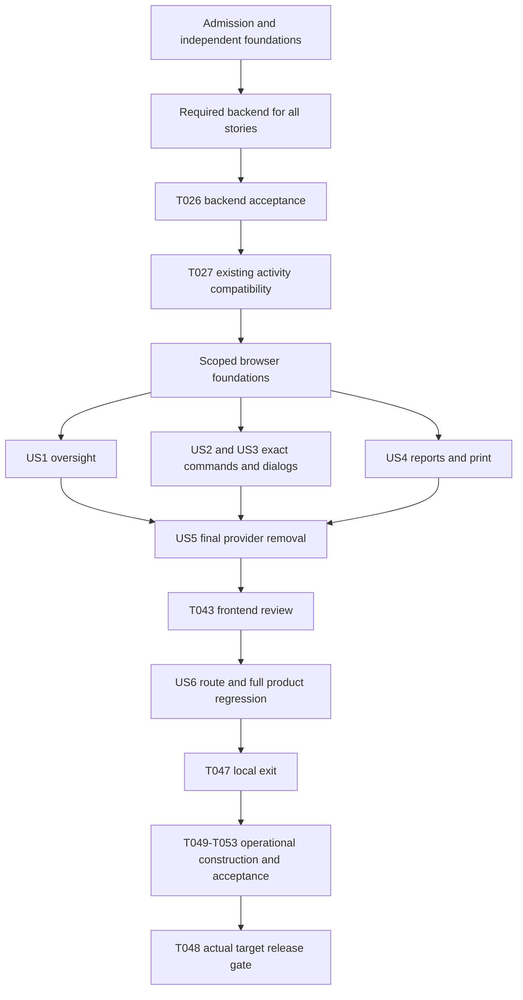

# Tasks: Administration, Reports and Production Readiness

**Roadmap Phase**: P08 — Administration, reports, full regression, and production readiness\
**Feature Directory**: `specs/008-admin-reports-readiness`\
**Generated**: 2026-11-15\
**Input**: Accepted [spec](spec.md), [technical plan](plan.md), [backend design](backend-design.md), [data model](data-model.md), [contract](contracts/administration.md), [frontend design](frontend-design.md) and [operations design](operations-readiness.md).\
**Artifact-generation authorization (historical)**: Owner-delegated pre-IMPLEMENT Spec Kit remediation through ANALYZE only. Amend the matching P08 artifacts and preserve accepted task IDs/progress. All tasks below are future execution work and remain unchecked; no application check, implementation or target action occurs in this sequence.

**Current implementation scope**: Group 5 — Selected Operational Construction Before T048; T049–T053. T001–T047 are complete, with T047's accepted local checkpoint reused after source/hash verification. This invocation authorizes construction, isolated local checks and both reviews for the five serial operational tasks. T048 actual-target work, commit/push and consequential target actions remain excluded. Earlier execution records retain historical scope.

Apply the [constitution](../../.specify/memory/constitution.md), [engineering index](../../docs/engineering/README.md), [phase delivery](../../docs/workflow/phase-delivery.md) and [implementation handoff](../../docs/workflow/implementation-handoff.md). These are internal delivery groups in one feature. The historical authorization notes in earlier artifacts describe their producing command; this task document does not rewrite those records or broaden current authorization.

## Task Format and Execution Rules

Each checkbox has a stable ID, an optional `[P]` marker, a story label for story work and an exact primary file path. Its expanded description is its filled brief below. `[P]` means the named task can share a batch after all dependencies pass, with disjoint file ownership. It grants no external-action authority. All six accepted stories are P1; execution order follows shared integrity and backend acceptance rather than invented story independence.

Every brief includes exact allowed paths, existing/proposed source context, fixed algorithms, preservation rules and concrete verification. Paths marked **create** by a brief or its referenced ledger are proposed outputs, not claims that they exist now. Reopen source on admission/resume and account for predecessor changes. Do not interpret a directory reference as permission to edit every file there. New production dependencies, product surfaces and alternative architecture are excluded.

### Shared context bundles

Read these exact owning sections in addition to each brief's operation/source bundle:

- **G-B (backend/contracts)**: `docs/engineering/code-style.md` “Canonical module patterns”, “Type safety and boundary truth”, “Efficiency without speculative architecture”; `backend-standard.md` sections 2, 4–6, 9; `api-contracts.md` sections 2–7; `security.md` “Start with an authority table”, “Validation, output and injection protection”, “Secrets, configuration, errors and logs”. Reuse current middleware, ResponseHelper, current-account authority and central contract owners.
- **G-D (persistence)**: G-B plus `docs/engineering/data-patterns.md` sections 2–8. Reopen `packages/database/prisma/schema.prisma`, existing migration definitions named in D02 and actual service callers. No old SQL/checksum edits. The two new P08 migrations are one unshipped authoring unit; their sequential authoring tasks share the second SQL file. Incremental tests use fresh owned disposable targets, never a durable environment. Once a migration has durable application history, stop rewriting it and return forward-repair design to its owner.
- **G-F (frontend)**: `apps/web/AGENTS.md`; relevant installed guides under `apps/web/node_modules/next/dist/docs/` for server/client composition, useSearchParams/useRouter and rendering; `docs/engineering/frontend-standard.md` sections 2–8; `api-contracts.md` sections 3–7; `security.md` existing authentication/transport and output boundaries; code-style strictness/cohesion. Reuse the one QueryClient, central transport, RHF, Arabic/RTL/Cairo components and reached prototype UI.
- **G-O (operations)**: G-B/G-D where touched; `docs/engineering/backend-standard.md` “Configuration and process lifecycle”; `security.md` “Cookies, CSRF, origins and deployment topology”, “Secrets, configuration, errors and logs”, “Security verification and release limits”. Existing Compose is PostgreSQL-only and Caddy is a template, not an approved target.
- **G-V (all verification/review)**: `docs/engineering/testing.md` “Choose the correct evidence”, “Current harness and discovery”, “Commands and their limits”, “Construct meaningful cases”, “Cleanup and test integrity”; `code-review.md` sections 1–4. Requirements and engineering verdicts are separate. Use matching installed production/test/docs skills according to scope; a skill name alone is not review evidence.

### Shared verification and completion policy

Each implementation task owns the tests listed in its allowed files or exact linked operation ledger; no separate ceremonial test is required for trivial wrappers. A checkbox can be completed only after the task's meaningful cases, affected shared regressions, source/caller review and both requirements/engineering assessments pass. Record exact commands, intended discovery, results, warnings, infrastructure/cleanup and fresh versus cached evidence in this task file's execution evidence section. A later task's broader suite does not excuse skipping a task's focused evidence.

Run commands from repository root. Package scripts do not automatically rebuild changed dependency packages: before dependent API/web checks, build the changed shared contracts/database packages through their existing `build` scripts and generate Prisma only from the reviewed schema. Integration uses real migrated PostgreSQL in existing owned Testcontainers harnesses; missing Docker/image access blocks that evidence, never selects a developer database. API assertions use actual `createApp` where HTTP is claimed. Components/hooks use real isolated QueryClient/RHF with doubles only at transport. Browser evidence uses real API/DB and existing capture-off desktop/narrow harnesses. Close clients/processes and remove only owned test data/containers/private artifacts in finally paths.

Behavioral failures must retain meaningful assertions and be reproduced before a fix when feasible. Preserve initial/loading/empty/denied/error/malformed/refresh/conflict/unknown and synchronization distinctions, current authority and no old-context disclosure. No API/DB mocks can establish persistence/rollback, no screenshot can establish authorization, and no skipped case/arbitrary retry/suppression can close a gate. Existing test cleanup must account for the new retained tables in FK-safe order. Production secrets, private archives and credentials never enter artifacts, URLs or ordinary diagnostics.

All backend behavior, compatibility, migration, HTTP, SMTP and disposable restore evidence named in the backend gate must pass before dependent frontend execution. Full local exit and target release remain separate gates. `pnpm verify` is not a documentation check; no application command below was run by TASKS generation.

## Resolved Decisions and Runtime Admission

The owner delegated recommended decisions and authorized correction through read-only ANALYZE. Prior DESIGN-01/I1, U1, U2, I2 and U3 are resolved in their owning contract/data/backend/frontend/operations sections: three exact history projections, actual terminal manufacturing actors, observation-first serialized retry, canonical full-population action search and explicit failure-test boundaries. Peer review also fixed linked-customer same-version draft refresh and history-only manufacturing/quality extensions that leave standalone feeds narrow.

D-011/O13 now select the production calendar, stack, mail transport, backup policy, exact validators/tools and ordered target operations. Real host/domain/account/admin/storage/operator values and action authorization remain required runtime inputs and observed execution evidence. They are not fabricated, pre-approved or a missing technical design. At artifact generation, every task below had filled decisions and no task was marked executed. Current completion is recorded in the execution evidence below.

Existing T001–T048 IDs and relative order are preserved. New bounded construction IDs T049–T053 are appended. The explicit amendment dependency chain is **T047 → T049 → T050 → T051 → T052 → T053 → T048**. Execute by the dependency graph, not numeric sorting: keeping the final observed-release ID stable does not admit it before its new construction prerequisites. An unmet runtime precondition refuses that operation without changing this design-readiness meaning.

## Group 1: Scoped Intake and Actual Prerequisites

**Goal:** revalidate selection, existing acceptance, protected work and requirements review before an authorized implementation. Reuse completed P01–P07 foundations.

- [x] T001 Record P08 execution admission and requirements-quality evidence in `specs/008-admin-reports-readiness/tasks.md`; see [filled brief](#brief-t001).

## Group 2: Required Backend, Tests and Acceptance

**Goal:** complete the canonical administration contract, durable graph, existing-domain compatibility, authoritative reads/writes and real boundary evidence. Each implementation brief includes its meaningful discovered test work.

- [x] T002 [P] Extract cycle-safe order facts and preserve public money/count exports in `packages/contracts/src/sales-orders/order-facts.schema.ts`; see [filled brief](#brief-t002).
- [x] T003 [US2] Define strict administrative command, correction and retained-fact contracts in `packages/contracts/src/administration/administration-command.schema.ts`; see [filled brief](#brief-t003).

  Quote constraint (D02): "ADMIN_CORRECT has no scope and empty pieceIds; ADMIN_CANCEL has 1–200 sorted unique IDs; ITEM exactly one." This is a retained storage/result selection constraint: the strict ADMIN_CORRECT request body contains patch and reason only, and rejects scope/pieceIds fields. Reject duplicate IDs before canonical ordering; enforce serialized UTF-8 input<=65536 bytes.

  Quote constrained inputs: "generalNotes": existing draft generalNotes bounded nullable text, max4000; "customerName": customerCaptureSchema.shape.name (trimmed nonblank max150); customerPhone reuses the canonical Saudi validator; optional email/address retain existing nullable/clear semantics and address max2000. Require nonblank reason<=4000 for correction, optional custom cancellation reason normalizes missing/blank to null.

- [x] T004 Add full administrative and minimal operational activity variants plus quality cancellation enum in `packages/contracts/src/administration/administration-event.schema.ts`; see [filled brief](#brief-t004).

  Quote enum constraint: "qualityWorkVisitSchema has an inline endReason enum of INSPECT_ACCEPTED/INSPECT_REJECTED/ISSUE_REPORTED. Add CANCELLED there with the same chronological/end-witness refinements; its qualityActor already permits ADMIN." Preserve actor/time/source refinements and public exports.

- [x] T005 [US1] Define canonical administration query, detail, dashboard, oversight and report read schemas in `packages/contracts/src/administration/administration.schema.ts`; see [filled brief](#brief-t005).
- [x] T006 [P] Add P08 additive Prisma graph, enum migration and owned-test cleanup prerequisites in `packages/database/prisma/schema.prisma`; see [filled brief](#brief-t006).

  D01 constraint row (verbatim): | `AdministrationCommand` / `administration_commands` | commandId UUID PK; operation enum ADMIN_CANCEL or ADMIN_CORRECT; actorId UUID FK User; actorFullName varchar150; actorRole existing UserRole restricted ADMIN; actorDepartment existing nullable Department; orderId UUID FK SalesOrder; expectedVersion/beforeVersion/afterVersion int; payloadHash char64; reason varchar4000 nonblank; scope nullable enum ORDER, ITEM or QUANTITY; pieceIds UUID[] sorted distinct; beforeFacts/afterFacts/outcome JSONB validated against contract; occurredAt timestamptz6. Unique `(commandId,orderId)` and `(orderId,afterVersion)`. |

  D01 constraint row (verbatim): | `AdministrationCancelledPiece` / `administration_cancelled_pieces` | commandId/orderId/pieceId UUID; PK `(commandId,pieceId)`; unique pieceId (one actual cancellation ever); compound FKs `(commandId,orderId)` to admin command and `(pieceId,orderId)` to physical piece. beforeFacts/afterFacts JSONB exact physical facts; no duplicated quantity/price. |

  D01 constraint row (verbatim): | `AdministrationOrderCorrection` / `administration_order_corrections` | commandId UUID PK; orderId UUID; afterVersion int; compound command/order FK; full effective customerName varchar150, customerPhone varchar13, customerEmail nullable varchar320, customerAddress nullable varchar2000; beforeValues/afterValues JSONB complete five-field correction snapshots (including generalNotes); changedFields text[] sorted unique; unique `(orderId,afterVersion)`; FK to order. Append-only. |

- [x] T007 Implement retained administrative head, exact child and witnessed note guards in `packages/database/prisma/migrations/20261115000200_p08_administration/migration.sql`; see [filled brief](#brief-t007).

  Quote constraint: "ADMIN actor, positive versions below max-int, after=before+1=expected+1, nonblank reason, hex hash, strict JSON objects"; validate exact bounded sorted child identities/current inserted facts, real actor snapshot and unchanged paid/frozen fields.

- [x] T008 [US2] Preserve returned applicability and cancelled membership through preapproval SQL graphs in `packages/database/prisma/migrations/20261115000200_p08_administration/migration.sql`; see [filled brief](#brief-t008).
- [x] T009 [US2] Bind admin cancellations to real manufacturing, issue and quality closure sources in `packages/database/prisma/migrations/20261115000200_p08_administration/migration.sql`; see [filled brief](#brief-t009).

  Quote nullable field constraints: "ManufacturingWorkVisit.endAdministrationCommandId; QualityWorkVisit.endAdministrationCommandId; QualityCorrectionCycle.resolutionAdministrationCommandId; ManufacturingIssue.resolutionAdministrationCommandId." Keep old rows null; connect actual new command FKs.

- [x] T010 [US2] Finalize failed-return cancellation SQL compatibility and full fresh/populated migration evidence in `packages/database/prisma/migrations/20261115000200_p08_administration/migration.sql`; see [filled brief](#brief-t010).
- [x] T011 [US2] Extract one retained cancellation mechanic and adapt real quality/manufacturing actor projection in `apps/api/src/modules/approval/order-cancellation.writer.ts`; see [filled brief](#brief-t011).
- [x] T012 [P] [US2] Adapt returned resubmission and first approval to carried admin versions and retained cancelled pieces in `apps/api/src/modules/approval/approval.rules.ts`; see [filled brief](#brief-t012).
- [x] T013 [P] [US2] Adapt real warehouse retry/dispatch and history to the remaining-active returned set in `apps/api/src/modules/warehouse/warehouse.rules.ts`; see [filled brief](#brief-t013).
- [x] T014 [US3] Project effective permitted contacts/current notes and extract reusable authoritative tracking in `apps/api/src/modules/sales-orders/order-contact.projection.ts`; see [filled brief](#brief-t014).
- [x] T015 [US2] Implement typed administration selection/correction/calendar planners and safe module errors in `apps/api/src/modules/administration/administration.types.ts`; see [filled brief](#brief-t015).
- [x] T016 [US2] Implement atomic administrative cancellation/correction writes using existing domain mechanics in `apps/api/src/modules/administration/administration-command.writer.ts`; see [filled brief](#brief-t016).
- [x] T017 [US2] Implement current-authority command execution, original-ID replay and observation recovery in `apps/api/src/modules/administration/administration-command-executor.ts`; see [filled brief](#brief-t017).
- [x] T018 [US1] Implement shared administration cohort SQL and exact mixed all-orders pagination in `apps/api/src/modules/administration/administration.queries.ts`; see [filled brief](#brief-t018).
- [x] T019 [US1] Implement dashboard, actual owner options and approval/correction/delivery oversight reads in `apps/api/src/modules/administration/administration.queries.ts`; see [filled brief](#brief-t019).
- [x] T020 [US1] Implement current detail, correction metadata and safe immutable mixed activity pagination in `apps/api/src/modules/administration/administration.queries.ts`; see [filled brief](#brief-t020).
- [x] T021 [US4] Implement shared six-section aggregates and complete bounded report-print snapshot in `apps/api/src/modules/administration/administration-report.queries.ts`; see [filled brief](#brief-t021).
- [x] T022 [US1] Compose administrative services, protected routes, DTO aliases and OpenAPI with actual HTTP proof in `apps/api/src/modules/administration/administration.service.ts`; see [filled brief](#brief-t022).
- [x] T023 [P] [US6] Enforce production SMTP certificate/protocol/STARTTLS admission in existing config and transporter owners in `apps/api/src/core/config/email.config.ts`; see [filled brief](#brief-t023).
- [x] T024 [US6] Verify existing liveness, DB-only readiness, provider failure and redacted runtime evidence at their real boundaries in `apps/api/src/app.integration.test.ts`; see [filled brief](#brief-t024).
- [x] T025 [US6] Prove owned application-data backup, distinct disposable restore, retained authority and restart persistence in `apps/api/src/operations-readiness.integration.test.ts`; see [filled brief](#brief-t025).
- [x] T026 Review and accept the complete P08 backend, migrations, security/mail and disposable restoration before frontend wiring in `specs/008-admin-reports-readiness/tasks.md`; see [filled brief](#brief-t026).

**Backend gate:** T026 must pass with all its predecessor evidence before any Group 3 execution. Partial endpoints, fixture responses, mocked persistence, unchecked migration/compatibility or unperformed restore do not pass. Independent SMTP work may run earlier after admission.

## Group 3: Dependent Existing-Frontend Integration

**Goal:** connect the existing reached surfaces after backend acceptance, retaining Arabic/RTL/Cairo, routes, dialogs, tables and paper/report layouts. Shared scope/API/cache work precedes its consuming story views. Unlabelled production tasks here are shared browser foundations, with their cross-story requirements listed in each brief.

- [x] T027 [US1] Coordinate existing mixed-history consumers with administration event variants (three fixed projections) in `apps/web/src/features/sales/model/order-view.model.ts`; see [filled brief](#brief-t027).

### Shared Browser Foundations

- [x] T028 [P] Add current-ADMIN scope and validated read transport in `apps/web/src/shared/query/operational-scope.ts`; see [filled brief](#brief-t028).
- [x] T029 Implement canonical administration queries and presentation projections in `apps/web/src/features/administration/hooks/administration.hooks.ts`; see [filled brief](#brief-t029).
- [x] T030 [P] Define canonical and legacy administration URL state in `apps/web/src/features/administration/model/administration-query.model.ts`; see [filled brief](#brief-t030).
- [x] T031 Add reactive scoped pagination admission in `apps/web/src/features/administration/hooks/administration-page-bounds.hooks.ts`; see [filled brief](#brief-t031).
- [x] T032 Add exact command/result binding and immutable session model in `apps/web/src/features/administration/model/administration-command-binding.model.ts`; see [filled brief](#brief-t032).

### Story Surfaces and Command Integration

- [x] T033 [US2] Add exact cancellation/correction review and browser-safe form models in `apps/web/src/features/administration/model/administration-form.model.ts`; see [filled brief](#brief-t033).
- [x] T034 [US5] Implement admin command recovery and required read synchronization in `apps/web/src/features/administration/hooks/administration-commands.hooks.ts`; see [filled brief](#brief-t034).
- [x] T035 [P] [US1] Connect dashboard and all-orders with real scoped rows and URLs in `apps/web/src/features/administration/screens/admin-dashboard-view.tsx`; see [filled brief](#brief-t035).
- [x] T036 [P] [US1] Connect approval oversight and actual quality-correction history in `apps/web/src/features/administration/screens/admin-approvals-view.tsx`; see [filled brief](#brief-t036).
- [x] T037 [P] [US1] Connect delivery exceptions and immutable mixed activity in `apps/web/src/features/administration/screens/admin-delivery-exceptions-view.tsx`; see [filled brief](#brief-t037).
- [x] T038 [P] [US3] Connect one persisted order detail and both existing administrative dialogs in `apps/web/src/features/administration/hooks/administration-dialogs.hooks.ts`; see [filled brief](#brief-t038).
- [x] T039 [P] [US4] Connect complete operational snapshot and guarded six-section print in `apps/web/src/features/administration/model/administration-report.model.ts`; see [filled brief](#brief-t039).
- [x] T040 [US4] Connect report filters, cohort totals and preserved print navigation in `apps/web/src/features/administration/screens/admin-reports-view.tsx`; see [filled brief](#brief-t040).
- [x] T041 [P] [US5] Extend owning mutation synchronization to P08 reads in `apps/web/src/features/administration/hooks/staff.hooks.ts`; see [filled brief](#brief-t041).
- [x] T042 [US5] Replace production fixture badges and remove reached MVP providers in `apps/web/src/components/workspace/workspace-navigation.ts`; see [filled brief](#brief-t042).

### Frontend Review Gate

- [x] T043 [US6] Review completed frontend source and run affected component acceptance in `specs/008-admin-reports-readiness/tasks.md`; see [filled brief](#brief-t043).

**Frontend gate:** T043 verifies the complete affected producer/consumer and component boundary; browser/physical output acceptance follows in Group 4.

## Group 4: Cross-Layer and Phase Exit

**Goal:** establish complete local product evidence, accurate operator documentation and a distinct target release decision.

- [x] T044 [US6] Bind every current route and Appendix B action to explicit real browser cases and classifications in `apps/web/e2e/p08-route-cases.ts`; see [filled brief](#brief-t044).
- [x] T045 [US6] Complete real cross-role seven-type workflows, failure recovery, reviewed-workbook and physical print acceptance in `apps/web/e2e/administration-readiness.spec.ts`; see [filled brief](#brief-t045).
- [x] T046 [US6] Write accurate local operations/recovery guidance and reconcile product references to implemented behavior in `docs/operations/release-runbook.md`; see [filled brief](#brief-t046).
- [x] T047 [US6] Run full local verification, complete independent requirement/engineering reviews and preserve release gates in `specs/008-admin-reports-readiness/tasks.md`; see [filled brief](#brief-t047).
- [ ] T048 [US6] Verify the selected target and separately authorized observed release evidence in `specs/008-admin-reports-readiness/operations-readiness.md`; see [filled brief](#brief-t048).

**Exit:** all independent work requires verified completion; T048 requires the completed T049–T053 construction/evidence and actual OPS-01 runtime inputs plus separately covered action/environment authorization. A local/backend/frontend/browser PASS cannot close P08 or claim deployment while mandatory target/prerequisite evidence remains open.

## Group 5: Selected Operational Construction Before T048

**Goal:** implement and locally accept the concrete O13 tools under bounded ownership, then return to the preserved T048 actual-target gate. This is future work, not authorization to construct or run it during SDD.

- [x] T049 [US6] Implement strict operational runtime admission and zero-effect preview in `scripts/operations/release-config.mjs`; see [filled brief](#brief-t049).
- [x] T050 [US6] Package the exact compiled application and private Compose/Caddy topology in `deploy/Dockerfile`; see [filled brief](#brief-t050).
- [x] T051 [US6] Implement verified off-host logical backup, distinct restore, retention and fixed daily scheduling in `scripts/operations/backup.mjs`; see [filled brief](#brief-t051).
- [x] T052 [US6] Implement fail-closed forward deployment, real administrator observation and replacement recovery transitions in `scripts/operations/release-config.mjs`; see [filled brief](#brief-t052).
- [x] T053 [US6] Review the completed operational stack, verify its complete local evidence and publish accurate operator instructions in `docs/operations/release-runbook.md`; see [filled brief](#brief-t053).

**Order:** T047 → T049 → T050 → T051 → T052 → T053 → T048. All five construction tasks are serial because they share operational entry/test owners. Missing real target values cannot be replaced with fixtures to run T048.

## Dependencies and Safe Execution

Every listed prerequisite means verified completion at execution time. The preserved stable-ID amendment has a forward-number dependency T048→T053; this is deliberate and acyclic. Required execution follows T047→T049→T050→T051→T052→T053→T048, while T001–T047 retain their original dependency order.

| Task | Direct prerequisites                                 | Story  |
| ---- | ---------------------------------------------------- | ------ |
| T001 | None                                                 | Shared |
| T002 | T001                                                 | Shared |
| T003 | T002                                                 | US2    |
| T004 | T003                                                 | Shared |
| T005 | T004                                                 | US1    |
| T006 | T003                                                 | Shared |
| T007 | T006, T003                                           | Shared |
| T008 | T007                                                 | US2    |
| T009 | T008, T004                                           | US2    |
| T010 | T009                                                 | US2    |
| T011 | T010, T004                                           | US2    |
| T012 | T011                                                 | US2    |
| T013 | T011                                                 | US2    |
| T014 | T005, T012, T013                                     | US3    |
| T015 | T014                                                 | US2    |
| T016 | T015                                                 | US2    |
| T017 | T016                                                 | US2    |
| T018 | T015, T005, T017                                     | US1    |
| T019 | T018                                                 | US1    |
| T020 | T019, T017                                           | US1    |
| T021 | T020                                                 | US4    |
| T022 | T017, T021                                           | US1    |
| T023 | T001                                                 | US6    |
| T024 | T023, T022                                           | US6    |
| T025 | T022, T014, T010                                     | US6    |
| T026 | T022, T023, T024, T025                               | Shared |
| T027 | T026                                                 | US1    |
| T028 | T026, T027                                           | Shared |
| T029 | T026, T027, T028                                     | Shared |
| T030 | T026, T027                                           | Shared |
| T031 | T026, T027, T029, T030                               | Shared |
| T032 | T026, T027, T028                                     | Shared |
| T033 | T026, T027, T029, T032                               | US2    |
| T034 | T026, T027, T029, T030, T032, T033                   | US5    |
| T035 | T026, T027, T029, T030, T031                         | US1    |
| T036 | T026, T027, T029, T030, T031                         | US1    |
| T037 | T026, T027, T029, T030, T031                         | US1    |
| T038 | T026, T027, T029, T030, T031, T033, T034             | US3    |
| T039 | T026, T027, T029, T030, T033                         | US4    |
| T040 | T026, T027, T029, T030, T031, T039                   | US4    |
| T041 | T026, T027, T029, T034                               | US5    |
| T042 | T026, T027, T035, T036, T037, T038, T039, T040, T041 | US5    |
| T043 | T026, T027, T042                                     | US6    |
| T044 | T043                                                 | US6    |
| T045 | T044, T026, T043                                     | US6    |
| T046 | T024, T025, T045                                     | US6    |
| T047 | T023, T024, T025, T045, T046                         | US6    |
| T048 | T053                                                 | US6    |
| T049 | T047                                                 | US6    |
| T050 | T049                                                 | US6    |
| T051 | T050                                                 | US6    |
| T052 | T051                                                 | US6    |
| T053 | T052                                                 | US6    |

One batch lead serializes evidence updates after parallel workers return. Shared migration/query/mapper/operational-entry/test files require one writer; operational T049–T053 are deliberately serial. The existing [P] examples apply only after all prerequisites pass.

### Completion Order



The direct-dependency table governs individual tasks; this diagram summarizes completion order. The former design findings are closed. Actual runtime admission and observed release remain separate from construction/design readiness.

## Task Briefs

The expanded descriptions below are part of each task. Operation IDs refer to the linked accepted design owner, not a new technical choice. All completion conditions and commands are future implementation obligations.

### Brief T001

**Record P08 execution admission and requirements-quality evidence**

- **Outcome / requirements / dependencies**: All six stories; constitution I/X/XI; phase-delivery requirements approval before implementation. Dependencies: None; first admission task.. The task produces the bounded result in its title; predecessor outputs are required evidence, not assumed existing behavior.
- **Allowed file actions**: **Modify** `specs/008-admin-reports-readiness/tasks.md`; **Modify** `specs/008-admin-reports-readiness/checklists/requirements.md`; **Modify** `specs/008-admin-reports-readiness/checklists/administration-reports-readiness.md`. Create only the proposed outputs and modify only the existing symbols identified in this brief/context; reuse the existing foundations.
- **Read-before-edit bundle**: Read root AGENTS.md, protected root plan.md P08, .specify/feature.json and environment selection, feature spec.md Scope and Baseline/D-007–009, plan.md Constitution Check/Backend and Frontend Delivery Groups, both requirement checklists and implementation-handoff section 4. Reopen P01–P07 accepted task exit evidence, current manifests/runner configs, affected source and immediate callers. Existing closed ledgers are historical prerequisite records, not a rerun or permission to rebuild foundations. Shared bundles: G-V and phase-delivery requirements approval before implementation.
- **Ordered steps**:
  1. Under an actual IMPLEMENT request, resolve its permitted IDs and dependencies, current Git state and unchanged P08 selection. Record the observed revision, preserved edits, guide/source coverage and exact admitted IDs here. No application edits occur in this admission task.
  2. Before code work, review every item in both checklists as required by phase-delivery; preserve IDs/wording, add concise evidence for supported written criteria only and leave genuine gaps open. Reuse the valid 16/16 built-in review unchanged unless actual underlying requirement drift needs its owning specification workflow; do not reset it for a ritual review. Requirements-quality approval does not assert execution. Checklists remain read-only during subsequent code work.
  3. Revalidate prerequisite acceptance and distinguish CAT/PRC received values from actual activation; retain P03 D-002 confirmed numbering without reopening the stale roadmap row. Record OPS-01 as blocking target binding only. If source drift changes a material algorithm/interface, return the specific gap to its design owner and continue independent authorized IDs.
- **Preserve / failure unchanged**: Preserve root roadmap, accepted designs/decisions, earlier task progress and unrelated edits. No clone/reinitialization, seed, catalog load, runtime action, checklist bypass or invented phase. This TASKS generation leaves both checklists unchanged.
- **Tests / verification**: Read-only Git/selection/artifact checks and item-by-item checklist evidence review at implementation admission. Confirm all selected IDs have filled briefs and satisfied predecessors; no application test is required for this evidence-only task. Use git diff --check for any authorized evidence edits.
- **Done when**: The actual implementation scope, requirements review, source/prerequisite observations and outstanding gates are recorded before code; unresolved mandatory gaps block only dependent IDs.

### Brief T002

**Extract cycle-safe order facts and preserve public money/count exports**

- **Outcome / requirements / dependencies**: Shared prerequisite for FR-006/011/017/019/023; US1–4; no new product policy. Dependencies: T001. The task produces the bounded result in its title; predecessor outputs are required evidence, not assumed existing behavior.
- **Allowed file actions**: **Create** `packages/contracts/src/sales-orders/order-facts.schema.ts`; **Modify** `packages/contracts/src/sales-orders/sales-orders.schema.ts`; **Modify test** `packages/contracts/src/sales-orders/sales-orders.schema.test.ts`; **Modify** `packages/contracts/src/index.ts`. Create only the proposed outputs and modify only the existing symbols identified in this brief/context; reuse the existing foundations.
- **Read-before-edit bundle**: contracts/administration.md §6; backend-design.md B09; docs/engineering/api-contracts.md §§1–3,5 and code-style.md Type safety/Cohesion. Read existing private moneySchema, currentOrderCountsSchema, retainedOrderCountsSchema and every index export/caller before moving them. Shared bundles: G-B/G-D/G-V.
- **Ordered steps**:
  1. Move the existing money/count definitions unchanged into proposed order-facts.schema.ts; export salesOrderMoneySchema/currentOrderCountsSchema/retainedOrderCountsSchema there and preserve existing public count names through imports/reexports.
  2. Export salesOrderMoneySchema from the existing public index and sales-orders schema owner; retain exact BigInt precision, max200 count and historical/current completion refinements; introduce no administration dependency in the primitive facts file.
  3. Extend discovered sales-orders.schema.test.ts for money identity/due/surplus and 199/200 current-versus-retained completion, including module import initialization through the package index.
- **Preserve / failure unchanged**: No changed money bounds, numeric coercion, count meaning, event field or consumer behavior. Browser-safe contracts only; no Prisma/API/Node imports or duplicate validation.
- **Tests / verification**: Later run pnpm --filter @template/contracts test src/sales-orders/sales-orders.schema.test.ts and pnpm --filter @template/contracts check-types; test valid exact 650.00/1000.00 surplus350.00, invalid arithmetic and current199/200<100 while retained snapshots remain accepted.
- **Done when**: Existing schema behavior passes unchanged, new money export is usable through the public index, and the dependency graph has no sales-orders→administration→sales-orders cycle.

### Brief T003

**Define strict administrative command, correction and retained-fact contracts**

- **Outcome / requirements / dependencies**: FR-007–015/023; US2 and US3; contract portion V-B06/V-B07/V-B08. Dependencies: T002. The task produces the bounded result in its title; predecessor outputs are required evidence, not assumed existing behavior.
- **Allowed file actions**: **Create** `packages/contracts/src/administration/administration-command.schema.ts`; **Create test** `packages/contracts/src/administration/administration-command.schema.test.ts`; **Modify** `packages/contracts/src/index.ts`. Create only the proposed outputs and modify only the existing symbols identified in this brief/context; reuse the existing foundations.
- **Read-before-edit bundle**: contracts/administration.md §§1,6; spec FR-007–015/023 and D-007/008; data-model.md D01/D02; existing customerCaptureSchema/customerPatchSchema/customerPhoneSchema and sales command receipts. Read API contracts Values/commands and Testing Contract evidence. Shared bundles: G-B/G-D/G-V.
- **Ordered steps**:
  1. Implement administrationCommandBodySchema/Input/Body, correction values/patch, administrationCommandFactsSchema and administrationCommandDataSchema exactly as the canonical ledger; strict discriminated ADMIN_CANCEL/ADMIN_CORRECT, no privileged fields.
  2. Quote constraint (D02): "ADMIN_CORRECT has no scope and empty pieceIds; ADMIN_CANCEL has 1–200 sorted unique IDs; ITEM exactly one." This is a retained storage/result selection constraint: the strict ADMIN_CORRECT request body contains patch and reason only, and rejects scope/pieceIds fields. Reject duplicate IDs before canonical ordering; enforce serialized UTF-8 input<=65536 bytes.
  3. Quote constrained inputs: "generalNotes": existing draft generalNotes bounded nullable text, max4000; "customerName": customerCaptureSchema.shape.name (trimmed nonblank max150); customerPhone reuses the canonical Saudi validator; optional email/address retain existing nullable/clear semantics and address max2000. Require nonblank reason<=4000 for correction, optional custom cancellation reason normalizes missing/blank to null.
  4. Validate receipt/version/order/result/physical-piece/returnProof consistency, including complete before/after facts and current max-version envelope; import primitive order facts rather than sales-orders.schema.
  5. Export administrationOperationSchema and inferred AdministrationOperation from the command primitive owner exactly as contract section 1/6; event and action-label consumers reuse it without importing an administration read schema.
- **Preserve / failure unchanged**: No customer-master uniqueness on order-only contacts, no quantity field authority, no optional clearing of required name/phone, no mutation/actor/time authority in body, no silent truncation.
- **Tests / verification**: pnpm --filter @template/contracts test src/administration/administration-command.schema.test.ts; pnpm --filter @template/contracts check-types. Cases: ITEM one ID vs2; ORDER/QUANTITY unique<=200; forbidden paid/spec field; omit vs clear; malformed email/phone/NUL; 64KiB UTF8; mismatched receipt/facts.
- **Done when**: Every command/fact export in the ledger exists, exact accepted/rejected shapes have discovered meaningful tests, and no contract cycle or new policy is introduced.

### Brief T004

**Add full administrative and minimal operational activity variants plus quality cancellation enum**

- **Outcome / requirements / dependencies**: FR-001/002/006/010/015/021/023; US1–3/US5; V-B04 and D02 enum evidence. Dependencies: T003. The task produces the bounded result in its title; predecessor outputs are required evidence, not assumed existing behavior.
- **Allowed file actions**: `packages/contracts/src/administration/administration-event.schema.ts`; `packages/contracts/src/administration/administration-event.schema.test.ts`; `packages/contracts/src/sales-orders/sales-orders.schema.ts`; `packages/contracts/src/approval/approval.schema.ts`; `packages/contracts/src/manufacturing/manufacturing.schema.ts`; `packages/contracts/src/quality/quality.schema.ts`; `packages/contracts/src/quality/quality.schema.test.ts`; `packages/contracts/src/warehouse/warehouse.schema.ts`; `packages/contracts/src/index.ts`; `packages/contracts/src/sales-orders/order-activity-labels.ts`; `packages/contracts/src/sales-orders/order-activity-labels.test.ts`; `packages/contracts/src/manufacturing/manufacturing.schema.test.ts`; `packages/contracts/src/warehouse/warehouse.schema.test.ts`. Create proposed outputs or modify the existing/dependency-produced owners identified by the fixed blueprint; no other file actions.
- **Read-before-edit bundle**: Contract sections 1/5/7 and canonical action-label table; backend B04/B09; data D02 producer/consumer compatibility; existing salesActivityItemSchema and manufacturing/quality/warehouse feed versus order-history schemas, with actual callers. T003 supplies operation primitives. G-B/G-V apply. The existing two-shape proposal was inconsistent; the accepted D-010 decision now fixes three exact projections and a history-only operational extension.
- **Ordered steps**:
  1. Create strict administrationActivityEventSchema for protected ADMIN full audit, administrationOrderActivityEventSchema for value-free existing sales/approval history even when caller ADMIN, and administrationOperationalActivityEventSchema for cancellation-only factory/quality/warehouse history. Use exact contract section 5 fields/refinements; reject private extra fields rather than strip them.
  2. Export the readonly nonAdministrationActivityItemSchemas tuple from the existing sales-orders schema; preserve each old item unchanged. Compose salesActivityItemSchema with the owner-summary member, leaving full administrationActivityItem composition to T005. Retain primitive facts import direction and package-index initialization tests.
  3. Apply the contract section 5/7 history-only manufacturing/quality schema and container refinement recipes, keeping standalone feed unions/types unchanged. Preserve department equality for existing event branches; the minimal cancellation history branch uses its strict contract and actual server requested-department relation, with no fake department field. Preserve warehouse separate history/feed precedent.
  4. Add qualityWorkVisitSchema CANCELLED with its existing chronology/real ADMIN actor rules. Preserve every old event variant and actor/time refinement.
  5. Create order-activity-labels.ts/test with orderActivityActionSchema/OrderActivityAction, exhaustive orderActivityActionLabels, toOrderActivityActionLabel and findOrderActivityActions exactly as the finite canonical table. Move existing nonadministration wording byte-identically from the named web label owners; fix ADMIN_CORRECT to information correction, not work restart. Export through contracts index; no duplicate API/SQL/browser label registry.
  6. Cover all strict privacy projections, owner-safe responses for ADMIN on existing endpoints, history-only safe cancellation, narrow feed rejection, department/order/piece bounds, all canonical operation pairs and case/trim/empty/literal action search. Runtime initialization through public index must remain cycle-free.
- **Preserve / failure unchanged**: No finance/contact/free-text leak to factory or warehouse, no fake issue/inspection event for cancellation, no cast through the prior enum, no changes to accepted P04 issue-event text policy.
- **Tests / verification**: Run pnpm --filter @template/contracts test src/administration/administration-event.schema.test.ts src/sales-orders/order-activity-labels.test.ts src/sales-orders/sales-orders.schema.test.ts src/manufacturing/manufacturing.schema.test.ts src/quality/quality.schema.test.ts src/warehouse/warehouse.schema.test.ts and pnpm --filter @template/contracts check-types. Assert exact forbidden-key rejection, unchanged old variants/feed shape, accepted relevant history cancellation and all canonical labels/search pairs. G-V review/discovery applies.
- **Done when**: Three exact safe/full projections, history-only operational extensions and one finite label/search registry pass their discovered contract cases without import cycles or widened standalone feeds.

### Brief T005

**Define canonical administration query, detail, dashboard, oversight and report read schemas**

- **Outcome / requirements / dependencies**: FR-001–006/016–024; US1/US4/US5; contract basis V-B01–B05. Dependencies: T004. The task produces the bounded result in its title; predecessor outputs are required evidence, not assumed existing behavior.
- **Allowed file actions**: **Create** `packages/contracts/src/administration/administration.schema.ts`; **Create test** `packages/contracts/src/administration/administration.schema.test.ts`; **Modify** `packages/contracts/src/index.ts`. Create only the proposed outputs and modify only the existing symbols identified in this brief/context; reuse the existing foundations.
- **Read-before-edit bundle**: contracts/administration.md §§1–5 in full; spec US1/US4 and FR-001–006/016–024; backend B02–B05. Existing pagination, sales/draft summaries, current counts and safe staff fields are foundations. Shared bundles: G-B/G-D/G-V.
- **Ordered steps**:
  1. Create every read/query/params export listed in the canonical ledger; context echoes use endpoint-specific parsed schemas, history fixes orderId, detail discriminates draft/submitted and carries historyCount/real lastCorrection metadata.
  2. Preserve mixed all-root defaults, draft honest nullable contacts/businessNumber and zero physical facts; reports default MONTH, direct print and all-orders ALL; presets fill omitted endpoints, explicit endpoints override corresponding preset, effective reversed ranges invalid.
  3. Implement named dashboard fields including totalOrders, all-root activeOrders, cycle-row activeCorrections versus distinct openCorrectionOrders, submitted-only physical quantity subtitles and mixed recent rows<=5.
  4. Define bounded filter-options UNIQUE/MISSING/AMBIGUOUS, six report sections with separately scoped roster and effective address/fifth shipping context; enforce max100 paged rows,5000 complete order/roster rows,20000 exception cases and8MiB output guards with no partial-success shape.
  5. Compose administrationActivityItemSchema/AdministrationActivityItem from the T004 non-administration tuple plus its full ADMIN event member, and echo the endpoint-specific context. Never reuse the owner-safe administration member as full ADMIN history; all new read exports remain canonical in contract sections 1-5.
- **Preserve / failure unchanged**: No fixture names/dates/references, implicit draft exclusion, client-supplied eligibility, financial reports, shipping department, staff assignment inference or altered schema-required contacts.
- **Tests / verification**: pnpm --filter @template/contracts test src/administration/administration.schema.test.ts; pnpm --filter @template/contracts check-types. Cases V-B02–B05: singleton/invalid query fields, valid normalized echo, draft detail counts, kind/ID mismatches, exact enum/date/page/size bounds and all six report sections.
- **Done when**: The complete canonical read export ledger is implemented/tested without parallel schema definitions; future API/UI can consume exact inferred types.

### Brief T006

**Add P08 additive Prisma graph, enum migration and owned-test cleanup prerequisites**

- **Outcome / requirements / dependencies**: Shared prerequisite FR-007–015/027; US2/US3/US6; D01/D03 additive storage and cleanup. Dependencies: T003. The task produces the bounded result in its title; predecessor outputs are required evidence, not assumed existing behavior.
- **Allowed file actions**: **Modify** `packages/database/prisma/schema.prisma`; **Create** `packages/database/prisma/migrations/20261115000100_p08_admin_enums/migration.sql`; **Create** `packages/database/prisma/migrations/20261115000200_p08_administration/migration.sql`; **Modify test** `packages/database/tests/schema-contract.test.ts`; **Modify test** `packages/database/tests/integration/seed.integration.test.ts` only owned explicit cleanup table list; **Modify** `apps/api/src/test-support/reset-test-data.ts`; **Modify test** `apps/api/src/test-support/reset-test-data.test.ts`; **Modify test** `apps/api/src/test-support/reset-test-data.integration.test.ts`. Create only the proposed outputs and modify only the existing symbols identified in this brief/context; reuse the existing foundations.
- **Read-before-edit bundle**: data-model D01/D03; backend B09; existing schema and original P03–P07 SQL; packages/database/tests/schema-contract.test.ts; fixed owned reset helper and its guards. Data patterns Forward migrations/Seed isolation and Testing discovery/cleanup apply. Shared bundles: G-B/G-D/G-V.
- **Ordered steps**:
  1. Before editing, confirm these two proposed migrations have no durable application history; they remain unshipped task-owned drafts edited sequentially through T010. If a retained target has applied them, stop draft rewriting and return for forward-repair planning.
  2. Add AdministrationOperation→administration_operation and AdministrationCancellationScope→administration_cancellation_scope, plus quality_visit_end CANCELLED in the separate first enum migration. Add the three P08 models/relations/indexes and four nullable lifecycle source columns exactly D01/D02.
  3. D01 constraint row (verbatim): | `AdministrationCommand` / `administration_commands` | commandId UUID PK; operation enum ADMIN_CANCEL or ADMIN_CORRECT; actorId UUID FK User; actorFullName varchar150; actorRole existing UserRole restricted ADMIN; actorDepartment existing nullable Department; orderId UUID FK SalesOrder; expectedVersion/beforeVersion/afterVersion int; payloadHash char64; reason varchar4000 nonblank; scope nullable enum ORDER, ITEM or QUANTITY; pieceIds UUID[] sorted distinct; beforeFacts/afterFacts/outcome JSONB validated against contract; occurredAt timestamptz6. Unique `(commandId,orderId)` and `(orderId,afterVersion)`. |
  4. D01 constraint row (verbatim): | `AdministrationCancelledPiece` / `administration_cancelled_pieces` | commandId/orderId/pieceId UUID; PK `(commandId,pieceId)`; unique pieceId (one actual cancellation ever); compound FKs `(commandId,orderId)` to admin command and `(pieceId,orderId)` to physical piece. beforeFacts/afterFacts JSONB exact physical facts; no duplicated quantity/price. |
  5. D01 constraint row (verbatim): | `AdministrationOrderCorrection` / `administration_order_corrections` | commandId UUID PK; orderId UUID; afterVersion int; compound command/order FK; full effective customerName varchar150, customerPhone varchar13, customerEmail nullable varchar320, customerAddress nullable varchar2000; beforeValues/afterValues JSONB complete five-field correction snapshots (including generalNotes); changedFields text[] sorted unique; unique `(orderId,afterVersion)`; FK to order. Append-only. |
  6. Keep FKs RESTRICT/NO ACTION and cyclic graph FKs DEFERRABLE INITIALLY DEFERRED; no original-row backfill. Extend exact schema/migration inventory assertions and fixed owned reset table list with only the three new tables; retain marker/current-database refusal and no CASCADE.
- **Preserve / failure unchanged**: Old migrations/checksums, generated-code authorship boundary, original snapshots/accounts/history, developer/production data and cleanup safeguards. No default admin, fixture import or production migration execution.
- **Tests / verification**: pnpm db:format; pnpm db:validate; pnpm db:generate; pnpm --filter @template/database test tests/schema-contract.test.ts; pnpm --filter @template/api test src/test-support/reset-test-data.test.ts. Only fresh owned disposable migration targets may be used during draft assembly; final fresh/populated acceptance belongs T010.
- **Done when**: Generated types/schema and intentional exact inventory match additive models/enums; test cleanup remains explicitly owned; no retained-target application or old SQL rewrite occurred.

### Brief T007

**Implement retained administrative head, exact child and witnessed note guards**

- **Outcome / requirements / dependencies**: FR-001/007–015/023/027; D02/D04 direct SQL graph; V-B06/V-B08. Dependencies: T006, T003. The task produces the bounded result in its title; predecessor outputs are required evidence, not assumed existing behavior.
- **Allowed file actions**: **Modify** `packages/database/prisma/migrations/20261115000200_p08_administration/migration.sql`; **Create test** `packages/database/tests/integration/administration-migration.test.ts`. Create only the proposed outputs and modify only the existing symbols identified in this brief/context; reuse the existing foundations.
- **Read-before-edit bundle**: data D02 New retained administrative graph; backend B06/B08; existing enforce_p05_root_head, check_sales_order_graph, actor snapshot/current account guards and P03 immutable terms. Read data patterns Transactions/Forward migrations and testing SQLSTATE/savepoint evidence. Shared bundles: G-B/G-D/G-V.
- **Ordered steps**:
  1. Extend the task-owned second forward SQL sequentially; add exact ck_administration_command_shape/correction_values/piece_binding/command_graph/retained checks and parent/child FK bindings from D02.
  2. Quote constraint: "ADMIN actor, positive versions below max-int, after=before+1=expected+1, nonblank reason, hex hash, strict JSON objects"; validate exact bounded sorted child identities/current inserted facts, real actor snapshot and unchanged paid/frozen fields.
  3. Create check_p08_administration_command/enforce_p08_administration_graph/enforce_p08_administration_retained; current root/current state validation is new insertion/head-only, never compare old receipts against a later current head.
  4. Extend the exact-one-version-witness UNION; add p08_order_note_witness for next-version ADMIN_CORRECT or existing RESUBMIT_ORDER with matching OLD/NEW note values/current deferred root version. Preserve all old source branches.
- **Preserve / failure unchanged**: Historical before/after/outcome stay immutable/replayable after later operations; no session-variable or trigger-disable bypass; arbitrary direct SQL note/source/actor/version changes fail rather than invent a witness.
- **Tests / verification**: pnpm --filter @template/database test:integration tests/integration/administration-migration.test.ts on fresh owned disposable targets. Prove valid non-returned correction/head insertion; reject forged actor/source/version/selection, mutable history and unversioned notes by exact SQLSTATE23514/constraint; use savepoints for each negative case.
- **Done when**: New administrative graph and note/head witnesses are enforced without weakening prior source branches; retained receipts survive a later version change.

### Brief T008

**Preserve returned applicability and cancelled membership through preapproval SQL graphs**

- **Outcome / requirements / dependencies**: FR-007–015/027; US2/US3; D02 returned/preapproval compatibility; V-B07c/V-B08. Dependencies: T007. The task produces the bounded result in its title; predecessor outputs are required evidence, not assumed existing behavior.
- **Allowed file actions**: **Modify** `packages/database/prisma/migrations/20261115000200_p08_administration/migration.sql`; **Create test** `packages/database/tests/integration/administration-lifecycle.test.ts`. Create only the proposed outputs and modify only the existing symbols identified in this brief/context; reuse the existing foundations.
- **Read-before-edit bundle**: data D02 Current root/returned proof/first approval; backend B07/B08 status table; actual check_sales_order_graph, check_approval_order_graph, enforce_p04_initial_transition_witness, enforce_p04_command_head and latest enforce_p05_piece_transition definitions. Shared bundles: G-B/G-D/G-V.
- **Ordered steps**:
  1. Amend the same unshipped second migration sequentially; carry current RETURNED applicability version across a gap-free ADMIN_CANCEL/ADMIN_CORRECT chain while keeping original decision ID/reason/time and immutable return command.
  2. Validate exact contiguous chain length/current version with no unrelated sales/approval operation hidden; keep ordinary currentReturn version equality, and clear only current proof on full CANCELLED transition.
  3. Adjust initial approval witnesses to retain cancelled physical rows unchanged while requiring positive active set, releasing only active awaiting pieces; preserve total retained piece membership and exact frozen prices.
  4. Direct-SQL lifecycle cases use representative returned and preapproval roots, including partial/full cancellation and forbidden reactivation; no source/service changes in this task.
- **Preserve / failure unchanged**: No new return decision, automatic resubmission, discarded cancelled row, identity/price/contact change, zero-active approval or old migration rewrite.
- **Tests / verification**: pnpm --filter @template/database test:integration tests/integration/administration-lifecycle.test.ts; assert unchanged original return facts, allowed contiguous admin chain, rejection of gaps/changed reason and active-only initial release with exact source constraints.
- **Done when**: The complete SQL graph permits only accepted carried-return/active-only outcomes and rejects unsupported proof/identity transitions on owned data.

### Brief T009

**Bind admin cancellations to real manufacturing, issue and quality closure sources**

- **Outcome / requirements / dependencies**: FR-007–011/015/027; US2; D02/D04 current work closure and source privacy compatibility; V-B07c. Dependencies: T008, T004. The task produces the bounded result in its title; predecessor outputs are required evidence, not assumed existing behavior.
- **Allowed file actions**: **Modify** `packages/database/prisma/migrations/20261115000200_p08_administration/migration.sql`; **Modify test** `packages/database/tests/integration/administration-lifecycle.test.ts`; **Modify test** `packages/database/tests/integration/p05-manufacturing-constraints.integration.test.ts`; **Modify test** `packages/database/tests/integration/p06-quality-constraints.integration.test.ts`. Create only the proposed outputs and modify only the existing symbols identified in this brief/context; reuse the existing foundations.
- **Read-before-edit bundle**: data D02 Cancellation lifecycle sources and enum compatibility; backend B07 shared source signature; current ck_manufacturing_visit_times/ck_quality_visit_shape/ck_quality_correction_shape/ck_manufacturing_issues_state and source-binding/retained functions listed in D02. Shared bundles: G-B/G-D/G-V.
- **Ordered steps**:
  1. Sequentially add exactly-one approval/admin/quality terminal-source checks and source/time/order/piece/version bindings; noncancellation branches require admin source null.
  2. Quote nullable field constraints: "ManufacturingWorkVisit.endAdministrationCommandId; QualityWorkVisit.endAdministrationCommandId; QualityCorrectionCycle.resolutionAdministrationCommandId; ManufacturingIssue.resolutionAdministrationCommandId." Keep old rows null; connect actual new command FKs.
  3. Permit real admin cancellation of active quality visit with CANCELLED; close OPEN quality cycle/held issue under actual selected admin source. Allow only witnessed ADMIN_CANCEL SALES_CONTACT→RESOLVED, preserving latest proposal/resume/source fields and never accepting proposal.
  4. Extend exact existing retained/graph functions, not broad trigger bypasses; receivedAt stays unchanged and no new action is attributed to the original starter.
- **Preserve / failure unchanged**: Old approval issue/report/correction branches remain valid; no fabricated quality rejection or fake ApprovalCommand; earlier starter/actor/origin/packing/proposal facts stay intact.
- **Tests / verification**: pnpm --filter @template/database test:integration tests/integration/administration-lifecycle.test.ts tests/integration/p05-manufacturing-constraints.integration.test.ts tests/integration/p06-quality-constraints.integration.test.ts. Assert live manufacturing/QUALITY/open-cycle/held-source cancellation and direct forged/null/multiple-source rejection with exact constraint names.
- **Done when**: Every real admin closure has one exact retained source, ordinary old graph behavior still passes, and history cannot be rewritten.

### Brief T010

**Finalize failed-return cancellation SQL compatibility and full fresh/populated migration evidence**

- **Outcome / requirements / dependencies**: FR-007–011/027; US2/US6; D02–D04 complete migrations and P07 compatibility. Dependencies: T009. The task produces the bounded result in its title; predecessor outputs are required evidence, not assumed existing behavior.
- **Allowed file actions**: **Modify** `packages/database/prisma/migrations/20261115000200_p08_administration/migration.sql`; **Modify test** `packages/database/tests/integration/administration-lifecycle.test.ts`; **Modify test** `packages/database/tests/integration/administration-migration.test.ts`; **Modify test** `packages/database/tests/integration/warehouse.integration.test.ts`; **Modify test** `packages/database/tests/integration/migration.integration.test.ts`; **Modify test** `packages/database/tests/schema-contract.test.ts`. Create only the proposed outputs and modify only the existing symbols identified in this brief/context; reuse the existing foundations.
- **Read-before-edit bundle**: data D02 Receipt/failed-delivery and D03/D04; backend B07 status table/B09; actual check_p07_warehouse_order_state/check_p07_warehouse_command/enforce_p07_order_transition/enforce_p07_root_current_state and exact schema inventory tests. Shared bundles: G-B/G-D/G-V.
- **Ordered steps**:
  1. Add narrowly witnessed admin current-custody cancellation: current OUT_FOR_DELIVERY/DELIVERED denied; real failed physical return allows subset cancellation while retaining original receipt and attempt members.
  2. Require every historical-attempt member omitted from current active retry to have a later exact retained admin cancellation; partial failed cancellation stays DELIVERY_FAILED until explicit ordinary retry; fully cancelled becomes non-deliverable; fresh dispatch is complete remaining-active set.
  3. Finish the second unshipped migration, preserving every prior definition/branch. Add no inferred data backfill; intentional table/model/enum/index inventories include exact new objects without dropping existing assertions.
  4. Run complete fresh plus populated P01–P07 upgrade in owned disposable targets; compare original migration SQL hashes/records/ledger and expected nullable source defaults. This task owns final assembled migration evidence before domain/API exposure.
- **Preserve / failure unchanged**: No rewritten prior migration, erased receipt, altered original attempt membership, silent retry/ready or partial customer delivery; never apply draft migration to developer/production/durable retained targets.
- **Tests / verification**: pnpm --filter @template/database test tests/schema-contract.test.ts; pnpm --filter @template/database test:integration tests/integration/administration-migration.test.ts tests/integration/administration-lifecycle.test.ts tests/integration/warehouse.integration.test.ts tests/integration/migration.integration.test.ts. Cases V-D03/V-B07b: [P1,P2] failed→cancelP1→retryP2→new full-active dispatch; forged omission denied; prior data hashes unchanged.
- **Done when**: The complete two-migration graph passes fresh/populated/inventory evidence and old SQL/records remain unchanged; if durable history is discovered, stop rewriting and obtain forward-repair planning.

### Brief T011

**Extract one retained cancellation mechanic and adapt real quality/manufacturing actor projection**

- **Outcome / requirements / dependencies**: FR-007–011/015/023; US2; B07/D02 source reuse; V-B07c. Dependencies: T010, T004. The task produces the bounded result in its title; predecessor outputs are required evidence, not assumed existing behavior.
- **Allowed file actions**: `apps/api/src/modules/approval/order-cancellation.writer.ts`; `apps/api/src/modules/approval/approval.service.ts`; `apps/api/src/modules/manufacturing/manufacturing-work.lifecycle.ts`; `apps/api/src/modules/quality/quality-work.lifecycle.ts`; `apps/api/src/modules/quality/quality.mapper.ts`; `apps/api/src/modules/quality/quality-work.lifecycle.test.ts`; `apps/api/src/modules/quality/quality-command-executor.integration.test.ts`; `apps/api/src/modules/approval/approval.service.integration.test.ts`; `apps/api/src/modules/manufacturing/manufacturing.mapper.ts`; `apps/api/src/modules/manufacturing/manufacturing.mapper.test.ts`; `apps/api/src/modules/manufacturing/manufacturing.rules.test.ts`; `apps/api/src/modules/quality/quality.rules.test.ts`. Create proposed outputs or modify the existing/dependency-produced owners identified by the fixed blueprint; no other file actions.
- **Read-before-edit bundle**: B07/B09 and D02 Cancellation lifecycle sources, including exact MANUFACTURING_VISIT_SELECT/WORK_ACTOR_SELECT/private mapVisit and QUALITY_VISIT_SELECT/mapQualityVisit changes. Reopen existing cancelManufacturingVisit/cancelQualityCorrection, manufacturingWorkVisitSchema endedAt/endedBy parity, latest-visit loading and current approval callers. Read the typed open-visit fixtures in manufacturing.rules.test.ts and quality.rules.test.ts: both must explicitly retain endAdministrationCommandId:null and endAdministrationCommand:null after the selected-record extension, preserving existing assertions. T004 supplies strict enums. G-B/G-D/G-V apply; current manufacturing mapper knows only manufacturing/approval terminal sources and must be extended.
- **Ordered steps**:
  1. Create OrderCancellationSource and applyRetainedPieceCancellation(tx,input) exactly as B07/shared interface; extract current physical/visit/cycle/issue mechanics and adapt ApprovalService approval callers without widening held-issue conditions. Caller retains authority, transaction, root version, money and status policy.
  2. Adapt manufacturing/quality lifecycle exports to explicit approval/admin source. Keep issue interruption approval-only; preserve receipt, starter/origin/time, inspection/packing and selected-source conditional predicates with checked update counts.
  3. Extend MANUFACTURING_VISIT_SELECT with endAdministrationCommandId and safe actor-only endAdministrationCommand selection using WORK_ACTOR_SELECT. mapVisit must use the actual unique manufacturing/approval/admin terminal source under D02, preserving startedBy and chronology. Extend QUALITY_VISIT_SELECT/mapQualityVisit equivalently; no fake ApprovalCommand or cast.
  4. Create manufacturing.mapper.test.ts typed selected-record regressions for old terminal sources and real administration-shaped selected actor data, including cancelled latest visit and end/time parity; retain old P04 and quality service/lifecycle regressions. Adapt only the two existing rule-test open-visit fixtures with endAdministrationCommandId:null and endAdministrationCommand:null; do not change their behavior or assertions.
  5. Do not import the future T017 executor here. The real ADMIN_CANCEL on active CUTTING/PRODUCTION followed by existing manufacturing service/HTTP detail is the mandatory V-B07d integration regression owned by T017 after both interfaces exist.
- **Preserve / failure unchanged**: No nested transaction, invented selected identity, root version increment or paid/status settlement inside shared mechanics; no fake approval record, changed original starter/time or private data projection.
- **Tests / verification**: Run pnpm --filter @template/api test src/modules/manufacturing/manufacturing.mapper.test.ts src/modules/quality/quality-work.lifecycle.test.ts src/modules/manufacturing/manufacturing.rules.test.ts src/modules/quality/quality.rules.test.ts and pnpm --filter @template/api check-types, and pnpm --filter @template/api test:integration src/modules/approval/approval.service.integration.test.ts src/modules/quality/quality-command-executor.integration.test.ts. Prove safe terminal actor/time mapping and unchanged old approval behavior; typed-record mapping does not claim the later real command/read boundary. T017 must execute V-B07d. G-V review applies.
- **Done when**: One shared source-typed cancellation mechanic and both real terminal-actor projections pass focused mapping/old-service evidence, with V-B07d explicitly assigned to T017 rather than a circular prerequisite.

### Brief T012

**Adapt returned resubmission and first approval to carried admin versions and retained cancelled pieces**

- **Outcome / requirements / dependencies**: FR-007–015/023; US2/US3; returned/preapproval compatibility required before admin command exposure. Dependencies: T011. The task produces the bounded result in its title; predecessor outputs are required evidence, not assumed existing behavior.
- **Allowed file actions**: **Modify** `apps/api/src/modules/approval/approval.rules.ts`; **Modify** `apps/api/src/modules/approval/approval.service.ts`; **Modify** `apps/api/src/modules/approval/approval.mapper.ts`; **Modify** `apps/api/src/modules/sales-orders/sales-orders.queries.ts`; **Modify** `apps/api/src/modules/sales-orders/sales-orders.service.ts`; **Modify test** `apps/api/src/modules/approval/approval.rules.test.ts`; **Modify test** `apps/api/src/modules/approval/approval.service.integration.test.ts`; **Modify test** `apps/api/src/modules/sales-orders/sales-orders.queries.test.ts`; **Modify test** `apps/api/src/modules/sales-orders/sales-orders.service.integration.test.ts`. Create only the proposed outputs and modify only the existing symbols identified in this brief/context; reuse the existing foundations.
- **Read-before-edit bundle**: data D02 Current root/returned proof/first approval; backend B07/B08; exact assertInitialDecisionState/executeInitial/mapApprovalFacts/mapCurrentOrderReturnProof/readCurrentOrderReturnProof/resubmit source and direct callers. Shared bundles: G-B/G-D/G-V.
- **Ordered steps**:
  1. Keep current applicability proof check while consuming SQL-witnessed carried returned revisions; preserve original decision/reason/time and do not issue a replacement return.
  2. Require positive active set and awaiting/incoming state for initial approval; release/open visits only for active stable IDs, while initial facts retain cancelled rows unchanged.
  3. Keep returned resubmit original piece membership/order; cancelled rows are immutable/read-only, allowed existing corrections apply only active rows; preserve number/type/decorations/prices/original contacts and current admin order notes.
  4. Exercise partial/full preapproval cancellation, admin correction on RETURNED, later valid resubmit and approval; deny changed cancelled rows/zero-active approval and preserve losing state.
- **Preserve / failure unchanged**: No cancelled-row revival/delete, original piece/price mutation, duplicated release/return event, sales direct cancellation or erased source history.
- **Tests / verification**: pnpm --filter @template/api test src/modules/approval/approval.rules.test.ts src/modules/sales-orders/sales-orders.queries.test.ts; pnpm --filter @template/api test:integration src/modules/approval/approval.service.integration.test.ts src/modules/sales-orders/sales-orders.service.integration.test.ts. V-B07c/V-B08 must pass through actual services plus real PostgreSQL.
- **Done when**: Existing accepted approval/resubmit workflows remain executable after valid admin cancellation/correction and can never reactivate a cancelled physical row.

### Brief T013

**Adapt real warehouse retry/dispatch and history to the remaining-active returned set**

- **Outcome / requirements / dependencies**: FR-006–011/023/027; US2; P07 compatibility B07/D02. Dependencies: T011. The task produces the bounded result in its title; predecessor outputs are required evidence, not assumed existing behavior.
- **Allowed file actions**: **Modify** `packages/contracts/src/warehouse/warehouse-event.schema.ts` (existing `hasBoundAttempt` only); **Modify test** `packages/contracts/src/warehouse/warehouse-event.schema.test.ts`; **Modify** `packages/contracts/src/warehouse/warehouse.schema.ts` (`warehouseOrderDataSchema` refinement only); **Modify test** `packages/contracts/src/warehouse/warehouse.schema.test.ts`; **Modify** `apps/api/src/modules/warehouse/warehouse.rules.ts`; **Modify** `apps/api/src/modules/warehouse/warehouse.queries.ts`; **Modify** `apps/api/src/modules/warehouse/warehouse-command-executor.ts`; **Modify** `apps/api/src/modules/warehouse/warehouse.mapper.ts`; **Modify test** `apps/api/src/modules/warehouse/warehouse.rules.test.ts`; **Modify test** `apps/api/src/modules/warehouse/warehouse-command-executor.integration.test.ts`; **Modify test** `apps/api/src/modules/warehouse/warehouse.queries.integration.test.ts`. Create only the proposed outputs and modify only the existing symbols identified in this brief/context; reuse the existing foundations.
- **Read-before-edit bundle**: B07 historical retry membership compatibility, existing historical-event schema/test and T013 executor integration failed-return fixture plus `WarehouseService.activity`/`orderHistory` callers; data D02 Receipt/failed-delivery; backend B07/B09; the D02 existing warehouseOrderDataSchema membership/custody refinement amendment, its contract tests, and actual deliveryActions/assertWarehouseSelection/warehouseRootsSql/lockWarehouseOrders/attempt mapping/planOutcome and P07 source caller tests. Shared bundles: G-B/G-D/G-V.
- **Ordered steps**:
  1. Use the exact current-active intersection with retained failed-attempt members for post-admin-cancel retry admission; prove every omitted historical member's real cancellation witness, never reconstruct/overwrite original attempt members.
  2. Preserve DELIVERY_FAILED after partial physically-returned cancellation until explicit retry, and READY after already completed valid retry where positive full receipt remains; full cancellation has no delivery action.
  3. Apply D02’s exact existing warehouse detail refinement for retained failed members and fully CANCELLED detail with zero active pieces/no delivery actions; keep strict active equality for DISPATCHED/DELIVERED. Add the named positive/negative shared-contract cases. Next dispatch creates a new whole current-active attempt/predecessor retry; old failed attempt detail renders full original scope. Current queues/counts/selection and mapped action hints use the same guards.
  4. Apply B07 historical retry membership compatibility: only RETRY_DELIVERY permits nonempty subset of original attempt IDs, with all existing evidence/authority guards preserved. Add specified positive/negative contract cases and actual global/order-history assertions after the existing real partial-cancel/retry fixture; preserve next dispatch and original graph assertions.
  5. Keep current-custody OUT_FOR_DELIVERY/DELIVERED cancellation protection, physical receipt evidence, unrelated remaining-piece state and entire-batch rejection.
- **Preserve / failure unchanged**: No partial delivery, erased attempt/receipt/paid/history, silent auto-retry, selected-piece substitution or factory action restoration.
- **Tests / verification**: pnpm --filter @template/contracts test src/warehouse/warehouse.schema.test.ts src/warehouse/warehouse-event.schema.test.ts; pnpm --filter @template/contracts check-types; pnpm --filter @template/api test src/modules/warehouse/warehouse.rules.test.ts; pnpm --filter @template/api test:integration src/modules/warehouse/warehouse-command-executor.integration.test.ts src/modules/warehouse/warehouse.queries.integration.test.ts. V-B07b and invalid/foreign/stale membership must prove real final graph.
- **Done when**: Old P07 flows and admin-cancelled failed-return chain both satisfy actual service/database predicates and historical attempt scope remains unchanged.

### Brief T014

**Project effective permitted contacts/current notes and extract reusable authoritative tracking**

- **Outcome / requirements / dependencies**: FR-001–003/012–015/019/023; US1/US3/US4; V-B04/V-B08. Dependencies: T005, T012, T013. The task produces the bounded result in its title; predecessor outputs are required evidence, not assumed existing behavior.
- **Allowed file actions**: **Modify** `apps/api/src/modules/manufacturing/manufacturing.queries.ts`; **Modify** `apps/api/src/modules/quality/quality.queries.ts`; **Modify test** `apps/api/src/modules/manufacturing/manufacturing.queries.integration.test.ts`; **Modify test** `apps/api/src/modules/quality/quality.queries.integration.test.ts`; **Modify test** `apps/api/src/modules/warehouse/warehouse.rules.test.ts` (selected-record fixture compatibility only); **Create** `apps/api/src/modules/sales-orders/order-contact.projection.ts`; **Modify** `apps/api/src/modules/sales-orders/sales-orders.mapper.ts`; **Modify** `apps/api/src/modules/sales-orders/sales-orders.queries.ts`; **Modify** `apps/api/src/modules/sales-orders/sales-orders.service.ts`; **Modify** `apps/api/src/modules/approval/approval.queries.ts`; **Modify** `apps/api/src/modules/approval/approval.mapper.ts`; **Modify** `apps/api/src/modules/manufacturing/manufacturing.mapper.ts`; **Modify** `apps/api/src/modules/quality/quality.mapper.ts`; **Modify** `apps/api/src/modules/warehouse/warehouse.mapper.ts`; **Modify** `apps/api/src/modules/warehouse/warehouse.queries.ts`; **Modify test** `apps/api/src/modules/sales-orders/sales-orders.queries.integration.test.ts`; **Modify test** `apps/api/src/modules/approval/approval.queries.integration.test.ts`; **Modify test** `apps/api/src/modules/warehouse/warehouse.queries.integration.test.ts`. **Modify test** `apps/api/src/modules/warehouse/warehouse.service.integration.test.ts` only B02 explicit pre-P08 historical sales projection. Create only the proposed outputs and modify only the existing symbols identified in this brief/context; reuse the existing foundations.
- **Read-before-edit bundle**: data D01 Current versus original; backend B04/B08 Shared projection interface; current SALES_ORDER_SELECT/mapSalesOrder/mapFactoryOrder/mapSalesOrderSummary and raw summary/search/official/warehouse projections. Reopen manufacturing queueSource/filteredQueue/loadQueuePapers, quality qualityQueueSource/qualitySearchSql/loadQualityHeaders and their current list/piece/dashboard callers; D01 fixes the bounded current-name lookup/cohort algorithm and history exclusion. Shared bundles: G-B/G-D/G-V.
- **Ordered steps**:
  1. Implement exact pure effectiveOrderContact(original,latest) and bounded latest-correction select, never mutate original SalesOrder contact columns/customer master.
  2. Map current permitted details/search/summary/report/official paper via the same effective values; current notes come from root.generalNotes, original notes from real first submission snapshot. Retained revision/command/attempt facts never get current overlays.
  3. Extract mapSalesOrderTracking(order) from existing SalesOrdersService.tracking and reuse it; no nested service read transaction for admin detail.
  4. Factory receives only its already-permitted effective customer name/general notes; warehouse only name/phone/address; full admin snapshots/finance/email stay excluded. Admin-only actual latest correction actor/reason/time/changed fields remain B04/T020 producer work using T015’s proposed select; do not make T014 depend on its later consumers or expose this metadata here.
- **Preserve / failure unchanged**: No role/privacy widening, historical rewrite, client-side projection override, duplicate contact cache/table or API-feature service cycle.
- **Tests / verification**: pnpm --filter @template/api test:integration src/modules/manufacturing/manufacturing.queries.integration.test.ts src/modules/quality/quality.queries.integration.test.ts src/modules/sales-orders/sales-orders.queries.integration.test.ts src/modules/approval/approval.queries.integration.test.ts src/modules/warehouse/warehouse.queries.integration.test.ts; pnpm --filter @template/api check-types. Corrected address/name/current note visible only to accepted roles; original snapshots and past attempt data unchanged; P04 pending-reapproval print still denied.
- **Done when**: Every affected authoritative producer uses its correct effective-field allowlist, tracking has one reusable mapper, and cross-role/history regressions pass.

### Brief T015

**Implement typed administration selection/correction/calendar planners and safe module errors**

- **Outcome / requirements / dependencies**: FR-005–015/017/023; US2/US3 and shared US1/US4; B01/B02/B07/B08. Dependencies: T014. The task produces the bounded result in its title; predecessor outputs are required evidence, not assumed existing behavior.
- **Allowed file actions**: **Create** `apps/api/src/modules/administration/administration.types.ts`; **Create** `apps/api/src/modules/administration/administration.mapper.ts`; **Create** `apps/api/src/modules/administration/administration.rules.ts`; **Create** `apps/api/src/modules/administration/administration.errors.ts`; **Create test** `apps/api/src/modules/administration/administration.rules.test.ts`. Create only the proposed outputs and modify only the existing symbols identified in this brief/context; reuse the existing foundations.
- **Read-before-edit bundle**: backend B01 internal type ledger/B02/B07/B08; contract §§2–6; data D01/D02; exact reused money/count/status/parseDateOnly/timezone functions. Code style strict types/explicit dependencies and API values apply. Shared bundles: G-B/G-D/G-V.
- **Ordered steps**:
  1. Create every exact Observation/ResolvedPeriod/RootRecord/AggregateFacts/Plan/PlanInput type and ADMINISTRATION_ORDER_SELECT from the blueprint, including the explicit original approval stamp, latest attempt relation path and one-way rules/mapper dependency; selected relations bounded current/latest or<=200 physical rows, no full historical tree.
  2. Implement resolveAdministrationPeriod and pure exact-ID cancellation planner/status table, optional honest reason, mapAdministrationCommandFacts and complete before/after/result planning with preserved receipt/paid/companions.
  3. Implement allowlisted effective correction planner with normalized omission/clear/no-change rules and unchanged lifecycle; import existing customer and exact money validators rather than duplicate limits.
  4. Create exact named module-local AppError classes/codes; exhausted current version2147483647 fails409 before adding one. New errors never embed raw DB/parser payloads.
- **Preserve / failure unchanged**: No database I/O/authority or speculative fake snapshots inside pure rules, no incidental array selection, new status/policy, default timezone or duplicate money arithmetic.
- **Tests / verification**: pnpm --filter @template/api test src/modules/administration/administration.rules.test.ts; pnpm --filter @template/api check-types. V-B06/07/08: matching exact candidates, ITEM1/ORDERfull/QUANTITYsubset, failed-return status unchanged, received cancellation math, no-change correction, preset endpoints/year/DST calendar input and max-version denial.
- **Done when**: Blueprint types/plans/errors exist and deterministic behavior tests cover their meaningful boundaries without invented authority or material choices.

### Brief T016

**Implement atomic administrative cancellation/correction writes using existing domain mechanics**

- **Outcome / requirements / dependencies**: FR-007–015/023; US2/US3; core real write evidence. Dependencies: T015. The task produces the bounded result in its title; predecessor outputs are required evidence, not assumed existing behavior.
- **Allowed file actions**: **Create** `apps/api/src/modules/administration/administration-command.writer.ts`; **Create test** `apps/api/src/modules/administration/administration-command-executor.integration.test.ts`; **Modify** `apps/api/src/modules/approval/approval-command.writer.ts` only advanceApprovalOrderVersion optional conditional same-update notes input. Create only the proposed outputs and modify only the existing symbols identified in this brief/context; reuse the existing foundations.
- **Read-before-edit bundle**: backend B06 steps5–7/B07/B08; data D01/D02; completed shared cancellation writer, exact source union/version helper/selected types and immutable SQL guards. Reopen actual current code from predecessor outputs. Shared bundles: G-B/G-D/G-V.
- **Ordered steps**:
  1. Implement exact applyAdministrativeCancellation/applyAdministrativeCorrection signatures, sorted command advisory lock helper and durable parent/child mapping required by B06; all work uses caller tx.
  2. For cancellation call shared physical/lifecycle writer, compute survivor money/status via existing pure helpers, preserve paid/receipt/attempts and apply the explicit B07 status table; advance root once and carry/clear return applicability as appropriate.
  3. For correction append full effective-contact correction record and actual before/after/changedFields, write only changed current generalNotes in the same conditional root version UPDATE using the B06 helper extension, preserve original contact columns/master/lifecycle/paid/work; carry returned applicability without new decision.
  4. Check every conditional update count, inspect resulting facts equal plan, and rely on active deferred graph guards; induced late child/audit/visit failure must roll back prior changed rows.
- **Preserve / failure unchanged**: No nested tx, skipped selected members, duplicate source/version, manual paid/prices, reactivation/rewind, provider I/O or historical overlay rewrite.
- **Tests / verification**: pnpm --filter @template/api test:integration src/modules/administration/administration-command-executor.integration.test.ts (writer-focused real-tx cases). Use createQualityFixture/appendQualityOrder or owning approval fixture outside claimed write boundary; assert V-B07a/V-B07c/V-B08 final state and complete induced rollback.
- **Done when**: Both operation writers satisfy exact selected/effective plan within one real tx; required failures leave original complete state and immutable facts unchanged.

### Brief T017

**Implement current-authority command execution, original-ID replay and observation recovery**

- **Outcome / requirements / dependencies**: FR-001/007–015/023; US2/US3; V-B06–V-B08 and D04 races. Dependencies: T016. The task produces the bounded result in its title; predecessor outputs are required evidence, not assumed existing behavior.
- **Allowed file actions**: **Create** `apps/api/src/modules/administration/administration-command-executor.ts`; **Modify** `apps/api/src/modules/administration/administration.mapper.ts`; **Modify test** `apps/api/src/modules/administration/administration-command-executor.integration.test.ts`; **Modify** `apps/api/src/modules/approval/order-cancellation.writer.ts` and `apps/api/src/modules/manufacturing/manufacturing-work.lifecycle.ts` only the B07 same-update administration pointer clearance/real open-visit closure. **Modify** `apps/api/src/test-support/p05-legacy-upgrade.fixture.ts` only the B09 optional pre-guard seed rootVersion argument. Create only the proposed outputs and modify only the existing symbols identified in this brief/context; reuse the existing foundations.
- **Read-before-edit bundle**: backend B06 in full/B01/B07/B08; contract §6; existing SalesCommandExecutor/ApprovalCommandExecutor/WarehouseCommandExecutor patterns, lockAccountRows/loadIdentityAccount/assertBusinessAuthority and source-owned conflict predicates. Shared bundles: G-B/G-D/G-V.
- **Ordered steps**:
  1. Implement class constructor/execute/observe and hashAdministrationCommandIntent exactly; actor SHARE lock/current eligible ADMIN, advisory command lock, retained binding, then root FOR UPDATE and sorted physical locks.
  2. Bind original command ID to actor/operation/order/version/canonical hash; current authority gates replay; same accepted intent returns retained facts, changed intent409, another actor cannot observe private result.
  3. Use current root/physical/attempt/issue state and max-version guards before planners/writers; ReadCommitted maxWait5s/timeout10s with fixed lock5s/statement8s and only one recognized full safe retry; unknown connection/commit is not blanket retried.
  4. Observe under the same actor/command lock, no fake not-found success; retained original receipt survives later versions and never claims to be current detail.
  5. Execute B09 V-B07d after the real executor exists: independently create/start CUTTING and PRODUCTION visits, cancel through AdministrationCommandExecutor, then read the existing ManufacturingService detail and actual protected HTTP route. Strict response parses; cancelled latest workVisit.endedBy equals the retained ADMIN snapshot/time, original worker/origin/start remain unchanged and factory finance/contact redaction holds. Add these cases to administration-command-executor.integration.test.ts; no fake approval command or mapper-only success substitutes for this real graph/read proof.
- **Preserve / failure unchanged**: No stale role authority, actor-controlled timestamps, nested old executor transaction, automatic new-ID retry, duplicated history/effects or raw exception leak.
- **Tests / verification**: pnpm --filter @template/api test:integration src/modules/administration/administration-command-executor.integration.test.ts; controlled independent connections cover cancel/dispatch, cancel/paid, correction/resubmit, cancel/quality and authority races, exact replay/changed intent/cross actor/unknown observation, late-save rollback and max-version V-B06.
- **Done when**: Real serialized actor/state/version/write/replay/recovery behavior passes with no duplicate or partial effects, and backend command interface is ready for HTTP composition.

### Brief T018

**Implement shared administration cohort SQL and exact mixed all-orders pagination**

- **Outcome / requirements / dependencies**: FR-002–006/017/023; US1/US4; B02 shared read foundation. Dependencies: T015, T005, T017. The task produces the bounded result in its title; predecessor outputs are required evidence, not assumed existing behavior.
- **Allowed file actions**: **Create** `apps/api/src/modules/administration/administration.queries.ts`; **Modify** `apps/api/src/modules/administration/administration.mapper.ts`; **Create test** `apps/api/src/modules/administration/administration.queries.integration.test.ts`; **Modify** `apps/api/src/modules/administration/administration.types.ts` and `apps/api/src/modules/administration/administration.rules.ts` only B02 summary record/structural eligibility types; **Modify** `apps/api/src/modules/sales-orders/sales-orders.mapper.ts` only shared header/summary extraction; **Modify test** `apps/api/src/modules/sales-orders/sales-orders.queries.integration.test.ts` for preserved full and summary projections. Create only the proposed outputs and modify only the existing symbols identified in this brief/context; reuse the existing foundations.
- **Read-before-edit bundle**: backend B02; contract §2/§4; existing pagination parse/build helpers, sales root/order safe projections and corrected contact lateral join. Data patterns Queries/projections/pagination plus Testing real query proof. Shared bundles: G-B/G-D/G-V.
- **Ordered steps**:
  1. Implement administrationCohortSql/administrationPhysicalFactsSql/findAdministrationOrders and exact minimal submitted-summary mapper and shared sales header extraction; parameterize values, literal-escape search, identity owner filters and current location/piece EXISTS.
  2. Use SalesDraft.createdAt and independently resolved local-midnight SQL bounds (date::timestamp AT TIME ZONE IANA and next calendar date), not host timezone or+24h arithmetic.
  3. Aggregate original/cancelled/active/received once per physical ID; drafts retained as union with honest zero physical facts; root counts never multiplied by piece joins; current199/200<100/zeroactive nondeliverable.
  4. Rows/counts/context use same caller RepeatableRead tx, createdAt DESC/idDESC, finite<=100 page and truthful empty/out-of-range metadata; no fake empty after DB/contract failure.
- **Preserve / failure unchanged**: No implicit submitted-only/all-root exclusion, broadening invalid filters, unbounded full specifications, display-name authority, extra quantity store or runtime default clock.
- **Tests / verification**: pnpm --filter @template/api test:integration src/modules/administration/administration.queries.integration.test.ts. V-B02 mixedroots/distinct owner/type/stage/current-courier, literal wildcard, boundary date/DST/year,200piece counts and empty/out-of-range matching row/count/context.
- **Done when**: The shared exact cohort and count algorithms match declared wire semantics under a real migrated tx; consumers can reuse fixed SQL instead of duplicating filters.

### Brief T019

**Implement dashboard, actual owner options and approval/correction/delivery oversight reads**

- **Outcome / requirements / dependencies**: FR-001–006/017–018/023; US1/US4; B03/V-B03. Dependencies: T018. The task produces the bounded result in its title; predecessor outputs are required evidence, not assumed existing behavior.
- **Allowed file actions**: **Modify** `apps/api/src/modules/administration/administration.queries.ts`; **Modify** `apps/api/src/modules/administration/administration.mapper.ts`; **Modify test** `apps/api/src/modules/administration/administration.queries.integration.test.ts`. **Modify** `apps/api/src/test-support/approval.fixture.ts`, `apps/api/src/test-support/manufacturing.fixture.ts`, `apps/api/src/test-support/quality.fixture.ts` only B03 optional initial delivery-date fixture passthrough. Create only the proposed outputs and modify only the existing symbols identified in this brief/context; reuse the existing foundations.
- **Read-before-edit bundle**: backend B03; contract §4 exact dashboard/options/oversight fields; current AdminDashboardView/computeNavBadges counts and actual P01 pending staff/current cycles/P07 outcome facts. Shared bundles: G-B/G-D/G-V.
- **Ordered steps**:
  1. Implement exact dashboard count units: total/allroot active/recent mixed<=5 actual updatedAt recency; activeCorrections OPEN cycle rows versus openCorrectionOrders distinct orders; server physical subtitles/current operational totals submitted-only.
  2. Implement bounded current safe owner options with actual phone/name/current retained ID, exact current/retained-name UNIQUE/MISSING/AMBIGUOUS resolution, independent of workforce filters.
  3. Implement same-search before-tab counts/rows for approvals, real quality-cycle ACTIVE/RESOLVED/ALL and distinct delivery FAILED/OVERDUE/DISPATCHED/ALL; proper actor/date/cycle sources and stable order. Apply FR-005 exactly: ready, dispatched, failed, awaiting retry, delivered and fully cancelled orders are never overdue; verify past-promise exclusions through real warehouse transitions.
  4. Schema-parse each endpoint result/context under caller read tx; never invent a supervisor, quality cycle, date, pending employee or empty outage response.
- **Preserve / failure unchanged**: Read-only oversight adds no approval/delivery write or assignment workflow; no cycle/order-unit swap, fixture option, historical-source rewrite or swallowed read failure.
- **Tests / verification**: pnpm --filter @template/api test:integration src/modules/administration/administration.queries.integration.test.ts. V-B03 two cycles/oneorder, drafts in total/recent0physical, duplicate names/phones, FR-005 overdue exclusions and distinct exception union, exact tab/search counts and options guard422 no partial list.
- **Done when**: Every named existing dashboard/oversight surface has exact real scoped facts and matching units without browser-local aggregation.

### Brief T020

**Implement current detail, correction metadata and safe immutable mixed activity pagination**

- **Outcome / requirements / dependencies**: FR-001–003/006/012–015/019/023; US1/US2/US3; B04/V-B04. Dependencies: T019, T017. The task produces the bounded result in its title; predecessor outputs are required evidence, not assumed existing behavior.
- **Allowed file actions**: `apps/api/src/modules/administration/administration.queries.ts`; `apps/api/src/modules/administration/administration-activity.queries.ts`; `apps/api/src/modules/administration/administration.mapper.ts`; `apps/api/src/modules/sales-orders/order-activity.queries.ts`; `apps/api/src/modules/approval/approval.queries.ts`; `apps/api/src/modules/manufacturing/manufacturing.queries.ts`; `apps/api/src/modules/quality/quality.queries.ts`; `apps/api/src/modules/warehouse/warehouse.queries.ts`; `apps/api/src/modules/administration/administration.queries.integration.test.ts`; `apps/api/src/modules/sales-orders/sales-orders.queries.integration.test.ts`; `apps/api/src/modules/manufacturing/manufacturing.queries.integration.test.ts`; `apps/api/src/modules/manufacturing/manufacturing.http.integration.test.ts`; `apps/api/src/modules/quality/quality.queries.integration.test.ts`; `apps/api/src/modules/quality/quality.http.integration.test.ts`; `apps/api/src/modules/warehouse/warehouse.queries.integration.test.ts`; `apps/api/src/modules/warehouse/warehouse.http.integration.test.ts`. Create proposed outputs or modify the existing/dependency-produced owners identified by the fixed blueprint; no other file actions.
- **Read-before-edit bundle**: B04 exact safe/full reader and history-only query interface ledgers; contract sections 5/7 and canonical action registry; D01 originals/effective values; existing order-activity.queries.ts identity-before-page/qualityReportChildSql, manufacturing departmentHistory/order-history callers, quality history callers and warehouse separate feed/history precedent. T004/T005 supply strict tuple and safe/full types. G-B/G-D/G-V apply; existing nonadministration and standalone feed behavior remains the baseline.
- **Ordered steps**:
  1. Implement draft/submitted detail with existing draft/order/tracking projections, exact candidates<=200, historyCount from the same merged identity source and real lastCorrection metadata. Draft history retains real CREATE/SAVE events without a submitted-only guard.
  2. Extend existing findOrderActivity with the owner-safe administration summary for every existing sales/approval caller, including ADMIN. Add trusted actor-checked findAdministrationOrderActivity(tx,actor,input) and private bounded identity/select helpers with exact B04 signatures. Only that trusted export returns full ADMIN events; no request field selects projection.
  3. For manufacturing/quality order history, apply the B04/contract history-only source/mapper branches while standalone feeds keep old unions and rows. Operational cancellation output has no free text or private fields and uses real requested-department/order/piece relation predicates before mapping. Warehouse keeps its independently scoped minimal history branch.
  4. Implement displayed action search via findOrderActivityActions and the fixed per-kind operation resolver/SQL aliases from B04. OR matching action pairs with escaped literal reference/internalUUID, retained actor and only that projection permitted note, then AND orderId/authority before count/page. Never search hidden admin reason/values in safe projections.
  5. Preserve one deterministic cross-source identity UNION, old quality-child suppression, occurredAt DESC/eventId DESC/kind ASC and bounded source mapping. Do not concatenate independent first pages or import full command JSON into operational selectors.
  6. Cover three projections, ADMIN on a safe endpoint, cross-role/piece/order rejection, unchanged narrow feeds, source-qualified IDs, historyCount, draft visibility and action-only search matches across multiple pages with equal row/count scope. Literal wildcard text and genuine no-match remain bounded literal searches.
- **Preserve / failure unchanged**: Original actor names/departments, old event variants, P04 print eligibility, history privacy and actual draft visibility; no old command afterFacts treated as current state.
- **Tests / verification**: Run pnpm --filter @template/api test:integration src/modules/administration/administration.queries.integration.test.ts src/modules/sales-orders/sales-orders.queries.integration.test.ts plus the exact existing manufacturing/quality/warehouse query owners named in B09 for history/feed compatibility. Cover V-B04 and its canonical action-search/privacy matrix with real migrated PostgreSQL. Reopen exact public/private signatures before edits; G-V review/discovery applies.
- **Done when**: Current detail and every authorized history projection have exact safe/full sources, history-only operational extensions and pre-pagination action search, with truthful counts/privacy and passing real query evidence.

### Brief T021

**Implement shared six-section aggregates and complete bounded report-print snapshot**

- **Outcome / requirements / dependencies**: FR-005–006/016–020/023; US4; B05/V-B05. Dependencies: T020. The task produces the bounded result in its title; predecessor outputs are required evidence, not assumed existing behavior.
- **Allowed file actions**: **Create** `apps/api/src/modules/administration/administration-report.queries.ts`; **Modify** `apps/api/src/modules/administration/administration.mapper.ts`; **Modify test** `apps/api/src/modules/administration/administration.queries.integration.test.ts`. Create only the proposed outputs and modify only the existing symbols identified in this brief/context; reuse the existing foundations.
- **Read-before-edit bundle**: backend B05/B02; contract §§2/5; D-009 accepted cohort/roster; current six report section callers, phone/address and fifth courier context. Data queries bounds/snapshot and Testing real boundary rules apply. Shared bundles: G-B/G-D/G-V.
- **Ordered steps**:
  1. Implement findAdministrationReport/findAdministrationPrintReport and shared facts under one caller RepeatableRead/captured server instant/explicit business calendar; identical cohort before pagination, common filter context and generation metadata.
  2. Return mixed roots honestly, draft UUID/null contact/zero physical facts, SQL aggregates and current department/shipping context; roster independently department-scoped with actual row statuses/active headline, not personal duplicated department work.
  3. Retain overlapping exception category cases versus distinct orders, historic quality corrections/current return distinction, effective permitted address, all six sections with honest empty/manual signoff fields and no fabricated official reference.
  4. Before arrays materialize count max5000 orders/roster and20000 cases; batch safe summaries<=100 in same tx, schema-parse and enforce8MiB UTF8 before complete:true; any limit/timeout/denial returns no partial DTO. ScreenMONTH/directPrintALL and explicit endpoint precedence stay fixed.
- **Preserve / failure unchanged**: No saved-report ledger/retention policy/PDF server, financial report, firstpage-only output, partial truncation, supervisor/manager fiction or current warehouse-occupancy=ready assumption.
- **Tests / verification**: pnpm --filter @template/api test:integration src/modules/administration/administration.queries.integration.test.ts. V-B05:26orders vs25screenpage, mixeddraft, two same-deptworkers, distinct overlapping exceptions, direct/all period and midnight/DST, all6empty sections, full limits+byte cap+failure no partial success.
- **Done when**: Complete and paged reports satisfy exact common scope/independent roster and truthful metadata/guards under real query evidence, ready for HTTP/frontend consumption.

### Brief T022

**Compose administrative services, protected routes, DTO aliases and OpenAPI with actual HTTP proof**

- **Outcome / requirements / dependencies**: FR-001–024; US1–5; B01/current middleware and all HTTP boundaries. Dependencies: T017, T021. The task produces the bounded result in its title; predecessor outputs are required evidence, not assumed existing behavior.
- **Allowed file actions**: **Create** `apps/api/src/modules/administration/administration.service.ts`; **Create** `apps/api/src/modules/administration/administration.controller.ts`; **Create** `apps/api/src/modules/administration/administration.routes.ts`; **Create** `apps/api/src/modules/administration/dto/administration-read.dto.ts`; **Create** `apps/api/src/modules/administration/dto/administration-command.dto.ts`; **Create** `apps/api/src/modules/administration/index.ts`; **Modify** `apps/api/src/modules/index.ts`; **Modify** `apps/api/src/router.ts`; **Modify** `apps/api/src/infrastructure/openapi/openapi.ts`; **Modify test** `apps/api/src/infrastructure/openapi/openapi.test.ts` only B01 exact new-path/method/security/schema ledger; **Create test** `apps/api/src/modules/administration/administration.http.integration.test.ts`. Create only the proposed outputs and modify only the existing symbols identified in this brief/context; reuse the existing foundations.
- **Read-before-edit bundle**: backend B01/B06 class/method/interface ledger; contract §3 allroutes/status/error; actual createApiRouter/createApp/ResponseHelper/current middleware/OpenAPI recipe and business-http fixture. Completed queries/writer/executor are prior outputs. Shared bundles: G-B/G-D/G-V.
- **Ordered steps**:
  1. Implement exact AdministrationService read/command delegation; read helper current actor lock/reload/eligibleADMIN and declared clock/RepeatableRead5s/10s/statement8s policy, no nested service tx.
  2. Create thin controller/DTO aliases/routes: current business auth→authorizeRolesADMIN→CSRF onwrite→sharedvalidation→controller; mount /administration and /administration-commands once with configured calendar and injectable now.
  3. Register every canonical endpoint and safe success/error shape in OpenAPI using shared schemas; no invented HTTP routes/fields/statuses, hardcoded API prefix or string-cast request authority.
  4. Actual createApp HTTP cases verify each read/write/recovery route guards, strict field/query/context, exact failure envelopes, no protected-state mutation on denial and no fixture/empty success on outage.
- **Preserve / failure unchanged**: Existing auth/session/cookie/CSRF/role protocols, normal domain routes, strict shared producers/consumers, safe logs and backend gate; no frontend wiring yet.
- **Tests / verification**: pnpm --filter @template/api test:integration src/modules/administration/administration.http.integration.test.ts; pnpm --filter @template/api check-types; pnpm --filter @template/api lint. V-B01/V-B04 plus commands/report error/status/CSRF/private-key cases and controller/OpenAPI agreement.
- **Done when**: Every canonical endpoint is reachable through actual protected Express composition, schemas/OpenAPI/HTTP agree, denied/failing requests remain truthful and unchanged.

### Brief T023

**Enforce production SMTP certificate/protocol/STARTTLS admission in existing config and transporter owners**

- **Outcome / requirements / dependencies**: FR-021/028-029; VR-009-010; O09; SC-008 scoped independent configuration evidence. Dependencies: T001. The task produces the bounded result in its title; predecessor outputs are required evidence, not assumed existing behavior.
- **Allowed file actions**: **Modify** `apps/api/src/core/config/email.config.ts`; **Modify** `apps/api/src/core/config/mailer.config.ts`; **Create test** `apps/api/src/core/config/email.config.test.ts`; **Create test** `apps/api/src/core/config/mailer.config.test.ts`; **Modify** `.env.example`. Create only the proposed outputs and modify only the existing symbols identified in this brief/context; reuse the existing foundations.
- **Read-before-edit bundle**: Read operations-readiness.md O09; docs/engineering/backend-standard.md Configuration and process lifecycle; security.md Cookies, CSRF, origins and deployment topology and Secrets/configuration/errors/logs; testing.md evidence/isolation. Reopen current email.config.ts, mailer.config.ts, app.config.ts and infrastructure/email/email-delivery.ts with callers. assertProductionSmtpSecurity is proposed by O09; getSmtpTransporter and its cached owner already exist. Read installed Nodemailer requireTLS option/type and EHLO/STARTTLS implementation before edits. Existing source currently permits production self-signed/TLSv1 and does not force STARTTLS. Shared bundles: G-O/G-D/G-V.
- **Ordered steps**:
  1. Add O09 exact pure assertProductionSmtpSecurity signature in email.config.ts; parse SMTP security values once and validate before freezing the config. Return unchanged outside production/non-SMTP; reject production self-signed override and TLSv1 with the fixed safe O09 messages.
  2. Keep getSmtpTransporter export and cache; import existing appConfig and pass requireTLS: appConfig.isProduction && !emailConfig.smtpSecure, preserving secure socket, cert validation, min version, credentials and timeout options. Do not add ignoreTLS/opportunisticTLS or another provider.
  3. Add discovered config/transport tests for rejected and accepted production settings and unchanged development/Resend capability. Use a loopback-only refusing SMTP server with actual Nodemailer to prove rejection before AUTH/MAIL FROM; restore environment/module state, settle retry ownership and close sockets/transporter/listener.
  4. Update only applicable .env.example comments; add no secret, target origin, provider choice or environment default. Review changed production code with clean-code-guard and tests with test-guard before recording task evidence.
- **Preserve / failure unchanged**: One EmailDelivery stack, existing getSmtpTransporter signature/cache, current provider retry behavior, valid secure SMTP/Resend and development mail. No real provider contact, credentials in output, production target configuration or secret/protocol weakening.
- **Tests / verification**: Run pnpm --filter @template/api test src/core/config/email.config.test.ts src/core/config/mailer.config.test.ts src/infrastructure/email/email-delivery.test.ts src/core/config/auth-secrets.test.ts, then affected API lint/types as admitted by root workflow. Assert actual STARTTLS refusal before credentials/message transmission rather than only option snapshots. Record discovery/outcomes and finally cleanup; meaningful failures remain visible.
- **Done when**: Production SMTP security rules and actual local protocol-refusal tests pass with preserved valid/dev behavior; separate requirements/engineering review passes and actual evidence is appended. No target mail/TLS/release result is claimed.

### Brief T024

**Verify existing liveness, DB-only readiness, provider failure and redacted runtime evidence at their real boundaries**

- **Outcome / requirements / dependencies**: FR-027-029/031; VR-008-010; O09; SC-008. Dependencies: T023, T022. The task produces the bounded result in its title; predecessor outputs are required evidence, not assumed existing behavior.
- **Allowed file actions**: **Modify test** `apps/api/src/app.integration.test.ts`; **Modify test** `apps/api/src/infrastructure/email/email-delivery.test.ts`; **Modify test** `apps/api/src/infrastructure/logger/logger.test.ts`; **Modify test** `apps/api/src/infrastructure/logger/request-sanitizer.test.ts`. Create only the proposed outputs and modify only the existing symbols identified in this brief/context; reuse the existing foundations.
- **Read-before-edit bundle**: Read O09 source ledger/ordered decisions/concrete verification; actual health service/controller/routes, server.ts and app.ts; existing app.integration.test.ts setup/cleanup, email-delivery.test.ts and logger/request-sanitizer tests. API health paths/shapes already exist and must be reused. This task adds/extends evidence, not a new mail-health endpoint or runtime contract. Review testing.md distinction between DB/HTTP/provider-double claims and actual live mail receipt. Shared bundles: G-O/G-D/G-V.
- **Ordered steps**:
  1. Extend existing actual Express app health cases: live 200/database:not_checked and healthy ready 200/database:ok with current success envelope/request ID.
  2. Use an independently owned disposable DB/client for unavailable-DB readiness where necessary; make only that owned dependency unavailable, verify ready503/degraded/database:error while process liveness remains independently responsive, then restore/close owned resources. Do not stop the integration runner shared DB or a developer container.
  3. Retain/extend controlled provider failure proof and safe logging tests for named credential fields and token-bearing request URLs; verify existing registration failure/neutral recovery semantics and no false provider success.
  4. Record liveness, DB readiness, provider acknowledgement/failure and inbox receipt as separate boundaries. Extend tests only for missing meaningful coverage; do not duplicate already-valid assertions or broaden this task into a health/provider redesign.
- **Preserve / failure unchanged**: Existing GET /api/v1/health/live and /ready paths/envelopes, server startup/shutdown and no DB/mail secrets or action URLs in evidence. Provider doubles remain outside the claimed HTTP/database boundary. Actual inbox/TLS/proxy target checks stay blocked.
- **Tests / verification**: Run pnpm --filter @template/api test src/infrastructure/email/email-delivery.test.ts src/infrastructure/logger/logger.test.ts src/infrastructure/logger/request-sanitizer.test.ts and pnpm --filter @template/api test:integration src/app.integration.test.ts. Assert intended cases discovered; inspect all resource cleanup and unchanged shared fixture data. Apply test-guard; record actual results and missing target evidence.
- **Done when**: Current HTTP readiness/live semantics, controlled mail failure and credential-safe evidence have real scoped passing tests/review without a new endpoint or claim of live mail/release.

### Brief T025

**Prove owned application-data backup, distinct disposable restore, retained authority and restart persistence**

- **Outcome / requirements / dependencies**: FR-027/030; VR-008-010; SC-007/008; O11 and D01-D04. Dependencies: T022, T014, T010. The task produces the bounded result in its title; predecessor outputs are required evidence, not assumed existing behavior.
- **Allowed file actions**: **Create test** `apps/api/src/operations-readiness.integration.test.ts`. **Create** `packages/database/prisma/migrations/20261116000100_p08_restore_safe_function_paths/migration.sql`; **Modify test** `packages/database/tests/schema-contract.test.ts` only exact migration inventory; **Modify test** `packages/database/tests/integration/administration-migration.test.ts` only D03 empty-search-path valid/invalid CHECK helper coverage. **Modify test** `packages/database/tests/integration/migration.integration.test.ts` only final exact migration count; **Modify test** `packages/database/tests/integration/p06-quality-constraints.integration.test.ts` only final exact applied migration ledger. Create only the proposed outputs and modify only the existing symbols identified in this brief/context; reuse the existing foundations.
- **Read-before-edit bundle**: Read O11 exact helper ledger/isolated algorithm/evidence limits; data-model.md D01-D04; backend-design.md B06-B09 and contract command/retained data shapes. Reopen installed StartedPostgreSqlContainer exec/archive/restart types, API integration discovery/setup, quality.fixture.ts createQualityFixture/appendQualityOrder, actual Quality/Warehouse executor signatures, AdministrationCommandExecutor from completed dependencies, createApp and existing businessTestHeaders. New restore owner/helpers are proposed; fixture/executors/builders are reused actual interfaces. No API dependency on pg is introduced. Shared bundles: G-O/G-D/G-V.
- **Ordered steps**:
  1. Apply D03/B09 forward helper search-path configuration and its real DB/schema inventory checks, preserving previous SQL and validation. Create discovered API integration file with O11 local createRecoveryFixture, readRestoreFingerprint, dumpOwnedDatabase and restoreOwnedArchive signatures using DatabaseClient/createDatabaseClient and existing Testcontainers. Own two distinct postgres:18.4 containers; never consume ambient developer/shared DATABASE_URL.
  2. Migrate only owned source and build O11 two-order history via actual quality/manufacturing/warehouse/admin/paid commands: correction/reinspection/delivery; failed physical return/partial cancellation/explicit retry/new delivery; order-only contact/note correction, surplus, active+suspended actors and real retained receipts. No direct status/history fabrication.
  3. Capture deterministic private migration/table/business fingerprints including all three P08 tables and parent-child scope/version/reason/actor/time/before-after facts. Run exact fixed-argv custom pg_dump; transfer binary tar stream through PassThrough/pipeline to the distinct empty target; run O11 transactional fail-on-error pg_restore without clean/create/reset.
  4. Compare all target fingerprints, migration status/redeploy and actual restored protected read/denied employee operation through createApp/current authority. Close target clients, target.restart(), observe bounded SQL readiness, recreate clients and compare again.
  5. Add same/nonempty/wrong target refusal, truncated archive, transfer/restore failure and unchanged-source cases. Own startup/cleanup in bounded fixture hooks/finally under current runner limits; settle streams/clients and remove only owned containers/files on success, failure and partial startup.
- **Preserve / failure unchanged**: No production CLI/endpoint or database-package import of API; no new pg dependency. Keep the API runner shared DB untouched. No raw archive bytes, connection strings, credentials or private snapshots in logs. Logical restore does not establish target/PITR/cluster-role backup or a retention/RPO/RTO promise.
- **Tests / verification**: Run pnpm --filter @template/api test:integration src/operations-readiness.integration.test.ts with intended discovery. Inspect real restored before/after/authority and rejection states, source unchanged after negatives, restart persistence and cleanup under partial startup/transfer/restore failure. Apply test-guard and relevant data/security review; record fresh isolated evidence. Root migration task separately owns fresh/populated schema acceptance; do not duplicate it here.
- **Done when**: Real custom archive/restore/restart and negative cases pass with preserved P08/upstream identities/terms/money/history/current authority and verified owned cleanup. All backend fixture dependencies exist; actual target recovery remains unperformed.

### Brief T026

**Review and accept the complete P08 backend, migrations, security/mail and disposable restoration before frontend wiring**

- **Outcome / requirements / dependencies**: All required backend FR-001–024/027–030 and VR-001–004/008–010 independent scope; US1–6 backend prerequisite. Dependencies: T022, T023, T024, T025. The task produces the bounded result in its title; predecessor outputs are required evidence, not assumed existing behavior.
- **Allowed file actions**: **Modify** `specs/008-admin-reports-readiness/tasks.md`. Create only the proposed outputs and modify only the existing symbols identified in this brief/context; reuse the existing foundations.
- **Read-before-edit bundle**: plan.md Backend/Frontend Delivery Groups and Verification/Review; backend B01–B09/D01–D04; operations O09–O11 independent mail/restore outputs. Read docs/engineering/code-review.md and every owning boundary/caller; task evidence stays in existing tasks owner. Shared bundles: G-B/G-D/G-V.
- **Ordered steps**:
  1. Review current implemented diff/callers against both accepted FR/VR and all engineering rules; use clean-code-guard/test-guard/security/React skills only by actual scope; no application edit under this acceptance-only task—return concrete in-scope findings to their owning tasks.
  2. Verify complete schema→DBguard→domain compatibility→admin service→HTTP→safe projection path, all named fresh/populated/old migration inventory evidence, actor/order/version/replay/unknown/rollback races, current-vs-historical privacy and retained receipt/failed-attempt semantics.
  3. Run affected shared contract/database/API regressions, actual type/lint/build checks and independent production-safe mail config plus disposable backup/restore evidence; distinguish fresh/cache/failed/unperformed. No Docker/target fallback to developer/production.
  4. Record separate REQUIREMENTS and ENGINEERING verdicts and exact applicable commands/results. Required missing/failing evidence leaves backend gate open; dependent F01–F06 code wiring cannot start. OPS-01 target-specific actions remain separately blocked.
- **Preserve / failure unchanged**: No checkmark from task count/mocksuccess/docs, waived mandatory failure, old SQL rewrite, fabricated release/mail proof or permission expansion. Acceptance task writes only its actual evidence/markers in tasks.md.
- **Tests / verification**: After focused cases already pass, run pnpm --filter @template/contracts test; pnpm --filter @template/database test; pnpm --filter @template/database test:integration; pnpm --filter @template/api test; pnpm --filter @template/api test:integration; pnpm --filter @template/contracts check-types; pnpm --filter @template/database check-types; pnpm --filter @template/api check-types; pnpm --filter @template/contracts lint; pnpm --filter @template/database lint; pnpm --filter @template/api lint; pnpm --filter @template/contracts build; pnpm --filter @template/database build; pnpm --filter @template/api build. Root web build/output validation follows frontend compatibility/integration at local exit, avoiding a backend gate that depends on its unbuilt frontend. Run DB/API integration sequentially with harness ownership; smtp-security/restore-restart commands/evidence from ops briefs are mandatory gate deps. Do not run root pnpm verify as TASKS-generation work.
- **Done when**: Separate requirements/docs/engineering/backend verdicts pass with real discovered evidence and required restoration/mail readiness tests; dependent frontend admission is explicit, while target/release acceptance remains unperformed until OPS-01.

### Brief T027

**Coordinate existing mixed-history consumers with administration event variants (three fixed projections)**

- **Outcome / requirements / dependencies**: US1 primary; US2/US3 preserved history and US5 real authority; FR-002/003/015/023/025; F01/F02/F08; B04/V-B04; contracts sections 5/7. D-010 and contract section5 now fix the exact owner-safe projection; no schema precedence or private payload is left to implementation. Dependencies: T026. The task produces the bounded result in its title; predecessor outputs are required evidence, not assumed existing behavior.
- **Allowed file actions**: `apps/web/e2e/quality-packing-reinspection.spec.ts` only the two existing receipt-idempotency history filters described in F01.4; `apps/web/src/features/sales/model/order-view.model.ts`; `apps/web/src/features/sales/model/order-view.model.test.ts`; `apps/web/src/features/sales/api/orders.api.test.ts`; `apps/web/src/features/sales/api/orders.api.ts` only orderActivity request/result binding under F01.4; `apps/web/src/features/sales/screens/sales-activity-view.test.tsx`; `apps/web/src/features/sales/screens/sales-order-detail-view.tsx`; `apps/web/src/features/sales/screens/sales-order-detail-view.test.tsx`; `apps/web/src/features/manufacturing/api/manufacturing.api.test.ts`; `apps/web/src/features/manufacturing/api/quality.api.ts`; `apps/web/src/features/manufacturing/api/quality.api.test.ts`; `apps/web/src/features/manufacturing/screens/manufacturing-order-detail-view.tsx`; `apps/web/src/features/manufacturing/screens/manufacturing-order-detail-view.test.tsx`; `apps/web/src/features/warehouse/api/warehouse.api.ts`; `apps/web/src/features/warehouse/api/warehouse.api.test.ts`; `apps/web/src/features/warehouse/components/warehouse-order-detail.tsx`; `apps/web/src/features/warehouse/components/warehouse-order-detail.test.tsx`; `apps/web/src/features/approval/api/approval.api.test.ts`; `apps/web/src/features/approval/screens/approval-decision-view.tsx`; `apps/web/src/features/approval/screens/approval-decision-view.test.tsx`; `apps/web/src/features/manufacturing/model/manufacturing-event.model.ts`; `apps/web/src/features/manufacturing/model/manufacturing-event.model.test.ts`; `apps/web/src/features/manufacturing/model/quality-event.model.ts`; `apps/web/src/features/manufacturing/model/quality-event.model.test.ts`; `apps/web/src/features/warehouse/model/warehouse-event.model.ts`; `apps/web/src/features/warehouse/model/warehouse-event.model.test.ts`. Create proposed outputs or modify the existing/dependency-produced owners identified by the fixed blueprint; no other file actions.
- **Read-before-edit bundle**: F01.4 exact reached consumer/prop and registry ledger; contract section 5 three projections and history-only containers; B04 safe/full readers. Reopen toSalesActivityRow, sales and approval detail history branches/keys, ordinary manufacturing history and QualityHistoryEventContent, warehouse historySummary, quality/warehouse piece binding, and current operation-label wrappers. T004/T005/T020 and backend acceptance provide the designed schemas/producers. G-F/G-V and installed Next guidance apply. Existing schemas/callers did not handle administration; this task changes these same reached consumers and keeps standalone feeds narrow.
- **Ordered steps**:
  1. After T026, extend the existing toSalesActivityRow exhaustive switch with AdministrationOrderActivityEvent. Follow F01.4 exact row mapping: source-qualified identity, real reference/actor/time, canonical operation label, contract-sorted changed-field labels then selected IDs/count for cancellation and retained version. No reason or before/after value is available or inferred; no default/cast hides a missing kind.
  2. Add administration to the existing sales detail summary branch and the reached approval decision history branch. Use safe row label/fields and source-kind-qualified keys; preserve old contextual order/approval labels/details. Never send an administration event ID to a revision/receipt/action endpoint.
  3. Add explicit minimal cancellation branches before ordinary manufacturing/issue and quality fallthrough and warehouse historySummary. QualityHistoryEventContent takes the new QualityOrderHistoryItem inferred type; standalone QualityActivityItem/feed components remain narrow. Map only exact selected IDs/count, before/after status, version and retained actor/time; quality task cell is non-actionable.
  4. Bind quality/warehouse order-history piece filtering explicitly with event.pieceIds for administration while retaining existing variants and the complete original group. Generic manufacturing orderId/department/page binding remains intact. No history extension widens standalone activity feed schema/data/UI.
  5. Make the existing manufacturing/quality/warehouse to*OperationLabel wrappers delegate to T004 canonical order-activity labels with unchanged signatures/old wording. Sales delegates its canonical activity labels while preserving contextual old decision-view labels. The new admin model keeps one-way imports and handles full ADMIN events itself in T029.
  6. Cover all old variants and both owner-safe operations, full/private extra-key rejection, safe endpoint under ADMIN, exact order/department/piece matching, original group retention, equal UUID across different source kinds, no fake task/receipt link and no source import cycle. Use the F08 fourth focused command and current component/transport harnesses.
- **Preserve / failure unchanged**: Existing Arabic/RTL/Cairo history tables, tabs, pagination and localized status meanings; actual retained event actors/times/IDs and original group membership; own-root sales visibility and department-scoped manufacturing/quality/warehouse authorization; existing domain receipt controls and order/approval revision behavior. No new public helper, route, endpoint, protected server fetch, state store, schema escape hatch or administration-to-sales import cycle. No production application work is authorized by TASKS generation itself.
- **Tests / verification**: Run the F08 fourth focused web command exactly: sales mapper/API/activity/detail; approval API/decision view; manufacturing/quality API/detail plus all three existing operation-label model test owners; warehouse API/detail; then pnpm --filter @template/web lint and pnpm --filter @template/web check-types. Every exact file is listed in Allowed file actions or F08. Contract and backend evidence remains T026; no new browser suite. G-V applies.
- **Done when**: All reached old mixed-history consumers parse/render only their designated strict projection, shared vocabulary retains existing labels and no admin event invokes another domain action. Narrow standalone feeds and focused tests/web checks pass.

### Brief T028

**Add current-ADMIN scope and validated read transport**

- **Outcome / requirements / dependencies**: FR-001/003–005/015/019/023–024; VR-001/002/005; F01 Dependencies: T026, T027. The task produces the bounded result in its title; predecessor outputs are required evidence, not assumed existing behavior.
- **Allowed file actions**: **Modify** `apps/web/src/shared/query/operational-scope.ts`; **Modify test** `apps/web/src/shared/query/operational-scope.test.ts`; **Create** `apps/web/src/features/administration/api/administration.api.ts`; **Create test** `apps/web/src/features/administration/api/administration.api.test.ts`. Create only the proposed outputs and modify only the existing symbols identified in this brief/context; reuse the existing foundations.
- **Read-before-edit bundle**: F01.1–F01.3; Contract sections1–5; existing readBusinessSessionScope and warehouse-scope reset/cancel/remove; warehouse.api.ts and order-paper.api.ts; central api-client parseApiResponse/ApiContractError. New administration schemas are the accepted backend output, not local replacements. Shared bundles: G-F/G-V.
- **Ordered steps**:
  1. Extend the existing scope owner with AdministrationOperationalScope/current-read/assert/hook/key exports exactly as F01; require actual current eligible ADMIN, accessVersion and auth epoch. Reset/cancel/remove only obsolete P08 queries and never alter prior phase scopes.
  2. Create administrationApi GET methods dashboard/filterOptions/orders/order/orderHistory/approvals/corrections/deliveryExceptions/activity/report/reportPrint. Parse shared inputs, pass AbortSignal, parse unknown envelopes/data, bind exact IDs/kind/context/tab/page/limit and return validated data only.
  3. Create AdministrationApi type from the actual object. Command/observe methods are added by T032; do not import their not-yet-created binding module or add stubs now.
  4. Add adapter/scope regressions using current real session QueryClient and transport-boundary doubles; keep the API/DB proof supplied by backend acceptance distinct.
- **Preserve / failure unchanged**: Existing auth, central credentials/CSRF/refresh/error semantics, old scope exports, global QueryClient and private data withdrawal remain. No second session/transport/local-store fallback.
- **Tests / verification**: FE-01 and scope portion FE-03: eligible ADMIN versus employee/revoked/epoch change; absent/invalid context and foreign IDs; malformed success/private fields; exact query echo and signal. Future commands: pnpm --filter @template/web test src/shared/query/operational-scope.test.ts src/features/administration/api/administration.api.test.ts; pnpm --filter @template/web lint; pnpm --filter @template/web check-types.
- **Done when**: All named read/scope exports exist and validate/bind their real boundaries; current/late denial cases pass and no dependent screen is wired before backend acceptance.

### Brief T029

**Implement canonical administration queries and presentation projections**

- **Outcome / requirements / dependencies**: FR-001–006/015/023; VR-001/002/005; F01/F02/F05 Dependencies: T026, T027, T028. The task produces the bounded result in its title; predecessor outputs are required evidence, not assumed existing behavior.
- **Allowed file actions**: **Create** `apps/web/src/features/administration/hooks/administration.hooks.ts`; **Create test** `apps/web/src/features/administration/hooks/administration.hooks.test.tsx`; **Create** `apps/web/src/features/administration/model/administration-view.model.ts`; **Create test** `apps/web/src/features/administration/model/administration-view.model.test.ts`; **Create** `apps/web/src/features/administration/model/administration-event.model.ts`; **Create test** `apps/web/src/features/administration/model/administration-event.model.test.ts`. **Create test fixture** `apps/web/src/test/p08-fixtures.ts` only the F08 parsed browser builders. Create only the proposed outputs and modify only the existing symbols identified in this brief/context; reuse the existing foundations.
- **Read-before-edit bundle**: F01.1–F01.3/F02.2/F05.1; Contract safe shapes/context; existing warehouse.hooks.ts queryOptions/publication/markDestination; sales order-view and draft-form adapters; existing canonical cross-phase key exports. Shared bundles: G-F/G-V.
- **Ordered steps**:
  1. Create administrationKeys and every read hook/options/fetch export using the exact F01 tuple dimensions. Null/invalid inputs use disabled skipToken; report-print is staleTime0/gcTime0. Assert current scope around awaits/publication and reconcileBusinessDenial before rethrowing.
  2. Parse prior/incoming values at structural-sharing publication, bind key context and prevent a late lower-version detail or draft result replacing newer submitted state. fetchAdministrationOrder returns the current validated published detail after fresh fetch.
  3. Implement invalidateAdministrationReads and markAdministrationReadsStale with F05.1 ID/null semantics; active synchronization cancels then awaits active refetch, while print keys only become invalid and profile marking performs no network refetch. Keep command hooks out of this read module.
  4. Create only read presentation exports now: union order row, authoritative submitted tracking/paper, honest draft paper, and exhaustive mixed activity row mapping with source-kind:event-ID keys. Dialog prop/form types are added by T033; no forward placeholder imports.
  5. Use F01.4 exact direct full-administration event mapping, delegating only the six compatible nonadministration kinds to toSalesActivityRow. Full ADMIN facts never pass through the owner-summary union. Use canonical operation-label wrappers; expose no fallback private fields in safe projection adapters.
- **Preserve / failure unchanged**: No optimistic business authority, page-row aggregation, fabricated draft number/location, full admin projection into factory cache or second server-state store. Preserve original versus effective values through server DTOs.
- **Tests / verification**: FE-03 plus row/event projections: real isolated QueryClient, old-account/reset/late failure, malformed cache, current smaller version, draft→submitted monotonic publication, all key dimensions, exact detail/tracking piece/version agreement and immutable historical actors. Future: pnpm --filter @template/web test src/features/administration/hooks/administration.hooks.test.tsx src/features/administration/model/administration-view.model.test.ts src/features/administration/model/administration-event.model.test.ts; web lint/check-types.
- **Done when**: All read/presentation exports and both invalidation modes are implemented with current scope/shape binding and passing meaningful QueryClient/model cases.

### Brief T030

**Define canonical and legacy administration URL state**

- **Outcome / requirements / dependencies**: FR-004–005/017–019/023; D-009; VR-002/005; F02.1 Dependencies: T026, T027. The task produces the bounded result in its title; predecessor outputs are required evidence, not assumed existing behavior.
- **Allowed file actions**: **Create** `apps/web/src/features/administration/model/administration-query.model.ts`; **Create test** `apps/web/src/features/administration/model/administration-query.model.test.ts`. Create only the proposed outputs and modify only the existing symbols identified in this brief/context; reuse the existing foundations.
- **Read-before-edit bundle**: F02.1 exact route/query map and alias table; Contract query/filter-options/defaults; actual current controls in admin-all-orders/admin-reports and workflow nonOverdueStatuses; installed Next use-search-params/use-router guidance. Public schemas/options types exist after backend acceptance. Shared bundles: G-F/G-V.
- **Ordered steps**:
  1. Create exact route-discriminated valid/invalid/resolve-salesperson state, parsers, href/search builders and legacy owner resolver from F02.1. Use only fixed route paths and shared schema input types.
  2. Implement deterministic legacy label associations against their named source entries; recognize only declared keys/aliases. Reject unknown/duplicate/conflicting keys, invalid enums/UUID/dates/window/NUL/over-limit search without issuing a broadened query.
  3. Resolve legacy owner names only with a context-bound filter-options UNIQUE result; MISSING/AMBIGUOUS requires explicit actual owner choice. Preserve independent bounded owner options and use ID for new selections.
  4. Fix defaults/ordersALL, screenMONTH, directprintALL; preserve explicit endpoint precedence and serialize explicit screen period/effective dates for print. Canonicalization never drops a meaningful filter.
- **Preserve / failure unchanged**: Existing filter meanings and routes, current source labels, seven uppercase type tokens, identity distinction between equal names, English artifacts/Arabic UI. No decorative-key guessing or fixture owner options.
- **Tests / verification**: FE-02: round-trip all aliases/defaults; same-name ambiguity/missing/current or retained name UNIQUE; conflicting aliases and duplicate keys; valid boundary/reversed/partial dates; safe page/limit/search; native Back/Forward inputs represented by parse results. Future: pnpm --filter @template/web test src/features/administration/model/administration-query.model.test.ts; web lint/check-types.
- **Done when**: All parser/builders are typed and deterministic; invalid or unresolved owner intent cannot produce an unrestricted valid query.

### Brief T031

**Add reactive scoped pagination admission**

- **Outcome / requirements / dependencies**: FR-004/023–024; VR-002/005; F02.3 Dependencies: T026, T027, T029, T030. The task produces the bounded result in its title; predecessor outputs are required evidence, not assumed existing behavior.
- **Allowed file actions**: **Create** `apps/web/src/features/administration/hooks/administration-page-bounds.hooks.ts`; **Create test** `apps/web/src/features/administration/hooks/administration-page-bounds.hooks.test.tsx`. Create only the proposed outputs and modify only the existing symbols identified in this brief/context; reuse the existing foundations.
- **Read-before-edit bundle**: F02.3 exact mapped input/result types; current warehouse-queue.tsx remembered canonical cache metadata/subscription recipe and T054 tests; administration keys/data schemas; existing DataTablePagination component. Do not copy P07 rows into P08 state. Shared bundles: G-F/G-V.
- **Ordered steps**:
  1. Create useAdministrationPageBounds for exact resource/query/data pairings, extracting report nested pagination versus normal pagination and binding history orderId.
  2. Implement current-valid-first metadata and remember only a same-scope/resource/filter confirmed key. Subscribe to matching added/updated/removed cache events through notifyManager.batchCalls and deterministic useSyncExternalStore metadata snapshots.
  3. Revalidate metadata again in navigate at click time before route admission. Cache removal/corruption/wrong-context invalidates old controls even before batched render; current smaller data always wins.
  4. Invalidate the exact out-of-range destination without refetch, recover URL page within same filters and let its authoritative query fetch. Do not reset dirty inputs/focus or copy server rows/totals.
- **Preserve / failure unchanged**: Existing pagination styling, stable inputs/focus, zero-page meaning and scope boundaries. Remembered metadata never supplies current rows or stale action authority.
- **Tests / verification**: FE-04 real QueryClient cases: current totals precedence; removal/corruption during pending/failed read; queued click before notification issues no GET; wrong-view cache; smaller result and fresh destination; same-context Back/Forward. Future: pnpm --filter @template/web test src/features/administration/hooks/administration-page-bounds.hooks.test.tsx; web lint/check-types.
- **Done when**: Pager remains coherent and cannot navigate using absent/corrupt/foreign remembered metadata; actual event-time and reactive regressions pass.

### Brief T032

**Add exact command/result binding and immutable session model**

- **Outcome / requirements / dependencies**: FR-001/008–010/015/023; VR-001/003–005; F05 Dependencies: T026, T027, T028. The task produces the bounded result in its title; predecessor outputs are required evidence, not assumed existing behavior.
- **Allowed file actions**: **Create** `apps/web/src/features/administration/model/administration-command-binding.model.ts`; **Create test** `apps/web/src/features/administration/model/administration-command-binding.model.test.ts`; **Create** `apps/web/src/features/administration/model/administration-command-state.ts`; **Create test** `apps/web/src/features/administration/model/administration-command-state.test.ts`; **Modify** `apps/web/src/features/administration/api/administration.api.ts`; **Modify test** `apps/web/src/features/administration/api/administration.api.test.ts`. **Modify test fixture** `apps/web/src/test/p08-fixtures.ts` only F08 p08CorrectionCommandFixture. Create only the proposed outputs and modify only the existing symbols identified in this brief/context; reuse the existing foundations.
- **Read-before-edit bundle**: F05 export/state ledger; Contract section6 exact command/receipt/facts; existing warehouse-command-binding.model.ts and warehouse-command-state.ts; central errors; T028 produced actual read API object. Shared bundles: G-F/G-V.
- **Ordered steps**:
  1. Create bindAdministrationCommandResult with exact actor/command/operation/order/before-after version, result IDs and selected cancellation intent/fact binding. Replays remain historical receipts and cannot imply current detail.
  2. Create runtime session schema and idle/pending/unknown/confirmed/synchronized union, local BUSY/MISMATCH/INVARIANT errors, synchronization error carrying retained result, and exact unknown-write classification.
  3. Extend the existing administrationApi object with POST command and GET observe, validating shared bodies/results and original intent/command ID. Never allocate a replacement ID in the transport.
  4. Add adapter and local model cases without fabricating DB/race proof or weakening schemas to fit fixtures.
  5. Keep the documented phase union unchanged. T034 owns observation-first retry and shared transient activity guard; do not copy the existing P07 direct-retry POST branch into this model or transport.
- **Preserve / failure unchanged**: One exact intent/actor binding, no automatic retry, no localStorage session, no cross-actor receipt disclosure, no historical receipt overwrite of current facts.
- **Tests / verification**: FE-01/07: mismatched actor/operation/order/version/selected IDs; unchanged exact replay; malformed result/session; known validation versus unknown network/5xx/contract failure. Future: pnpm --filter @template/web test src/features/administration/model/administration-command-binding.model.test.ts src/features/administration/model/administration-command-state.test.ts src/features/administration/api/administration.api.test.ts; web lint/check-types.
- **Done when**: Exact command transport and immutable state/binding exports compile and their mismatch/unknown/replay model regressions pass.

### Brief T033

**Add exact cancellation/correction review and browser-safe form models**

- **Outcome / requirements / dependencies**: FR-007–015/024; D-007–008; VR-003–005; F03/F04 Dependencies: T026, T027, T029, T032. The task produces the bounded result in its title; predecessor outputs are required evidence, not assumed existing behavior.
- **Allowed file actions**: **Create** `apps/web/src/features/administration/model/administration-form.model.ts`; **Create test** `apps/web/src/features/administration/model/administration-form.model.test.ts`; **Modify** `apps/web/src/features/administration/model/administration-view.model.ts`; **Modify test** `apps/web/src/features/administration/model/administration-view.model.test.ts`. Create only the proposed outputs and modify only the existing symbols identified in this brief/context; reuse the existing foundations.
- **Read-before-edit bundle**: F03/F04 exact model/form/dialog-prop exports; Contract section6 patch normalization and public salesOrderMoneySchema; current admin cancel/reopen controls and BaseDialog; existing draft/customer form error mapping. T029 owns existing read exports in the view model. Shared bundles: G-F/G-V.
- **Ordered steps**:
  1. Add both local RHF schemas, exact review/form types, capture/review/build command functions, safe error mapper and the two typed dialog-prop exports; extend view owner rather than creating alternate interfaces.
  2. Implement ORDER allactive, ITEM one persisted row and QUANTITY exact unique subset. Validate current candidates/version/full scope before command construction, preserving ID distinctions and one physical piece per row.
  3. Implement previewAdministrationCancellation with validated frozen decimal strings to BigInt cents, retained paid, due/surplus and exact formatting validated by public salesOrderMoneySchema. Import no API/server/database rule.
  4. Implement five-field correction default/diff/normalization: omit unchanged, nullable optional clearing, required name/phone, reason<=4000 and no-effective-change denial. Map only allowlisted errors; no authority/status/paid/specification field enters payload.
- **Preserve / failure unchanged**: Original snapshots/paid/cancelled/history, optional cancellation custom reason, exact money and existing requiredness. Model validation failure allocates no intent ID or POST and never invents grouping/price/phone uniqueness.
- **Tests / verification**: FE-05/06: same-model distinct IDs, zero/duplicates/foreign/stale, ORDER/ITEM/subset, 650x2 paid1000→total650/due0/surplus350, allcancelled; BigInt/bounds/invalid money; correction omission/clear/blank required/overlimit/no-op/forbidden fields. Future: pnpm --filter @template/web test src/features/administration/model/administration-form.model.test.ts src/features/administration/model/administration-view.model.test.ts; web lint/check-types.
- **Done when**: Both complete pure review/form models and exact dialog types exist without forward stubs; numerical/selection/patch failure cases pass.

### Brief T034

**Implement admin command recovery and required read synchronization**

- **Outcome / requirements / dependencies**: FR-001/010/015/023–024; VR-001/003–005; F05 Dependencies: T026, T027, T029, T030, T032, T033. The task produces the bounded result in its title; predecessor outputs are required evidence, not assumed existing behavior.
- **Allowed file actions**: **Create** `apps/web/src/features/administration/hooks/administration-commands.hooks.ts`; **Create test** `apps/web/src/features/administration/hooks/administration-commands.hooks.test.tsx`; **Create** `apps/web/src/features/administration/components/administration-command-recovery.tsx`; **Create test** `apps/web/src/features/administration/components/administration-command-recovery.test.tsx`. Create only the proposed outputs and modify only the existing symbols identified in this brief/context; reuse the existing foundations.
- **Read-before-edit bundle**: F05 exact export/activity-key/MutationCache and fresh observation branch order; F05.1 sync matrix; F08 FE07 request-order cases; actual warehouse command/state/recovery recipe, installed Query5 Mutation.execute pending-before-await behavior and useIsMutating/filter signatures. T032 supplies exact bindings/state and T033 safe field errors. Current P07 direct retry is a named deviation, not the P08 algorithm. G-F/G-V apply.
- **Ordered steps**:
  1. Implement frozen-body current-scope session/submit/observe/synchronize/acknowledge with F05 publication and intent binding. Return busy:boolean from useAdministrationCommand; confirmed is published before awaited required read synchronization and a failed sync retains its result.
  2. Use the one existing QueryClient MutationCache activity key [...administrationScopeKey(scope),command-activity] and F05 retry:false/gcTime0/no-scope queue policy. Every entry point synchronously checks exact current scope/intent and client.isMutating before mutateAsync; useIsMutating supplies shared busy state. The one action remains guarded through observe, optional POST and synchronization; competing hook instances/actions receive BUSY.
  3. Explicit retrySame always makes a fresh disabled/manual receipt refetch for the original intent first, ignoring cached data/error or any earlier404. After await recheck actor/accessVersion/epoch, still-unknown canonical session and entire frozen body. Bound found receipt => confirmed then synchronization only, zero POST.
  4. Only fresh status404 plus ADMINISTRATION_COMMAND_NOT_FOUND for that exact intent enters no-receipt handling. Observe remains unknown with no POST; explicit retrySame rechecks current intent then publishes pending and sends exactly one original-ID/body POST. It never recomputes selection/price/patch/version or calls404 a failed/rolled-back earlier effect.
  5. Every other observation error/malformed/mismatched/denied result sends no POST; keep the same intent unknown only while its scope is current. Replay failure also preserves the original unknown intent. Reassert scope/expected phase after later awaits; obsolete contexts publish neither success nor private error/result. Confirmed sync repair performs reads only.
  6. Create accessible Arabic recovery/busy/actions independent of dialog lifetime; release transient busy on settlement, not by pretending reset cancelled the write. Synchronize exact permitted family reads; print only invalidates without automatic print fetch. Mount remains T042.
  7. Test fresh GET-before-POST order, found receipt zero POST, bound404 one exact POST, other errors zero POST, cached404 not admission, concurrent two-hook Observe/Retry/Save/Enter BUSY, body/session/account changes before late404 no POST/publication, closed dialog original-intent recovery and confirmed sync-only repair.
- **Preserve / failure unchanged**: No auto/new-ID retry, optimistic save, private cross-family DTO injection, command recursion or wholesale cache clear. Unknown and confirmed-unsynchronized are not success or rollback.
- **Tests / verification**: Run pnpm --filter @template/web test src/features/administration/hooks/administration-commands.hooks.test.tsx src/features/administration/components/administration-command-recovery.test.tsx, then web lint/check-types. Real isolated QueryClient/RHF activity tests assert network sequence and exact original body, not only final rendering. F08 FE07 and G-V apply; DB replay/races remain actual backend evidence.
- **Done when**: Only a fresh bound observation admits an explicit same-intent replay, one shared activity guard prevents duplicate chains, and late scopes/private results never publish. Focused recovery/synchronization cases and source review pass.

### Brief T035

**Connect dashboard and all-orders with real scoped rows and URLs**

- **Outcome / requirements / dependencies**: FR-002/004–006/022–024; VR-002/005; F02 Dependencies: T026, T027, T029, T030, T031. The task produces the bounded result in its title; predecessor outputs are required evidence, not assumed existing behavior.
- **Allowed file actions**: **Modify** `apps/web/src/features/administration/screens/admin-dashboard-view.tsx`; **Create test** `apps/web/src/features/administration/screens/admin-dashboard-view.test.tsx`; **Modify** `apps/web/src/features/administration/screens/admin-all-orders-view.tsx`; **Create test** `apps/web/src/features/administration/screens/admin-all-orders-view.test.tsx`; **Modify** `apps/web/src/app/(workspace)/admin/orders/page.tsx`. Create only the proposed outputs and modify only the existing symbols identified in this brief/context; reuse the existing foundations.
- **Read-before-edit bundle**: F02.1–F02.3; Contract dashboard/allorders shapes; existing complete screen markup/callers, OrientalPageHeader/KpiGrid/OrientalTable/FilterSelect and current links; installed useSearchParams Suspense guidance. Shared bundles: G-F/G-V.
- **Group4 returned-owner amendment**: Reopen only this brief's existing affected screen/test owners for F02.1 native same-page History navigation. Preserve all strict route/query/scope/bounds/raw-input behavior and cross-page links. Update existing tests to observe pushState/replaceState; actual browser URL regressions remain mandatory. No other file actions or product changes.
- **Ordered steps**:
  1. Replace only these screens store data/derived authority with read hooks, canonical URL state/pager and row adapters; no fixture fallback. Add Suspense to orders page composition.
  2. Bind dashboard allroot total/active/recent union and server physical counts; use cycle sidebar semantics versus distinct open-correction orders; show real business date/activity. Generate exact filtered drill-downs.
  3. Bind orders search/status/type/department/exception, truthful fullcohort metadata/page, stable ID routes/visible submitted number or draft reference; no fake location/receipt/progress.
  4. Keep input caret across immediate filter/page changes; implement initial/refresh/empty/error/denied and same-context recoveries in existing classes.
- **Preserve / failure unchanged**: Approved Arabic/RTL/Cairo layout/cards/table/menu/links and existing routes. Drafts have no physical finance/print/cancel authority; server counts are not recomputed from a displayed page.
- **Tests / verification**: FE-08: actual rendered controls with real QueryClient and adapter-boundary doubles; allroot total/recent draft, cycle-v-order/physical count units, URL status/flag drilldowns, unknown filters no GET, pagination/BackForward, valid empty versus error, no local snapshot fallback. Future: pnpm --filter @template/web test src/features/administration/screens/admin-dashboard-view.test.tsx src/features/administration/screens/admin-all-orders-view.test.tsx; web lint/check-types.
- **Done when**: Dashboard and all-orders render authoritative scoped data and complete preserved interactions, with source/requirements reviews and focused cases passing.

### Brief T036

**Connect approval oversight and actual quality-correction history**

- **Outcome / requirements / dependencies**: FR-002/004/006/017/022–024; VR-002/005; F02 Dependencies: T026, T027, T029, T030, T031. The task produces the bounded result in its title; predecessor outputs are required evidence, not assumed existing behavior.
- **Allowed file actions**: **Modify** `apps/web/src/features/administration/screens/admin-approvals-view.tsx`; **Create test** `apps/web/src/features/administration/screens/admin-approvals-view.test.tsx`; **Modify** `apps/web/src/features/administration/screens/admin-corrections-view.tsx`; **Create test** `apps/web/src/features/administration/screens/admin-corrections-view.test.tsx`; **Modify** `apps/web/src/app/(workspace)/admin/approvals/page.tsx`; **Modify** `apps/web/src/app/(workspace)/admin/corrections/page.tsx`. Create only the proposed outputs and modify only the existing symbols identified in this brief/context; reuse the existing foundations.
- **Read-before-edit bundle**: F02 oversight binding/pager; B03 and Contract safe approvals/correction row/count semantics; existing screen tabs/search/table/approval links; installed Next Suspense requirement. Shared bundles: G-F/G-V.
- **Group4 returned-owner amendment**: Reopen only this brief's existing affected screen/test owners for F02.1 native same-page History navigation. Preserve all strict route/query/scope/bounds/raw-input behavior and cross-page links. Update existing tests to observe pushState/replaceState; actual browser URL regressions remain mandatory. No other file actions or product changes.
- **Ordered steps**:
  1. Bind approval PENDING/RETURNED/APPROVED/ALL tabs, search and same-search counts/pagination using the canonical parser; actual approved history is not another approval mutation.
  2. Bind quality ACTIVE/RESOLVED/ALL actual retained cycle IDs/rejection/resolution timestamps and distinct active-piece count; remove invented segment-cycle/date reconstruction.
  3. Keep canonical drill-down to existing approval and admin detail, current tab/page BackForward, truthful async/empty/denied/error states and required page Suspense wrappers.
  4. Apply F02.2 truthful routine labels: APPROVED is retained approval history even for delivered/cancelled orders; RESOLVED is closed cycles with explicit OPEN/ACCEPTED/REJECTED/CANCELLED meanings. Test rejected/cancelled cycles never claim successful quality acceptance; preserve visual tabs/layout.
- **Preserve / failure unchanged**: Existing visual tabs/counters/navigation and actual actors/quality history. No new department, assignment, fabricated cycle/date or local decision authority.
- **Tests / verification**: FE-08 plus FE-04: tab counts and rows share search, active cycles differ from active pieces/order counts, real dates/repeated cycles, no reconstructed duplicate, stale page recovery, Arabic accessible error/retry and approval-link target. Future: pnpm --filter @template/web test src/features/administration/screens/admin-approvals-view.test.tsx src/features/administration/screens/admin-corrections-view.test.tsx; web lint/check-types.
- **Done when**: Both read-only oversight routes use exact retained sources/tab semantics and pass preserved-interaction/query tests.

### Brief T037

**Connect delivery exceptions and immutable mixed activity**

- **Outcome / requirements / dependencies**: FR-001–002/004–006/015/022–024; VR-001/002/005; F02 Dependencies: T026, T027, T029, T030, T031. The task produces the bounded result in its title; predecessor outputs are required evidence, not assumed existing behavior.
- **Allowed file actions**: **Modify** `apps/web/src/features/administration/screens/admin-delivery-exceptions-view.tsx`; **Create test** `apps/web/src/features/administration/screens/admin-delivery-exceptions-view.test.tsx`; **Modify** `apps/web/src/features/administration/screens/admin-activity-view.tsx`; **Create test** `apps/web/src/features/administration/screens/admin-activity-view.test.tsx`; **Modify** `apps/web/src/app/(workspace)/admin/delivery-exceptions/page.tsx`; **Modify** `apps/web/src/app/(workspace)/admin/activity/page.tsx`. Create only the proposed outputs and modify only the existing symbols identified in this brief/context; reuse the existing foundations.
- **Read-before-edit bundle**: F02.2/F02.3; B03/B04/Contract safe mixed events and exception union; current markup/tab/search/warehouse action links; source-kind activity adapter from T029. Shared bundles: G-F/G-V.
- **Group4 returned-owner amendment**: Reopen only this brief's existing affected screen/test owners for F02.1 native same-page History navigation. Preserve all strict route/query/scope/bounds/raw-input behavior and cross-page links. Update existing tests to observe pushState/replaceState; actual browser URL regressions remain mandatory. No other file actions or product changes.
- **Ordered steps**:
  1. Bind FAILED/OVERDUE/DISPATCHED/ALL rows and distinct searched counts; preserve warehouse action link and current custody facts, with no duplicate admin delivery command. Fixed summary fields provide received/active/status/location/contact/date; carton/failure-note columns explain availability in the owning warehouse detail instead of fabricated values or per-row extra reads (F02.2).
  2. Bind server-paged mixed immutable activity and actual actor/department/time/scope; use source-kind+event ID for presentation keys, not client page concatenation/reversal.
  3. Wire canonical URL/tab/search/page and same-context error/recovery states; add required Suspense wrappers and preserve all controls/classes.
  4. Preserve action-label/operation search end to end under F01.4/F02/B04: send one normalized literal query, render server counts/rows and never filter only the current page. Test an action-only match across multiple pages, literal wildcard text, no-match empty and denied/failed read without broadening.
- **Preserve / failure unchanged**: History/order privacy, no new courier UI or mutation, actual delivery details and unchanged retained events. Failed reads do not become empty or demo activity.
- **Tests / verification**: FE-08: overlapping exception categories remain distinct union; real failure/dispatch/overdue tabs; historical names unchanged; same UUID in different source kinds does not collide; page/order context bound; retry/denial/empty distinct. Future: pnpm --filter @template/web test src/features/administration/screens/admin-delivery-exceptions-view.test.tsx src/features/administration/screens/admin-activity-view.test.tsx; web lint/check-types.
- **Done when**: Both routes show real bounded exceptions/activity with correct metadata, links and meaningful rendered tests.

### Brief T038

**Connect one persisted order detail and both existing administrative dialogs**

- **Outcome / requirements / dependencies**: FR-001/006–015/019/022–024; US2–US3; VR-001/003–006; F02–F05 Dependencies: T026, T027, T029, T030, T031, T033, T034. The task produces the bounded result in its title; predecessor outputs are required evidence, not assumed existing behavior.
- **Allowed file actions**: **Create** `apps/web/src/features/administration/hooks/administration-dialogs.hooks.ts`; **Create test** `apps/web/src/features/administration/hooks/administration-dialogs.hooks.test.tsx`; **Modify** `apps/web/src/features/administration/screens/admin-order-detail-view.tsx`; **Create test** `apps/web/src/features/administration/screens/admin-order-detail-view.test.tsx`; **Modify** `apps/web/src/features/prototype/components/admin-cancel-dialog.tsx`; **Create test** `apps/web/src/features/prototype/components/admin-cancel-dialog.test.tsx`; **Modify** `apps/web/src/features/prototype/components/admin-reopen-dialog.tsx`; **Create test** `apps/web/src/features/prototype/components/admin-reopen-dialog.test.tsx`. Create only the proposed outputs and modify only the existing symbols identified in this brief/context; reuse the existing foundations.
- **Read-before-edit bundle**: F02.2/F03/F04 exact controller and prop interfaces; current sole AdminOrderDetailView caller and both BaseDialog components; real OrderPaperForm/OrderDetailTabs/OrderFullTrackingView plus sales/draft authoritative adapters; B07/B08 returned/preapproval/failed-delivery compatibility; D-007/008 already accepted. Shared bundles: G-F/G-V.
- **Ordered steps**:
  1. Create the shared confirmation controller with unconditional RHF forms, current scope/resource/preparation tokens, fresh authoritative detail admission, explicit reviewCurrent and event-time recheck before one frozen command ID.
  2. Convert detail discriminated draft/submitted read and actual historyCount/lastCorrection banner. Draft read-only has no admin mutation/official print; submitted tracking/paper use accepted adapters and effective corrected values. Load paged history only for active tab.
  3. Update both existing dialogs and their sole reached caller together to the exact typed props: cancel ORDER/ITEM/subset selection/derived count/reconciliation and correction five fields/reason/Save. Remove all fixture actor/store callbacks and immediate pre-confirmation close.
  4. Preserve dirty input across recoverable errors/stale version; review correction by reset-to-current then restore intended fields with shouldDirty. Close invalidates preparation; pending/unknown survives in F05 recovery. Only synchronized success closes.
  5. Keep current received/returned failed-delivery eligible selection rules, original receipts/attempt membership and explicit warehouse retry; no hidden ready/dispatch. Required failure rejects whole scope; terminal correction never restarts work.
- **Preserve / failure unchanged**: Existing dialog/page/style/focus/paper/tracking tabs and separate paid/P04 print authority. No price/specification/linked-customer/paid/work/delivery edits, dropped cancelled rows, local fallback or invented success.
- **Tests / verification**: FE-05/06/08 with real QueryClient+RHF: exact subset and same-model IDs; pending/double click/Enter; stale member/late prep; unsent cancel; lost confirmed reply and close; paid1000/total650 surplus350; allcancelled; any submitted terminal correction, drafts denied; clear/omit/no-op/forbidden patch; history count without inactive fetch and real lastCorrection. Future: pnpm --filter @template/web test src/features/administration/hooks/administration-dialogs.hooks.test.tsx src/features/administration/screens/admin-order-detail-view.test.tsx src/features/prototype/components/admin-cancel-dialog.test.tsx src/features/prototype/components/admin-reopen-dialog.test.tsx; web lint/check-types.
- **Done when**: The one reached detail and both tightly coupled dialogs use current real read/command behavior with no obsolete overload/store authority, and their state/permission/form/interaction regressions pass.

### Brief T039

**Connect complete operational snapshot and guarded six-section print**

- **Outcome / requirements / dependencies**: FR-004–006/016–020/022–024; D-009; VR-002/005–006; F06 Dependencies: T026, T027, T029, T030, T033. The task produces the bounded result in its title; predecessor outputs are required evidence, not assumed existing behavior.
- **Allowed file actions**: **Create** `apps/web/src/features/administration/model/administration-report.model.ts`; **Create test** `apps/web/src/features/administration/model/administration-report.model.test.ts`; **Create** `apps/web/src/features/printing/hooks/administration-report-print.hooks.ts`; **Create test** `apps/web/src/features/printing/hooks/administration-report-print.hooks.test.tsx`; **Modify** `apps/web/src/features/printing/screens/print-report-view.tsx`; **Create test** `apps/web/src/features/printing/screens/print-report-view.test.tsx`; **Modify** `apps/web/src/features/printing/screens/print-report-overview.tsx`; **Modify** `apps/web/src/features/printing/screens/print-report-workforce.tsx`; **Modify** `apps/web/src/features/printing/screens/print-report-orders.tsx`; **Modify** `apps/web/src/features/printing/screens/print-report-exceptions.tsx`; **Modify** `apps/web/src/features/printing/screens/print-report-endorsements.tsx`; **Delete after converting all actual callers** `apps/web/src/features/printing/screens/report-summary.ts`; **Modify** `apps/web/src/styles/oriental/report-print.css`; **Modify** `apps/web/src/app/(print)/reports/print/page.tsx`. **Modify test fixture** `apps/web/src/test/p08-fixtures.ts` only F08 p08ReportPrintFixture. Create only the proposed outputs and modify only the existing symbols identified in this brief/context; reuse the existing foundations.
- **Read-before-edit bundle**: F06.1–F06.3 exact report model/props/controller and limits; Contract B05 complete snapshot/MIXED/cohort/directory/address/shipping fields; current PrintOrderView cache/currentPaper/prepare/beforeprint recipe; complete current print subcomponents/styles; installed useSearchParams/Suspense guidance. B05 backend acceptance proves one RepeatableRead snapshot. Shared bundles: G-F/G-V.
- **Group4 returned-owner amendment**: Reopen only the existing workforce print owner for F06.2 fixed-table/wrapped-cell overflow correction, preserving all five columns and actual values. The canonical T045 browser owner adds real bounds/PDF evidence; existing component print tests remain regression coverage. No other source actions or redesign.
- **Ordered steps**:
  1. Create pure presentation adapters and exact print controller using existing administration key/API owner; request one complete snapshot, validate binding/complete/counts/sections and never concatenate pages.
  2. Rewire existing six components to explicit server projections: mixed draft/zero physical facts, real phone/effective address, four departments plus shipping context, warehouse occupancy versus receipt/readiness, independent directory, overlapping/historical exceptions and honest blank manual signoff.
  3. Remove fabricated document/registration/manager/date/page1of1 claims and obsolete local getReportSummary owner after all its callers are converted; preserve actual brand/layout and no-finance operational projection.
  4. Implement fresh prepare/frame/token/current-cache checks, stale/denied/cache removal withdrawal, guarded Ctrl/Cmd+P and beforeprint, afterprint/route/scope/listener cleanup, safe errors and honest scope-too-large filtering recovery.
  5. Keep named A4 portrait/margins/type; allow long tables to flow with repeating headers/row avoidance, never clip whole long sections. Add page Suspense. Do not alter landscape/eight-row order paper.
- **Preserve / failure unchanged**: All six reached report sections, actual filter URLs, Arabic/RTL/Cairo and native Print/Save PDF. No truncation, full financial payload, fabricated authority, unprepared stale print or second report store/ledger.
- **Tests / verification**: FE-09 model/controller/rendered tests: direct print ALL, mixed cohort, multi-page complete rows, directory scope, actual address/shipping, incoming warehouse not falsely ready, overlapping exceptions, 422 limits, honest blank metadata, cache corruption/removal/invalidation/late scope/StrictMode printing once. Future: pnpm --filter @template/web test src/features/administration/model/administration-report.model.test.ts src/features/printing/hooks/administration-report-print.hooks.test.tsx src/features/printing/screens/print-report-view.test.tsx; web lint/check-types. Real PDF proof is ops T045 FE-13, not mocked here.
- **Done when**: Complete server snapshot drives the existing six-section preview and only current validated print can open; focused model/state/rendering checks pass and physical PDF remains explicitly pending ops browser proof.

### Brief T040

**Connect report filters, cohort totals and preserved print navigation**

- **Outcome / requirements / dependencies**: FR-004–006/016–024; D-009; VR-002/005–006; F02/F06 Dependencies: T026, T027, T029, T030, T031, T039. The task produces the bounded result in its title; predecessor outputs are required evidence, not assumed existing behavior.
- **Allowed file actions**: **Modify** `apps/web/src/features/administration/screens/admin-reports-view.tsx`; **Create test** `apps/web/src/features/administration/screens/admin-reports-view.test.tsx`; **Modify** `apps/web/src/app/(workspace)/admin/reports/page.tsx`. Create only the proposed outputs and modify only the existing symbols identified in this brief/context; reuse the existing foundations.
- **Read-before-edit bundle**: F02/F06; existing AdminReportsView offered controls and markup; administration report/options hooks; canonical URL state and report model from T039; current actual dashboard/report defaults and complete print route already implemented by prerequisite. Shared bundles: G-F/G-V.
- **Group4 returned-owner amendment**: Reopen only this brief's existing affected screen/test owners for F02.1 native same-page History navigation. Preserve all strict route/query/scope/bounds/raw-input behavior and cross-page links. Update existing tests to observe pushState/replaceState; actual browser URL regressions remain mandatory. No other file actions or product changes.
- **Ordered steps**:
  1. Bind MONTH-default screen query, actual retained-owner options/legacy resolution and current URL filters; server paged order rows do not determine full-cohort KPI/department/exception/workforce facts.
  2. Preserve D009 directory label/department membership independence and mixed root/draft meaning; render actual server scope/generation/effective dates so changing order filters never silently changes workforce membership.
  3. Wire existing print button to canonical complete print URL without page/limit and with explicit period/effective endpoints; retain date aliases and source-preserved direct print behavior.
  4. Add stable pager and Suspense; safe filter input/empty/read failure/invalid scope/size-limit handling retains current safe input and never falls back to MVP or fixture names.
- **Preserve / failure unchanged**: Existing filter bar/cards/table/print-navigation/Arabic layout and no financial report. No broadening unresolved owner/invalid date and no current-page totals.
- **Tests / verification**: FE-02/09: screen MONTH versus explicit ALL; same-day/partial/reversed ranges; duplicate owner names and legacy UNIQUE/MISSING/AMBIGUOUS; per-department directory independent of salesperson/type/date; correct multi-page totals and exact print URL; valid empty versus outage. Future: pnpm --filter @template/web test src/features/administration/screens/admin-reports-view.test.tsx; web lint/check-types.
- **Done when**: Existing report screen reads the shared cohort and opens the already real complete print route with identical accepted scope; focused interaction tests pass.

### Brief T041

**Extend owning mutation synchronization to P08 reads**

- **Outcome / requirements / dependencies**: FR-003/015/023–024; VR-005; F05.1 Dependencies: T026, T027, T029, T034. The task produces the bounded result in its title; predecessor outputs are required evidence, not assumed existing behavior.
- **Allowed file actions**: **Modify** `apps/web/src/features/administration/hooks/staff.hooks.ts`; **Modify test** `apps/web/src/features/administration/hooks/staff.hooks.test.tsx`; **Modify** `apps/web/src/features/users/hooks/users.hooks.ts`; **Modify test** `apps/web/src/features/users/hooks/users.hooks.test.tsx`; **Modify** `apps/web/src/features/sales/hooks/sales-commands.hooks.ts`; **Modify test** `apps/web/src/features/sales/hooks/sales-commands.hooks.test.tsx`; **Modify** `apps/web/src/features/approval/hooks/approval-commands.hooks.ts`; **Modify test** `apps/web/src/features/approval/hooks/approval-commands.hooks.test.tsx`; **Modify** `apps/web/src/features/manufacturing/hooks/manufacturing-commands.hooks.ts`; **Modify test** `apps/web/src/features/manufacturing/hooks/manufacturing-commands.hooks.test.tsx`; **Modify** `apps/web/src/features/manufacturing/hooks/quality-commands.hooks.ts`; **Modify test** `apps/web/src/features/manufacturing/hooks/quality-commands.hooks.test.tsx`; **Modify** `apps/web/src/features/warehouse/hooks/warehouse-commands.hooks.ts`; **Modify test** `apps/web/src/features/warehouse/hooks/warehouse-commands.hooks.test.tsx`. Create only the proposed outputs and modify only the existing symbols identified in this brief/context; reuse the existing foundations.
- **Read-before-edit bundle**: F05.1 exact reverse-sync owner/call/ID/null matrix; existing useStaffCommand onSuccess synchronization try/catch, useUpdateProfile mutationFn scope/session publication, synchronizeSales/Approval/Manufacturing/Quality/WarehouseCommand and canonical scopes. Customer/draft read-hook files contain no mutations and are excluded. Shared bundles: G-F/G-V.
- **Ordered steps**:
  1. Within each receipt-aware owning command success synchronization, discover only current eligible P08 scope, await invalidateAdministrationReads, and let its existing retained-result synchronization error path own failure.
  2. Pass changed root IDs for draft/submitted results, null for staff effects and null for customer-master-only effects; single sales command owner already covers customer/draft/submission/resubmit/paid. Customer changes invalidate all current P08 detail/history keys via bounded active refetch, because linked DraftDto.customer can change without draft.version advancing. Submitted contact snapshots remain unchanged.
  3. For confirmed profile update only, reassert existing profile scope, call markAdministrationReadsStale with null (cancel+invalidate/no network refetch), reassert profile identity, and return the actual confirmed account. Do not invent profile receipt/replay protocol or false save failure from P08 network refresh.
  4. Keep invalidation imports pointing at the read-only administration module, with no command recursion/cycles/private DTO injection; inactive print eligibility becomes stale.
- **Preserve / failure unchanged**: Every earlier phase command/result/unknown/replay and authority protocol, profile session ownership and earlier tests. Non-admin never obtains P08 reads or changes its old flow.
- **Tests / verification**: FE-11: actual owning hook + QueryClient, current ADMIN visible P08 list/report/print stale after effect; failed mandatory refetch retains original existing receipt and no new POST; non-admin skip; obsolete scopes no publication; same-version cached draft detail receives changed linked-customer name/phone while submitted snapshots stay unchanged; profile saved with local stale marking/no P08 request; no recursive commands. Future: pnpm --filter @template/web test src/features/administration/hooks/staff.hooks.test.tsx src/features/users/hooks/users.hooks.test.tsx src/features/sales/hooks/sales-commands.hooks.test.tsx src/features/approval/hooks/approval-commands.hooks.test.tsx src/features/manufacturing/hooks/manufacturing-commands.hooks.test.tsx src/features/manufacturing/hooks/quality-commands.hooks.test.tsx src/features/warehouse/hooks/warehouse-commands.hooks.test.tsx; web lint/check-types.
- **Done when**: Both mutation directions reconcile current permitted P08 reads while preserving each earlier command/profile success-recovery contract and passing affected hook regressions.

### Brief T042

**Replace production fixture badges and remove reached MVP providers**

- **Outcome / requirements / dependencies**: FR-001/021–024/026; VR-001/005–007; F07 Dependencies: T026, T027, T035, T036, T037, T038, T039, T040, T041. The task produces the bounded result in its title; predecessor outputs are required evidence, not assumed existing behavior.
- **Allowed file actions**: **Create** `apps/web/src/components/workspace/workspace-navigation.ts`; **Modify** `apps/web/src/components/workspace/workspace-shell.tsx`; **Modify test** `apps/web/src/components/workspace/workspace-shell.test.tsx`; **Modify** `apps/web/src/features/prototype/components/app-shell.tsx`; **Create test** `apps/web/src/features/prototype/components/app-shell.test.tsx`; **Modify** `apps/web/src/app/(workspace)/layout.tsx`; **Modify** `apps/web/src/features/printing/components/print-access-boundary.tsx`; **Modify test** `apps/web/src/features/printing/components/print-access-boundary.test.tsx`; **Modify** `apps/web/src/app/unauthorized/page.tsx`. Create only the proposed outputs and modify only the existing symbols identified in this brief/context; reuse the existing foundations.
- **Read-before-edit bundle**: F07.1/F07.2 complete actual caller inventory; current WorkspaceShell/AppShell/ShellProps/nav fixture role descriptions/computeNavBadges; existing real role dashboard hooks/count schemas, identity-label/status routes; all reached admin/report consumers are converted prerequisites. Shared bundles: G-F/G-V.
- **Ordered steps**:
  1. Extract only vetted static navigation/role labels/descriptions into the new real workspace-navigation owner. Replace AppShell unconditional store/fixture identity/badge computation with typed navCounts; preserve actual account name and visual shell.
  2. Create exact role-specific shell child hooks and F07 badge mapping; unavailable/malformed/denied reads hide numeric badges, valid zero stays zero. Preserve route/department identity and current user/account controls, local sidebar preference/CtrlB/mobile behavior.
  3. Mount one AdministrationCommandRecovery for actual ADMIN in existing content slot across authorized workspaces, including factory presentation roles; keep employees excluded and identity cleanup intact. Localize the existing appended English sign-out failure sentence to safe Arabic recovery.
  4. Recheck caller inventory against current source; then remove providers only from workspace layout/report boundary/unauthorized. Retain real guards and dev-only preview/OTP providers, persisted/quality union branches and all reached product/paper components.
  5. If unexpected current production source still reaches a legacy store branch, stop provider removal and report exact caller/interface drift to its planning owner; never restore fixture fallback or delete prototype wholesale.
- **Preserve / failure unchanged**: Arabic/RTL/Cairo routes/navigation/sidebar/responsive/accessibility and actual account/status/print security. Browser presentation preference may remain local; operational fixture authority/reset/import may not.
- **Tests / verification**: FE-10: render real production composition without MVP provider for every role; exact validated badge units, no fixture fallback, valid zero, account/department switching, admin recovery across routes, logout failure language, sidebar keyboard/focus/mobile and report/order guards. Future: pnpm --filter @template/web test src/components/workspace/workspace-shell.test.tsx src/features/prototype/components/app-shell.test.tsx src/features/printing/components/print-access-boundary.test.tsx; web lint/check-types. Full102-route/old-storage browser proof is ops T045.
- **Done when**: All reached production shell/provider consumers use real data with no required MVP context, previews remain isolated, and preserved UI/guard component cases pass.

### Brief T043

**Review completed frontend source and run affected component acceptance**

- **Outcome / requirements / dependencies**: FR-022–027/031; VR-005–008; SC-005–006; F08 Dependencies: T026, T027, T042. The task produces the bounded result in its title; predecessor outputs are required evidence, not assumed existing behavior.
- **Allowed file actions**: **Modify** `specs/008-admin-reports-readiness/tasks.md`. Create only the proposed outputs and modify only the existing symbols identified in this brief/context; reuse the existing foundations.
- **Read-before-edit bundle**: F08 FE-01–FE-13; Plan backend/frontend delivery groups and verification/review; current actual diff/callers and all produced tests; docs/engineering/code-review.md/testing.md plus installed clean-code-guard/test-guard/React guidance. This is an implementation-time review/evidence task, not checklist approval or new product work. Shared bundles: G-F/G-V.
- **Ordered steps**:
  1. Review all task-owned frontend code and immediate callers separately for requirements and engineering conformity, including exact contract/publication, preserved UI, dialog/print recovery, privacy and no production fixture authority.
  2. Run the explicit F08 focused four web test commands, full web unit suite, web lint/check-types and both harness typecheck scripts on current source after dependencies are built. Record actual discovery/fresh/cached/failure evidence and source revision; do not equate a mocked component pass with browser/persistence acceptance.
  3. Confirm no required in-scope finding remains; if correction needs code beyond an earlier task allowed owner, report a precise remediation need rather than silently widening this review-only task. Retain failures and evidence ownership in tasks.md.
  4. Hand off FE-12/13 once to ops T045, which owns administration-readiness.spec.ts/p08-route-cases.ts plus all102routes/all7types/workbook/PDF; do not generate a duplicate browser suite or claim browser/phase/release complete here.
- **Preserve / failure unchanged**: Existing checklist markers, accepted decisions/IDs, all earlier evidence and protected roadmap/selection. This task writes only its task completion/evidence after actual checks; code fixes remain owned by the corresponding authorized implementation task.
- **Tests / verification**: Future commands: pnpm --filter @template/web test src/features/administration; pnpm --filter @template/web test src/features/prototype/components/admin-cancel-dialog.test.tsx src/features/prototype/components/admin-reopen-dialog.test.tsx src/features/prototype/components/app-shell.test.tsx src/features/printing src/components/workspace src/shared/query/operational-scope.test.ts; pnpm --filter @template/web test src/features/sales/hooks src/features/approval/hooks src/features/manufacturing/hooks src/features/warehouse/hooks src/features/customers/hooks src/features/users/hooks; pnpm --filter @template/web test src/features/sales/model/order-view.model.test.ts src/features/sales/api/orders.api.test.ts src/features/sales/screens/sales-activity-view.test.tsx src/features/sales/screens/sales-order-detail-view.test.tsx src/features/approval/api/approval.api.test.ts src/features/approval/screens/approval-decision-view.test.tsx src/features/manufacturing/api/manufacturing.api.test.ts src/features/manufacturing/api/quality.api.test.ts src/features/manufacturing/screens/manufacturing-order-detail-view.test.tsx src/features/manufacturing/model/manufacturing-event.model.test.ts src/features/manufacturing/model/quality-event.model.test.ts src/features/warehouse/api/warehouse.api.test.ts src/features/warehouse/components/warehouse-order-detail.test.tsx src/features/warehouse/model/warehouse-event.model.test.ts; pnpm --filter @template/web test; pnpm --filter @template/web lint; pnpm --filter @template/web check-types; pnpm --filter @template/web check:e2e-types; pnpm --filter @template/api check:e2e-types. No command is executed during TASKS.
- **Done when**: Separate frontend requirements/engineering and component/harness verdicts are supported by actual discovered checks with no unresolved owned finding. Browser/local phase/OPS-01 release gates remain explicit and are not prematurely marked complete.

### Brief T044

**Bind every current route and Appendix B action to explicit real browser cases and classifications**

- **Outcome / requirements / dependencies**: FR-021/025-027; VR-006-007; SC-006; O12/F07-F08. Dependencies: T043. The task produces the bounded result in its title; predecessor outputs are required evidence, not assumed existing behavior.
- **Allowed file actions**: **Create** `apps/web/e2e/p08-route-cases.ts`; **Create** `apps/web/e2e/administration-readiness.spec.ts`. Create only the proposed outputs and modify only the existing symbols identified in this brief/context; reuse the existing foundations.
- **Read-before-edit bundle**: Read O12 complete current102-route family matrix and explicit AppendixB caller ledger, F07 production consumer inventory and F08 real browser cases; root plan.md Appendices A/B as inventory only; actual app/**/page.tsx wrappers and reached source callers. Read current Playwright config/global setup/runtime and installed framework route guidance. P08_ROUTE_CASES/P08RouteCase and the canonical administration-readiness.spec.ts are proposed O12/F08 outputs introduced here; T045 later extends this same owner. Preserve existing earlier-phase suites and any already-introduced canonical cases on resume. Shared bundles: G-O/G-V.
- **Ordered steps**:
  1. Create P08RouteCase/P08_ROUTE_CASES with exact O12 fields, normalized source page/URL, classification, allowed context, fixture key, redirect destination/null and matching scenario key. Enumerate every current page using the complete family matrix and actual wrappers, not only a count.
  2. Add source-set equality/uniqueness guard: strip route groups and /page.tsx, preserve dynamic segments; compare all source pages and roadmap inventory, rejecting missing/extra/unclassified routes. Bind dynamic IDs/phone to actual owned records; no first-record fallback.
  3. Bind every AppendixB action row to current rendering caller and explicit real scenario/evidence owner; record ConfirmReceiptDialog/StartWorkDialog/AdminAssignRoleDialog as unreached definition/barrel alternatives, never connect them. Preserve aliases and development-only notFound behavior.
  4. Verify allowed workspace/admin/customer/status routes and denied direct wrong-role URLs with genuine context fixtures. A rendered wrapper/count is only inventory evidence; link workflow/persistence assertions to the real browser owner instead of claiming the inventory itself proves end-to-end behavior.
- **Preserve / failure unchanged**: All existing product URLs/redirects and reached controls; only isolated previews/OTP remain development-only. Keep trace/video/screenshots off, one worker/zero retries and all earlier test cases. No production route registry or fixture/reset endpoint.
- **Tests / verification**: Run pnpm --filter @template/web check:e2e-types, pnpm --filter @template/api check:e2e-types and pnpm --filter @template/web test:e2e administration-readiness.spec.ts on desktop/narrow. Confirm actual source inventory102=84+18 or explain source drift from current set; every case/action links to discovered real assertions. Inspect no unauthorized content and correct redirects/development-only404. Apply test-guard.
- **Done when**: Every current route and AppendixB action has an explicit supported classification/caller/scenario, source-set guard passes and real route cases run on both projects without fixture authority or dropped URLs.

### Brief T045

**Complete real cross-role seven-type workflows, failure recovery, reviewed-workbook and physical print acceptance**

- **Outcome / requirements / dependencies**: FR-025-027; VR-006-008; SC-005-007; O12; complete accepted D-007-009 consumers. Dependencies: T044, T026, T043. The task produces the bounded result in its title; predecessor outputs are required evidence, not assumed existing behavior.
- **Allowed file actions**: **Modify test** `apps/api/src/modules/sales-orders/sales-orders.http.integration.test.ts` (F08 safe assertion context and explicitly owned file-local Node HTTP server lifecycle only); **Modify** `apps/web/src/features/prototype/components/quality-inspection-dialog.tsx` (`QualityInspectionForm` post-validation focus only); **Modify test** `apps/web/src/features/prototype/components/quality-inspection-dialog.test.tsx`; **Modify** `apps/web/e2e/administration-readiness.spec.ts`; **Modify** `apps/web/e2e/p08-route-cases.ts`; **Modify** `apps/web/e2e/customer-drafts.spec.ts` (returned zero-badge assertion only); **Modify** `apps/web/e2e/global-setup.ts` (disposable login-source budget only); **Modify** `apps/web/e2e/warehouse-receipt-delivery.spec.ts` (real activity-response diagnosis and evidence-supported original-result test repair only). Create only the proposed outputs and modify only the existing symbols identified in this brief/context; reuse the existing foundations.
- **Read-before-edit bundle**: F08 sales HTTP owned-listener experiment, installed Supertest serverAddress/end and Superagent agent defaults, Node server start/close API and all existing test setup/teardown; F08 sales HTTP regression diagnosis, actual sales HTTP owner, `businessTestHeaders`, `createApp`, integration config/setup and immediate fixture/callers; F08 quality validation focus compatibility, actual `QualityInspectionForm`/`BaseDialog`/`useZodForm` and installed React Hook Form error-focus ordering; Read F08 authorized full-suite regression handoff and its three exact source owners, existing `warehouseActivityDataSchema`, warehouse activity component/pagination and actual query projection. Read O12 browser/data admission and exact reviewed-workbook command/hash; F08 cases and earlier persisted browser suites, runtime helpers and lifecycle request/response schemas. Reopen existing six browser files and completed frontend P08 cases to reuse their actual fixture/CSRF/identity pattern without rewriting unrelated tests. This task owns the real FE-12/FE-13 admin/report browser scenarios plus complete integrated workflows in the same canonical P08 owner; frontend tasks own component proofs rather than a duplicate browser suite. Print layout/backend contracts remain preserved implementation, not redesigned in tests. Shared bundles: G-O/G-V.
- **Ordered steps**:
  1. Implement FE-12 real ADMIN filter/tab/page/drill-down/count/history scenarios; exact partial/whole/item cancellation with overpayment/full-cancel retention; allowed correction on live/delivered/cancelled submitted records; forbidden correction/direct non-admin denial; old browser snapshot ignored; second-session visibility. Include warehouse failed-return -> admin cancellation -> explicit retry -> new full-active dispatch compatibility, retaining original attempt members. Exercise D-009 workforce separately scoped directory and report complete-order cohort/filter URLs, not just a rendered menu.
  2. Complete one actual order of each SHOP/EXTERNAL/REPAIR/GIFT/READY/ACCESSORY/ADJUSTMENT through submitted pricing/number -> approval -> cutting -> production -> quality -> physical receipt -> reviewed whole-order delivery. Reuse fresh owned contexts and real APIs/persistence; repair/adjustment cannot shortcut cutting.
  3. Exercise separate required branches: initial return/resubmit, colleague continuation, one-piece A/B/C and owner contact reapproval, both quality correction targets/reinspection, partial receipt, failed physical return/retry, cancellation/overpayment, allowed administrative correction and authorized report/order print. Preserve unaffected companions/original history/paid.
  4. Add direct URL/HTTP wrong-role/owner/current-revocation, two-user/tab stale/retry/unknown-result and browser transport/lost-response recovery cases using the real allowed backend path. Reuse T024 actual HTTP/database/provider failure evidence for FR-027; no new browser DB/mail fault-control interface is required. Controlled lost-response tests may forward the real write and withhold its reply after observed commit, but cannot fabricate persisted JSON. No interception of main persisted success or weakened guards/assertions; use real version/command intents and observation.
  5. Run reviewed-workbook mode through the existing fixed reader/owned loader and assert catalogEvidence kind plus exact SHA-256 before workbook-backed claims. Verify original-language catalog strings and no synthetic fallback; do not import/activate any target data or select production timezone.
  6. Verify FE-13 physical A4 portrait multi-page report output/complete rows/five context-distribution rows/all six sections/filter snapshot and existing landscape paper 1/8/9/17 eligible rows/cancelled-empty cases, wide/narrow RTL/keyboard/focus/dialog behavior. Use existing owned synthetic PDF export conventions, inspect geometry/pages, then enumerated private cleanup.
  7. Apply only the F08 authorized full-suite regression handoff: require visible validated zero, raise isolated source login budget250→500, and observe/parse actual warehouse activity before deciding whether bounded existing pagination is necessary. Failed schema/HTTP or product behavior returns to its owning planning step; preserve all real receipt/write assertions. Re-run both selected cases/projects, then the complete unfiltered suite at T047.
  8. Apply F08 quality validation focus compatibility exactly: form-local post-commit first-invalid focus after pending controls re-enable, without changing pending/capture/draft/validation protocols. Extend the existing test with a synchronous real pending commit and observed native enabled focus; run the9-case owner, full web units and existing quality browser regressions before final T047 exit.
  9. Follow F08 sales HTTP regression diagnosis at the two unchanged failing assertions; determine actual path/envelope/transport before choosing any repair. Preserve all tests, authority and no-write assertions; amend/analyze a concrete repair before implementation if needed.
  10. Apply only F08 sales HTTP owned-listener experiment in that same test owner: explicitly await one loopback server startup/closure, preserve real requests and all original assertions, and verify focused/predecessor then root full API acceptance. Preserve cleanup on failure and retain unproven earlier causes; do not add retries or a pooling workaround.
- **Preserve / failure unchanged**: Six earlier suites and actual valid assertions, no retries/skips/suppressions or arbitrary sleeps, capture-off credential policy, owned harness isolation, current UI/print design and production/client gates. A real isolated fixture or reviewed workbook is not production activation or real inbox evidence.
- **Tests / verification**: Run pnpm --filter @template/web test:e2e administration-readiness.spec.ts; P04_E2E_CATALOG_MODE=reviewed-workbook pnpm --filter @template/web test:e2e approval-reapproval-printing.spec.ts administration-readiness.spec.ts; then unfiltered browser at T047. Require Docker/Chromium/Poppler and actual test discovery on both projects. Record missing tools/failures, actual outcome and private PDF cleanup. Source expected hash:88acb9b4b0389b86d75c191fa7a3201a27f0d387dd1098f45562a8ff02753e9b. Apply test-guard and separate requirements/engineering review.
- **Done when**: All integrated scenarios have real passing browser/backend state evidence in both projects, actual workbook mode/print geometry and verified cleanup; every inventory/action entry links to evidence, without claiming deployed/live-mail acceptance.

### Brief T046

**Write accurate local operations/recovery guidance and reconcile product references to implemented behavior**

- **Outcome / requirements / dependencies**: FR-028-031; VR-010; SC-008; O09-O13. Dependencies: T024, T025, T045. The task produces the bounded result in its title; predecessor outputs are required evidence, not assumed existing behavior.
- **Allowed file actions**: **Create** `docs/operations/release-runbook.md`; **Modify** `README.md`; **Modify** `PROJECT_REFERENCE.md`. Create only the proposed outputs and modify only the existing symbols identified in this brief/context; reuse the existing foundations.
- **Read-before-edit bundle**: Read O09-O13 exact current starts/health/mail/provisioning/upgrade/restore/evidence/gates; implemented manifests/config/Caddy/Compose/provisioning/seed/source and actual task evidence. Use docs-guard and docs/engineering/code-review.md documentation procedure. Proposed release-runbook is a distinct operator owner; existing README/reference preserve real commands and distinguish local versus target claims. D-011/O13 already select the target stack, operational policy and tool interfaces. T049–T052 construct those proposed owners later; this earlier documentation task must distinguish selected design from implemented capability. Shared bundles: G-O/G-V.
- **Ordered steps**:
  1. Create runbook with actual prerequisites, revision/environment/operator/authorization evidence record, exact current compiled starts, health scope, migration inspection/deploy, restricted preview/apply semantics and safe recovery/restore admission. Label commands as local/isolated or target-gated, and record explicit UNPERFORMED fields for unobserved target checks.
  2. Document implemented production SMTP checks, real versus captured mail outcomes, one-origin TLS/proxy/cookie/CSRF requirements, restart versus restoration distinction, logical-dump scope and operator responsibilities. Preserve real source interface names and flags; no secrets or live action links.
  3. Reconcile README and PROJECT_REFERENCE product/remaining-domain claims with completed current source and observed local results; retain useful setup commands, reached UI, correct current scopes and all still-open client/OPS-01/release limitations. Remove stale claims of remaining local production authority only when its actual conversion has passed.
  4. Document the selected D-011/O13 Linux/Compose/Caddy supervision, SMTP transport, Asia/Riyadh calendar, verified02:00 backup and14-archive policy as planned choices. Keep actual host/domain/SMTP account/admin identity/operator/storage values and observed authorization/results as runtime inputs, without inventing them or contractual recovery guarantees. The future operational files/commands are not available until T049–T052 and T053 acceptance; identify that construction state explicitly. T053 later updates implemented operator commands, and T048 retains actual authorized target evidence. No further PLAN choice is required for the already selected design.
- **Preserve / failure unchanged**: Root roadmap, accepted spec/plan/requirements checklist/old task evidence and all actual commands/provenance. No deployment authorization, provider spending, admin apply, real messaging or destructive action follows from documentation.
- **Tests / verification**: Apply docs-guard against actual source/manifests/argument parsers and recorded implementation results; check relative links/anchors/examples and pnpm exec prettier --check docs/operations/release-runbook.md README.md PROJECT_REFERENCE.md, plus git diff --check. No application checks for this docs-only task unless actual code changes become separately scoped.
- **Done when**: Operator guide and product references match implemented source/actual evidence, all links/commands/format pass, secrets absent and every unperformed target/OPS-01 action remains explicit.

### Brief T047

**Run full local verification, complete independent requirement/engineering reviews and preserve release gates**

- **Outcome / requirements / dependencies**: FR-025-031; VR-001-010; SC-001-008 for local boundaries; separate T048 remains mandatory. Dependencies: T023, T024, T025, T045, T046. The task produces the bounded result in its title; predecessor outputs are required evidence, not assumed existing behavior.
- **Allowed file actions**: **Modify** `specs/008-admin-reports-readiness/tasks.md`. Create only the proposed outputs and modify only the existing symbols identified in this brief/context; reuse the existing foundations.
- **Read-before-edit bundle**: Read main plan Verification and Review Plan/Backend and Frontend Delivery Groups/Design Readiness; O12 exact manifest-backed ordered exit and O13 gate; B09/D04/F08 required tests; docs/engineering/testing.md and code-review.md. Read selected task/checklist completion evidence and current source/manifests/Git before running. Requirements checklist markers remain read-only during implementation; completed task/evidence is not a target release decision. Fresh/populated P08 migration and current legacy-account preservation are owned by T010 and earlier migration/compatibility dependencies; reuse their evidence, then refresh the full integration suite. Existing restricted-admin service/CLI and production seed-refusal files remain part of actual full unit/integration acceptance, not a new bootstrap implementation task. Shared bundles: G-O/G-V.
- **Ordered steps**:
  1. Freeze the reviewed runtime source revision/state and inspect all in-scope task evidence, full route/action mapping, fresh/populated upgrade/bootstrap/restore results, actual catalog-backed submission and owner/role/failure cases. Required missing/failed checks remain open; no cached claim substitutes for an actual boundary.
  2. Run O12 ordered full applicable sequence: format, lint, types, bounded full unit, uncached full integration, build/output, both harness typechecks, focused+unfiltered browser, then normal production build/output restoration and whitespace. Keep actual command/output/discovery and source/cached distinctions; do not run broad root formatting just to clean docs.
  3. Perform separate requirements and engineering reviews on complete changed owners/callers plus clean-code-guard/test-guard/docs-guard and React/security guides by their real scopes. Any needed in-scope fix must return to its owning implementation task and refresh affected checks; this check-only task cannot mutate source or rewrite acceptance to pass.
  4. Verify cleanup of owned DBs/children/listeners/private artifacts and preserved unrelated work/data. Append actual results, warnings/failures, reviewed revision, source preservation and distinct backend/frontend/browser/local verdicts; explicitly keep target-gate/OPS-01/phase-release evidence unresolved where unperformed.
- **Preserve / failure unchanged**: No source/config/spec/plan/checklist edits, skipped assertions, force exits or destructive environment cleanup. A local PASS is not whole P08 production readiness/deployment and grants no external action.
- **Tests / verification**: Execute exact O12 sequence including pnpm format:check; pnpm lint; pnpm check-types; pnpm test --concurrency=1 -- --maxWorkers=2; pnpm test:integration --concurrency=1; pnpm build; pnpm verify:build-output; both package check:e2e-types; focused/unfiltered test:e2e; normal build/output restoration; git diff --check. All intended tests discovered, actual failures/warnings retained and cleanup reviewed. Repeat/broaden only for new changes, failures or unresolved concerns.
- **Done when**: Every independent required local requirement/docs/engineering/backend/frontend/browser check passes with honest fresh/cache evidence and cleanup; only this local exit checkpoint completes, while target/production acceptance stays open until separately authorized observed evidence.

### Brief T048

**Verify the selected target and separately authorized observed release evidence**

- **Outcome / requirements / dependencies**: FR-028-031; VR-010; SC-008; OPS-01 and explicit action/environment authorization. Dependencies: T053. The task produces the bounded result in its title; predecessor outputs are required evidence, not assumed existing behavior.
- **Allowed file actions**: `specs/008-admin-reports-readiness/tasks.md`. Create proposed outputs or modify the existing/dependency-produced owners identified by the fixed blueprint; no other file actions.
- **Read-before-edit bundle**: Spec FR-028–031/D-011 and O13.1–O13.7 exact selected deployment/CLI/input/operation/evidence contract. T049–T053 produce and review all named files and local checks before this gate. Reopen actual implemented release-config/backup/release CLI, current source/lock/migration/image identities, real private operator configuration and implemented runbook. Runtime values are required operation inputs, not a new design choice; the current SDD request authorizes no target action. G-O/G-V apply.
- **Ordered steps**:
  1. Under separately covered target/action authorization, bind the real environment/host/local Docker IDs, reviewed revision/digests, actual domain/SMTP/inbox, selected administrator, encrypted off-host mount/storage approval and operator references. Keep private env/config outside repo; missing/invalid input refuses the fixed admission with no guessed value/effect. Inspect actual topology/storage/permissions and record sanitized observations.
  2. Use the implemented exact preview/observe/apply actions from O13. Prepare only after packaged-source/local-ops acceptance and the verified predeployment distinct-restore checkpoint. Verify real forward migration status/ledger and maintenance state; failures stay their exact gate, never a reset/automatic rollback.
  3. Complete real registration/verification/sign-in only when initial administrator is needed, then use exact restricted preview/apply for the observed ID/version. After success or unknown reply observe the singleton/current account before any retry; reauthenticate and rebind the real ACTIVE ADMIN/accessVersion, preserving original receipt. Existing administrator follows the same protected actual-authority check.
  4. Observe actual public HTTPS/origin/prefix/cookies/CSRF, live versus DB-ready separately, verification/recovery inbox receipt and one-time action/reuse denial, authorized and current-denied access, redacted logs and allowed catalog-backed submission/print where target-data actions are authorized. A local CA/captured message/provider ACK/preview cannot close these observations.
  5. Observe authorized restart/retained-volume persistence, actual approved backup/distinct restore, scheduled backup installation and operator demonstration. Use the explicit O13 safe state/retention/replacement/DNS order; never overwrite a live database or invent recovery timing/availability guarantees.
  6. Only explicit cutover authorization plus all recorded mandatory local/ops/target/operator evidence permits open-traffic. Record real results separately from prior local results, including initial public opening versus subsequent timer/handoff evidence; T048 cannot complete until all required observations pass. Failed/unknown outcomes remain unperformed/failed, not completed by this design document.
- **Preserve / failure unchanged**: No source/config/spec/checklist change or external action is authorized merely by this task list. Only the selected implemented CLI and explicit operator handoffs may affect the exact admitted runtime paths/resources under action/environment authorization. Preserve original DB/history/volumes/backup and reconcile uncertainty before retry; secrets never enter artifacts/chat/logs.
- **Tests / verification**: Execution verification uses the implemented O13 fixed preview/observe/apply commands and actual permitted target observations, not a placeholder command template. Compare runtime identity/digests/ledger, private checkpoint/restore/restart/authority and inbox/TLS/operator evidence. Actual target inputs/authorization are required before execution; no such action or test ran during SDD. Record each mandatory observation as real PASS/failed/UNPERFORMED and require separate requirements/engineering/release acceptance.
- **Done when**: Complete only when all separately authorized required target operations/observations, scheduled recovery readiness and operator/release acceptance actually pass. Until execution this checkbox remains unchecked, even though its exact input/algorithm/verification brief is design-ready. All original phase/prior-input requirements remain mandatory.

### Brief T049

**Implement strict operational runtime admission and zero-effect preview**

- **Outcome / requirements / dependencies**: FR-028–031; VR-009/010; SC-008; delegated operational choices and O13.1–3. Dependencies: T047. Dependency completion/local evidence is required before execution; this is a filled construction brief, not performed work.
- **Allowed file actions**: `scripts/operations/release-config.mjs`; `scripts/operations/release.mjs`; `scripts/operations/release-config.test.mjs`; `scripts/operations/release.test.mjs`. Create proposed files or modify outputs of earlier named construction tasks only; no other actions.
- **Read-before-edit bundle**: O13.8/O13.9 exact private session/evidence/state/index/adapter protocols and read-only/apply distinctions; O13.1–3 exact delegated choices, file/interface/JSDoc ledger, runtime schema, literal raw-env parsing, closed action/argv/error protocol; O09 existing email/app/auth/order/cookie config owners and source callers; security secrets/topology and backend configuration/lifecycle guides. Reopen actual app.config.ts/email.config.ts/order.config.ts/users mapper and initial-admin argument parser. All listed operational modules/tests are proposed; existing app config has import side effects and cannot be imported/mutated as a pure preview parser. Root package/lockfile stays unchanged. Shared bundles G-O/G-V and the applicable G-B/G-D/G-F sections apply.
- **Ordered steps**:
  1. Implement O13 parseReleaseConfig/parseRawEnvironment/parseReleaseArguments/admitTarget/renderCaddyMode with exact readonly JSDoc types, strict fields and fixed selected Asia/Riyadh, one-hop proxy, SMTP587 STARTTLS and shutdown10000 constraints. Preserve the fresh-admin null ID/version pair only until real registration; later protected operations require actual bound values.
  2. Implement planReleaseAction/main preview composition and safe OperationResult/error codes, closed action-specific flags and exact confirm-environment/user/restore guards. Preview is default and performs zero spawn/write/network/build/DB/mail/timer effects. --observe is read-only only for inspect/admin-preview; --scheduled is daily-backup-only standing authorization.
  3. Construct minimal child environments with COMPOSE_DISABLE_ENV_FILE=1, discard inherited COMPOSE_*, DOCKER_HOST/CONTEXT/proxy overrides and retain only admitted local Docker endpoint plus fixed safe tool environment/public interpolation. Never print expanded config/private env/child stderr/SQL/credential-bearing argv.
  4. Provide private canonical path/ownership/resource-label/run-lock/state adapters for later tasks, with no generic SSH/arbitrary command/reset/live-overwrite action. Independently validate fixed ops constraints in pure code; admitted compiled API observation/start later validates its full existing configuration. Apply production/test/docs reviews by actual scope.
     Use the O13.9 `createOperationContext` seam and exercise its bounded private read, atomic JSON write and exclusive lease on owned isolated temporary files. The public CLI always selects live scope explicitly.
  5. Stage construction without forward-import stubs: T049 implements config/plan/main preview and read-only admission only. Until later tasks install their real action handlers, --apply refuses with RELEASE_ADMISSION_MISSING and no effect. Do not import the future backup module here. T050 adds real inspect/package/Caddy dispatch, T051 adds backup imports/dispatch and T052 completes transitions; tool publication is T053 only.
- **Preserve / failure unchanged**: No target operation is authorized by constructing this CLI. Preserve auth/config exports, backend authority, accepted product routes/UI and root roadmap. No new npm dependency/package command; secret values remain outside repo/output. No actual runtime fact is invented.
- **Tests / verification**: Future node --check scripts/operations/release-config.mjs and release.mjs; node --test --test-concurrency=1 scripts/operations/release-config.test.mjs scripts/operations/release.test.mjs. Meaningful cases: absent/unknown/control/duplicate fields, wrong host/daemon/revision/digest/domain/calendar/proxy/SMTP/shutdown, private path/mode, null fresh admin vs protected-operation refusal, argv mix/confirmation/auth scope, zero-effect preview/refusal, secret sentinels absent from output, poisoned release .env/inherited COMPOSE_ENV_FILES/COMPOSE_FILE/DOCKER_CONTEXT/DOCKER_HOST cannot alter plan/endpoint. Doubled runner cases prove control flow only. Document intended discovery, cleanup and separate reviews.
- **Done when**: Exact config/preview/guard interfaces and unit cases pass with no side-effectful preview or secret output. Missing actual host/domain/account/mount inputs remain runtime admission failures, not architecture gaps or invented values.

### Brief T050

**Package the exact compiled application and private Compose/Caddy topology**

- **Outcome / requirements / dependencies**: FR-021/026–031; VR-008–010; SC-006/008; O13.1–4. Dependencies: T049. Dependency completion/local evidence is required before execution; this is a filled construction brief, not performed work.
- **Allowed file actions**: `deploy/Dockerfile`; `.dockerignore`; `deploy/compose.production.yaml`; `deploy/Caddyfile`; `apps/web/next.config.ts`; `scripts/operations/release.mjs`; `scripts/operations/release.test.mjs`; `scripts/operations/release.integration.test.mjs`. Create proposed files or modify outputs of earlier named construction tasks only; no other actions.
- **Read-before-edit bundle**: O13.8/O13.9 exact private session/evidence/state/index/adapter protocols and read-only/apply distinctions; O13.1–4 exact topology, runtime COPY allowlist, digest-pinned image references, fixed Compose prefix/env/service lifecycle/Caddy modes; current package manifests, pnpm lock/workspace, DB dist/Prisma assets, current API start/server shutdown and Next config/launcher. Read apps/web/AGENTS.md and installed Next16.2.12 output.md/self-hosting.md. Reopen cited official Docker raw env-file>=2.30/healthy dependencies/run/exec/up/stop and Caddy reload/remote_ip docs. Proposed production files are distinct from preserved PG-only root compose.yaml/Caddyfile templates. Shared bundles G-O/G-V and the applicable G-B/G-D/G-F sections apply.
- **Ordered steps**:
  1. Add only the build-only ORIENTAL_DEPLOYMENT_BUILD=standalone Next config branch and monorepo trace root, preserving default local/browser build/start. Author pinned Node24-bookworm multi-stage Dockerfile with npm-installed pnpm11.17.0, frozen full dependency build and synthetic nonconnecting build Prisma URL/public API origin. Use `pnpm build --env-mode=loose` only inside the Docker builder as explained in the O13.4 build-environment correction; current Turbo strict filtering otherwise drops the standalone build flag.
  2. Copy only O13 explicit runtime artifacts/dependency layouts/Prisma CLI+schema+migrations+config and generated standalone tree/public/static. Run as nonroot node; exclude project src/maps/tests/harness/seed/private env/docs/agent files. Verify generated /workspace/web/apps/web/server.js and actual API/Prisma/native dependency imports rather than assuming COPY completeness.
  3. Create exact four-service Compose stack: direct Caddy only public80/443, PG18.4 persistent volume, Caddy data/config volumes, API/web private ports, required separate raw env-files, init:true,15s grace, existing API Node entry and generated standalone web, meaningful existing ready/web health and bounded Docker logs. Never mount Docker socket or use privileged apps.
  4. Implement package/read-only inspect and persistent normal/maintenance/acceptance Caddy rendering/validate/reload with operator CIDRs and no URI stripping. Use the O13.4 immutable-attempt imageReference/buildId and owner-verified failed-candidate cleanup; never retag a published package. Rejected reload restores prior file/active config; accepted mode persists through restart. Use minimal Compose env from T049 so developer .env cannot participate.
  5. Introduce the Node isolated integration owner with explicit P08_OPERATIONS_ISOLATED=1 guard, captured p08-ops-test resource IDs, local daemon, private ephemeral loopback ports and run-owned internal CA. No target CLI bypass/test endpoint/public ACME/provider contact.
- **Preserve / failure unchanged**: Root local templates/start behavior and existing application routes/paper remain; only deployment build selects standalone. No image tag drift, runtime secret build args, source/test/private file shipping, shared ports/volumes, provider purchase or real target package/deploy action.
- **Tests / verification**: Future node unit command for release-config/release tests; P08_OPERATIONS_ISOLATED=1 node --test --test-concurrency=1 scripts/operations/release.integration.test.mjs. Assert actual docker compose config --quiet/raw dollar+quote preservation/poisoned .env isolation, image boots compiled API+Next+Prisma, no project source/test/env leakage, only intended loopback test ports, PG-health dependency/start failure, normal/maintenance/acceptance/CIDR denial, failed reload preserves old active and on-disk config through the actual O13.4 `changeCaddyMode(context, mode)` captured-container verification seam. Existing root normal pnpm build/verify:build-output and relevant web type checks remain required; Docker deployment build is separately exercised. No insecure TLS client flags. Finally remove only captured owned resources.
- **Done when**: Explicit production image/Compose/Caddy mechanisms and their genuine isolated startup/TLS/private-port/output checks pass; ordinary build/browser behavior remains valid. Local CA/startup checks do not claim public HTTPS, inbox receipt or target deployment.

### Brief T051

**Implement verified off-host logical backup, distinct restore, retention and fixed daily scheduling**

- **Outcome / requirements / dependencies**: FR-027–031; VR-008–010; SC-007/008; O11/O13.5. Dependencies: T050. Dependency completion/local evidence is required before execution; this is a filled construction brief, not performed work.
- **Allowed file actions**: `scripts/operations/operation-runtime.mjs`; `scripts/operations/operations-records.mjs`; `scripts/operations/operations-records.test.mjs`; `scripts/operations/release-lifecycle.mjs`; `scripts/operations/backup.mjs`; `scripts/operations/backup.test.mjs`; `scripts/operations/release.mjs`; `scripts/operations/release.test.mjs`; `scripts/operations/release.integration.test.mjs`; `deploy/systemd/oriental-shoes-backup@.service`; `deploy/systemd/oriental-shoes-backup@.timer`. Create proposed files or modify outputs of earlier named construction tasks only; no other actions.
- **Read-before-edit bundle**: O13.10 exact shared runtime/record/lifecycle owners, context operation/resource identity and backup sequence; O13.8/O13.9 exact private session/evidence/state/index/adapter protocols and read-only/apply distinctions; O11 retained-data/fingerprint/restore limits plus O13.2/3/5 exact helper/manifest/storage/timer interfaces, safe daily-state admission and retention. Current PG18.4/migrations, installed Testcontainers source and canonical T025 real domain restore owner remain evidence context, not a replacement implementation. Read cited PostgreSQL COPY/pg_dump/pg_restore/psql and systemd.time/systemd.timer, plus data/testing/security cleanup rules. Runtime off-host encrypted mount identity/approval and standing scheduled authorization are actual required inputs; fixed policy is02:00Asia/Riyadh,14 verified daily dates plus protected predeploy checkpoints, measured durations without SLO promises. Shared bundles G-O/G-V and the applicable G-B/G-D/G-F sections apply.
- **Ordered steps**:
  1. Implement registered-container-only readDatabaseFingerprint with deterministic streamed COPY row SHA-256/counts, fixedUTC/ISO/C locale/timeout settings and migration/role/ownership facts. Enumerate actual table set first; admitted FRESH_EMPTY records ledgerAbsent/migrationFacts empty, whereas migrated/populated missing ledger/tables fails.
  2. Implement exclusive private backup bundle flow: validate independent approved mounted storage before/after, capture exact prior services/images/mode/complete-ledger state, maintenance+stop writers, fixed binary pg_dump stream/hash/exit/fsync, unchanged-source fingerprint, private env/release.json/acceptedmode/source-lock-migration manifest copies and hashes. No payload/secret output or ambient DB URL.
  3. Restore through pg_restore stdin into an empty distinct run-owned network-none PG18.4 container with synthetic nonsuperuser app role, compare all fingerprints/role flags and retained-volume restart, then clean only captured owned test container/storage. Corrupt/transfer/restore/timeout/wrong-target failure cannot promote bundle or mutate source.
  4. Implement atomic VERIFIED index/promotion and exact contained-path pruning:14 latest successful daily business dates, retain protected prior/latest predeploy checkpoints until a later successful release, no glob/foreign/partial deletion and no prune with uncertain mount/index. Daily job starts only OPEN healthy compatible state; safely resume only previously running exact services with unchanged compatible data/ledger and passing health. Failed prepare/stopped/uncertain state is never revived by backup.
  5. Create fixed systemd oneshot/timer paths, explicit IANA OnCalendar02:00, Persistent=true and bounded service execution; implement explicit authorized install/verify/enable action using standing daily-only authorization. Missing Linux/systemd verification remains that evidence gate; no cron portability guess or contractual recovery guarantee.
- **Preserve / failure unchanged**: No live restore/reset/volume deletion, no new cloud client/account or retained-data fabrication. Canonical T025 still owns domain-history/API-authority restoration evidence. An approved mounted path is observed, never assumed encrypted/off-host from a boolean. No nightly action grants deployment/promotion/recovery authority.
- **Tests / verification**: Future node --check backup.mjs; node --test --test-concurrency=1 scripts/operations/backup.test.mjs scripts/operations/release.test.mjs; guarded actual release.integration.test.mjs. Verify Unicode/newline/null row hashing, empty-ledger classification, full table set, real custom archive/restore/restart, corrupt/truncated/transfer/restore failures/source unchanged, wrong/unowned/nonempty destination refusal, mount disappearance/same-storage/unsafe path refusal, retention boundary14/checkpoint protection, partial cleanup, daily after failed prepare refuses with zero starts, prior stopped state and safe daily resume/failure evidence. systemd-analyze verify both unit paths and actual installed timer/service observation only on an authorized appropriate Linux test/target; no target scheduler now. Re-run T025 focused integration after operational construction and record separate actual scopes.
- **Done when**: Real isolated verified backup/restore/restart, refusal/cleanup and deterministic retention tests pass; scheduler syntax/host support is honestly verified or remains specifically unperformed. Target storage/operator/authorization and actual scheduled success remain operational admission/evidence gates.

### Brief T052

**Implement fail-closed forward deployment, real administrator observation and replacement recovery transitions**

- **Outcome / requirements / dependencies**: FR-028–031; VR-009/010; SC-008; O10/O13.3–6. Dependencies: T051. Dependency completion/local evidence is required before execution; this is a filled construction brief, not performed work.
- **Allowed file actions**: `scripts/operations/backup.mjs`; `scripts/operations/release-package.mjs`; `scripts/operations/operation-runtime.mjs`; `scripts/operations/operations-records.mjs`; `scripts/operations/operations-records.test.mjs`; `scripts/operations/release-lifecycle.mjs`; `scripts/operations/release-config.mjs`; `scripts/operations/release.mjs`; `scripts/operations/release-config.test.mjs`; `scripts/operations/release.test.mjs`; `scripts/operations/release.integration.test.mjs`. Create proposed files or modify outputs of earlier named construction tasks only; no other actions.
- **Read-before-edit bundle**: O13.11 exact lifecycle handler/shared-package/Compose/lease composition; O13.10 exact shared runtime/record/lifecycle owners, context operation/resource identity and backup sequence; O13.8/O13.9 exact private session/evidence/state/index/adapter protocols and read-only/apply distinctions; O13.3/4/6 exact closed action/state/error algorithms; O10 restricted bootstrap and actual initial-administrator.arguments.ts/service.ts/provision-initial-admin.ts; current users.routes.ts/getMe/mapSafeUser accessVersion; existing package migration/start commands/health/server shutdown. Read Prisma7 status docs: exit1 represents both expected pending/no-table and errors; the prior direct SQL ledger is required. Consume completed T049–T051 owners; do not add product/admin/reset endpoints or a generic deployment framework. Shared bundles G-O/G-V and the applicable G-B/G-D/G-F sections apply.
- **Ordered steps**:
  1. Implement prepare from fixed packaged source/image. Populated target requires verified same-source predeploy checkpoint; genuinely fresh namespace creates only safe dedicated role/database then internally verifies its empty checkpoint before any schema migration. Existing role/database must match ownership/nonsuperuser guards; never alter/drop/promote/reset existing state to fit config.
  2. Inspect ordered direct SQL migration history/checksums before existing one-off status/deploy/status commands. All runtime pnpm calls use the fixed O13.4 `--config.verify-deps-before-run=false` prefix to prevent automatic reinstall in the immutable reduced workspace. Permit pre-status1 only for proven expected fresh/pending prefix; refuse failed/diverged/unknown/in-progress/missing-populated state. Deploy and final status must0 with complete exact SQL ledger. On failure/uncertainty retain stopped writers/maintenance; no application-only rollback or guessed schema retry.
  3. Start/verify API/web into operator-CIDR acceptance only. Real selected person registers/verifies then signs in through existing login for their credential-valid restricted session if fresh; bind actual identity-authenticated GET /api/v1/users/me ID/version before exact existing admin preview/apply. Apply requires confirmed selected UUID plus existing --apply --allow-production restrictions. Observe singleton/account after lost reply before retry; committed promotion is never repeated. After success reauthenticate/getMe same ACTIVE ADMIN and real new accessVersion, atomically rebind private current-authority config/evidence while retaining original beforeVersion receipt; never infer absent CLI output fields.
  4. Implement restart only from OPEN or verified ACCEPTANCE with exact compatible complete ledger/no uncertainty and captured previously running images/services. Preserve fingerprints/authority and old mode; never revive a stopped/failed incident deployment. Keep maintenance on mismatch/health failure and require explicit owning repair/recovery for unresolved schema effects.
  5. Implement recover-replacement only under separately authorized confirmed new empty namespace. Verify private bundle, rebind actual new host/daemon/mount/config, repackage exact reviewed source/lock/migration/pinned bases on matching architecture and record new image ID without bitwise claim. Restore/compare then new verified checkpoint/forward migration/acceptance; preserve original DB/backup. Public DNS change is a separately authorized operator handoff while replacement remains maintenance/acceptance, followed by actual certificate/mail/authority/restart tests; no DNS API.
  6. Implement open-traffic gate requiring all distinct local/ops/actual target/operator evidence and explicit cutover authorization, fresh health/current authority and reviewed image/migration identity. Only successful mode reload atomically publishes OPEN/current pointer; failed/unknown results never mark release complete or guess a mutation retry.
- **Preserve / failure unchanged**: No runtime secret/token/action URL in evidence, seed/bootstrap bypass, altered old migration/role/account or live overwrite. Existing provisioning singleton and before/after receipt remain authoritative. Actual DNS/provider/host facts and consequential actions require their own admitted values/authorization; construction/test execution cannot perform them implicitly.
- **Tests / verification**: Future release-config/release node unit suites and guarded real Docker integration. Cases: fresh empty checkpoint before migration, completed and pending populated upgrades, valid status1 vs failed/diverged/no-ledger refusal, migration failure leaves maintenance/no starts, actual non-superuser ownership, healthy/failed-start state, provisioning1→observed2 rebinding and lost reply/same receipt (reuse existing actual HTTP/provisioning integration evidence), graceful stop bound10000/15s, failed prepare→restart/timer refusal, retained data/image/volume on restart, wrong/nonempty replacement refusal, old local image absent→same-source repackage/new image record, DNS-before-publicTLS ordering, no unobserved mail/authority/operator success, failed open reload retains old state. Unit doubles do not prove DB/TLS; reuse T010/T024/T025/real provisioning cases at their genuine boundaries. Run actual applicable focused API integration and full local exit at ops acceptance.
- **Done when**: All fixed lifecycle transitions/refusals and genuine isolated migration/recovery/restart evidence pass with correct private current-authority rebinding and preserved state. No actual target result or release is claimed from local checks.

### Brief T053

**Review the completed operational stack, verify its complete local evidence and publish accurate operator instructions**

- **Outcome / requirements / dependencies**: FR-025–031; VR-001–010 applicable local scopes; SC-006–008; O13.7 and handoff/code-review separate verdicts. Dependencies: T052. Dependency completion/local evidence is required before execution; this is a filled construction brief, not performed work.
- **Allowed file actions**: `apps/api/src/modules/administration/administration.http.integration.test.ts` (only safe failure diagnostics and evidence-supported file-owned listener per O13.11 regression handoff); `docs/operations/release-runbook.md`; `README.md`; `PROJECT_REFERENCE.md`; `specs/008-admin-reports-readiness/tasks.md`. Create proposed files or modify outputs of earlier named construction tasks only; no other actions.
- **Read-before-edit bundle**: O13.8/O13.9 exact private session/evidence/state/index/adapter protocols and read-only/apply distinctions; O09–O13, especially exact O13.2–7 source/interfaces/commands/refusals and new test discovery; T047 local exit and implemented T049–T052 diff/callers/evidence. Include O13.10 introduced runtime/record/lifecycle owners in all syntax/JSDoc/unit/integration review. Read code-review/testing/security/data/backend/frontend guides by actual touched boundaries and installed docs-guard/clean-code-guard/test-guard. Main source root templates and old documentation claims are current baseline; replace only claims proven by the actual newly implemented stack. This is docs/review/evidence work, not a source-fix or target-execution bypass. Shared bundles G-O/G-V and the applicable G-B/G-D/G-F sections apply.
- **Ordered steps**:
  1. Review every new operational production/config/test owner and immediate application caller against selected choices and FR/VR plus engineering requirements separately. Check runtime COPY/imports/no-secret/no-test output, pinned public build origin/normal Next preservation, raw-env/host/namespace guards, migration status branches, administrator actual-version/receipt recovery, backup mount/fingerprints/safe resume/retention/timer and replacement/DNS/cutover ordering. Return any correction to its exact owning task and refresh affected checks; this task cannot change source/config.
  2. Run exact new O13 Node syntax/unit/guarded-isolated suites with discovered counts, Docker/Caddy/SQL real evidence and owned cleanup; validate systemd units on appropriate Linux or explicitly retain missing host evidence. Re-run canonical T025 restore and complete applicable O12/root build/browser checks after new deployment config; record real/cache/failed/unperformed scopes and normal-build restoration.
  3. Update runbook/README/reference to actual installed CLI actions/flags/config/private artifact layout, source-backed starts, provisioning rebinding, forward-failure handling, daily backup/restore/retention/timer/operator checks and non-destructive replacement recovery. Describe exact missing real runtime values and authorization gates, no generic unresolved architecture template or fabricated configured target.
  4. Record actual source revision/tool/discovery/cleanup and separate requirements/engineering/docs/backend/frontend/browser/local-ops verdicts in tasks.md. Complete only this construction/local operational checkpoint; T048 retains actual host/domain/mail/storage/DNS/restart/restore/operator/release observations and explicit consequential-action authorization.
- **Preserve / failure unchanged**: Root roadmap/spec/plan/checklist IDs/decisions and existing task progress remain. No actual host provisioning, image/provider purchase, live mail, migration/admin apply, backup/timer installation, restart/DNS/cutover or destructive action follows from local acceptance/docs. No relaxed test/assertion or target-unperformed→PASS promotion.
- **Tests / verification**: Future exact O13.7 node --check/unit/guarded integration commands, canonical pnpm --filter @template/api test:integration src/operations-readiness.integration.test.ts and full applicable O12 sequence; systemd-analyze verify only on supported authorized host/test and classified separately. Apply docs-guard source/flags/link checks, pnpm exec prettier --check docs/operations/release-runbook.md README.md PROJECT_REFERENCE.md, root pnpm format:check, normal pnpm build/verify:build-output and git diff --check. Record no missing required local evidence and no cleanup of unrelated resources.
- **Done when**: The fully implemented operational design, real local tests/cleanup and accurate docs pass separate requirements/engineering reviews, with actual runtime admission/observed release explicitly open until T048. All prior48 IDs remain unchanged; amended dependency order is T047→T049→T050→T051→T052→T053→T048.

## Implementation Readiness Coverage

PASS means the brief decisions/interfaces/context/dependencies/concrete checks are filled. It does not mean predecessor code exists, checks ran, runtime inputs were supplied or a target action is authorized. IMPLEMENT reopens selected current source and verifies actual dependencies first. Final ANALYZE reviews this table and every brief read-only.

| Task ID | Filled brief / blueprint / source references                                                                | Readiness          | Remaining execution evidence                                                                                  |
| ------- | ----------------------------------------------------------------------------------------------------------- | ------------------ | ------------------------------------------------------------------------------------------------------------- |
| T001    | [Brief](#brief-t001); `specs/008-admin-reports-readiness/tasks.md`                                          | PASS (design only) | Predecessor implementation and named real checks unperformed                                                  |
| T002    | [Brief](#brief-t002); `packages/contracts/src/sales-orders/order-facts.schema.ts`                           | PASS (design only) | Predecessor implementation and named real checks unperformed                                                  |
| T003    | [Brief](#brief-t003); `packages/contracts/src/administration/administration-command.schema.ts`              | PASS (design only) | Predecessor implementation and named real checks unperformed                                                  |
| T004    | [Brief](#brief-t004); `packages/contracts/src/administration/administration-event.schema.ts`                | PASS (design only) | Predecessor implementation and named real checks unperformed                                                  |
| T005    | [Brief](#brief-t005); `packages/contracts/src/administration/administration.schema.ts`                      | PASS (design only) | Predecessor implementation and named real checks unperformed                                                  |
| T006    | [Brief](#brief-t006); `packages/database/prisma/schema.prisma`                                              | PASS (design only) | Predecessor implementation and named real checks unperformed                                                  |
| T007    | [Brief](#brief-t007); `packages/database/prisma/migrations/20261115000200_p08_administration/migration.sql` | PASS (design only) | Predecessor implementation and named real checks unperformed                                                  |
| T008    | [Brief](#brief-t008); `packages/database/prisma/migrations/20261115000200_p08_administration/migration.sql` | PASS (design only) | Predecessor implementation and named real checks unperformed                                                  |
| T009    | [Brief](#brief-t009); `packages/database/prisma/migrations/20261115000200_p08_administration/migration.sql` | PASS (design only) | Predecessor implementation and named real checks unperformed                                                  |
| T010    | [Brief](#brief-t010); `packages/database/prisma/migrations/20261115000200_p08_administration/migration.sql` | PASS (design only) | Predecessor implementation and named real checks unperformed                                                  |
| T011    | [Brief](#brief-t011); `apps/api/src/modules/approval/order-cancellation.writer.ts`                          | PASS (design only) | Predecessor implementation and named real checks unperformed                                                  |
| T012    | [Brief](#brief-t012); `apps/api/src/modules/approval/approval.rules.ts`                                     | PASS (design only) | Predecessor implementation and named real checks unperformed                                                  |
| T013    | [Brief](#brief-t013); `apps/api/src/modules/warehouse/warehouse.rules.ts`                                   | PASS (design only) | Predecessor implementation and named real checks unperformed                                                  |
| T014    | [Brief](#brief-t014); `apps/api/src/modules/sales-orders/order-contact.projection.ts`                       | PASS (design only) | Predecessor implementation and named real checks unperformed                                                  |
| T015    | [Brief](#brief-t015); `apps/api/src/modules/administration/administration.types.ts`                         | PASS (design only) | Predecessor implementation and named real checks unperformed                                                  |
| T016    | [Brief](#brief-t016); `apps/api/src/modules/administration/administration-command.writer.ts`                | PASS (design only) | Predecessor implementation and named real checks unperformed                                                  |
| T017    | [Brief](#brief-t017); `apps/api/src/modules/administration/administration-command-executor.ts`              | PASS (design only) | Predecessor implementation and named real checks unperformed                                                  |
| T018    | [Brief](#brief-t018); `apps/api/src/modules/administration/administration.queries.ts`                       | PASS (design only) | Predecessor implementation and named real checks unperformed                                                  |
| T019    | [Brief](#brief-t019); `apps/api/src/modules/administration/administration.queries.ts`                       | PASS (design only) | Predecessor implementation and named real checks unperformed                                                  |
| T020    | [Brief](#brief-t020); `apps/api/src/modules/administration/administration.queries.ts`                       | PASS (design only) | Predecessor implementation and named real checks unperformed                                                  |
| T021    | [Brief](#brief-t021); `apps/api/src/modules/administration/administration-report.queries.ts`                | PASS (design only) | Predecessor implementation and named real checks unperformed                                                  |
| T022    | [Brief](#brief-t022); `apps/api/src/modules/administration/administration.service.ts`                       | PASS (design only) | Predecessor implementation and named real checks unperformed                                                  |
| T023    | [Brief](#brief-t023); `apps/api/src/core/config/email.config.ts`                                            | PASS (design only) | Predecessor implementation and named real checks unperformed                                                  |
| T024    | [Brief](#brief-t024); `apps/api/src/app.integration.test.ts`                                                | PASS (design only) | Predecessor implementation and named real checks unperformed                                                  |
| T025    | [Brief](#brief-t025); `apps/api/src/operations-readiness.integration.test.ts`                               | PASS (design only) | Predecessor implementation and named real checks unperformed                                                  |
| T026    | [Brief](#brief-t026); `specs/008-admin-reports-readiness/tasks.md`                                          | PASS (design only) | Predecessor implementation and named real checks unperformed                                                  |
| T027    | [Brief](#brief-t027); `apps/web/src/features/sales/model/order-view.model.ts`                               | PASS (design only) | Predecessor implementation and named real checks unperformed                                                  |
| T028    | [Brief](#brief-t028); `apps/web/src/shared/query/operational-scope.ts`                                      | PASS (design only) | Predecessor implementation and named real checks unperformed                                                  |
| T029    | [Brief](#brief-t029); `apps/web/src/features/administration/hooks/administration.hooks.ts`                  | PASS (design only) | Predecessor implementation and named real checks unperformed                                                  |
| T030    | [Brief](#brief-t030); `apps/web/src/features/administration/model/administration-query.model.ts`            | PASS (design only) | Predecessor implementation and named real checks unperformed                                                  |
| T031    | [Brief](#brief-t031); `apps/web/src/features/administration/hooks/administration-page-bounds.hooks.ts`      | PASS (design only) | Predecessor implementation and named real checks unperformed                                                  |
| T032    | [Brief](#brief-t032); `apps/web/src/features/administration/model/administration-command-binding.model.ts`  | PASS (design only) | Predecessor implementation and named real checks unperformed                                                  |
| T033    | [Brief](#brief-t033); `apps/web/src/features/administration/model/administration-form.model.ts`             | PASS (design only) | Predecessor implementation and named real checks unperformed                                                  |
| T034    | [Brief](#brief-t034); `apps/web/src/features/administration/hooks/administration-commands.hooks.ts`         | PASS (design only) | Predecessor implementation and named real checks unperformed                                                  |
| T035    | [Brief](#brief-t035); `apps/web/src/features/administration/screens/admin-dashboard-view.tsx`               | PASS (design only) | Predecessor implementation and named real checks unperformed                                                  |
| T036    | [Brief](#brief-t036); `apps/web/src/features/administration/screens/admin-approvals-view.tsx`               | PASS (design only) | Predecessor implementation and named real checks unperformed                                                  |
| T037    | [Brief](#brief-t037); `apps/web/src/features/administration/screens/admin-delivery-exceptions-view.tsx`     | PASS (design only) | Predecessor implementation and named real checks unperformed                                                  |
| T038    | [Brief](#brief-t038); `apps/web/src/features/administration/hooks/administration-dialogs.hooks.ts`          | PASS (design only) | Predecessor implementation and named real checks unperformed                                                  |
| T039    | [Brief](#brief-t039); `apps/web/src/features/administration/model/administration-report.model.ts`           | PASS (design only) | Predecessor implementation and named real checks unperformed                                                  |
| T040    | [Brief](#brief-t040); `apps/web/src/features/administration/screens/admin-reports-view.tsx`                 | PASS (design only) | Predecessor implementation and named real checks unperformed                                                  |
| T041    | [Brief](#brief-t041); `apps/web/src/features/administration/hooks/staff.hooks.ts`                           | PASS (design only) | Predecessor implementation and named real checks unperformed                                                  |
| T042    | [Brief](#brief-t042); `apps/web/src/components/workspace/workspace-navigation.ts`                           | PASS (design only) | Predecessor implementation and named real checks unperformed                                                  |
| T043    | [Brief](#brief-t043); `specs/008-admin-reports-readiness/tasks.md`                                          | PASS (design only) | Predecessor implementation and named real checks unperformed                                                  |
| T044    | [Brief](#brief-t044); `apps/web/e2e/p08-route-cases.ts`                                                     | PASS (design only) | Predecessor implementation and named real checks unperformed                                                  |
| T045    | [Brief](#brief-t045); `apps/web/e2e/administration-readiness.spec.ts`                                       | PASS (design only) | Predecessor implementation and named real checks unperformed                                                  |
| T046    | [Brief](#brief-t046); `docs/operations/release-runbook.md`                                                  | PASS (design only) | Predecessor implementation and named real checks unperformed                                                  |
| T047    | [Brief](#brief-t047); `specs/008-admin-reports-readiness/tasks.md`                                          | PASS (design only) | Predecessor implementation and named real checks unperformed                                                  |
| T048    | [Brief](#brief-t048); `specs/008-admin-reports-readiness/tasks.md`                                          | PASS (design only) | Actual validated runtime inputs, specific action authorization and observed target/operator evidence required |
| T049    | [Brief](#brief-t049); `scripts/operations/release-config.mjs`                                               | PASS (design only) | Predecessor implementation and named real checks unperformed                                                  |
| T050    | [Brief](#brief-t050); `deploy/Dockerfile`                                                                   | PASS (design only) | Predecessor implementation and named real checks unperformed                                                  |
| T051    | [Brief](#brief-t051); `scripts/operations/backup.mjs`                                                       | PASS (design only) | Predecessor implementation and named real checks unperformed                                                  |
| T052    | [Brief](#brief-t052); `scripts/operations/release-config.mjs`                                               | PASS (design only) | Predecessor implementation and named real checks unperformed                                                  |
| T053    | [Brief](#brief-t053); `docs/operations/release-runbook.md`                                                  | PASS (design only) | Predecessor implementation and named real checks unperformed                                                  |

## Independent Story Criteria and MVP

Each story has its own observable acceptance below, using satisfied shared/backend/frontend predecessors. This is independent verification, not independent deployment. All six stories remain required for P08.

| Story (all P1) | Tasks with primary label | Independent acceptance criterion                                                                                                                                                                                                                                                                                                 |
| -------------- | ------------------------ | -------------------------------------------------------------------------------------------------------------------------------------------------------------------------------------------------------------------------------------------------------------------------------------------------------------------------------- |
| US1            | 9                        | Three retained pieces: one cancelled, one received, one in production → original3/cancelled1/active2/received-active1 agree across list/detail/dashboard/history after reload; owner sales sees only its own context and current non-admin/revoked access is denied.                                                             |
| US2            | 11                       | Two650.00 pieces, paid1000.00; cancel exact eligible P1 → total650.00/due0.00/surplus350.00, P2 continues and original receipt remains. Mixed stale/foreign/dispatched members reject the whole intent; same-ID replay adds no effect.                                                                                           |
| US3            | 2                        | On any submitted order including delivered/fully cancelled, address A→B with required reason preserves original A, effective B and before/after history. Customer master/work/paid/attempts/state stay unchanged; omit/clear/no-op/forbidden/stale cases are explicit.                                                           |
| US4            | 3                        | A26-order cohort with25-row screen page prints all26 under identical filters; department filtering retains all active piece locations of selected orders, while current workforce changes only for department. Six sections, overlapping exception units, real metadata and complete portrait output agree.                      |
| US5            | 3                        | Poison old MVP browser storage, reload reached production surfaces and change account/context → only current permitted real data or genuine empty/error/denied states appear. Unknown/confirmed-unsynchronized actions survive dialog close without new-ID retry or late disclosure; previews cannot grant production authority. |
| US6            | 14                       | Every actual route/action and all seven types have real full-flow/failure/print evidence; fresh/populated upgrades and owned distinct restore+restart preserve identities/authority/terms/money/history. Actual target HTTPS/mail/operator/recovery acceptance remains separately gated.                                         |

**Total:** 53 tasks: US1 9, US2 11, US3 2, US4 3, US5 3, US6 14, plus 11 shared/admission/acceptance tasks. Primary labels do not exclude cross-story coverage explicitly named in a brief. In particular, T033, T038 jointly cover US1 detail and both US2/US3 dialog interfaces. Shared foundations are not fictitious additional stories.

**Suggested MVP:** US1 authoritative oversight after the shared/backend gate, scoped read/URL/pager foundations, existing-consumer compatibility and its actual component/browser evidence. It is the first useful review increment, not phase/release acceptance. The former design findings are corrected. The full selected implementation still completes all six stories; it must not stop at this MVP.

## Parallel Execution Examples

These examples are schedules after every named dependency has passed; they do not make shared-file work concurrent. Workers return evidence to one serialized ledger writer.

| Story being advanced | Safe example | Reason / admission                                                                                                                                                    |
| -------------------- | ------------ | --------------------------------------------------------------------------------------------------------------------------------------------------------------------- |
| US1                  | T035 + T036  | Same completed scoped-read/URL/pager prerequisites; distinct screens/tests/pages. Delivery/activity may join with its own distinct files.                             |
| US2                  | T012 + T013  | After shared cancellation and schema guards pass; approval/sales compatibility files differ from warehouse compatibility files.                                       |
| US3                  | T038 + T037  | After all detail/form/lifecycle and activity prerequisites pass; detail/dialog/controller owners differ from delivery/activity owners.                                |
| US4                  | T039 + T035  | After both sets of prerequisites pass; report model/print files differ from dashboard/all-orders files.                                                               |
| US5                  | T041 + T036  | After the read and command lifecycle owners exist; existing mutation hooks differ from read-only oversight screens.                                                   |
| US6                  | T023 + T002  | After admission; SMTP config/protocol tests differ from primitive shared contract extraction. Full browser runs retain their existing single worker and zero retries. |

Before scheduling, recheck current allowed-file sets and predecessor edits. Never run two migration-guard tasks, two shared administration mapper/query writers, two detail dialog callers or two P08 browser-owner edits together. All [P] examples retain satisfied-prerequisite and disjoint-writer admission; they do not authorize implementation in this SDD sequence.

## Requirement and Review Coverage

Tests live with the listed implementation IDs; the acceptance IDs inspect actual passing evidence rather than adding duplicate test files.

| Requirement / risk                                                                                                                                  | Implementation IDs                                                           | Test / review / evidence IDs |
| --------------------------------------------------------------------------------------------------------------------------------------------------- | ---------------------------------------------------------------------------- | ---------------------------- |
| FR-001–006; VR-001/002; SC-001/004: authority, mixed roots, counts/calendar, filters and existing staff/customer/paid reuse                         | T005, T014, T018, T019, T020, T022, T035, T036, T037                         | T026, T043, T045             |
| FR-007–011; VR-003; SC-002: exact retained cancellation, paid/surplus, stale/replay/rollback/races                                                  | T003, T007, T008, T009, T010, T011, T012, T013, T015, T016, T017, T033, T038 | T026, T043, T045             |
| FR-012–015; VR-004; SC-003: allowlisted corrections/effective contact/current notes/original snapshots/history privacy                              | T004, T014, T015, T016, T017, T020, T027, T033, T038                         | T026, T043, T045             |
| FR-016–020; VR-005; SC-004/005: common report cohort, current directory, complete print, real calendar/metadata                                     | T005, T018, T021, T022, T030, T039, T040                                     | T026, T043, T045             |
| FR-021–024; VR-001/005/006; SC-006: production authority, UI preservation, scopes, dirty/conflict/unknown/late states and Arabic recovery           | T028, T029, T031, T032, T034, T038, T041, T042                               | T043, T044, T045             |
| FR-025–027; VR-007–009; SC-006/007: complete product/route/action/account regressions, forward upgrade and recovery                                 | T006, T010, T024, T025, T044, T045                                           | T026, T043, T047             |
| FR-028–031; VR-010; SC-008: fail-closed runtime/mail, operator guidance, target binding and separate observed release                               | T023, T024, T025, T046, T048                                                 | T026, T047, T048             |
| Constitution I–XI: bounded scope, one owner/contract, strict types, authority, integrity, backend gate, preserved UI and honest meaningful evidence | T001                                                                         | T026, T043, T047, T048       |

## Full Local Exit Command Sequence

T047 uses this exact future O12 sequence after implementation/fixtures exist. Focused task checks still run at their owning boundary. Reconfirm manifests/source and prerequisites before execution, label cached results, and retain all failures. No command in this block was executed while generating tasks.

```sh
pnpm --filter @template/api test src/core/config/email.config.test.ts
pnpm --filter @template/api test src/core/config/mailer.config.test.ts
pnpm --filter @template/api test:integration src/operations-readiness.integration.test.ts
pnpm --filter @template/database test:integration tests/integration/migration.integration.test.ts
pnpm --filter @template/api test:integration src/app.integration.test.ts src/modules/auth/initial-administrator.service.integration.test.ts
pnpm format:check
pnpm lint
pnpm check-types
pnpm test --concurrency=1 -- --maxWorkers=2
pnpm test:integration --concurrency=1
pnpm build
pnpm verify:build-output
pnpm --filter @template/web check:e2e-types
pnpm --filter @template/api check:e2e-types
pnpm --filter @template/web test:e2e administration-readiness.spec.ts
P04_E2E_CATALOG_MODE=reviewed-workbook pnpm --filter @template/web test:e2e approval-reapproval-printing.spec.ts administration-readiness.spec.ts
pnpm --filter @template/web test:e2e
pnpm build
pnpm verify:build-output
git diff --check
```

## Execution Evidence

**Current execution status:** Group 1 admission evidence is recorded below. T002–T053 remain unchecked and unperformed. The generation/amendment records below are historical; they performed documentation work only.

At implementation time append bounded evidence here with admitted/completed IDs, reviewed revision and changed paths, exact checks/discovery/results, fresh/reused/cached/failed/unperformed status, owned cleanup, requirements and engineering verdicts, and separate backend/frontend/browser/local/target verdicts. Record concrete failures and return source fixes to their owning tasks. Requirement checklist markers remain read-only during code work. Do not replace this planned section with invented results or create a report per task.

### Initial TASKS Generation Evidence (historical)

Documentation-only checks passed on 2026-11-15: the setup resolver selected this P08 feature and the project task-template override; all48 IDs are unique, sequential and unchecked with48 filled briefs; direct dependencies are topologically ordered and parallel writers do not overlap; all109 relative links/anchors resolve; English, fixed constraints, scoped Prettier and whitespace checks pass. Independent backend, frontend and operations artifact reviews found no additional material conflict after the T003 request-versus-retained-selection clarification.

The SHA-256 preservation check confirms all1196 pre-existing files are byte-identical, including root roadmap, accepted P08 artifacts, both checklists, old migrations, source/manifests and feature selection. This command adds only this tasks.md. Pre/post hook checks found no `.specify/extensions.yml`. No application tests, types, build, migration or runtime/release action ran during generation.

That initial TASKS snapshot preceded the subsequent ANALYZE findings and this authorized amendment. The current53-row readiness table and resolved-decision section supersede its former7/41 design-blocker counts. No implementation/runtime/release acceptance follows from either snapshot.

### Authorized TASKS Amendment Evidence

The owner authorized recommended fixes and the complete pre-IMPLEMENT sequence through ANALYZE. Existing T001–T048 IDs and unchecked progress are preserved; T049–T053 add bounded operational construction while T048 retains actual observed release acceptance. All53 briefs name allowed owners, fixed algorithms/source context, dependencies, preservation and concrete checks. The five prior analysis findings and two peer source-compatibility corrections are addressed in their owning B/D/F/O sections and matching briefs.

The stable-ID extension intentionally uses the explicit acyclic T047→T049→T050→T051→T052→T053→T048 execution order. Source/config/migrations/old phases/root roadmap/selection remain protected; no task is completed and no application check or target operation ran during this amendment. Final ANALYZE is the separately read-only tail of the authorized sequence, with every brief in scope.

### Group 1 / T001 — Execution admission and requirements review — 2026-11-15

**Scope and preservation.** The explicit IMPLEMENT request names Group 1, which contains T001 only; no predecessor task is required. Roadmap phase P08 maps to `specs/008-admin-reports-readiness`, while Group 1 is an internal delivery group, not a new roadmap phase. Actual branch `main`, revision `382a7f580cc2699d43369cde95fe8ad27fbc24da`. Intake `git status --short` reports only the existing untracked P08 directory. Preserve all ten existing P08 artifacts and all tracked files. Effective selection matches `.specify/feature.json`; neither `SPECIFY_FEATURE_DIRECTORY` nor `SPECIFY_FEATURE` is set. The prerequisite resolver returns this exact absolute feature directory and `data-model.md`, `contracts/`, `tasks.md`. No before/after implementation hooks exist because `.specify/extensions.yml` is absent.

**Prewrite gate.** Reopened T001's complete brief, dependency table and allowed files, root AGENTS/constitution, phase delivery, implementation handoff section 4, engineering index and applicable testing/code-review/documentation guidance. Revisited the selected spec's Scope and Baseline, decisions, FR/VR/SC, feature plan's Constitution Check/delivery groups, both full requirements checklists and their referenced B/D/contract/F/O design owners. Existing source confirms real domain composition in `apps/api/src/router.ts`, current ADMIN checks in `staff.service.ts`, explicit business-calendar configuration in `order.config.ts`, and remaining browser-local admin authority in `admin-dashboard-view.tsx` and the workspace layout. Those are preserved current owners, not application changes. Manifests and Vitest/Playwright configs confirm existing scripts/discovery and capture-off isolated browser boundaries; no configuration change is necessary. Previous design analysis is reused as prior design evidence, not a fresh application or whole-feature implementation review. No material T001 design/interface gap was found.

**Historical prerequisite acceptance, inspected now; not rerun:**

| Feature                        | Completed task markers | Reused acceptance boundary                                                                                                                                                                                                                                                           |
| ------------------------------ | ---------------------- | ------------------------------------------------------------------------------------------------------------------------------------------------------------------------------------------------------------------------------------------------------------------------------------ |
| P01 staff/access/accounts      | 59/59                  | Existing local identity/staff acceptance; production provisioning remains separately gated.                                                                                                                                                                                          |
| P02 customers/drafts           | 47/47                  | Existing local customer/draft acceptance and owner isolation.                                                                                                                                                                                                                        |
| P03 catalog/pricing/submission | 53/53                  | T042 records actual reviewed-workbook preview; T043 records actual workbook apply/replay and one catalog-backed UI submission in owner-authorized disposable `oriental_p03_acceptance`, using UTC for that acceptance only. This is not activation in an eventual production target. |
| P04 approval/reapproval/print  | 47/47                  | Existing local backend/frontend/browser and physical-PDF acceptance.                                                                                                                                                                                                                 |
| P05 cutting/production         | 50/50                  | Existing local manufacturing acceptance.                                                                                                                                                                                                                                             |
| P06 quality/packing            | 66/66                  | Existing local exit, real integration/browser and cleanup evidence.                                                                                                                                                                                                                  |
| P07 warehouse/delivery         | 54/54                  | T054 records renewed local exit on 2026-11-15, including 597 integration and 166 browser cases. These counts are inspected historical records only.                                                                                                                                  |

P03 D-002 confirms `TYPE-YYYY-NNNN` with one shared sequence continuing across types and years; the older root pending NUM-01 row is not reopened or rewritten. CAT-01/PRC-01 confirmation and CAT-02 receipt are distinguished from the actual isolated T042/T043 acceptance and future production activation. Root owner-review status remains unchanged; the present request supplies authorization for this named group only. OPS-01 still requires actual target/domain/mail/admin/operator/storage bindings and observed authorized target execution. D-011/O13 already select calendar/backup/topology policy; absent actual runtime inputs do not block this evidence-only admission. Prior advisory/warning/release limitations in upstream ledgers remain recorded and are not waived.

**Requirements-quality review, completed before code work:**

| Checklist                                        | Total | Checked | Unchecked | Status                                                                     |
| ------------------------------------------------ | ----- | ------- | --------- | -------------------------------------------------------------------------- |
| `checklists/requirements.md`                     | 16    | 16      | 0         | PASS — existing supported review reused byte-identically.                  |
| `checklists/administration-reports-readiness.md` | 47    | 47      | 0         | PASS — each original criterion reviewed with individual evidence appended. |

Custom markers mean the written requirement/design criterion is satisfied, not that a future test or implementation passed. All 47 original IDs/wording remain unchanged. The checklists are read-only after this preflight; no application implementation follows within Group 1.

**Verification and review.** Documentation-only T001 uses fresh selection/Git/marker/brief/reference/link/format/whitespace and preservation checks. The scoped formatter checks only the two amended Markdown files; `git diff --check` checks tracked whitespace and a separate check covers these untracked owned files. Relative links/anchors and the original checklist wording/task briefs are verified. A SHA-256 baseline covers 1,197 existing repository files including the ignored feature pointer; only this ledger and the custom checklist may change. No application tests, lint/types/build, Prisma generation/migration, catalog loading, database contact, browser run, target action or resource creation is required or performed. Backend acceptance and dependent frontend integration are N/A to T001; T026 must still pass before any Group 3 work. No production/test source changed, so production-code and test-code guard reviews are N/A; docs-guard checks the new evidence against source and upstream records.

| Review dimension                               | Verdict     | Evidence and boundary                                                                                                                                                                        |
| ---------------------------------------------- | ----------- | -------------------------------------------------------------------------------------------------------------------------------------------------------------------------------------------- |
| REQUIREMENTS                                   | PASS        | T001's three ordered steps: exact scope/selection, supported checklist review and truthful prerequisite/runtime-gate distinctions; no material admission gap.                                |
| ENGINEERING STANDARDS                          | PASS        | Constitution I/X/XI, phase-delivery scope/write limits, handoff section 4, testing documentation boundary and code-review procedure; original briefs/progress and unrelated files preserved. |
| Group 1                                        | PASS        | T001 admission deliverable complete with documentation verification; no application behavior claim.                                                                                          |
| P08 backend / frontend / whole-phase / release | UNPERFORMED | T002–T053 remain unchecked; future dependency gates, real tests and target authorization/evidence are required.                                                                              |

**Completion boundary.** Only T001 is completed by this invocation. All 52 remaining accepted tasks are outside Group 1 and remain unchecked. No commit, push, deployment, external message or consequential data action occurred.

**Final fresh documentation checks:** The prerequisite resolver, scoped `pnpm exec prettier --check specs/008-admin-reports-readiness/tasks.md specs/008-admin-reports-readiness/checklists/administration-reports-readiness.md`, `git diff --check` and a separate untracked-file whitespace check pass. All 134 relative links/anchors in the two amended files resolve. All 53 brief bodies match the accepted pre-IMPLEMENT SHA-256 checkpoint. Reconstructing the custom checklist's original content by removing only this review append and reverting its 47 markers exactly matches its intake SHA-256. The built-in checklist is byte-identical. The 1,197-file inventory has no addition/removal and exactly two changed paths: this task ledger and the custom checklist. Only T001 is marked complete (1/53); T002–T053 remain unchecked. Final pre/post hook observation again finds no extension file.

### Group 2 — Required backend execution — 2026-11-15

**Admission.** Explicit IMPLEMENT authorization covers T002–T026 only, dependency order from the accepted task table. T001 and supported requirements reviews are reused: built-in16/16, custom47/47, no marker changes. Current branch/main revision382a7f5; effective P08 selection unchanged and environment overrides absent. Intake contains only the pre-existing untracked P08 documents. A 1,197-file SHA-256 checkpoint preserves this state. Source, selected briefs/contract/data/backend decisions and owning engineering guides are reopened before each slice. No extension file/hooks exist. Backend acceptance T026 precedes dependent frontend work; this invocation performs no Group3 work or target/deployment/activation action.

#### T002 — Primitive order facts

Moved the existing money/count validators unchanged into `packages/contracts/src/sales-orders/order-facts.schema.ts`; existing count exports and sales-order consumers use the same objects. The new public `salesOrderMoneySchema` is exported through the sales-order owner and package index. The existing unit-price/paid-change uses reuse its paid-amount validator rather than duplicating numeric policy. The primitive owner imports only Zod and primitive draft bounds; no administration/API/database dependency. Extended the discovered sales-order contract file for public-index initialization, exact surplus, invalid arithmetic/precision/bounds/private fields and current199/200 versus retained rounding. Existing broader count/snapshot regressions remain intact.

Fresh checks: focused sales-order file30/30 PASS; full contracts320/320 in17 files PASS; contracts `check-types` PASS; scoped ESLint PASS. The first lint check caught export placement ahead of imports; reordered it and reran successfully, without rule changes. Scoped Prettier applied. No database or HTTP claim is made by these schema checks.

**T002 REQUIREMENTS: PASS; ENGINEERING STANDARDS: PASS.** Clean-code-guard finds no duplicate validator knowledge, weakened boundary or new dependency; test-guard confirms real public schemas, no mocks/skips and distinct behavior assertions. T002 is complete; its dependent T003 is admitted.

#### T003 — Strict commands and retained results

Implemented canonical operation, correction values/patch, exact discriminated command intent, complete physical/count/money/return-proof facts and receipt/result exports in the proposed administration-command owner. Reused canonical contact, note, identity, actor and primitive money/count validators. Raw serialized UTF-8 admission precedes normalization; duplicate selection rejects before canonical sorting, ITEM requires one physical row, correction rejects scope/selection/forbidden edits and required contacts cannot clear. Retained results bind identities/versions/facts, current counts, carried return proof, original paid, exact selected effects and unchanged companions; correction preserves lifecycle/pieces/money and requires effective change. No API/Prisma dependency or cycle was added.

Fresh focused10/10 and full contracts330/330 in18 files PASS; contracts typecheck and scoped ESLint PASS; scoped Prettier applied. Cases cover exact1/200/201/duplicate/invalid identities, forbidden authority/field variants, omission/clear/normalization/NUL/bounds, raw ASCII/multibyte input size, max versions, wrong receipt/resource/actor/effects, terminal correction and carried-return witness. Public-index initialization is exercised. No persistence/HTTP acceptance is claimed.

**T003 REQUIREMENTS: PASS; ENGINEERING STANDARDS: PASS.** Production/test guard review confirms one executable schema owner, no unsafe casts/mocks/suppression/dependency and preserved earlier behavior. T003 is complete; T004 and T006 await their own prewrite gates.

#### T004 — History privacy, compatibility and action labels

Added strict full-admin, value-free owner/approval and cancellation-only operational schemas. Full history validates receipt/facts and exact changed fields; safe schemas reject private keys. Existing sales/approval mixed history uses only the safe member regardless of caller role. Extracted the unchanged six-item tuple for later administration composition. Added separate manufacturing/quality order-history item/container owners without widening standalone feeds; preserved requested-order, existing event-department, pagination and distinct-key checks. Warehouse's existing history-only seam now admits the minimal variant. Quality CANCELLED retains real terminal actor/time and chronology refinements. Created the finite26-pair browser-safe label/search registry from actual existing wording; later T027 removes the old web label maps under its own scope.

Fresh focused156/156 in6 files PASS; full contracts371/371 in20 files PASS; package typecheck/lint PASS. Tests exercise full/safe privacy, wrong actor/resource/version/effect/field labels, history-only cancellation, wrong department/order/duplicate/private fields, unchanged feed rejection, quality terminal chronology, canonical labels, literal/blank/case-insensitive search and kind-qualified overlaps. All public exports initialize without cycles. DTO evidence is not service authorization or query relevance; real SQL/HTTP evidence remains assigned to later backend tasks.

**T004 REQUIREMENTS: PASS; ENGINEERING STANDARDS: PASS.** Production/test guard review finds no broadened feed, fake department, duplicated wire validator, unsafe cast, new dependency, mocked persistence or weakened prior assertion. T004 is complete.

#### T005 — Canonical administrative read/report contracts

Implemented every canonical read/query/params export and inferred type from the interface ledger in `administration.schema.ts` and the public index. Existing order/draft schemas remain the authoritative primitives. Added strict normalized query echoes, endpoint period/tab defaults, real-date/offset bounds, mixed draft/submitted detail with bound tracking/candidates/history count, actual correction metadata, named dashboard units, explicit owner resolution and real cycle states. Admin mixed history composes the unchanged six-item tuple with the full-admin event, separately from the safe sales union. Reports preserve six sections, separately scoped current workforce, real metadata/manual signoff, complete print rows and finite row/byte limits; no partial-print shape.

Fresh full contracts380/380 in21 files, package lint and typecheck PASS. Nine new cases cover endpoint defaults, invalid/singleton/hidden query fields, normalization/dates, incomplete read-only draft context, owner ambiguity, full-history privacy, six-section empty/26-order reports, invalid references/cohort/metadata, duplicate/oversized output and canonical page echoes/cycle dates. Initial checks exposed refined-Zod `.pick` incompatibility, an incorrectly named synthetic draft field and redundant optional chaining. Corrected these against actual schema shapes/current compiler behavior; assertions/discovery/settings are unchanged. Final checks pass.

**T005 REQUIREMENTS: PASS; ENGINEERING STANDARDS: PASS.** Guard review verifies strict explicit safe fields, reused validators and primitives, no private report finance/email payload, bounded print validation using an order-ID set, no framework/config changes and no weakened prior tests. These are contract checks, not executed read services or frontend integration.

#### T006 — Additive storage and owned cleanup prerequisites

Added the two new administration enums, separate quality CANCELLED enum migration, three retained models/tables, declared indexes and four nullable real administrative closure sources. Generated a schema-to-schema structural diff from an owned private original-schema checkpoint; no datasource was queried by that diff. All ten new FKs retain RESTRICT/NO ACTION and are deferred. Added mathematically redundant compound unique keys needed by Prisma7 for the two compound one-to-one relations; the existing unique pieceId/commandId meanings are unchanged. No old data backfill/default role/source was added. Original SQL files remain untouched. These new migration files were absent at admission and are task-owned unshipped drafts for sequential T007–T010 assembly; only the owned harness has applied this intermediate structure. No durable target is selected or contacted.

Updated exact model/enum/migration inventories and added only the three retained tables to the fixed owned cleanup statement and its unit expectation. Real cleanup readback now explicitly inspects all three new tables. Existing environment/marker/current-database/sentinel protections and no-CASCADE policy remain intact.

Fresh `db:format`, `db:validate`, `db:generate`, contracts build and database build PASS. Database schema inventory10/10; reset-helper unit8/8; real API/PostgreSQL reset integration3/3 PASS (5.22s), with owned container teardown. Scoped database/API lint and whitespace checks PASS. Initial Prisma validation identified required compound one-to-one unique declarations; corrected them before successful generation/build. The existing pg concurrent-query deprecation warning remains visible. Intermediate structural/cleanup evidence does not close T007–T010 graph/upgrade acceptance.

**T006 REQUIREMENTS: PASS; ENGINEERING STANDARDS: PASS.** Schema/diff and production/test guard review preserve compound binding, history, generated authorship and owned cleanup; no new dependency, database fallback, old migration rewrite or frontend change. T007 is admitted.

#### T007 — Retained graph and note/head integrity

Extended only the unshipped second P08 migration with typed strict JSON/value checks, exact current-before/current-after graph validation, current actor snapshot/lock enforcement, immutable retained rows, exact selected-child/correction/result binding and one-next-version root witness. Immediate parent admission follows B06's fixed parent-before-effects sequence, preventing fabricated before facts; deferred parent/child checks verify committed effects. Sorted/unique selection, ORDER completeness, current courier/delivered/unresolved custody, unchanged companions/paid, finite time, canonical versions/counts/money/contact facts and carried-proof identity are explicit. The submitted-note trigger binds OLD/NEW values to the actual next-version admin correction or existing RESUBMIT_ORDER; initial draft submission remains outside the submitted-only note guard. No earlier SQL definition was edited; the current root-head function is forward-replaced with its old branches intact plus the administration union.

Fresh real PostgreSQL focused integration3/3 PASS (final3.70s), plus test lint/format/whitespace PASS. Direct SQL covers valid contact/note corrections, current readback, later correction with unchanged older receipt, immutable parent/child rejection, forged actor/before facts/duplicate selection/invalid money or timestamp, orphan parent, false paid effects and unwitnessed notes with exact23514/named constraints and savepoint rollback. All synthetic graphs and connections are owned; the harness tears down its container. Initial SQL parser/JSON-operator precedence failures were diagnosed in a separate owned disposable container, corrected and followed by fresh successful migration/test runs; failed startup runs prove no tests. No old history, target or developer database was used.

**T007 REQUIREMENTS: PASS; ENGINEERING STANDARDS: PASS.** Guard review confirms actor-before-root locks, bounded per-order facts, indexed contact lookup, exact failure classifications, deferred after-state versus immutable historical receipts and real SQL assertions without mocks/bypasses. Full preapproval/work/custody compatibility and populated-upgrade acceptance remain T008–T010.

#### T023 — Independent SMTP hardening (in progress)

Implemented the O09 pure production certificate/protocol guard in the existing email-config owner, parsing both values once; production SMTP rejects self-signed override/TLSv1. The existing cached Nodemailer transporter now forces STARTTLS in production unless using an already-secure socket. Updated only explanatory .env.example comments. New tests use actual module/environment admission, safe synthetic provider settings, a loopback-only refusing SMTP server, real Nodemailer and the existing delivery adapter/no-wait retry seam, with transporter/socket/listener/environment cleanup. No external provider was contacted.

The original transport reproduced plaintext acceptance when STARTTLS was unavailable; after the fix the focused mail/auth set passes33/33 and production API build passes. Scoped SMTP lint passes after ordinary callback/style corrections. Full API typecheck currently reports four errors in the existing quality lifecycle test fixtures because T006 added nullable generated fields; T011 owns their adaptation. Those errors are recorded and not waived, and T023 remains unchecked until its remaining verification closes. No actual target mail/TLS/release evidence is claimed.

### Group 2 — T008 completed

- Forward-only definitions carry the original RETURN_INITIAL proof across contiguous ADMIN_CORRECT/ADMIN_CANCEL heads, preserve cancelled physical membership during active-only initial approval, and reject reactivation and zero-active approval.
- Owned PostgreSQL focused administration migration/lifecycle run: 7/7 passed (two files, 3.86s). Scoped lifecycle ESLint and Prettier checks passed. Tests cover unchanged original return decision/time, correction then partial/full cancellation, missing head and changed reason rejection, subset substitution and retained cancellation.
- REQUIREMENTS: PASS for T008. ENGINEERING STANDARDS: PASS for T008; earlier migration SQL untouched, no service/frontend changes, no retained target contacted. Full assembled migration acceptance remains T010.

### Group 2 — T009 completed

- Added exact-one terminal source checks and selected administration child/time/order/piece bindings for manufacturing and quality visits, open quality cycles and held issues. Existing ordinary branches and immutable origin/start/inspection/proposal facts remain guarded. SALES_CONTACT resolution requires the real selected administrative source and preserves resume/proposal fields; resolved issues cannot be rewritten.
- Real owned PostgreSQL: administration migration/lifecycle plus existing P05/P06 constraint suites, 78/78 passed (four files, 24.98s). Scoped test ESLint and Prettier passed. Negative cases cover missing/multiple/nonexistent/wrong-member sources, retained terminal mutation, and resolved-issue mutation, with exact SQLSTATE/constraint assertions and rollback checks.
- The P06 populated upgrade exact ledger assertion now includes both additive P08 migrations; earlier records/checksum assertions are retained. Existing manufacturing retained whole-row comparison already protects the added source on ended visits, so it needed no redundant replacement.
- REQUIREMENTS: PASS for T009. ENGINEERING STANDARDS: PASS for T009. Complete warehouse compatibility and fresh/populated assembled migration acceptance remain T010.

### Group 2 — T010 completed

- Completed forward definitions for failed-return membership, remaining-active retry, fresh complete dispatch, narrowly witnessed custody/status transitions and admin-root current-state checks. Migration preflight validates every existing order graph without inferred repair. Historical attempt members and receipts remain retained.
- Fresh/populated acceptance: all 39 cases across administration migration/lifecycle, migration upgrade and warehouse integration suites pass on their final runs. The final full warehouse run passed 10/10 (45.47s), including actual populated P07 dispatch/failure before P08, byte-equal earlier table facts/ledger/SQL hashes afterward, exact null source defaults, forged omission denial, partial/full cancellation, cancellation after retry, fresh remaining-active dispatch and dispatched/delivered denial. The migration suite passed 19/19 after exact inventory updates; administration migration/lifecycle passed 10/10 in that assembled run.
- Schema inventory 10/10, database generated-client typecheck and scoped test ESLint/Prettier passed. Protected-file hash check: 50/50 unchanged (accepted planning/checklists/selection/root roadmap/earlier migrations). No durable target application.
- REQUIREMENTS: PASS for T010. ENGINEERING STANDARDS: PASS for T010. This accepts the SQL prerequisite; API command acceptance remains T017/T026 and no frontend integration is authorized.

### Group 2 — T011 implementation, verified boundaries and task-brief scope gap

- Implemented the fixed shared `OrderCancellationSource`/`applyRetainedPieceCancellation` interface and reused it from the unchanged held-issue approval admission. Conditional physical/visit/cycle/issue writes retain paid/status/version policy in their callers, preserve receipt/proposal/original start facts, and use checked update counts. Manufacturing and quality select the real safe administrative terminal actor; missing/multiple terminal relations fail rather than guessing a starter.
- Focused mapping/lifecycle tests: 15/15 PASS. Existing actual approval-service and quality-executor PostgreSQL integrations: 68/68 PASS (two files, 79.50s). These prove compatibility of existing approval cancellation and quality correction work; the future real administration executor/read regression V-B07d still belongs to T017. Scoped changed-source/test ESLint PASS and production API build PASS. Existing pg concurrent-client-query deprecation warning remains visible and unsuppressed.
- Fresh full API typecheck: FAIL, seven diagnostics across exactly two unchanged old rule-test fixtures: `apps/api/src/modules/manufacturing/manufacturing.rules.test.ts:38` and `apps/api/src/modules/quality/quality.rules.test.ts:146,147,188,193,196,226`. Each fixture visit lacks the newly selected `endAdministrationCommandId` and `endAdministrationCommand` nullable fields. The additive fields in T011's allowed quality lifecycle fixture have been adapted; no production type diagnostic remains.
- The two rule-test paths are absent from T011's explicit allowed-file list, which says no other file actions. Neither path was edited and no accepted brief/blueprint was rewritten. Concrete owning correction proposed to TASKS: append only those two existing test files to T011's allowed paths and read-before-edit context; add both null fields to each unchanged open-visit fixture, preserving every existing assertion. Re-run read-only ANALYZE on the amendment, then the affected rule tests/full API typecheck and resume T011/Group 2. This is a task-brief file-scope omission, not a new product policy or architecture choice.
- Current invocation is standalone IMPLEMENT. Requested authorization for that narrow TASKS amendment and ANALYZE before proceeding outside the accepted list. T011 remains unchecked. Its dependent T012–T022 and T024–T026 remain unstarted; none was bypassed.
- REQUIREMENTS: T011 focused behavior PASS, full task acceptance BLOCKED by the brief gap. ENGINEERING STANDARDS: BLOCKED by the failing full typecheck and unavailable file authorization. T026/backend acceptance is OPEN; Group 3 remains excluded.

### Group 2 — T023 final scoped checks, aggregate verification pending

- Re-ran the four mail/auth files: 33/33 PASS (439ms), including actual loopback STARTTLS refusal before AUTH/MAIL. Changed mail/config lint PASS; production API build PASS after the current source changes. No actual provider or target was contacted.
- The earlier T006-related quality lifecycle fixture errors are resolved by T011. Full API typecheck now fails only on the two rule-test fixtures named above. T023's production behavior meets its scoped requirements and clean-code/test review, but its checkbox remains open while the requested aggregate type verification is blocked; no failing check is waived.

### Group 2 — Current handoff boundary

- Completed in this invocation: T002–T010. In progress: T011 and independent T023. Still unstarted: T012–T022, T024–T026. Requirements checklists remain unchanged and approved; completed task markers do not imply backend/release acceptance.
- No frontend code, commit, push, deployment, retained/developer target migration, real mail or financial action was performed. The only migration targets were owned disposable test databases. Protected artifacts and earlier SQL hashes remain unchanged.

Final preservation/review check for the current blocked boundary: all 53 accepted execution-brief hashes match the producing stage's recorded values; all 50 protected artifact/earlier migration files match intake SHA-256 values; `git diff --check` and tasks.md Prettier check PASS. Documentation claims were checked against actual source/check outcomes. `.specify/extensions.yml` is absent, so there are no registered after-implement hooks to dispatch. Removed only the two task-owned temporary schema-diff files and their empty temporary directory. No further independent Group 2 task is dependency-ready while T011 remains open.

### Authorized T011 TASKS amendment — 2026-11-16

The owner approved adding exactly the existing manufacturing.rules.test.ts and quality.rules.test.ts fixture paths to T011, followed by read-only ANALYZE and resuming Group 2. The brief now names both nullable administration source fields, preservation of existing assertions and focused rule tests/full API typecheck. No task ID, dependency, completion marker, product behavior, blueprint or other brief changed. Historical blocked evidence remains intact; this approval supersedes only its missing file authorization.

### T011 amendment analysis and resumed acceptance — 2026-11-16

Read-only ANALYZE covered T011 only against its amended brief, B07/D02, selected Prisma actor projections and both exact fixture consumers: PASS; no material findings. T001–T010/T012–T053 were NOT REVIEWED in that narrow amendment analysis. No hook file exists. After returning to IMPLEMENT, added exactly the two nullable fields to each existing open-visit fixture; all prior assertions remain unchanged. Focused mapper/lifecycle/rule run: 53/53 PASS in four files; full API typecheck PASS; scoped fixture lint PASS. Reused matching 68/68 real approval/quality integrations, changed-production lint, 15/15 mapper/lifecycle checks, API production build and 33/33 mail/auth checks from the preceding verified source (only two null fixture fields changed since those runs).

T011 REQUIREMENTS: PASS. T011 ENGINEERING STANDARDS: PASS. V-B07d remains mandatory T017 work. T023 REQUIREMENTS: PASS; ENGINEERING STANDARDS: PASS, with its aggregate typecheck now closed. T011/T023 are marked complete. Earlier blocked evidence is historical and superseded by this authorized correction and passing checks. T026/backend acceptance remains open.

### T012 completed — active-only approval and carried returned resubmission

Initial decisions validate all retained rows, require a positive active awaiting/incoming set and release/open visits only for active IDs; complete approval facts keep cancelled members. Returned resubmit rejects changed cancelled captures/catalog bindings before writing, retains membership/order and reuses the existing capture writer. Existing current-return proof readers already require the current applicability version, and complete initial fact mapping already preserves every retained physical row; reused without duplicate logic.

Checks: focused rule/proof tests 8/8 PASS; real approval and sales-order service integrations 58/58 PASS in two files (20.47s), including actual original RETURN_INITIAL, retained SQL administration prerequisites, notes/partial cancellation, unchanged cancelled physical record/return receipt, allowed active correction, active-only approval and denied full-cancel resubmit/approval. These prerequisite fixtures do not claim future T017 administration executor acceptance. Full API typecheck and scoped production/test lint PASS. Existing pg concurrent-query deprecation warning remains unsuppressed. REQUIREMENTS: PASS; ENGINEERING STANDARDS: PASS.

### Authorized T013 PLAN/TASKS amendment — 2026-11-16

The owner approved the narrow existing warehouse detail contract correction, its existing shared test file, read-only ANALYZE and continued Group 2. D02 now fixes the exact retained failed/returned membership predicate, fully cancelled detail and negative cases without new wire fields, audit disclosure or weaker dispatched/delivered equality. Only T013’s brief gains those two paths/context/steps/checks; IDs/dependencies/markers and other briefs stay intact. Existing source reproduces the gap through four real detail failures; the real surviving-set retry/redispatch case passes independently. No code was edited during the PLAN/TASKS amendment.

### T013 amended analysis and implementation acceptance — 2026-11-16

Read-only ANALYZE of T013’s approved D02/brief amendment against the existing contract, mapper, rule/query sources and four reproduced service failures: PASS, no remaining material finding. T001–T012/T014–T053 were NOT REVIEWED in that narrow analysis. Returned to IMPLEMENT before any contract code edit.

Current retry admission, action hints and SQL queues use the active intersection only after checking each omitted failed member’s real selected cancellation/source/time/version. The bounded attempt selection carries only the needed internal source fields; public historical attempts retain complete original membership. The existing executor’s reviewed-scope retry/dispatch plan already creates the correct fresh active attempt and predecessor, and was reused without duplicate policy. Current warehouse detail now admits the exactly specified failed-return retained-member and fully cancelled cases; dispatched/delivered active equality remains strict, with no new wire fields. Existing retry-date projection is already READY-only and remains unchanged.

Checks: warehouse rules 6/6 PASS; focused contract file 11/11 PASS; full contracts 385/385 PASS in 21 files; five real surviving-set/detail regressions PASS; final full warehouse executor/query integrations 35/35 PASS in two files (194.42s), including existing large-batch cases. Contract/API typechecks and scoped changed-file lint PASS. Tests retain exact receipts/original attempt members, reject a reviewed cancelled selection without any graph effect, prove original failed/retried/full-cancel detail and retain retry history. SQL-retained setup plus the real shared cancellation writer is a prerequisite fixture, not T017 executor acceptance. The existing pg concurrent-query warning remains visible. REQUIREMENTS: PASS; ENGINEERING STANDARDS: PASS. Backend/T026 remains open.

### Current Group 2 boundary — 2026-11-16, T014 in progress

- Completed: T002–T013 and T023, with T001 reused. T014 is in progress; T015–T022/T024–T026 have not started. T027–T053 remain outside the selected invocation. Earlier blocked/current-boundary paragraphs are historical and superseded by the dated completed-task evidence above.
- T014 permitted work now supplies the exact pure effectiveOrderContact and shared validated tracking mapper; bounded latest correction selections; effective permitted sales/approval/factory/warehouse contact/name projections; and sales/approval/warehouse current search/count/page predicates. Sales/approval list/issue search uses parameterized current-contact cohorts before count/pagination and loads only bounded selected IDs; original submitted header/customer/retained command/attempt data remains unchanged. Factory/warehouse select and emit their narrower field allowlists. No original/history overlay was introduced. T013’s existing typed warehouse read-context fixture gained an empty latest-correction array, preserving its assertions.
- Fresh full API typecheck and changed-source/test lint PASS. API production build PASS. Warehouse rules 6/6 PASS. Matching existing sales/approval/warehouse query regressions passed 39 cases; the first newly added cross-role case caught an ineligible CUTTING factory actor on a warehouse order, corrected to the already-authorized ADMIN factory context without changing authority. The final focused current-projection and pending/held-issue searches pass 2/2 through real services/PostgreSQL. They prove current names/phones/notes, literal wildcard search, optional email/address clearing, factory/warehouse privacy, reusable tracking and unchanged original header/customer/sales commands/delivery attempt. These retained SQL setup corrections do not claim T017 executor evidence. Existing pg query deprecation warning remains unsuppressed.
- Two new real CUTTING/QUALITY queue cases remain FAIL: each expected one corrected-name order/two pieces but received zero. Current factory paper projection in those same employee contexts passes. Exact missing owners: manufacturing.queries.ts filteredQueue and loadQueuePapers still read h.customer_name/root.order.customerName; quality.queries.ts qualitySearchSql/loadQualityHeaders do the same. These query owners and their existing integration tests are absent from T014’s file list, although later T020 owns them for different history work. Leaving them to T020 would contradict T014’s completion gate and dependency order. No omitted query owner was edited.
- Concrete owning correction requested: amend PLAN/TASKS to add those four T014 query/test paths; specify bounded latest-name lookup/fallback in the current queue search before count/page and current list/dashboard/piece header projection, preserving original historical event snapshots and the existing name-only factory boundary. Analyze the amendment before implementing it. Also requested standing authorization for similarly bounded technical handoff repairs within Group 2, with analysis of each and no product-policy/frontend/release expansion. No answer was inferred from elapsed time.
- T014 REQUIREMENTS: BLOCKED by the two known current-name failures; ENGINEERING STANDARDS: BLOCKED pending the task-owner correction and passing required checks. T026/backend acceptance remains OPEN. No other unfinished Group 2 task is dependency-ready. No frontend, commit/push/deploy, target/provider/financial action or retained migration application occurred.

Final current-boundary checks: HEAD remains 382a7f580cc2699d43369cde95fe8ad27fbc24da on main. All 49 protected files excluding the explicitly authorized D02 amendment match intake hashes. Only T011 and T013 differ among the 53 original briefs, exactly as authorized; T014’s brief remains unmodified pending the owner’s answer. Both checklists remain approved (16/16 and 47/47). Tasks/data-model Prettier and git diff --check PASS. The final current-projection and pending/held-issue focused run is 2/2 PASS; the two separate CUTTING/QUALITY corrected-name query regressions remain FAIL. No extensions file exists, so no after-implement hooks are registered. No pending task was marked complete from a partial/mock/format result.

### Standing Group 2 technical remediation authorization — 2026-11-16

The owner authorized resolving remaining technical PLAN/TASKS handoff gaps within Group 2, read-only analysis of each amendment and continuing implementation without renewed routine file-owner approval. Accepted product decisions, frontend exclusion and all commit/push/deploy/target-action boundaries stay fixed. The T014 amendment adds the four exact manufacturing/quality query/test owners plus the already affected selected-record warehouse rule fixture, specifies D01's current-name cohort/header algorithm, and explicitly leaves admin-only metadata emission with the existing later B04/T020 owner. No task ID, dependency, completed marker or product requirement changed. Earlier pending-authorization evidence is historical and superseded.

### T015 technical handoff refinement — standing Group 2 authorization

PLAN/TASKS now names the existing approval stamp/print-policy owners, actual latest
attempt relation path, bounded current selections and one-way mapper/rules seam.
Accepted product behavior, task IDs/dependencies and file actions are unchanged.
ANALYZE follows read-only before T015 implementation.

### T014 acceptance — current projections and search

Requirements PASS: effective contact/name/clear/search semantics verified across
sales, approval, manufacturing, quality and warehouse; retained command/customer/
submission/attempt snapshots preserved and factory fields remain restricted.
Engineering PASS: bounded latest lateral projections precede counts/page; strict
shared tracking mapper reused; no service cycles or missing-schema fallback.
Five affected query suites: 66/67 passed initially; the one historical P06-upgrade
fixture failure was corrected through parameterized original-schema writes and its
focused rerun passed (1/1). Original graph/ledger/trigger/parent-validator assertions
remain, with explicit additive P08 inventory and null historical source checks.
Fresh API types and changed fixture lint pass. Prior changed-owner lint, API build,
warehouse rules6/6 and focused new projection cases4/4 pass. Full Group2 verdicts
remain open pending T015–T022/T024–T026. Existing pg deprecation warning remains.

### T015 acceptance — deterministic planners and safe selection

Requirements PASS: exact identity/scope, custody denial, partial/full status table,
received-piece money/surplus retention, terminal correction/nullable clear/no-change,
returned proof carry and exhausted versions covered. Explicit business calendar
presets/endpoints/DST/year handling has no host-zone fallback.
Engineering PASS: bounded selected graph composes existing financial/contact/print
owners; pure rules contain no I/O or runtime mapper cycle; safe module-local errors.
Focused rules12/12, changed module ESLint and API typecheck pass. Transaction, HTTP
and race evidence remain T016/T017/T024 rather than being claimed by these pure tests.

### T016 technical handoff amendment — atomic note/version witness

Real PostgreSQL correction reproduced ck_administration_order_note: incrementing
version and then issuing a second note UPDATE cannot satisfy its exact next-version
witness. B06/T016 now explicitly allow advanceApprovalOrderVersion's optional
before/after notes input, writing both in one conditional UPDATE. Existing callers
omit it. Product policy, guard/migration and all unrelated file actions stay fixed.

### T016 acceptance — atomic durable writes

Requirements PASS: real current quality cancellation closes only selected live work
with retained ADMIN provenance; correction preserves original contact/customer/
submitted revisions/physical lifecycle; late duplicate child failure rolls back the
complete parent/child/root/physical/visit graph. Real migrated writer cases3/3 pass.
Engineering PASS: caller-owned transaction, conditional same-update notes/version,
unchanged old helper callers, complete schema-parsed retained receipt, checked row
counts and reloaded planned-facts equality. API types and changed-owner lint pass.
The first two meaningful failures exposed complete-outcome and atomic-note witness
mismatches; both were fixed in their owners without weakening immutable DB guards.

### T017 technical handoff amendment — live manufacturing cancellation

The required real CUTTING/PRODUCTION cases reproduced the exact OLD/NEW pointer
witness mismatch. B07/T017 now permits atomic administration physical pointer clear
and source-aware closure of the real unique open manufacturing visit. Approval
behavior and signatures remain fixed; no DB guard/migration is relaxed. Read-only
ANALYZE of this narrow change found consistent ownership, algorithm and existing
real service/HTTP tests. T017 is ready to resume; other task briefs not re-analyzed.

### T018 bounded-summary handoff amendment

Current mapSalesOrderSummary maps every full specification through mapSalesOrder,
conflicting with B02's aggregate-first list boundary. B02/T018 now explicitly own a
minimal financial/current-metadata summary select and one shared sales header mapper;
full detail/command selects stay intact. Existing wire contracts and product policy
are unchanged. Analyze this narrow amendment read-only before its implementation.

### T017 exhausted-version fixture handoff

The existing owned historical fixture needs an optional original seed version to
prove the real SQL-backed int32 exhaustion guard without bypassing head history.
B09 fixes its exact default-preserving signature, allowed path and current denial
assertion. Analyze this narrow test-support amendment read-only before writing.

### T017 acceptance — serialized current-authority commands

Requirements PASS: executor/writer cases12/12 plus final focused3/3 (15 total)
prove current ADMIN gates, actor/intent binding, original replay/observation after
later versions, denied other actors, exact concurrent same-ID cancel/correct replay,
controlled independent root races against paid/quality/dispatch/resubmit, committed
actor restriction, real int32-exhausted migrated root and late rollback.
Real CUTTING/PRODUCTION cancellation is readable by ManufacturingService and actual
protected HTTP with original starter/origin plus actual terminal ADMIN/time and
factory privacy preserved. Existing approval compatibility52/52 passes.
Engineering PASS: root/physical/advisory/actor lock order, bounded retry and timeout
policy, safe mapping, same-update pointer/notes witnesses and current guard truth.
API types and changed owner lint pass. Broader actual admin-route authority/security
and matrix coverage remain T022/T024, not claimed by service-only paths.

### T018 acceptance — shared cohort and bounded summaries

Requirements PASS: mixed draft/submitted root count/pieces/status cohort, exact200
physical pieces, literal latest-contact/UUID/type/owner/current-location filtering,
calendar bounds, actual23/25-hour PostgreSQL DST midnights, empty/out-of-range pages
and unchanged sales summary/full detail all pass. Two query suites10/10 pass.
Engineering PASS: parameterized common CTE before counts/page, RepeatableRead caller
ownership, safe bigint bounds and deterministic ordering; minimal financial/current
metadata select avoids full specification materialization. Shared sales header mapper
preserves existing current contact/frozen owner/money/status/actions. Types/lint pass.

### T019 actual initial-date fixture refinement

B03/T019 fixes optional final deliveryDate fixture arguments through the existing
approval/manufacturing/quality chain so overlapping overdue/failed reads start from
an actual initial submitted date. No retained/current snapshot rewrite is permitted.
Analyze this bounded default-preserving fixture addition before implementation.

### T019 acceptance — authoritative dashboard and oversight

Requirements PASS: query cases6/6 plus focused5001-owner refusal1/1 prove mixed
recent/total units, two OPEN quality cycles versus one order, real pending staff,
actual nullable phones and distinct current/retained-name resolution, approval
oversight, resolved administrative cancellation cycle, and real initial-date
failed/overdue/courier union with no duplicate order or courier department count.
The max-options case uses ordinary directly seeded draft rows solely for the count
boundary, not domain-command acceptance. First setup failed on missing required
createdAt/updatedAt; corrected setup passes under all active SQL guards.
Engineering PASS: counts before tabs/page, real retained sources, safe scoped
projections, bounded output and complete-or-fail422; default-preserving fixture
passthrough uses actual initial submission. Types and changed-owner lint pass.

### T020 activity-note/detail-action handoff refinement

B04 fixes the permitted displayed note/search projection per source and the shared
mapAdministrationActions seam. Existing source meanings, strict role projections,
accepted products and task file actions stay fixed; frontend code is excluded.
Analyze these concrete mappings read-only before T020 implementation.

### T020 acceptance — current detail and role-specific retained history

Requirements PASS: original/effective submitted details, actual last correction
actor/reason/time/categories, exact cancellation candidates and read-only draft
history count; merged identity pagination/search with finite kind-qualified labels,
private-value nonsearchability, owner-sales/approval value-free projection, and
relevant cancellation-only manufacturing/quality/warehouse order histories.
Actual protected operational routes parse the strict minimal variant and deny
request-controlled feed inclusion; existing standalone feeds remain unchanged.
Engineering PASS: safe/full selectors are distinct SQL projections before transport,
current authority/department relation and fixed-root/piece scope remain in owners,
quality child suppression and original group identity are retained. Full facts use
the exact retained receipt timestamp representation for effect binding. No private
full object is fetched then stripped into an operational event.
Focused cases5/5 then route/label4/4 pass; complete affected nine query/operational
HTTP suites99/99 pass (192.09s). API types, changed-owner ESLint and diff checks pass.
No administration route/production-release acceptance is inferred; T022/T026 remain.

### T021 acceptance — coherent six-section screen/complete print reports

Requirements PASS: paged26-versus25/full26, honest mixed/draft references and zero
physical draft facts, all-context department buckets, one filtered cohort with
independent actual staff directory, original/effective/explicitly cleared contact
address, blank manual endorsements, overlapping category cases versus distinct
orders, real warehouse incoming/courier/failed context and SQL snapshot consistency.
Capacity evidence: complete5000 draft rows, refusal5001 mixed roots, independent
current directory above5000 even with empty order cohort, and UTF8-byte refusal
below order limit while screen25 rows remain valid. Six sections persist empty too.
Fifteen query cases:14/15 first run; the one incorrect fixture-address assumption
was corrected to the actual retained original and rerun1/1 passes, including a new
explicit-clear assertion. No production behavior/guard was relaxed.
Engineering PASS: counts before big arrays, <=100 selected summary batches without
specification trees, one RepeatableRead/captured explicit calendar observation,
safe bigint arithmetic, canonical schemas and complete-or-fail422. Types/lint pass.

### T022 OpenAPI ledger owner refinement

B01/T022 explicitly includes the existing exact OpenAPI route inventory test.
This is required to keep the 13 accepted routes reviewable without dropping old
paths or weakening the existing exact inventory. Analyze the bounded owner addition
read-only before editing that test.

### T022 acceptance — protected Express composition and OpenAPI

Requirements PASS: all13 canonical routes, current ADMIN/denied six department and
restricted identities, stale role claims, CSRF, strict body/query/context, original
ID replay/observation privacy, no-change/version/selection/foreign404 conflicts,
all7 order types through preapproval partial/correction/full/terminal behavior,
delivered correction preserving attempts/outcomes/physical rows, actual503 calendar
versus available detail/history/command recovery, truthful422 without report data,
400 intent/413 global parser bounds and controlled DB-boundary HTTP500 unchanged.
Engineering PASS: thin named handlers, existing middleware/response/error owners,
explicit injected clock/calendar, one RepeatableRead read with current actor lock,
no nested command transaction and bounded recognized retries. All14 HTTP cases and
all14 exact OpenAPI ledger tests pass; API types and changed-source ESLint pass.
OpenAPI documents the representable shared command pipeline.out intent shape and
explicit raw65536-byte rule; runtime still uses the full canonical pre-normalization
byte guard. The first docs build caught its unrepresentable custom node, now fixed
without weakening runtime validation or copying a schema.
Backend acceptance remains open for T024 health/mail, T025 restore and T026 review.

### T024 acceptance — actual health and bounded mail/log evidence

Requirements PASS: actual Express live200/database:not_checked, ready200/database:ok,
correlated IDs, deleted task-owned child DB ready503/degraded/database:error while
live remains200, then recreated child ready200. The runner DB stays responsive and
its user population unchanged; only the generated owned child is dropped/cleaned.
Full app integration28/28 preserves registration delivery failure rollback503,
neutral recovery/single-use reset/session revocation and existing authority cases.
Controlled SMTP/Resend adapter failures and real serialized Pino/token-bearing URL
checks23/23 pass, including named provider/database fields and encoded/mixed-case
credential query keys. Existing delivery assertions were reused, not duplicated.
Engineering PASS: no production health/mail protocol changes, no runner-container
shutdown, fixed generated/validated child identity and finally cleanup, actual
boundary-specific assertions and no secret payload/URL evidence. Types/lint pass.
This proves local process/DB/provider-double/log boundaries separately; actual inbox,
public HTTPS/proxy/TLS and OPS-01 target admission remain UNPERFORMED.

### T025 owning PLAN/TASKS amendment — real archive restore defect

The actual populated archive fails at pg_restore with missing p08_has_exact_keys.
The immutable CHECK helper depends on caller search_path. D03/B09/T025 now own one
new forward-only migration plus exact inventory/validator regression tests; no
previous migration, guard body, permission or product policy changes. Analyze this
bounded repair read-only before implementation. T025 remains incomplete until real
restore/restart and rejection cases pass; T026 must verify the new full migration set.

### T019 owning PLAN/TASKS correction — FR-005 overdue exclusions

The T026 requirements review found the shared cohort excluded only terminal states,
while FR-005 and B03 exclude ready, dispatched, failed and awaiting retry as well.
The earlier overlap fixture/evidence above is superseded: those statuses must not
overlap OVERDUE. Preserve fixed product decisions and existing T019 owners; correct
the shared SQL and actual warehouse-transition regression, including ready and retry.
The optional original deliveryDate fixture remains necessary and unchanged.

### T006/T025 owning TASKS amendment — full regression inventories

Full database regression revealed the existing seed test's fixed owned TRUNCATE list
needs the three P08 child/head tables, with all marker/current-database checks and
no CASCADE preserved. T006 adds only that test owner. T025's third forward migration
also needs the existing P03/P04 final migration count and P06 exact ledger updated.
No old SQL, retained graph or checksum comparison is changed. Existing B09/D03
additive-schema and owned-cleanup design already fixes the behavior.

### T025 acceptance — isolated logical recovery and restart

Requirements PASS: actual command-built two-order quality/manufacturing/delivery,
returned cancellation/retry, correction, surplus and suspended-authority graphs
restore from custom pg_dump to a distinct empty PostgreSQL 18.4 container. All table
counts/private hashes, migration ledgers, business graphs and guard definitions
match; migration status/redeploy, protected restored read/denied writes and database
restart persistence pass. All six cases pass, including same/reversed/nonempty
target refusal, truncated archive, transfer/restore failure and partial-start cleanup.
Source and runner fingerprints remain unchanged; all owned containers/streams close.
Engineering PASS: fixed argv, binary stream transfer, single-transaction fail-on-error
restore, no ambient target reset, no raw private evidence. Pretty SQL deparsing and
only literal varchar-array-to-text casts normalize equivalent PostgreSQL reparsing;
constraint validation/deferral/inheritance/enforcement flags remain fingerprinted.
The new forward helper-path migration preserves all prior SQL/body/permissions; real
empty-search-path valid/invalid helper checks pass4/4, schema inventory10/10.
Command: pnpm --filter @template/api test:integration src/operations-readiness.integration.test.ts —6/6 PASS. Target/PITR/roles/RPO/RTO/actual inbox remain unperformed.

### T019 review repair — overdue classification

Read-only amendment analysis PASS; shared cohort now enforces FR-005. The actual
past-promise incoming→ready→dispatch→failed-return→explicit retry test passes1/1.
Incoming is overdue; ready/courier/failed/retry are not. Failure remains its own
report category. Earlier recorded overdue/failed overlap is superseded. Both
independent read-only source reviewers returned requirements/engineering PASS;
T026 full execution gate remains open until all aggregate checks pass.

### T014 owning PLAN/TASKS amendment — historical P07 rounding fixture

Full API regression found the pre-P08 fixture's two SALES_ORDER_SELECT queries now
request the new correction table. B02 fixes an explicit old-schema projection plus
known empty correction collection, preserving actual legacy captures, full retained
JSON equality, replay, 199/200 current precision and final cancellation assertions.
No production fallback, migration or other file action is introduced.

### T011 owning PLAN/TASKS amendment — P05-only seam read

The historical future-quality integration intentionally stops at P05. Its final
findMany now implicitly requests the P08-only terminal-source column. Add only that
existing test owner and an explicit omit for that absent column; retain the exact
P05 cutoff, actual seam execution and all original returned-field assertions.

### T026 verification progress — preserved historical regression checks

The first complete API run passed494/496 and exposed two historical fixture reads:
pre-P08 sales selected absent correction storage; P05-only visits implicitly selected
the new terminal-source column. Their owning T014/T011 amendments were analyzed
read-only before the narrow test repairs. Actual original JSON/replay/rounding and
P05 seam assertions remain intact. Both complete affected files now pass15/15;
types/lint and test-guard/independent engineering re-review pass. The full496-case
API rerun is required before T026 closes. No production fallback or old SQL change.
Full database rerun passes190/190 after exact new-migration inventory and owned
seed cleanup list repairs; all ownership/unchanged-data checks remain enforced.

### T026 acceptance — complete Group 2 backend gate

**Scope/revision:** P08 / specs/008-admin-reports-readiness / Group 2 T002–T026,
working-tree implementation against main HEAD 382a7f580cc2699d43369cde95fe8ad27fbc24da.
T001 remains complete; T027–T053 remain unstarted and outside this invocation.

**REQUIREMENTS PASS.** Separate read-only requirements review traced accepted
commands, exact cancellation, current authority/replay, correction-only metadata,
financial/receipt/immutable history, active-only approval/resubmit, failed returned
membership, dashboard/oversight/detail/activity/report cohorts and private HTTP.
FR-005 overdue defect was repaired under analyzed T019 amendment and verified with
actual warehouse transitions. The historical P05/P07 fixture repairs preserve all
original capture/replay/source-cycle/rounding assertions and current-schema coverage.
No unresolved material Group 2 requirement/design gap remains.

**ENGINEERING PASS.** Independent standards review and its final narrow re-review
found no hard violation; clean-code-guard, test-guard and docs-guard checks pass.
Actual contracts→Prisma/forward guards→transaction/current actor→safe mapper→HTTP
paths, bounded reports, historical privacy, lock/retry/rollback ownership, strict
production mail configuration and isolated logical recovery follow owning guides.
No speculative Fowler smell was elevated into a rule or used to waive correctness.
Reviewers performed read-only source checks; execution evidence below is separate.

**Fresh executed verification:**

| Actual command                                    | Final result                                      |
| ------------------------------------------------- | ------------------------------------------------- |
| pnpm --filter @template/contracts test            | PASS 21 files/385 tests                           |
| pnpm --filter @template/database test             | PASS 2 files/22 tests                             |
| pnpm --filter @template/database test:integration | PASS 9 files/190 tests                            |
| pnpm --filter @template/api test                  | PASS 56 files/462 tests                           |
| pnpm --filter @template/api test:integration      | PASS 40 files/496 tests; clean full rerun 507.81s |
| pnpm --filter @template/contracts check-types     | PASS                                              |
| pnpm --filter @template/database check-types      | PASS; generated current Prisma client             |
| pnpm --filter @template/api check-types           | PASS                                              |
| pnpm --filter @template/contracts lint            | PASS                                              |
| pnpm --filter @template/database lint             | PASS                                              |
| pnpm --filter @template/api lint                  | PASS                                              |
| pnpm --filter @template/contracts build           | PASS                                              |
| pnpm --filter @template/database build            | PASS                                              |
| pnpm --filter @template/api build                 | PASS                                              |

Total 1555 tests across those five runners; focused checks are not added twice.
The full API result includes all six real restore/restart/negative-cleanup cases,
admin command/query/HTTP races and existing upstream suites. SMTP configuration/real
certificate/STARTTLS refusal cases and provider/log failure coverage remain distinct
from any actual inbox/target delivery claim. Current pg concurrent-client-query
deprecation warning remains visible and unsuppressed; no failing check was waived.
First full DB/API failures and their bounded repairs are retained above; final full
runs pass. Scoped Prettier source checks and git diff --check pass.

**Preservation/admission:** all 642 protected intake files match their original
hashes, including frontend, protected roadmap, governance, requirements checklists
and earlier migration SQL. All 53 task briefs were rechecked: only the 11 authorized
Group 2 amendments changed; all Group 3/later briefs remain byte-identical. Both
requirements checklists remain 16/16 and 47/47; active selection is unchanged and
there are no extension hooks. No manifest/dependency/governance/frontend scope was
added. Three forward P08 migrations remain local/unshipped; no target migration was
performed.

**Backend gate PASS; Group 2 complete.** Group 3 may be admitted by a request covering
its frontend tasks, but this run starts none. Web integration/build and cross-layer
phase exit remain pending their owning groups. OPS-01 binding, actual inbox/public
HTTPS/proxy evidence, target backup/PITR/recovery, production calendar verification,
deployment and release remain UNPERFORMED. No commit, push or external target action.

### Group 3 implementation admission

Authorized scope: P08 Group 3, T027–T043 only. Reused matching feature/selection
and Group 2 T026 acceptance (1555 passing tests, separate reviews); all backend
source and prior work are preserved. Intake main HEAD remains
382a7f580cc2699d43369cde95fe8ad27fbc24da; captured1234 file hashes before edits.
Checklists remain16/16 and47/47 with no open criteria; no extension hooks exist.
Frontend/contract/security/testing/code-style/review guides and installed Next
16.2.12 client/search/router guidance govern this batch. Existing Next/React Query,
RHF/session/transport and Arabic/RTL/Cairo/layout owners are reused. Group4/5,
commit/push/deployment/target actions remain excluded.
T027 prewrite PASS: exact three contract projections and reached old consumers
match F01.4; initial web types reproduce the expected missing-administration
consumer cases. Subsequent task briefs/source are checked at their own batches.

### T027 current verification and owning handoff gap

Existing consumer branches now separate strict owner-safe administration summaries
from minimal operational cancellation histories; standalone feeds remain narrow.
Actual F08 fourth focused command discovers14 files/157 tests:155 PASS, two new
regressions FAIL because the existing sales orderActivity adapter accepts events
from a different order. All rendered compatibility cases pass; current web types
pass. A test-only unnecessary String conversion reported by lint was corrected.
T027 remains OPEN; no acceptance or dependent task is claimed.

The accepted T027 allowed-file list includes sales/api/orders.api.test.ts but omits
sales/api/orders.api.ts. Required exact order binding therefore needs the owning
PLAN/TASKS amendment and read-only ANALYZE before that source can be edited. The
requested concrete repair validates each returned draft/order event against the
requested order ID and throws the existing ApiContractError on mismatch, preserving
central transport, shared schemas and all old event variants. User authorization
for this Group3 technical handoff amendment is pending; no adapter/design/brief
write is performed before it. Independent rendering/tests are complete at this point.

### T027 authorized technical handoff amendment

User authorized Group3 technical PLAN/TASKS amendments, each followed by read-only
ANALYZE and implementation, without reopening product decisions or Group4/5.
F01.4 now fixes the exact existing sales orderActivity adapter algorithm and T027
adds its missing source path, preserving every old variant and transport boundary.
Analyze this bounded amendment read-only before editing the adapter. Earlier
pending-authorization evidence is historical and is superseded by this approval.

### T027 acceptance

Authorized F01.4/brief amendment read-only ANALYZE PASS; the sales orderActivity
adapter now parses UUID/query and binds every draft/order root and page/limit.
Requirements PASS: strict owner-safe summaries for both operations, minimal
non-actionable operational cancellation histories, original grouped piece binding,
source-qualified IDs and unchanged standalone feeds/old contextual actions.
Engineering PASS: canonical action registry, one-way imports, no private enrichment,
new shared projection or weakened schemas; clean-code-guard/test-guard reviewed.
F08 fourth exact focused command PASS14 files/157 tests. Added legacy draft/order
root and page test then PASS11/11 in orders.api.test.ts (one additional case).
Web lint and check-types PASS. No backend/roadmap/governance files changed.
T028 prewrite PASS: accepted F01 scope/API signatures, current shared session/
P07 obsolete-scope cleanup, public schemas/context metadata and central transport
agree; implement only its four allowed source/test owners.

### T028 acceptance

Requirements PASS: all11 exact read adapters validate strict public schemas and
request/query/root/context/page/legacy/complete-report binding, pass AbortSignal
and preserve failures. ADMIN-only scope binds actual eligible session/accessVersion/
epoch, withdraws obsolete private queries and preserves replacements/other families.
Engineering PASS: existing session/transport/QueryClient and P07 reset recipe reused;
no second authority/store, command stub, secret or provider dependency.
Focused scope/API tests33/33 PASS; web lint/types PASS. Runtime schema-valid fixtures
cover malformed/context/private-extra/foreign-root/refusal paths.
T029 prewrite PASS: F01/F02/F05.1 keys, publication/monotonic rules, scope/adapter
outputs, existing warehouse fetch/invalidation helpers, draft/paper adapters and
canonical registry are checked against current source; only named owners admitted.

### T029 shared fixture handoff amendment

The same full detail/facts/session shapes are needed by the accepted query/model
and later form/dialog/screen tests. F08 now fixes one test-only owner and exact
parsed builders; T029 adds its create path. No production export, wire schema,
product decision or later-group file action changes. Analyze read-only before use.

### T029 acceptance

F08 shared test-fixture amendment read-only ANALYZE PASS before creation.
Requirements PASS: fixed scoped/filter/page keys, invalid/null skipToken admission,
canonical response/cache binding, malformed cached-data withdrawal, newest published
detail, submitted-over-draft monotonicity and equal-version live draft contact refresh.
Active synchronization awaits failures without losing data; explicit IDs/null/empty
semantics preserve receipts and invalidate print without automatic print refetch.
Real QueryClient/transport-boundary tests also reject old-epoch late results/denials.
Read rows/paper/tracking and full-versus-safe activity projections pass.
Engineering PASS: one QueryClient/session/transport, no command-hook cycle/private
projection injection or server-state copy, scoped parsers and deliberate pure adapters.
Focused3 files/13 tests PASS; web lint/types PASS after fixing test-only void-arrow/
import formatting and renderHook prop inference. Earlier in-flight lint PASS wording
for T028 is superseded by this completed clean full web lint/type result.
T030 prewrite PASS: F02.1/brief, exact current control values/print default, shared
query schemas and UUID normalization, legacy status/flag labels, installed router
semantics and fixed route families agree. No guessed alias or new route admitted.

### T030 acceptance

Requirements PASS: closed route/query union, actual legacy control/print aliases,
seven type tokens, exact owner ID/UNIQUE lookup binding, no broadening on ambiguity
or malformed/duplicate/conflicting/unknown filters, inclusive explicit date inputs
and preserved screen/print defaults. Canonical hrefs use fixed paths and parsed
UUID/query fields; encoded values cannot supply navigation authority.
Engineering PASS: pure schema-backed parser, no fixture source/clock or transport,
no generic query cast; only documented validated Next Route assertions.
Focused57/57 PASS, web lint/types PASS after correcting test schema-import/input
fixtures and type-only imports.
T031 prewrite PASS: F02.3 mapped resources/data, canonical keys, current warehouse
remembered-key/cache-subscription recipe and T054 queued/removal/smaller-total
regressions, existing pagination controls and actual Query5 APIs are inspected.
Only its two new hook/test owners are admitted.

### T031 acceptance

Requirements PASS: reactive metadata/key-only remembrance, all mapped resource
bindings, current totals precedence, immediate click-time reread, filter/scope
withdrawal, original history root and page/limit binding, and fresh destination
invalidation before out-of-range recovery. Real QueryClient/adapter/rendered pager
cases cover removed/malformed/wrong-context metadata under pending and failed
reads, including a queued click before batched notification; no unauthorized GET.
Engineering PASS: existing Query5 notifyManager/useSyncExternalStore recipe, no row/
response/total copies in state, no new pager design or global cache clear.
Focused10/10 PASS; complete web lint/types PASS after scoped test syntax fixes
and the existing minimal QueryCache event-type annotation.

### T032 technical handoff amendment

F05 now records concrete binder/status/paid/return/patch checks from the accepted
contracts and B07, plus parsed deep-frozen sessions. T032 adds the existing test
fixture owner for one reused parsed correction receipt/body builder. No product,
wire, public session phase or Group4/5 change. Analyze read-only before writing.

### T032 acceptance

Requirements PASS: exact intent/result/actor/version/cancellation/patch binding,
retained custody and return evidence, deep-frozen parsed session and honest unknown
write classification. Adapter observes the original ID and sends one strict POST.
Engineering PASS: shared schemas own invariant validation; redundant local paid/
return checks were removed. No retries, new authority or persistence store.
Focused 21/21 PASS; full web lint and TypeScript PASS. clean-code-guard: clean.
Test-guard: no outstanding findings; corruption cases exercise the public boundary.
T033 prewrite PASS: F03/F04, existing dialogs/BaseDialog, shared correction and
command validators, decimal-money schema and existing form-error owner inspected.

### T033 acceptance

Requirements PASS: exact ORDER/ITEM/QUANTITY identities, atomic invalid selection
denial, explicit review preserving IDs, exact BigInt cents with retained paid,
normalized five-field diff/clear/no-op rules, allowlisted localized form failures
and exact dialog prop exports. Focused 13/13 PASS; web lint and TypeScript PASS.
Engineering PASS: public schemas and actual money property names, no API/server
rule import or intent allocation. clean-code-guard: clean; test-guard: clean.
T034 prewrite PASS: F05/F05.1/F08, real receipt/recovery/family key owners and Query
5.101.4 Mutation.execute pending dispatch before first await inspected. No handoff
amendment or product decision required.

### T033/T034 review corrections and acceptance

Separate requirements and standards reviews initially BLOCKED on inactive approval/
contact version verification and non-specific correction messages. Both findings
were corrected within existing briefs. Canonical options refresh/version-floor
checks now cover those families; field-specific Arabic recovery names the field,
requiredness, actual shared length bound and invalid characters/phone/email.
Regression cases prove confirmed retention on stale detail and read-only repair.
Both reviewers re-reviewed these findings PASS (limited to corrections, not T027
or whole Group3 acceptance). Focused form17 + command16 + recovery1 =34/34 PASS;
full web lint/types PASS. Earlier T03313/T03415 counts are superseded.
clean-code-guard: corrected missing version gates and field-message specificity;
no outstanding finding in this batch. Test-guard: boundary doubles only, real cache.

### T035 acceptance

Requirements PASS: server all-root/physical counts, truthful recent draft, actual
business date/activity, canonical drill-down, closed filter parsing, current URL
restoration/caret retention, server-cohort counts and complete controlled server
pages. Seven rendered cases PASS, including25 rows without local slicing and bound
next-page navigation. Full web lint/types PASS before the final pager test addition;
next consolidated check includes it. Engineering PASS: current QueryClient, canonical
key/bounds/row owners, unchanged presentation classes, no store fallback.
T036 prewrite PASS: complete existing oversight views/callers, F02/B03/Contract
actual summaries/cycles/counts and controlled table recipe inspected. Approved
means retained history; resolved means closed with explicit retained state.

### T037 technical handoff clarification

The accepted summary contract exposes no carton/failure-note field. F02.2/T037 now
name the honest existing-column availability copy and owning warehouse link. No
wire/backend/product decision or new file owner changes. Read-only ANALYZE follows
before dependent writes.

### T036 acceptance

Requirements PASS: canonical search/tab/page, same-search server counts, submitted
summary links and real retained quality cycles. APPROVED is historical approval,
RESOLVED is closed cycles with OPEN/ACCEPTED/REJECTED/CANCELLED copy; exact defect/
instruction/rejection/resolution data are retained. Four rendered cases PASS; full
web lint/types PASS. Current table consumes controlled full server pages; no local
cycle reconstruction/date/store fallback. Engineering PASS through owning recipes.
T037 read-only ANALYZE PASS: F02.2 clarification matches fixed summary projection,
FR006/021/024 and existing warehouse route. No product/wire/owner-list conflict or
new dependency; only selected frontend owners admitted. T037 prewrite source and
contract/event/bounds owners inspected.

### T037 acceptance

Requirements PASS: distinct exception union/tab counts and existing warehouse links,
fixed summary availability copy, immutable mixed source-qualified activity, full
server action-search page (including page2 and literal wildcard input), current
actor/reason/time/full permitted correction fields, empty versus failed reads with
retained filters. Five rendered cases PASS; full web lint/types PASS. Engineering
PASS: controlled server pagination and existing scoped owners, no browser reversal/
page filtering/new delivery writes/extra per-row requests.
T038 prewrite PASS: F02–F05, exact controller/dialog props, sole reached detail caller,
BaseDialog, existing OrderDetailTabs/PaperForm data-state and authoritative tracking
props, and actual cache/session/form owners inspected.

### T038 acceptance

Requirements PASS: one fresh-detail RHF controller, exact piece review and BigInt
reconciliation, six permitted correction controls, terminal correction, UUID-free
invalid/no-op/stale confirmation, duplicate Save guard, explicit review preserving
dirty intent, late preparation suppression and unsent close without write. Detail
uses actual union/historyCount/lastCorrection, loads history only on selected tab,
and preserves authoritative tracking/paper/print boundaries. Thirteen focused
controller/dialog/detail cases PASS; complete web lint/types PASS.
Engineering PASS: real QueryClient/RHF, strict current cache/session checks and
identity/resource keyed mount; unchanged existing visual owners and BaseDialog.

### T039 technical handoff amendment

Correct the report-summary action to deletion already required by F06 after all
callers convert. Filter presentation accepts the actual shared screen or print meta
type. F06.3 names the read facade's parsed-copy behavior, exact canonical object/render
token binding, existing manual fresh refetch and current generation actor check.
No product, wire, report key or backend change. Read-only ANALYZE before writing.

T039 fixture-owner amendment: the existing test-only builder owner gains one parsed
empty complete snapshot shared by model/controller/rendered tests. Analyze read-only
before this fixture write; product/wire/production ownership stays fixed.

### T039 acceptance

Requirements PASS: one complete authoritative snapshot across all six retained
sections; actual generation actor/time/calendar, mixed draft meaning, complete36
rows, effective address, directory scope/status, warehouse incoming versus receipt,
shipping context, category-case versus distinct exception counts and blank manual
endorsements. Removed only the obsolete local aggregate owner after all callers
converted; no fabricated document/reference/name/page count remains.
Controller validates current actor/filter/complete snapshot, canonical cache object
and committed render token; fresh prepare/keyboard/beforeprint/afterprint, strict
mode single print, cache removal/corruption/invalidation, late identity and explicit
corrupt-cache repair are covered. Four model + seven controller + three rendered
cases =14/14 PASS; full web lint/types PASS. Named A4 portrait remains; long tables
flow with repeating headers and row avoidance. Physical PDF proof is not performed
here and remains Group4 T045. Engineering PASS; clean-code/test guards applied.
T040 prewrite PASS: full current report controls/markup and F02/F06, actual options/
report/model/bounds/complete-print owners and current URL/Query cache recipes read.

### T040/T041 acceptance

T040 requirements/engineering PASS: eight report filter/URL cases cover MONTH/ALL,
canonical identity versus legacy UNIQUE/MISSING/AMBIGUOUS, same-day/reversed ranges,
exact complete print bounds without page/limit, complete25-row page versus81-order
cohort, server99 percent, independent directory and department-only restriction.
Exact cache subscription/event-time reread withdraws print admission on stale data.
T041 requirements/engineering PASS: all seven existing mutation owners now reconcile
only current eligible P08 scopes, retain earlier command recovery and mark print
stale before mandatory active refresh. Profile uses cancel/stale-only and confirms
its actual account with no P08 GET. Equal-version draft linked-contact refresh and
unchanged submitted snapshot, staff effects, every department owner and confirmed
quality receipt/read-only repair are covered. Existing user-profile auth transport
mock was extended for the newly reached subject boundary; no validation weakened.
Eight selected files132/132 PASS; full web lint/types PASS (one test scope argument
was narrowed to its already verified APPROVAL capability before final type PASS).
T042 prewrite PASS: full WorkspaceShell/AppShell/static navigation and shared badge
schemas/callers read. Actual production inventory rechecked: cutting/production
persisted and quality explicit sources select nonlegacy branches; OrderSheet has no
production caller; UnauthorizedView is real session-only; development preview/OTP
gates retain their providers. No unexpected production legacy reader found.

### T042 acceptance

Requirements PASS: real role-specific dashboard badge units, unavailable versus zero,
actual account identity, department switching, ADMIN recovery across workspace roles,
Arabic logout recovery, sidebar keyboard/mobile behavior and print guards are covered.
The workspace layout, report boundary and unauthorized page no longer require the
MVP provider; development-only preview/OTP and preserved explicit persisted/quality
branches remain. Forty-three focused tests, full web lint and type checks PASS.
Engineering PASS: existing transport/hooks/QueryClient and real session boundaries
are reused; static navigation contains no operational people/order fixtures.

### T043 review and verification intake

All T027–T042 owned frontend source, immediate callers and produced test boundaries
were reviewed against F08 and the engineering guides. Separate fresh reviewers
initially blocked requirements on unresolved legacy-owner selection, and engineering
on read-error request IDs and invalid list URL recovery. Corrections stayed in the
existing T030/T033/T035/T036/T037/T039/T040 owners: actual owner selection/retry and
fresh lookup admission; bounded sanitized request IDs on six read surfaces; named
route errors and explicit reset on four lists. Added tests exercise missing/ambiguous
owners, failed lookup recovery, five invalid query classes per list and request-ID
privacy. All 155 targeted tests, lint and type checks PASS after corrections.

Requirements re-review PASS: no remaining confirmed P1/P2 within reviewed Group3.
Engineering re-review PASS: both mandatory findings closed; optional repeated minimal
operational-event summary remains a small duplication in existing independent owners.
Reviewers inspected source/tests read-only; check execution is parent-owned. Existing
legacy caller/test bodies were selectively inspected by reviewers, with parent
producer/consumer inventory and focused/full checks supplying complementary evidence.
No browser, persistence, physical PDF or release claim follows from these reviews.

### T027 final harness compatibility amendment

Final web harness typing found two existing quality receipt-idempotency assertions
reading commandId across the widened mixed history union. Extend F01.4/T027 only
with that existing harness owner: narrow to quality before reading commandId, retain
exact command equality and one-event expectation. No scenario, runtime setup, product,
backend or Group4/5 change. User standing Group3 amendment authorization applies;
read-only ANALYZE is required before editing this owner. Full web 1704/1704, all four
focused groups, lint and application types already PASS; initial web harness check
FAILED on these two TS2339 errors and remains open until corrected. API harness
types PASS independently.

### T043 final acceptance — Group3 complete

The bounded T027 harness amendment passed read-only ANALYZE before source changes:
correct selected feature, accepted mixed-history requirement, exact quality union
and both current filters inspected; no ambiguity, uncovered owner or material design
gap. The two quality discriminators preserve exact command-ID and one-event checks.
Separate requirements and engineering/test-guard re-reviews PASS for this last change.
The initial harness failure above is retained; its corrected web recheck PASS and
full web lint recheck PASS. No browser run was performed.

Fresh acceptance on the current working tree, pinned HEAD
`382a7f580cc2699d43369cde95fe8ad27fbc24da` on main (uncommitted implementation):

| Required check                                         | Observed result                                     |
| ------------------------------------------------------ | --------------------------------------------------- |
| F08 focused administration command                     | 28 files, 336 tests PASS                            |
| F08 focused dialogs/shell/printing/scope command       | 11 files, 115 tests PASS                            |
| F08 focused existing mutation hooks command            | 15 files, 147 tests PASS                            |
| F08 focused existing mixed-history consumers command   | 14 files, 158 tests PASS                            |
| Complete web unit/component suite                      | 177 files, 1704 tests PASS                          |
| Web lint                                               | PASS; repeated after final harness correction       |
| Web application types, including Next route generation | PASS                                                |
| Web browser-harness types                              | Initial two TS2339 failures; corrected recheck PASS |
| API browser-harness types                              | PASS                                                |
| Working-tree whitespace check                          | PASS                                                |

Executed the exact nine commands in Brief T043. Logs are local, disposable evidence
under `/tmp/p08-g3-final-{1..9}.log`, with corrected web harness/lint results in
`/tmp/p08-g3-final-8-recheck.log` and `/tmp/p08-g3-final-6-recheck.log`. Focused counts
overlap the full suite and are not added to its count. No test warning or stderr
failure appeared in the final four focused/full web logs. The final change affects
only an existing browser test union narrowing, so affected harness typing/lint were
rerun; no production code changed after the full unit suite and application typing.

Requirements PASS: T027–T043 producer/consumer, fixed projections, current ADMIN
scope, exact IDs/URL bindings, canonical query state, immutable command recovery,
reverse synchronization, authoritative reports, truthful failure states and preserved
existing product surfaces are implemented with component/adapter/cache evidence.
Engineering PASS: canonical contracts/transport/QueryClient/RHF/session owners,
privacy and validation, bounded source responsibilities and actual caller inventory
reviewed; clean-code-guard, test-guard and React guidance applied. Optional minimal
operational event-summary duplication is not a mandatory finding. Docs-guard PASS
for the changed handoff/evidence claims: owners, commands and counts checked against
source/manifests/fresh logs; planned physical/browser behavior remains labelled future.

Final scope audit: all 113 changed/new web owners (including the removed obsolete
report-summary owner) are named in T027–T042 briefs; only tasks.md/frontend-design.md
changed outside web relative to Group3 intake. All pre-existing backend changes,
root roadmap, constitution, engineering/workflow guides and checklist files retain
intake hashes. Root plan.md SHA256 remains
`21bb79951543a338e5208f401551bdbef92da16a189e9b87c527b0678531a02c`.
Checklist review remains 16/16 and 47/47 PASS without marker changes.

Frontend gate closed for this invocation only. T044–T053 remain unchecked and
excluded. T044/T045 own the 102-route inventory, real seven-type/cross-role/browser
workflows, reviewed-workbook and physical print/PDF acceptance; no duplicate suite
was introduced. No current frontend build, browser/persistence proof, phase/release
acceptance, target operation, commit, push or deployment is claimed or performed.

## Group4 execution admission

Selected P08 feature remains 008-admin-reports-readiness on main at
382a7f580cc2699d43369cde95fe8ad27fbc24da; existing196 dirty/untracked entries preserved.
Read T044–T048 briefs and O12/O13/F07/F08 against current wrappers, six browser
suites, runtime/global setup, package scripts and prerequisite evidence. Backend
T026 and frontend T043 PASS remain matching reused evidence before new checks.
Requirements checklists reviewed read-only:16/16 and47/47 PASS. No extension hooks
file exists. Docker29.8.2, Node24.18.1, pnpm11.17.0 and Poppler are available; reviewed
workbook SHA256 matches O12. T044/T045 prewrite PASS for existing isolated harness
and the two named new test owners. No production fixture endpoint or alternate
harness is introduced. T048 is not admitted: T049–T053 and actual OPS-01 target
inputs/action authorization are still prerequisites. Continue independent local tasks.

### Group4 authorized returned-owner repairs

User explicitly authorized the narrow F02/F06 PLAN/TASKS amendments, read-only
ANALYZE of each, their earlier frontend-owner repairs, then resuming Group4. Existing
T035/T036/T037/T040 own only six same-page navigation screen/test pairs; T039 owns
the existing workforce table. T044/T045 retain their two browser owners. No product,
wire/backend, Group5 or target authorization changes. Also authorized formatter-only
changes to .specify/feature.json, backend-design.md and data-model.md in addition to
tasks.md; T047's prohibition has only this explicit formatting exception.

Evidence before repair: navigation probe recorded router.replace's correct canonical
ALL href but only prior APPROVED history commit; no page error. Three real URL cases
fail on both projects. Physical report exported seven A4 pages with complete order
rows; visual inspection shows valid long staff names forcing other workforce columns
outside paper. These are required failures, not accepted output. Temporary DEBUG and
native-history probes removed from test source. Read-only ANALYZE each amendment
before any production-owner edit; preserve the red real-browser assertions.

### T044 acceptance

Requirements PASS; engineering PASS after separate read-only reviews. The fixed
source/roadmap inventory matches102 routes, unique source/URL/scenario sets; real
owned dynamic records, exact aliases/redirects and current permitted/restricted
contexts pass on desktop/narrow. Production preview/OTP denial checks actual not-found
UI/noindex; installed Next permits streamed HTTP200, so no false404 transport claim.
All23 AppendixB rows have44 precise evidence links, including explicit unreached
alternatives and multiple owners for broad action families. Full discovery contains
188 browser cases (94 unique file/title pairs); every expanded linked title exists,
including parameterized decision/department/type cases. Six focused inventory/route/
Appendix cases PASS; the repaired complete canonical suite also passes22/22.
Evidence: /tmp/p08-g4-intake-browser-final.log, /tmp/p08-g4-discovery.json and
/tmp/p08-g4-canonical-fourth.log. Mapping PASS does not claim every linked existing
scenario ran in that focused invocation; affected and full regressions follow.

### Group4 returned-owner repair execution

F02 T035/T036/T037/T040 and F06 T039 each passed read-only ANALYZE after the authorized
amendments and before production edits: existing exact owners/interfaces/requirements,
installed Next History semantics, current failures and concrete browser checks agree;
no unresolved design or changed product/backend decision. Six screens now use native
same-page History calls with their existing schema-built URLs and scope/page guards.
Their existing unit tests observe that browser boundary; cross-page links are retained.
The workforce table retains all five columns and wraps long values within fixed layout.
All81 affected component tests, source lint and full application types PASS. Complete
canonical browser22/22 PASS across desktop/narrow, including actual URL updates,
Back/Forward, invalid reset, two-session stale review and no legacy snapshot authority.
No DEBUG/probe code remains. Root formatter PASS after exactly the authorized formatting
exception; .specify pointer retains the same parsed feature value. Required earlier
approval/warehouse/workbook and full phase-exit checks remain pending here.

Five O12 operational prerequisite commands refreshed unchanged backend boundaries:
email config10, SMTP transport4, restore/restart6, database migration19 and real
HTTP/initial-administrator43 tests PASS (82 total). Logs: /tmp/p08-g4-ops-1.log
through /tmp/p08-g4-ops-5.log. PostgreSQL query deprecation and FORCE_COLOR/NO_COLOR
warnings remain recorded in browser logs; no warning is treated as acceptance.

### T045 acceptance

Requirements/source PASS and engineering PASS after independent reviews of complete
new owners and the seven repaired production owners/callers. Canonical22/22 and
existing approval/warehouse48/48 browser cases PASS on desktop/narrow. Reviewed
workbook mode24/24 PASS with exact source SHA256
88acb9b4b0389b86d75c191fa7a3201a27f0d387dd1098f45562a8ff02753e9b;
no synthetic fallback or target catalog activation. Logs: /tmp/p08-g4-canonical-fourth.log,
/tmp/p08-g4-affected-browser.log and /tmp/p08-g4-workbook-browser-final.log.

The first workbook run retained two route-driver failures: it navigated away from
print toolbar headings before protected paper/session restoration completed. The
corrected driver waits for actual official/report paper and current unauthorized-page
identity, strengthening acceptance without sleeps, retries or changed application auth.
The isolated workbook route reproduction and complete24-case recheck PASS. Earlier
failures remain in /tmp/p08-g4-workbook-browser.log, not relabelled successful.

Physical report evidence: all five desktop and seven narrow pages visually inspected;
44/57 complete order rows reconcile across rendered pages, five context-distribution
rows and all six sections remain, repeated headers/row boundaries and manual blanks
are retained. Every page's dimensions is within1.5pt of portrait A4. Long valid staff
names now wrap with all five columns visible. Default report SHA256s:
d1c9f4a2e9b8755b5798e1e45cee66dcb02d8ca2bee1fefaba791d9e1584c490
and f790d989b6575e69bd2321b85b211106539edd72e6aad9805a6d8e1b8369bff2.
Existing landscape1/8/9/17-row and cancelled/empty cases pass real PDF page counts;
all six exports per project match their checksums and landscape A4 dimensions.
Dense eight-row,17-row continuation and cancelled-empty output visually inspected
on both projects; source paper design remains unchanged.

Enumerated cleanup removed10 owned PDF directories/20 PDFs and their derived images,
including deliberately retained failed-before-repair artifacts; sanitized hashes/page
metadata remain in /tmp/p08-g4-pdf-evidence.json (mode0600). A deliberately interrupted
diagnostic setup left one private mailbox directory; exact source/domain/loopback/
ownership checks preceded removal of its nine synthetic captures. Final current
inventory shows no testcontainer-labelled running container or matching harness API/
Next child. No unrelated DB/process/file was stopped or deleted. Full T047 execution
will own and clean any new artifacts from its later runs.

T046 prewrite PASS: current start/build/health/mail/config/provisioning argument parser,
root Compose/Caddy templates, O09–O13 selected future construction and current product
callers/readme/reference inspected. T045 gate is complete; documentation must preserve
T048/Group5/OPS-01 runtime/action gates and separate local from target evidence.

### T046 acceptance and T047 intake

Requirements PASS; engineering/docs-guard PASS after separate read-only reviews.
Runbook and README/reference now match actual warehouse/admin/report authority,
compiled scripts, health/SMTP/provisioning and disposable restore boundaries. Two
initial docs findings were corrected: observe-first ordering is explicitly P08
administration-specific, and unperformed backup/restore claims explicitly concern
actual target production observations. Three-file Prettier, local-link existence and
whitespace checks PASS. Root roadmap and all client/release gates remain unchanged.

T047 prewrite PASS: O12 ordered commands, all dependency evidence/current manifests,
route/action discovery, backend/frontend reviews, workbook hash, migration/bootstrap/
restore evidence, PDF geometry/visual inspection and enumerated cleanup checked.
Current runtime source is frozen at unchanged HEAD382a7f580cc2699d43369cde95fe8ad27fbc24da
plus this uncommitted working tree; hashes saved locally before full exit commands.
No source change follows from this verification-only task. Both final independent
reviews and actual command outcomes remain required. T048 stays gated by unbuilt
T049–T053 and actual separately authorized OPS-01 target observations.

### T047 first full local exit — incomplete

Fresh required format, lint, type checks, 2,573 unit tests (contracts385, database22,
web1,704, API462), 686 integration tests (database190, API496), normal build/output
checks and both E2E type checks PASS. The refreshed canonical browser22 and reviewed-
workbook browser24 cases PASS. These counts describe their actual boundaries; the
82 operational precheck cases overlap the full suites and are not additive.

The unfiltered browser run completed all188 cases with172 PASS and16 FAIL. Two
sales failures expect the returned badge to disappear, conflicting with accepted
F07 valid-zero behavior. One desktop warehouse recovery case could not locate the
original-result activity row; its exact cause remains unproven. The remaining13
late narrow failures followed harness login-source exhaustion. A separate actual
loopback login response confirmed HTTP429 with the250/900-second policy exhausted
(`r=0`) while the generic5,000/minute budget retained4,997 requests. Production
limits and meaningful regression assertions remain unchanged.

Normal build restoration and emitted-output verification PASS after the failed
browser run. T047 stays unchecked. The three excluded regression/harness owners
have a pending narrow PLAN/TASKS amendment request; no implementation edits to
those paths are authorized by this evidence entry. Fresh checks and separate
requirement/engineering verdicts remain required after any authorized repair.

Both independent final reviews confirm T044–T046 PASS, T047 BLOCKED/incomplete and
T048 gated/unperformed. All-page A4 geometry/checksums were verified for18 new PDFs
from the exit runs; the expanded report's first pages and narrow15-page final page
were inspected. All8 exact owned PDF directories were removed after preserving
sanitized local metadata. No recent owned runtime directory, browser/API harness
child or testcontainer remains; the pre-existing development server was preserved.
The frozen runtime/source hashes remain unchanged; only this evidence owner changed.
Root roadmap SHA-256 remains
`21bb79951543a338e5208f401551bdbef92da16a189e9b87c527b0678531a02c`.

### Authorized three-owner regression amendment

The owner approved the three F08 regression/harness paths and read-only ANALYZE
before resuming implementation. T045 is reopened only for this bounded repair and
its checks/reviews; earlier accepted evidence remains historical, not waived.
T047 stays incomplete and T048/Group5 remain excluded/gated. No production repair
is authorized by this amendment. ANALYZE must check these exact branches against
F07/O12 and the current source before editing any of the three implementation owners.

Read-only ANALYZE PASS before implementation: T045 exact three-owner handoff ready;
T047 ready subject to T045 evidence; T044/T046 preserved; T048 gated/unperformed.
The separate requirement reviewer confirmed existing interfaces/validation and
bounded diagnostic branches. Other task IDs T001–T043 and T049–T053 were NOT
REVIEWED in this narrow amendment audit; their prior status/scope is preserved.
Analysis performed no artifact, selection or implementation writes. Subsequent
IMPLEMENT records this result and resumes only the approved owners.

### Approved regression repair execution — backend gap found

The approved three-owner changes are implemented. Fresh root format/lint, both
E2E type checks and whitespace PASS. The initial E2E type check caught a potentially
undefined callback dependency; the existing presence guard now supplies a stable
original receipt, and the repeated type check passes. Separate engineering/test-
guard source review PASS; all original persistence/privacy/replay assertions remain.

The combined P08 and two affected legacy cases completed26 tests:24 PASS,2 FAIL.
Both sales valid-zero cases pass. Both warehouse cases now expose the actual
activity GET returning HTTP500 instead of merely timing out on an absent row.
An isolated desktop run of only P08 failed-return cancellation and the warehouse
recovery case reproduced this dependency:1 PASS,1 FAIL. No pagination workaround
was added and no failed response/schema was bypassed.

A separate read-only invocation of the actual `findWarehouseActivity` query on
that run's owned PostgreSQL confirmed a ZodError at `events[2].event`. Parsing the
actual immutable event projection identified `RETRY_DELIVERY` with2 event members
and3 preserved original attempt members; the event set is a subset. Current
`warehouse-event.schema.ts` requires equal membership for every operation, so a
valid post-cancellation retry invalidates the global activity feed. This is a
production contract gap; these three-owner amendments authorize no production fix.

A narrow B07/T013 amendment is pending owner authorization: add only the existing
historical-event schema/test paths, specify retry-only nonempty subset membership
while other operations remain equal, and extend the existing T013 executor
integration test with actual global/order-history reads after retry. Then ANALYZE
before implementation and refresh backend acceptance before browser integration.
T045/T047 remain unchecked; no full-suite/phase PASS is claimed.

Normal build restoration and output verification PASS. All-page A4 geometry and
checksums for2 diagnostic PDFs were verified and their2 exact owned directories
removed; the temporary read-only diagnostic script was removed. Harness-owned
PostgreSQL containers were stopped by teardown. Earlier required full-unit and
integration evidence is unchanged-source evidence, not a check of the pending
contract repair. Group5 and T048 target gates remain unchanged.

### Authorized T013 historical-event contract amendment

The owner approved the narrow B07/T013 amendment and ANALYZE before production
edits. T013 is reopened only for the retry membership contract and specified
contract/integration checks. The public wire shape and server/database policy stay
fixed. T045/T047 remain dependent on fresh backend acceptance and browser evidence;
T048 and Group5 remain excluded/gated. This amendment adds only the two exact
historical-event schema/test owners to T013's existing allowed file list.

Read-only ANALYZE PASS before T013 edits: exact helper/owners, retry-only subset
algorithm and all retained guards/checks agree with current B07/D02/spec/source.
T045/T047 are dependency-gated; T044/T046 preserved; T048/Group5 gated/excluded.
All other task IDs NOT REVIEWED in this narrow audit. No files or selection changed
within ANALYZE. IMPLEMENT must build changed contracts for compiled consumers.

### T013 reopened contract repair acceptance

Requirements PASS and engineering/clean-code-guard/test-guard PASS from separate
read-only reviews. Both the contract and actual PostgreSQL activity-read regression
failed before the production fix. After the retry-only subset binding change,
contract13/13, warehouse rules6/6, contracts types/emitted build and actual executor/
query integration40/40 PASS. Global activity and fixed-order history now return the
same surviving-piece retry while preserving the complete original failed attempt;
existing redispatch, rollback and receipt assertions still pass. No wire field,
mapper, persistence, migration or authority change. T013 is complete again and
backend acceptance precedes dependent T045 browser reruns. Earlier failed logs
remain retained as RED evidence, not passing acceptance.

### T045 scoped repair acceptance and final T047 restart

After T013 backend acceptance, the real partial-cancel/retry, sales resubmission
zero badge and warehouse committed-reply recovery cases pass6/6 on desktop+narrow.
The warehouse response is schema-validated and bound to original command/order/
actor before the unchanged receipt/replay/privacy assertions. No pagination change
was needed. Both requirements and engineering/test-guard reviews PASS for these
owners. T045 is complete again; T047 now repeats its complete ordered exit against
the final frozen source, including current compiled-contract consumers. Prior RED
and failed full-browser runs remain historical evidence, not current acceptance.
The approved harness source budget remains500 with all actual limiters intact.
T048 remains gated by Group5/actual target inputs and separately covered actions.

### Final exit restart — quality validation focus amendment

The first final-source format/lint/types PASS, but full web units failed1/1,704 at
the existing first-invalid focus assertion. T047 stopped there; later checks were
not executed by that run. Native DOM instrumentation and installed library source
identified focus attempted while validation disables its fieldset. The original
initial-dialog-focus hypothesis was disproved; no readiness wait or retry is used.
The owner approved remaining technical Group4 handoff repairs with ANALYZE each.
T045 is reopened for the exact two F08 quality focus owners; no shared foundation,
product decision, Group5, commit/push or target-action scope is added. The backend
T013 acceptance remains valid. ANALYZE precedes the new frontend/test edits.

Read-only ANALYZE PASS before quality-focus edits: F08/T045 exact local algorithm,
native-focus test and retained guards agree with actual source/installed library.
T047 dependency remains open; T048/Group5 gated; all other IDs NOT REVIEWED in this
narrow audit. ANALYZE performed no file/selection writes. Backend is N/A for this
DOM-focus repair; previously completed backend acceptance remains preserved.

### T045 quality-focus repair acceptance

The strengthened existing9-case owner failed before the fix with native-focus
states `[true,false]`, proving an attempted disabled focus. The local post-commit
repair passes9/9, full web1,704/1,704 and actual quality keyboard/validation/
ordinary-flow browser6/6 across desktop+narrow. Scoped lint, web types and E2E
types PASS. The initial lint check caught an unbound native method in the observing
spy; binding it to the actual target preserves native behavior, and owner9/9 plus
lint pass again. Separate requirements and engineering/clean-code-guard/test-guard/
React reviews PASS. Existing guards/drafts/API behavior/design remain unchanged.
Temporary instrumentation config/setup files were removed; no repository runner
configuration changed. T045 is complete again. T047 restarts its entire ordered
exit on frozen source; the earlier full-unit failure is retained, never suppressed
or relabelled. T048/Group5 and commit/push/target-action exclusions remain fixed.

### Verified exit integration interruption — sales HTTP diagnosis

Final-source format/lint/types and full units2,573 PASS (matching-source Turbo
reuse labelled in logs). Uncached database integration190 PASS; API integration
494 PASS/2 FAIL of496, both in the existing three-case sales-order HTTP owner.
One expected read200 returned404; one expected validation400 returned401. T047
stopped at integration and later build/browser checks were not run. The two causes
are not inferred from status alone. Under the owner's standing technical Group4
amendment authorization, F08/T045 now admits only safe unexpected-response
diagnostics in that exact existing test. No success/status assertion is weakened;
ANALYZE must pass before diagnostics, and any eventual repair needs its own
source-grounded amendment/ANALYZE. T045/T047 remain open; target gates unchanged.

Read-only ANALYZE PASS for diagnostic-only T045 sales HTTP amendment: exact two
assertion sites and sanitized response fields are bounded; source does not yet
establish path/cause. Other IDs NOT REVIEWED, T047 open, T048/Group5 gated. No
files/selection changed during ANALYZE. IMPLEMENT resumes diagnostics only.

### Sales HTTP diagnostic execution — not reproduced

The unchanged three-case owner passes3/3 in isolation and27/27 with its actual
catalog/sales-draft fixture owners. An uncached full API diagnostic run passes
496/496 across40 files with no unexpected-response metadata emitted. Source review
found no established asynchronous reset leak or transport defect; installed
Superagent defaults to `agent:false`, so no pooling workaround is justified.
The earlier read404/forged-input401 cause remains unproven and its failed full-run
log is retained. No product or fixture repair, changed expected status or waiver is
claimed. Replace temporary console diagnostics with the same safe metadata in the
two assertion messages so any future occurrence identifies its path/envelope
without logging request credentials or operational bodies. API types pass; initial
scoped lint flagged redundant diagnostic coercions, now removed rather than
suppressed. Final ordered root acceptance and both reviews remain required; an
isolated or diagnostic PASS alone does not close T047. T048/Group5 remain gated.

The final safe assertion-context owner passes scoped lint, API types and its full
three-case integration owner again. Separate requirements and engineering/test-
guard reviews PASS with no established mandatory source defect. T045 diagnostic
work is complete; the earlier unexplained failures remain documented. T047 now
repeats the entire ordered root sequence on the frozen current source. No temporary
console logging, fixture change, retry, changed expected status or production
workaround remains. This is evidence-based current acceptance, not a claimed root
cause or repair of the earlier incident. Target gates remain unchanged.

### Root API transport recurrence and bounded ownership experiment

The root acceptance sequence again passed format/lint/types/full units and DB
integration190, but API integration495/496: the sales HTTP owner's third case had
`socket hang up`; its earlier two status assertions passed. Build/browser stages
were not reached. This establishes a transport failure, without explaining the
original404/401 pair. Both source reviewers support a bounded explicitly owned
loopback server experiment, not an asserted library defect or production repair.
F08/T045 now fixes exact start/request/close/cleanup steps in the same test owner.
Standing owner authorization covers this technical handoff; ANALYZE precedes edits.
T045/T047 remain open, other product/phase/target boundaries unchanged.

Read-only ANALYZE PASS for the exact T045 owned-listener experiment: fixed startup/
request/closure ownership, failure cleanup and retained assertions are ready.
T047 open, T048/Group5 gated; all other task IDs NOT REVIEWED in this narrow audit.
No files or selection changed during ANALYZE. IMPLEMENT resumes only this owner.

### Owned-listener focused acceptance and final root experiment

The exact file-owned server implementation passes scoped lint, API types, all
three HTTP cases and the27-case predecessor batch. Initial lint required explicit
callback braces; corrected without changing error propagation. Both requirements
and engineering/test-guard source reviews PASS. Startup/closure and nested-finally
cleanup preserve the real app, authority, credentials and every original status/
schema/persistence assertion. No retries, pooling setting or production change.
T045 focused work is complete. T047 now runs the entire ordered root exit, whose
uncached full API invocation is the required lifecycle experiment. Its success is
still required; focused passes do not establish the earlier failures' cause or
waive any full check. Prior404/401/socket failures remain retained. T048/Group5 and
all target/commit/push exclusions remain unchanged.

### T047 completed execution evidence — final verdict pending

The complete ordered exit ran successfully against the frozen completion source
manifest at unchanged HEAD `382a7f580cc2699d43369cde95fe8ad27fbc24da` plus this
uncommitted worktree. All 1,279 reviewed source/artifact hashes matched before this
evidence-only update. Earlier failed runs and RED evidence remain historical;
no failure is relabelled or hidden by a test retry or expected-status change.

| Ordered check                            | Observed result                                                                                                      |
| ---------------------------------------- | -------------------------------------------------------------------------------------------------------------------- |
| Root format check                        | PASS                                                                                                                 |
| Root lint                                | PASS; 4 tasks, 3 matching-source cache hits and 1 fresh                                                              |
| Root types                               | PASS; 4 tasks, 3 matching-source cache hits and 1 fresh                                                              |
| Bounded full unit command                | PASS; 2,573 cases: contracts 385, database 22, web 1,704, API 462; 6 tasks, 5 matching-source cache hits and 1 fresh |
| Uncached full integration command        | PASS; 686 cases: database 190 and API 496; both test tasks bypass cache, 2 dependency build tasks reused             |
| Normal build                             | PASS; 4 tasks, 2 dependency cache hits and 2 fresh application builds                                                |
| Emitted-output check                     | PASS; 6 required entries and 832 emitted files, no test artifacts                                                    |
| Web/API E2E type checks                  | PASS/PASS                                                                                                            |
| Focused P08 real browser                 | PASS; 22/22, desktop+narrow                                                                                          |
| Reviewed-workbook real browser           | PASS; 24/24; exact reviewed SHA-256 admission, no synthetic fallback                                                 |
| Unfiltered real browser                  | PASS; 188/188, one worker and zero retries, 11.1 minutes                                                             |
| Post-browser normal build                | PASS; 4 matching normal-build cache entries restored                                                                 |
| Post-browser emitted output / whitespace | PASS/PASS; same 6 entries/832 files                                                                                  |

The full root API run passes the exact sales HTTP owner with the explicitly owned
loopback listener. This verifies the selected fixture ownership; it does not prove
the cause of the earlier 404/401/socket failures. Their logs/uncertainty remain
recorded. All application/authentication/status/schema/state assertions remain;
no production workaround, pooling change, retry, skip or suppression was introduced.

Physical acceptance PASS: all 44 portrait report pages across 6 exports were visually
inspected. Raw PDF references reconcile all five smaller cohorts (44/57/44/58/44);
the largest reconciles 127 issued references plus 7 visually/word-coordinate-verified
complete draft references to 134 rows. All 6 report sections, five workforce columns,
long names, repeated headers, RTL and blank manual endorsements are intact. Current
landscape official-paper exports cover 1/8/9/17 and cancelled 1/0 rows; all 18 landscape
pages pass geometry and both projects' dense/continuation/empty examples were
visually inspected. All 18 PDFs/62 pages pass A4 geometry/checksums. Their 8 exact
owned directories, including all derived QA images, were removed after saving
sanitized private metadata. No testcontainer, recent owned runtime directory or
API/browser harness child remains. Pre-existing Next dev server PID 3890 is intact.

Scope audit PASS: 28 modified and 3 task-created owners, all authorized; no deletions
or unrelated changes. The existing reviewed workbook is not a task-created file
and retains SHA-256 `88acb9b4b0389b86d75c191fa7a3201a27f0d387dd1098f45562a8ff02753e9b`.
Root roadmap SHA-256 remains
`21bb79951543a338e5208f401551bdbef92da16a189e9b87c527b0678531a02c`.
Requirements 16/16 and custom 47/47 checklist markers remain unchanged/read-only.
Final requirements and engineering verdicts are still required before checking T047.

### T048 selected-group gate audit — UNPERFORMED

T048 remains unchecked. Its required T053 predecessor and T049–T053 construction/
acceptance are incomplete and excluded from this Group 4 request. Current inspection
confirms the selected `scripts/operations/release-config.mjs`, `release.mjs`,
`backup.mjs`, `deploy/Dockerfile` and `deploy/compose.production.yaml` are absent.
Actual OPS-01 target inputs and separately covered target/cutover actions are not
available in this scope. No target observation, first-account action, deployment,
backup/restore, scheduling, traffic opening, operator/release acceptance, commit or
push was performed. Local PASS does not complete T048, P08 or production release.

### T047 final acceptance

Independent final REQUIREMENTS verdict: PASS. Independent final ENGINEERING verdict:
PASS, including clean-code-guard, test-guard, docs-guard and applicable React guidance.
Both inspected the current ordered evidence and retained limitations; no mandatory
local source, requirements, engineering or verification finding remains. The final
requirements reviewer inspected all 44 report pages and reconciled all seven draft
references. The engineering reviewer confirmed the source/test/documentation scope,
matching-source cache labels, full integration/browser acceptance, normal-build
restoration and enumerated cleanup.

T047 is complete. Authorized Group 4 local tasks T044–T047 and the reopened T013
repair are complete. T048 remains UNPERFORMED/GATED; T049–T053 remain unchecked and
excluded. The earlier HTTP failures' original cause remains unproven and preserved
as historical evidence; current explicit listener ownership passed the full root
run without a retry or status waiver. No phase/release, target observation, traffic
opening, commit, push or deployment is claimed or authorized by local acceptance.
This final edit changes only the task/evidence owner after verified runtime source.

## Group 5 implementation admission and technical amendment

Authorized scope is T049–T053 only, mapped to the accepted P08 feature; T048 remains
excluded/gated. Intake preserves1,279 existing paths, the dirty prior worktree and
protected roadmap SHA-256 `21bb79951543a338e5208f401551bdbef92da16a189e9b87c527b0678531a02c`.
T047's prior accepted execution is reused, not called a fresh run. Current tooling:
Node24.18.1, pnpm11.17.0, local rootful Linux/aarch64 Docker via Unix socket and
Compose5.5.0. Host systemd/findmnt are absent on this macOS workstation; isolated
Linux syntax verification and actual target observations remain distinct.

The owner approved technical Group5 PLAN/TASKS amendments with read-only ANALYZE
on each, then implementation without repeated permission for routine omissions.
O13.8/O13.9 fill the concrete missing private authenticated observation/state/
operator-evidence protocols and safe read-only versus applied rebinding. No product,
CLI action, application endpoint, real target value or release authority changes.
Session credentials remain private; no values are requested or fabricated. New pure
helper exports and Node JSDoc checking are defined in that owner. Existing checklist
markers remain read-only; prior requirements-quality review is reused and the
amended handoffs require ANALYZE before any implementation source edits.

### Group 5 T049 construction evidence

Read-only ANALYZE of the approved O13.8/O13.9 amendment reviewed every selected
brief T049–T053 against the accepted spec, operations blueprint and current source:
all five PASS for design readiness; T048 and earlier completed IDs excluded. Separate
requirements and engineering artifact reviews found no remaining material gap. A
narrow follow-up constructor-interface amendment was analyzed read-only for T049
before source edits; PASS. Explicit scope wording merely aligns that interface.

T049 implements strict config/raw-env/argv/target/ownership validation, sanitized
zero-effect plans, fixed child environments, guarded programmatic isolated contexts,
bounded private reads, atomic0600 JSON records and run-owned exclusive leases. The
CLI explicitly constructs live context. Future handlers intentionally refuse with
RELEASE_ADMISSION_MISSING until their owning tasks implement them; no fake success.

Fresh evidence: Node syntax checks PASS; existing API TypeScript5.9.3 strict JSDoc
check PASS using pnpm --filter @template/api exec tsc with allowJs/checkJs/noEmit,
strict, noUncheckedIndexedAccess and exactOptionalPropertyTypes; explicit Node
unit suite61/61 PASS, zero skipped. Logs: /tmp/p08-g5-t049-unit.log. Actual owned
temporary-file tests cover modes, links, containment, bounded reads, atomic writes,
lock overlap/replacement and exact isolated run identity. A child primitive sentinel
checks preview writes/network/subprocess effects. Empty authorization and blank
secret regressions are covered. All owned temporary roots cleaned in finally.

Requirements review PASS; engineering review PASS after their concrete findings
were repaired. clean-code-guard applied: narrowed boundary errors, named cohesive
private adapters and explicit registry types; no outstanding finding. test-guard
applied: replaced context-property proxy with actual primitive sentinels and real
filesystem evidence. Target host/storage/TLS/mail/admin observations UNPERFORMED.
T050–T053 remain unchecked; T048 remains excluded and gated.

### Group 5 T050 package/supervision acceptance

T050 is complete locally. The exact new Dockerfile/runtime allowlist, separate raw
Compose files, private API/web/PG topology, public Caddy modes and conditional Next
standalone build are implemented. Root local Compose/Caddy and manifests remain
unchanged. The actual existing web health route is /auth/login; an initial incorrect
/login probe correctly failed readiness and was repaired, without adding a route.

Owner-approved technical handoffs were amended and each narrowly analyzed read-only
before dependent source changes: build-only Turbo environment propagation (T050);
Caddy's real captured-container verification seam (T050); immutable-runtime pnpm
no-auto-install prefix (T050/T052); captured Caddy identity/active reconciliation and
cleanup protocol (T050); immutable package-attempt image references and failed-image
cleanup (T050/T052). All those narrow readiness analyses PASS. No product, public
application API, closed CLI action, actual target input or T048 authorization changed.

Final fresh evidence:

- Guarded explicit Node integration:1/1 PASS, zero skipped,69.2seconds. Real Docker
  image/native/import/artifact/public-origin checks; raw dollar/quote/backslash env,
  poisoned dotenv/inherited environment exclusion; actual PG-health dependency denial
  and failed API startup; migrated API/web health; trusted internal-CA HTTPS and API
  prefix; spoof-header-resistant CIDR denial and admitted-peer routing. Real Caddy
  validation/reload/admin observations exercise rejected reload, lost reply, write/
  fsync failure, failed restoration, stopped/disappeared container guards, persistence
  and admin-loss uncertainty. Lost actual verifier-create reply is reconciled and
  cleaned. A failed repeat build preserves the old package/image and removes only
  its own immutable candidate. Log:/tmp/p08-g5-t050-isolated.log.
- Syntax PASS; strict existing API TypeScript JSDoc check PASS;61/61 Node unit checks
  PASS, zero skipped; scoped formatter check PASS; git diff --check PASS. Logs:
  /tmp/p08-g5-t050-jsdoc.log, /tmp/p08-g5-t050-unit.log and
  /tmp/p08-g5-t050-format-check.log.
- Normal root build4/4 PASS: web fresh,3 matching dependency tasks cached. Existing
  build-output verification6 entries/832 emitted files PASS. Web route typegen/
  typecheck PASS. Host standalone flag unset. Logs:/tmp/p08-g5-t050-normal-build.log
  and /tmp/p08-g5-t050-web-types.log.

Requirements PASS; engineering PASS after resolving both reviewers' concrete
findings. clean-code-guard and test-guard applied: actual primitive fault injection,
full context types, captured identity and retained state assertions replace weak
proxies/unchecked cleanup. The publication failure regression was reproduced RED
in /tmp/p08-g5-t050-publication-red.log before its correction. Earlier failed runs
are not acceptance evidence; their owned orphan objects were individually verified
and removed. Current canonical run resources all absent after cleanup. The initial
manual p08-ops-test-construction image remains task-owned for final cleanup; public
base images/build cache remain cache, and unrelated existing services are preserved.

T051–T053 remain unchecked. T048 actual host/DNS/public HTTPS/mail/off-host storage/
scheduling/operator acceptance remains excluded and UNPERFORMED.

### Group 5 T051 reviewed failure-path handoff amendment

Authorized standing technical amendment: O13.10 now specifies apply-only actual
Caddy mode and bounded TLS503 observation before writer stop, verified prior-mode
copy, and retained-index publication before obsolete deletion. T051 existing
runtime/backup/lifecycle/integration/unit owners implement and verify these details;
T052 consumes the helpers, T053 reviews their actual evidence. No new file/action,
product decision, target value or T048 authorization is introduced.

Read-only ANALYZE after amendment: requirement ownership O13.5.1/O13.10, fixed
helper signatures/physical trust boundary, failure order and concrete regression
checks are consistent with T051's filled brief. T051 design readiness PASS;
implementation/reviews remain pending. T052/T053 remain predecessor-dependent,
T048 remains excluded and unperformed.

### Group 5 T051 actual backup-directory mount refinement

Standing-authorized technical handoff amendment: O13.10 requires findmnt for the
actual backup directory and the pure assertStorageMounts(config,mount,directory,live)
policy, preventing a nested mount from bypassing approved-storage independence.
Read-only ANALYZE: existing runtime/backup.test paths, O13.5 storage requirements,
strict observation producer and deterministic refusal checks match T051; no action,
input, target proof or product decision changes. Design readiness PASS; actual
construction/evidence still pending. T052/T053 consume it after T051 acceptance.

### Group 5 T051/T052 receipt protocol refinement

Standing-authorized technical handoff amendment fills O13.8 operation receipt fields
and O13.10 exact run:<UUID> checkpoint-release evidence. Existing T051 records,
lifecycle, backup and tests own strict parser/consumer; T052 opening produces it.
Read-only ANALYZE: paths stay in existing briefs, closed actions/phases and safe
private records are consistent, older checkpoint release requires actual successful
later opening rather than a marker alone. Requirements unchanged; design PASS,
T051 implementation/verification and T052 predecessor gate remain outstanding.

### Group 5 T052 composition handoff amendment

Standing-authorized technical amendment fills O13.11 fixed lifecycle handler names,
shared buildPackageUnderLease extraction in release-package.mjs, Compose tool/private
stdin ownership and concrete prerequisite/publication order. T052 adds that one
production owner to its exact allowed paths; T053 consumes its syntax/JSDoc/review.
Read-only ANALYZE against current T050/T051 source, accepted O13.3–10 and every
T051–T053 brief: no import cycle or nested lease, no product/API/action/runtime
input expansion, and fixed scope/refusal/checks remain consistent. T052 design PASS,
implementation waits for verified T051 acceptance; T053 remains dependent and T048
excluded. All previous requirement decisions and task progress are preserved.

### Group 5 T052 interrupted-binding handoff refinement

Engineering review identified a concrete cross-file gap despite requirements intent
PASS. Standing-authorized O13.11 amendment now fixes the authority-rebind journal,
private compare-and-replace adapter, exact publication/reentry/barrier order and
failure-injection checks, plus the closed Compose request union. Existing T052
runtime/records/config/lifecycle/release/test owners cover it; T053 documents it.
Read-only ANALYZE: journal is a private technical recovery protocol, carries no
credentials or new account authority, preserves the original singleton receipt,
blocks dependent actions on incomplete publication and fits existing paths/tasks.
No product/action/API/target/commit scope expands. Design readiness awaits refreshed
engineering review; T052 implementation still waits for T051 acceptance.

### Group 5 T051 backup/restore/scheduling local acceptance

T051 is complete locally. Shared runtime and strict private records are implemented;
backup produces exclusive private streamed archives, exact source/restore/restart
fingerprints, role/owner/ledger facts, verified publication and UUID-indexed retention.
Daily lifecycle verifies actual Caddy mode and TLS503 before stopping writers, takes
its comparison baseline after shutdown drains, resumes only captured prior healthy
images, and still returns failure when backup failed. Manual predeploy never starts
stopped applications. Fixed systemd templates and guarded installation are present.

Actual final evidence (2026-11-17; current 13-file production/test/template freeze in
`/tmp/p08-g5-t051-frozen-hashes.json`):

- Node unit command over release-config/records/backup/release tests: **109 PASS,
  zero skipped** (`/tmp/p08-g5-t051-unit.log`). Includes strict protocols, live mount
  response guards, separate invocation/resource IDs and exclusive lease, receipt
  release predicates and missing/failed/divergent metadata refusal.
- Guarded real Docker suite: **1 PASS, zero skipped, 278.98s**
  (`/tmp/p08-g5-t051-isolated-final.log`). It reruns T050 image/raw-env/TLS/Caddy
  scenarios after runtime extraction; proves empty checkpoint before migration,
  migrated Unicode/newline/null archive restore/restart, corrupted transfer and
  actual pg_restore failure, lost-create reconciliation, nonempty/unowned target
  refusal, unchanged source and owned cleanup. It also verifies committed writes
  during drain are backed up, healthy daily resume, wrong503 blocks stopping,
  failed backup restores safe availability but remains failure, failed-state
  scheduled refusal with zero starts, manual stopped-state preservation, foreign
  index unchanged, 14 daily dates/protected checkpoint, missing opening receipt,
  and failed index publication/interrupted deletion leave a usable retained index.
- Strict JSDoc TypeScript with exact optional/index checks and unused checks:
  **PASS** (`/tmp/p08-g5-t051-jsdoc.log`); Node syntax and focused formatter checks
  **PASS**, `git diff --check` **PASS**.
- Canonical T025 actual API integration: **6 PASS**
  (`/tmp/p08-g5-t051-t025.log`), retaining the existing `pg` concurrent-query
  deprecation warning. This supplements operational mechanics with actual domain
  restore/authority evidence; it is not public target acceptance.
- Both fixed templates pass **Linux systemd252 verify** and calendar parsing in an
  explicitly owned disposable Node24 Linux container (`/tmp/p08-g5-t051-systemd.log`).
  The test installed syntax tooling only inside that disposable container and
  removed it by captured ID/label. No host timer/service was installed or executed.

Separate requirements and engineering reviewers inspected current source and all
corrections: **REQUIREMENTS PASS; ENGINEERING PASS**. clean-code-guard/test-guard
passes have no outstanding production/test findings. Earlier real failures were
retained as diagnostics and corrected: final-server readiness, retention publication
order, actual mode/503 observation, live backup-path reader, pre-quiesce data
baseline and a test assertion that wrongly counted unverified directories as
indexed. Assertions now preserve the exact failed evidence rather than discarding it.

Actual encrypted off-host storage/approval, actual target credentials/host/domain/
mail, manager installation/first scheduled success and T048 release remain
**UNPERFORMED**. Local storage response fixtures are not real off-host proof. T052
and T053 remain unchecked. Protected roadmap hash is unchanged; intake hash scan
shows no missing or changed earlier-group source outside the accepted Group5 Next
config and planning owners. No repository commit, push or deployment occurred.

T052 interrupted-binding refreshed read-only review: REQUIREMENTS PASS and
ENGINEERING PASS after clarifying that the before hash covers exact admitted
on-disk bytes and the after hash covers exact canonical replacement bytes. The
journal, private config adapter, failure/reentry checks and closed Compose union
are fully owned. T051 verified acceptance now satisfies the predecessor gate;
T052 implementation may proceed, T053/T048 execution remains gated.

T052 actual source recheck found primary-label checks did not bind the PG container's
actual mount to its owned named volume, and general live ownership intentionally
ignores run UUID for persistent resources. O13.11 now fixes exact primary PG storage
and explicit operation-tool run ownership, within existing runtime/release.test
owners. Read-only ANALYZE: this closes physical-target association in O13.4–6 without
new behavior/action/config/target authority; design PASS. Existing backup admission
consumes the runtime check; no earlier task status or product decision is replaced.

T052 read-only composition refinement was analyzed before implementation: admin
preview's fixed existing CLI must run without a lease or persistent writes, while
mutating Compose operations hold the lease. The native SQL stdin adapter now has
an explicit readOnly observation mode with server-enforced default read-only
transactions; SQL remains fixed internal source, never user CLI input. Existing
runtime/lifecycle/release tests own this boundary; O13.8–11 remain consistent.
Design PASS, no product or execution scope change.

T052 current-source prewrite refinement analyzed read-only: O13.11 now fixes permitted
administrator reentry states (without repairing a failed migration), actual public/
local Caddy certificate binding, and actual private/public service port observations.
Existing runtime/lifecycle/release test owners cover these independent guards. No
new provider/URL/action/config input is introduced; isolated TLS stays local-only.
This resolves operational target association and preserves accepted DNS-before-
public-acceptance, operator attestation and original account receipt decisions.
Requirements/design PASS; actual T052 implementation/checks remain in progress.

T052 opening/admission refinement: refreshed engineering review required an explicit
state-based opening barrier and final commit order. O13.11 now fixes that order,
lost-reply observation, interruption cases and pending-state admission refusal.
It also fixes the internal database-access operation to prove actual private app
credentials before allowing pending/no-table Prisma status1. Current source and
T051–T053 briefs were analyzed read-only: existing runtime/lifecycle/release/record
owners suffice, no new action/target authority, schema reset or account behavior.
Design PASS; actual T052 checks and both implementation reviews remain required.

T052 opening-anchor refinement analyzed read-only: lastTransition is overwritten by
later successful backups, so ReleaseState needs the explicit stable openingRunId
nullable UUID to bind the final opening receipt thereafter. Existing records,
lifecycle and release test owners cover it; no new file/action/config/user decision.
OPEN/current/receipt admission and pending-state barrier remain consistent with
O13.6/O13.11. Initial/ACCEPTANCE states retain null or the prior active anchor.
Design PASS; no target private state has been deployed or migrated.

T052 protected-target refinement analyzed read-only: the existing users-me stdin
adapter now verifies a derived hash of actual allowed container environment against
the private raw API input before authentication, then returns only the declared
identity metadata or reauthentication-required. Existing records/runtime/lifecycle
and tests own this internal protocol. No credentials enter argv/output, new operator
input or endpoint; compiled contracts and real HTTP/SQL remain authoritative.
Design PASS; runtime checks/reviews still required before T052 completion.

T052 pending-provisioning state refinement analyzed read-only before producer code:
current authority cannot contain afterVersion until fresh users-me succeeds, yet a
committed actual singleton receipt must be retained during AWAITING_OPERATOR. The
explicit top-level nullable provisioningReceipt slot now owns that SQL fact while
pending authority remains historical/null. The actual receipt is never inferred or
rewritten and the nested final authority receipt must agree. Existing owner paths
and tests suffice; no account role/API/action/target scope changes. Design PASS.

T052 checkpoint-reader owner refinement analyzed read-only: add only backup.mjs to
T052's allowed paths to export/reuse its existing archive/private integrity reader.
No backup policy, format, target or action changes. Existing runtime/records/lifecycle
boundaries and concrete checks remain consistent; design PASS. T051 verified work
is reused and this narrow changed owner is reverified by T052/T053.

T052 actual administrator regression disproved the earlier assumption that promotion
revokes the old access JWT. Source reread confirms identity-valid/current-DB authority
and no token accessVersion. Standing-authorized PLAN refinement now preserves that
application behavior and fixes CLI-only freshness through the existing compiled
verifier's credential role plus actual users-me/current SQL. Initial promotion always
returns AWAITING_OPERATOR; only a separately confirmed fresh-credential apply binds.
Read-only ANALYZE against actual middleware/JWT/provisioning source and T052 brief:
no product/backend mutation, API/input/action change or inferred version. Design PASS;
real regression remains strict and will be rerun with the corrected protocol.

T052 opening marker failure order analyzed read-only: after the state-based commit,
marker publication still completes under the lease before return. Unknown marker
writes are compared with captured old/new bytes; only the owned new value may be
restored. No deletion occurs, and failed completion restores known pointer/acceptance
and leaves UNCERTAIN. Final-state lost-reply reconciliation is restricted to that
boundary and includes actual metadata/routing/authority plus fsync. Existing owners
and interruption checks cover this exact protocol; design PASS.

T052 review-driven handoff refinement analyzed read-only: pending opening now refuses
all backup kinds before mutation, preserving its state-based barrier; restart records
maintenance mutation attempted before the adapter call, so uncertain reload enters
existing durable containment. Reviewed O13.11 against runBackup/runRestart and their
callers: design PASS; no new paths/actions/product scope. T001–T050/T053/T048 were
NOT REVIEWED by this narrow analysis. Actual regression/reviews remain pending.

T052 replacement input handoff analyzed read-only before implementation: fixed private
recovery-source transfer paths preserve source index/bundle and isolate the replacement
index; strict source/target identities and genuinely empty namespace precede effects.
Existing shared reader/package/prepare owners avoid duplicated validators or nested
leases. Exact restore argv, failure containment and new image-bound evidence are fixed
in O13.11. Design PASS for T052; T053 consumes the resulting protocol; other IDs NOT
REVIEWED. No real target or DNS action is authorized or performed.

T052 recovery image-evidence dependency analyzed read-only: first replacement build
may return PACKAGED/AWAITING_OPERATOR before namespace mutation; operator supplies
existing image-bound evidence, next invocation validates/reuses that replacement
package. This resolves the unknowable-before-build image binding without generating
PASS attestations or admitting old host images. Design PASS; same owners/scope.

### Group 5 T052 implementation checkpoint (acceptance pending)

Lifecycle source now implements prepare, protected administrator observation/apply,
retained-volume restart, opening, replacement recovery and read-only recorded-state
inspection, using the shared package owner and existing strict records/runtime. Review
found and repaired two uncertainty bypasses (predeploy overwriting an opening barrier;
restart not recording a maintenance attempt that failed before return). Recovery review
also required the original index's exact manifest digest, archive acquisition before
child creation, and replacement-engine/public-origin package binding. These are fixes
to the accepted O13.11 protocol, not new product or target authority.

Read-only source requirements review: no remaining concrete source defect; execution
and crash-boundary evidence remained pending. Engineering/test-guard source review:
no remaining concrete defect after those repairs; no executed acceptance was inferred.
The opening regression now includes interrupted persisted-artifact fixtures in addition
to caught failures, including pointer-present/receipt-absent admission. Actual isolated
runs remain required before checking T052. Earlier runs retained real failures: two
missing test imports/arguments and an incorrect expected Caddy error classification;
these harness errors were corrected without changing production routing or weakening
uncertain-state assertions. A verified Caddy restoration reports CHECK_FAILED while
the owning interrupted opening remains durably UNCERTAIN.

Fresh shared checks on matching application source: all 2,573 unit tests PASS
(database22/contracts385/API462/web1,704; each test runner executed, build dependencies
reused cache); root lint PASS (three cached package results, web executed), root types
PASS (three cached results, web executed). Canonical T025 real restore integration:
6/6 PASS, with the existing pg concurrent-query deprecation warning retained.
Operational units128/128 PASS; strict production JSDoc/unused checks PASS; no-undefined
scan of every operational mjs PASS; scoped operations/deploy format PASS. These results
do not complete T052/T053 or T048. Root roadmap and earlier application edits remain
preserved; no target action, commit, push or deployment occurred.

Group 5 full-regression handoff refinement analyzed read-only before test edits:
unexpected404 reproduced on different unchanged administration HTTP assertions.
O13.11 and T053 now permit only safe boundary diagnostics and, if evidenced, the
existing sales-test owned-listener pattern in that exact administration test path.
Read actual current helper/callers, Supertest serverAddress and existing sales
listener/teardown. No status/assertion waiver, test retry, timeout/agent workaround
or production edit is permitted. Design PASS; production cause remains unproven.
Other task briefs NOT REVIEWED in this narrow analysis. Earlier completed product
behavior and T048 scope remain preserved.

The safe diagnostic reproduced an HTML404 with no contract error envelope/request ID
on a denied read. Actual createApp always installs the JSON not-found/error boundary;
this response does not establish an administration-domain denial. The file repeatedly
uses Supertest-created transient listeners; the existing sales owner already owns an
awaited loopback server. Read-only ANALYZE of O13.11's conditional repair against this
response, actual app middleware, installed Supertest and canonical sales lifecycle:
PASS for the exact test-only owned-listener correction. No endpoint, authority/status
assertion, retry, timeout or HTTP-agent policy change. The precise source of the
transient HTML response remains unproven; focused and full actual HTTP runs are needed.

### Group 5 T052 accepted local completion

REQUIREMENTS PASS; ENGINEERING STANDARDS PASS. Both independent source reviews
found no remaining concrete production defect after the documented repairs; test-guard
review accepted the real external-effect/lost-reply and persisted crash fixtures.
The fresh complete guarded operations suite passes1/1, zero skip/retry, 769.8seconds:
`P08_OPERATIONS_ISOLATED=1 node --test --test-concurrency=1 scripts/operations/release.integration.test.mjs`
(`/tmp/p08-g5-t052-full-isolated-v5.log`). This is one serial end-to-end fixture, not
a claim that one assertion covers every operation. It executes the complete earlier
T050/T051 stack plus the new lifecycle operations/refusals.

Actual proofs include fresh empty checkpoint before migration, raw quoted credentials,
actual application access/status/deploy/status; real restricted promotion/lost reply,
still identity-valid old credential versus CLI freshness gate, fresh ADMIN2 binding
and interrupted journal reconciliation without repeat promotion; exact retained PG
volume/data/authority across acceptance and OPEN restarts; missing target attestations
refused, caught opening publication faults and uncontained durable crash artifacts at
barrier/reload/pointer-without-receipt/receipt, final-state lost-reply reconciliation,
stable opening anchor and no dependent starts/marker loss; maintenance-response and
failed daily/stopped backup/retention failure boundaries.

A second genuinely empty owned project builds its own immutable package, pauses
without namespace/state for image-bound evidence, rejects changed manifest/archive,
restores retained data into new owned PG, compares full source fingerprints, creates
its own new checkpoint and reaches acceptance with source bundle/database unchanged.
This proves local same-daemon replacement mechanics, not distinct real replacement
hardware, public DNS/TLS or off-host storage. No reliance on the source application
image lookup is introduced; recorded bases/source are repackaged on the target.
A third owned project uses real Prisma n-1 migration files, a retained row, checksum/
rolled-back/missing-ledger refusals, a real login-disabled Prisma deploy failure,
failed-prepare restart/daily refusal, then explicit forward prepare preserving that row.
The focused actual prefix diagnostic also passed. All captured test resources/roots
were cleaned on success; full suite reported no owned cleanup failure.

Operations units128/128 and strict production JS/unused checks PASS; runtime no-undef
scan, operations/deploy formatting and whitespace PASS. Frozen final source hashes
are recorded privately for T053 reuse. T053 may proceed; final full-root regression
with the narrowly repaired HTTP listener is still running. T048 remains excluded.

T053 final review returned one implementation defect to the existing T051 owner:
backup restore must acquire its validated archive handle/stream before starting
pg_restore, preserving all owned cleanup on a later open failure. T051 already owns
backup.mjs and the integration owner; no interface/product/target change is needed.
The new regression injects the real second archive-open EIO after hash validation,
observes actual spawn boundary, requires zero restore child starts, no temporary
credentials/container and unchanged source. Reverification is pending.

Standing-authorized handoff source-truth amendment: O13.2 now matches actual registered
container string keys, BackupBundle/BackupIndex returns and both Compose full command
paths from image WORKDIR. Read-only ANALYZE against current exports/callers and Compose:
PASS, no new architecture or behavior; all other task briefs NOT REVIEWED narrowly.
T053 remains incomplete until the source fix and affected checks/review pass.

The focused archive-open regression reproduced the review defect on the old source:
cancelling the already-started pg_restore caused an unhandled RELEASE_STATE_UNCERTAIN
completion rejection. Its interrupted disposable resources were enumerated, captured,
fully revalidated by engine/image/full ownership, then removed by exact captured IDs;
no other project was touched. T051/T052 are temporarily reopened for the archive-handle
ownership fix and full shared operations reacceptance. This is an implementation
correction within T051's existing allowed owners, not a new interface/design choice.

### Group 5 final local acceptance — T049–T053 complete

**REQUIREMENTS PASS. ENGINEERING STANDARDS PASS. DOCS/TEST GUARDS PASS.**
Final independent reviews inspected the selected operational source, immediate callers,
private protocols, source-aligned operator instructions and exact assertion-preserving
HTTP listener delta. The last two findings (archive reopen/process ownership and O13.2
source-truth signatures) are corrected. The final source requirements review found no
remaining material mismatch; engineering review found no remaining concrete blocker.
Checks below complete the previously pending execution gates. T051/T052 are reaccepted
after the shared backup repair; T053 closes this local construction checkpoint only.

| Boundary                              | Final observed result                                                                                                                                                                                                                                                                                                                                                                                                                                                                                                                    |
| ------------------------------------- | ---------------------------------------------------------------------------------------------------------------------------------------------------------------------------------------------------------------------------------------------------------------------------------------------------------------------------------------------------------------------------------------------------------------------------------------------------------------------------------------------------------------------------------------- |
| Root `pnpm verify`                    | **PASS, exit0**; Prisma format/validate/generate, global formatter, lint, types,2,573 units,190 database integrations,496 API integrations, normal build and build-output/whitespace checks. Latest aggregate uses matching Turbo cache where reported; both integration runners executed. Earlier separate shared unit invocation executed all2,573 cases.                                                                                                                                                                              |
| Normal build                          | **PASS**;6 required entry artifacts and832 emitted files with no project test artifacts. Final aggregate executed the affected build and reused matching dependency outputs; this is distinct from the isolated standalone Docker build.                                                                                                                                                                                                                                                                                                 |
| Real browser                          | **188/188 PASS**, desktop+narrow, one worker/zero retries; `/tmp/p08-g5-browser-full.log`.                                                                                                                                                                                                                                                                                                                                                                                                                                               |
| Reviewed workbook/browser print       | **24/24 PASS**, both viewports, exact protected workbook hash; `/tmp/p08-g5-browser-workbook.log`. Existing physical report/order-PDF assertions ran; six enumerated owned export directories/26 entries were removed afterward.                                                                                                                                                                                                                                                                                                         |
| Operational Node units                | **128/128 PASS**, zero skipped; `/tmp/p08-g5-t053-final-unit.log`.                                                                                                                                                                                                                                                                                                                                                                                                                                                                       |
| Complete actual operational stack     | **1/1 PASS**, zero skips/retries,720.3seconds; `/tmp/p08-g5-t053-full-isolated-final.log`. This serial test executes real pinned Docker/Compose/Caddy/TLS/Prisma/SQL/backup/restore/retention/admin/restart/open/replacement/upgrade boundaries and the new native archive-open failure. All captured resources and private execution roots were cleaned.                                                                                                                                                                                |
| Archive reopen regression             | Old source reproduced an unhandled restore completion on EIO; corrected focused real test **PASS, exit0** with zero restore child starts, no scratch env/container and unchanged source. `/tmp/p08-g5-t053-stream-green.log`; full final suite also passes it.                                                                                                                                                                                                                                                                           |
| Linux systemd syntax/calendar         | **PASS, exit0**, systemd252 and actual packaged Docker unit dependencies in a captured disposable Linux container. Package-service starts were disabled in that container; no timer/service was started. Earlier fixture attempts lacked tooling/dependency and failed; the corrected validation is `/tmp/p08-g5-t053-systemd.log`. Actual host install/first scheduled result remain UNPERFORMED.                                                                                                                                       |
| Canonical T025 restore                | Fresh focused **6/6 PASS**, also rerun inside the final496-case API suite.                                                                                                                                                                                                                                                                                                                                                                                                                                                               |
| Narrow administration HTTP regression | Original unchanged full run495/496 and focused13/14 exposed unexpected404; diagnostic proved HTML/non-contract response, not an administration JSON error. Exact original56 assertions remain unchanged except safe diagnostic arguments, with the baseline reconstructed SHA matching intake. File-owned awaited loopback listener/teardown follows the existing sales owner. Focused14/14 and final full496/496 **PASS**. Exact prior HTML-response origin remains unproven; no production/agent/retry/timeout/status change was made. |
| Static source/docs                    | Production strict JSDoc/exact optional/index/unused checks, all mjs syntax, no-undefined scan, formatter and whitespace **PASS**;159 relative links/anchors resolve. Runbook actions/flags/config/records/outcomes verified against current owners.                                                                                                                                                                                                                                                                                      |

Root aggregate log: `/tmp/p08-g5-final-verify.log` (direct process exit0 observed).
Existing `pg` concurrent-query deprecation and browser NO_COLOR/FORCE_COLOR warnings
remain visible; no warning suppression or test skip/retry was added. The initial
HTTP failure, failed fixture attempts and actual stream regression remain recorded
above; final passes do not erase those earlier observations.

The final source includes strict runtime/config/preview admission; pinned standalone
packaging and private topology; verified logical backup/distinct restore/retention/
scheduler; forward prepare, real restricted provisioning/fresh authority binding,
retained-volume restart, opening publication/crash gates and new-target recovery.
Runbook/README/reference describe these actual installed capabilities and separate
operator evidence from independently observed facts. No tool generates PASS target
attestations, invents runtime values, adds CLI actions/API routes or opens traffic
from local construction evidence.

Preservation: root roadmap SHA remains
`21bb79951543a338e5208f401551bdbef92da16a189e9b87c527b0678531a02c`;
reviewed workbook SHA remains
`88acb9b4b0389b86d75c191fa7a3201a27f0d387dd1098f45562a8ff02753e9b`.
Of1,279 preexisting intake paths none is missing. Only the seven expressly owned
source/test/docs/technical-handoff paths differ; new construction paths are the
accepted ops/deploy owners. Earlier Groups1–4 edits, migration history, checklist
markers and feature selection remain preserved. The early manually tagged construction
image was removed only after exact ID/tag/revision/no-consumer revalidation; public
base caches and unrelated services were retained. Failed-red-test leftovers were
removed by captured ID after engine/image/full-label checks. No Docker prune/reset.

**Group5 complete: T049–T053.** T001–T047 remain complete; **T048 alone remains
unchecked and gated**. Real host/config/storage/DNS/ACME/inbox/current operator/
first scheduled execution and final release acceptance are UNPERFORMED. No commit,
staging, push, deployment, target migration/promotion/backup/restore/restart/cutover
or external message occurred. No extension file exists at the final hook check.

## Phase 6: Convergence

This internal task section follows Groups 1–5 within the existing P08 feature; it
creates no roadmap phase. The 2026-11-17 read-only convergence inspected current
implementation and recorded evidence. The two partial gaps below need local
repairs; no tests, builds or formatters were executed by convergence. Existing
T048 remains the distinct, unchecked actual-target gate and is not duplicated.
Earlier content, completion markers, accepted decisions and evidence are preserved.

- [x] T054 [US2] Restore reachable, accessible cancellation-reason validation without losing exact selection or money review per FR-009/023–024, F03/FE-05 and T033/T038 (partial; MEDIUM); see [filled brief](#brief-t054).
- [x] T055 [US4] Keep valid long order/exception text inside the existing portrait report tables and prove the physical output per FR-019/022, VR-006, SC-005, F06.2/FE-13 and T039/T045 (partial; MEDIUM); see [filled brief](#brief-t055).

### Brief T054

**Restore cancellation-reason feedback while preserving the reviewed physical scope**

- **Outcome / requirements / dependencies**: FR-008–010/023–024; VR-003/005–006; SC-002/005; F03 and FE-05. Reuse completed T026 backend acceptance and T033/T034/T038/T043 browser foundations. Invalid optional reason text must produce an associated Arabic field error with retained input, exact identities and reconciliation, and no confirmation/write. No new backend or command interface is required.
- **Finding / current evidence**: `apps/web/src/features/prototype/components/admin-cancel-dialog.tsx:41` passes the entire watched form into `captureAdministrationCancellation`; its reason validation in `administration-form.model.ts:83–89` can throw before selection/money are published. The dialog then disables its only submit at line62 because `selected === null`. The textarea at lines186–190 has no input validation trigger, while `useAdministrationDialogs` creates the form with the default on-submit resolver at lines79–82. A 4001-character nonblank reason therefore removes the valid selection/amount preview and leaves no reachable submit-generated field error. The existing cancellation component test covers a valid exact-selection save only.
- **Allowed file actions**: **Modify** `apps/web/src/features/prototype/components/admin-cancel-dialog.tsx` (`AdminCancelDialog` preview and reason error association); **Modify** `apps/web/src/features/administration/model/administration-form.model.ts` (`administrationCancelFormSchema` reason-error mapping only); **Modify test** `apps/web/src/features/prototype/components/admin-cancel-dialog.test.tsx`; **Modify test** `apps/web/src/features/administration/model/administration-form.model.test.ts`. Append actual execution/review evidence under this convergence section of `specs/008-admin-reports-readiness/tasks.md`. All other production, contract, hook, backend, design and checklist owners remain outside this repair.
- **Read-before-edit bundle**: F03 exact cancellation algorithm and F08 FE-05; Brief T033/T038 and G-F/G-V; current `AdminCancelDialog`, `BaseDialog`, both named test files, `administrationCancelFormSchema`, `captureAdministrationCancellation`, `validatedReview`, `previewAdministrationCancellation` and `toAdministrationCancelCommand`; `useAdministrationDialogs` form construction/`confirmCancellation`; owning shared `administrationCommandBodySchema` cancellation reason rule. Read installed RHF resolver/submission/native-ref focus behavior and the frontend guide's forms, error accessibility and pending/draft rules. Preserve the existing submit-time full-form and current-review checks.
- **Ordered steps**:
  1. Extend the existing real-RHF component harness with an eligible reviewed selection and the existing two-piece `650.00`/paid `1000.00` reconciliation. Enter a 4001-character reason and demonstrate the current unreachable error/vanishing preview before repair. Retain the original successful exact-ID test.
  2. Calculate selection/money preview using `captureAdministrationCancellation(review.detail, { ...values, reason: "" })`, following the existing `validatedReview`/explicit-review neutral-reason convention. This neutral value belongs only to preview; preserve the actual RHF reason without trimming, truncating or replacing it. Invalid/empty/ineligible physical selections must still disable confirmation. Keep preparing/pending/review-required locks and the actual submission resolver unchanged.
  3. Continue validating the original reason against the shared rule at submit and command construction. Map an over-limit reason to an Arabic message naming the cancellation reason and the 4000-character maximum with a shortening instruction; map unsupported characters to an Arabic reason-specific removal instruction. Blank remains the accepted optional reason. Derive acceptance from the owning validator; do not add another length or character policy.
  4. Give the reason control/error stable IDs, `aria-invalid` and an error-only `aria-describedby` association. Preserve its registered native ref and visible label; render the reason error once. A reachable invalid submit must focus the enabled reason textarea, retain its draft and the same selected IDs/money, and call no confirmation handler. Correcting the reason then permits exactly one confirmation with the original selection and corrected reason.
- **Preserve / failure unchanged**: No ID allocation/POST on invalid input, hidden reason clearing, silent truncation, automatic scope replacement, optimistic success or new retry. Original paid/frozen prices, eligibility, stale-review admission, duplicate locks, dialog closing/recovery and Arabic/RTL/Cairo presentation remain intact. Do not introduce the unrelated quality-form pending/focus workaround: this dialog does not disable inputs for RHF validation alone.
- **Tests / verification**: In the existing component test, assert retained identities and `650.00` total/`1000.00` paid/`350.00` surplus with over-limit input, visible associated Arabic error, enabled native focus, zero confirm calls and one later corrected confirmation. Cover unsupported-character rejection in the existing form-model test; retain blank/custom valid reason, exact selection and invalid/ineligible selection cases. Run `pnpm --filter @template/web test src/features/prototype/components/admin-cancel-dialog.test.tsx src/features/administration/model/administration-form.model.test.ts src/features/administration/hooks/administration-dialogs.hooks.test.tsx`, then affected web lint/types and full web units. Use actual resolver/form interaction, no parser mocks or forced submit bypass. Apply separate requirements/engineering reviews and test-guard; record fresh/cache results and cleanup.
- **Done when**: Invalid reason feedback is reachable and associated without destroying the reviewed scope, every invalid case produces zero confirmation/write, corrected input confirms once, and the named checks plus both reviews pass. T048 remains unperformed; this task authorizes no target action.

### Brief T055

**Fit complete valid order and exception content within portrait report paper**

- **Outcome / requirements / dependencies**: FR-019/022; VR-006/008; SC-004–005; F06.2/F08 FE-13. Reuse completed T026/T039/T043/T045 and the current full-local evidence. Repair only horizontal containment of the two existing report tables; preserve complete authoritative content and the existing six-section portrait report. This task is independent of T054's implementation, but final local reacceptance must include both repairs.
- **Finding / current evidence**: `apps/web/src/features/printing/screens/print-report-orders.tsx:23–24,69–80` and `print-report-exceptions.tsx:33–34,49–53` render auto-layout tables inside `overflow-hidden` wrappers. Valid unbroken customer/owner names and addresses set an intrinsic table width beyond the paper and can be clipped. `administration.schema.ts:536–542` allows name/owner150 and address2000 characters. Imported report/global styles supply no applicable word wrapping; paper-form wrapping selectors are scoped to other elements. `print-report-workforce.tsx` already supplies the accepted fixed-layout/wrap-anywhere precedent. The actual report browser case checks workforce headers only at `administration-readiness.spec.ts:1381–1396`, so existing A4 geometry/row-count passes do not establish containment of the other two tables.
- **Allowed file actions**: **Modify** `apps/web/src/features/printing/screens/print-report-orders.tsx` (`ReportOrders`/`ReportOrderRow` layout classes only); **Modify** `apps/web/src/features/printing/screens/print-report-exceptions.tsx` (`ReportExceptions` layout classes only); **Modify test** `apps/web/e2e/administration-readiness.spec.ts` (the existing complete report snapshot/physical portrait case and its file-local owned fixture helpers). Append actual execution/review evidence under this convergence section of `specs/008-admin-reports-readiness/tasks.md`. No shared schema/API, report filter/cohort, print controller, global CSS, route or order-paper change is needed.
- **Read-before-edit bundle**: F06.2 complete sections/portrait flow and F06.3 print freshness; F08 FE-13; Brief T039/T045 and G-F/G-V. Read the two table owners, `ReportWorkforce`, `report-print.css`, `PrintReportView`, `useAdministrationReportPrintController`, `administrationReportPrintDataSchema`, `toAdministrationReportRow` and the actual report test/fixture helpers. Inspect the existing real quality-correction-history and administrative-correction browser cases to create retained exception content through permitted commands. Reuse Playwright/global setup/runtime and the existing `pdfinfo`/`pdftoppm` private export policy; no fixture API or intercepted success.
- **Ordered steps**:
  1. Extend the same real report case with an owned submitted order that has retained quality-correction history, using the existing manufacturing/quality command helpers. Apply an audited administrative contact correction with a valid unbroken150-character customer name and512-character address through the real command boundary. The order must appear in detailed orders and `QUALITY_CORRECTION_HISTORY` exception rows, independently of the current date. Assert the returned complete report contains those exact effective values and actual order/category identities. Keep all fixtures in the existing disposable harness; do not alter shared fixture account names or customer-master records to simulate report data.
  2. Before repair, demonstrate the orders/exception table bounds or cell horizontal overflow failure with that valid retained content. Preserve existing fresh-snapshot, complete row/count, workforce, metadata, six-section and physical PDF assertions.
  3. Reuse the workforce table's existing fixed table layout and wrap-anywhere classes in the two allowed table owners, including their customer/address/owner cells. Preserve every column, label, full string, font/token, border, section order and portrait margin. No ellipsis, truncation, content removal, smaller-font workaround, wider paper, scaling or hidden overflow as an acceptance substitute.
  4. Await actual fonts and the existing fresh print preparation. Inspect both tables' header/cell bounds within the paper and no horizontal cell overflow in screen and print media; include the rows containing the exact long values. Exercise both desktop/narrow projects. Generate the real multi-page PDF through the existing guarded path; retain A4 portrait geometry and complete order/exception content. Rasterize and inspect the pages containing those rows, record observations, and remove only enumerated owned private exports in cleanup. Preserve existing A4 landscape/eight-row official-order regressions.
- **Preserve / failure unchanged**: Real ADMIN authority, shared filtered cohort/current directory, complete snapshot limits, original/full correction history, denied/stale-print withdrawal, safe errors and zero business writes from reporting remain unchanged. Only the owned test's ordinary commands create its synthetic records. No product redesign, financial fields, duplicate report ledger or target operation.
- **Tests / verification**: Run `pnpm --filter @template/web check:e2e-types` and `pnpm --filter @template/api check:e2e-types`, then `pnpm --filter @template/web test:e2e administration-readiness.spec.ts` for both configured viewports. Run `P04_E2E_CATALOG_MODE=reviewed-workbook pnpm --filter @template/web test:e2e approval-reapproval-printing.spec.ts administration-readiness.spec.ts` with the existing protected workbook identity; no synthetic fallback for that run. After both new repair tasks, refresh full web units, unfiltered browser acceptance, normal build/output and the applicable O12 local exit checks; label matching reused backend/operations evidence separately. Docker, Chromium and Poppler are required; missing infrastructure leaves the corresponding verification open. Apply test-guard and separate requirements/engineering reviews, retaining failures/warnings and exact cleanup evidence.
- **Done when**: Contract-valid long text remains complete and visible within both existing tables on screen and physical A4 portrait pages, all six sections/cohort/print guards and official-paper regressions remain correct, and focused/shared checks plus both reviews pass. Earlier PASS records remain historical; new acceptance evidence must name the repaired source. T048 and actual release acceptance remain separate and open.
- **T055 fixture source/sequence clarification**: Read (do not modify) `apps/web/e2e/quality-packing-reinspection.spec.ts` (`qualityIncoming`, `chooseOutcome`, and the retained `REJECT`/`WAITING_CORRECTION` assertions) and `packages/contracts/src/quality/quality-command.schema.ts`. The current administration test's `handoff` helper accepts every inspected piece, so do not use it unchanged to claim correction history. In the allowed administration test owner, create one owned one-piece order; use its existing manufacturing `command` helper for RECEIVE_AND_START then COMPLETE_TRANSFER through CUTTING and PRODUCTION; fresh-read `qualityOrder`; POST the real shared-schema-validated quality RECEIVE_AND_START command for that exact piece/version; fresh-read again; POST INSPECT with the fresh order version and one decision containing that pieceId, decision REJECT, target CUTTING, nonblank synthetic reason/instructions, inspectorNote null and packing null. Validate the real `qualityCommandDataSchema` response and retained current correction before the administrative contact correction/report request. Keep the actual cycle as retained history; no date manipulation, completed-cycle fabrication or additional writable owner is required.

### Phase 6 execution acceptance — T054–T055 — 2026-11-17

**REQUIREMENTS PASS. ENGINEERING STANDARDS PASS.** Independent reviews inspected
both selected briefs, complete touched owners/callers and the final assertions.
Clean-code-guard and test-guard found no remaining required finding. The final
narrow review also accepted explicit print-media export and the typed reason-issue
assertion. Backend acceptance T026 is reused; this batch changes no backend contract
or persistence behavior. Requirements checklists remain16/16 and47/47, unchanged.

T054 separates selection/money preview from optional reason validation while keeping
the original strict submit/command validation and physical eligibility checks.
Invalid reasons retain exact selection and total650.00/paid1000.00/surplus350.00,
show associated Arabic guidance and native enabled error focus, and cause zero
confirmation. Corrected input confirms once. The shared reason validator still owns
acceptance; no truncation, hidden clearing or new input policy was introduced.

T055 applies the existing workforce fixed-layout/wrap-anywhere pattern to the two
existing order/exception tables. Real owned commands create a quality rejection and
retained correction history, then correct effective contact values to a150-character
unbroken name and512-character address. Screen/print bounds, complete report rows,
full PDF text and A4 portrait geometry pass on both viewports. All pages are rasterized.
Visual inspection of final full-suite desktop pages3/7 and narrow pages14/18 confirms
contained long order/exception content and preserved columns. The earlier focused
pages were also inspected. Official landscape/eight-row paper regressions remain.

| Check                               | Observed result / evidence                                                                                                                                                                                                                                                                                                                              |
| ----------------------------------- | ------------------------------------------------------------------------------------------------------------------------------------------------------------------------------------------------------------------------------------------------------------------------------------------------------------------------------------------------------- |
| Original cancellation regression    | Fails on original preview/disabled-submit behavior; `/tmp/p08-p6-reason-red.log`.                                                                                                                                                                                                                                                                       |
| Final focused form/dialog/model     | 26/26 PASS; `/tmp/p08-p6-reason-accepted.log`. Real RHF/resolver/native focus; unsupported-character and over-limit reason cases.                                                                                                                                                                                                                       |
| Original report overflow regression | 2/2 fail on original tables, desktop+narrow; `/tmp/p08-p6-print-red.log`.                                                                                                                                                                                                                                                                               |
| Corrected focused report/PDF        | 2/2 PASS; `/tmp/p08-p6-print-green.log`. Full values, screen/print bounds, PDF text/A4 and all-page raster output.                                                                                                                                                                                                                                      |
| Final administration browser        | 22/22 PASS; `/tmp/p08-p6-focused-final.log`.                                                                                                                                                                                                                                                                                                            |
| Reviewed-workbook browser           | 24/24 PASS; `/tmp/p08-p6-workbook-final.log`. Exact protected workbook identity; no synthetic fallback.                                                                                                                                                                                                                                                 |
| Complete browser                    | 188/188 PASS, one worker/zero retries; `/tmp/p08-p6-browser-full-final.log`,11.7minutes.                                                                                                                                                                                                                                                                |
| Root pnpm verify                    | PASS, observed exit0; `/tmp/p08-p6-verify-accepted.log`. Prisma format/validate/generate, global format/lint/types,2575 units/components,190 DB and496 API integrations, normal build/output and whitespace. Web1706 units executed fresh; contracts385/database22/API462 units reuse matching Turbo cache. Both integration runners executed uncached. |
| Build output                        | 6 required artifacts/832 emitted files; no test artifacts. Normal build restored after browser-specific builds.                                                                                                                                                                                                                                         |
| Harness typechecks                  | Both PASS; `/tmp/p08-p6-web-harness-final.log`, `/tmp/p08-p6-api-harness-final.log`.                                                                                                                                                                                                                                                                    |
| Existing operations evidence        | Prior Group5 evidence reused only for unchanged operational owners; all19 recorded source hashes still match. Operational Node/Docker/systemd suites were not rerun in this frontend repair. Actual target gates remain open.                                                                                                                           |
| Cleanup                             | 13 enumerated owned private export directories/106 files removed after ownership/mode/nonsymlink/content checks; `/tmp/p08-p6-export-cleanup.log`. Harnesses released owned resources. Final running-container inventory contains only the preexisting Oriental Mailpit/PostgreSQL and unrelated Eventora PostgreSQL; those were preserved.             |

Earlier failed/incomplete attempts are retained: first root verification stopped on
formatting, then on an unsafe asymmetric test matcher; scoped formatting and a typed
issue lookup corrected those failures. An overlapping browser build/interrupted run
produced unusable transport/readiness results and is excluded from acceptance. Runs
were subsequently serialized. The first serial report after layout repair exposed
Letter output because screen-media emulation remained active; explicitly restoring
print media before PDF export corrected the test sequence without weakening A4 or
full-content assertions. All final listed runs passed. Existing pg concurrent-query
deprecation and NO_COLOR/FORCE_COLOR warnings remain unsuppressed.

Preservation review compares1,297 preexisting source/document paths: only the seven
permitted source/test paths and this tasks file differ; no paths were added or removed.
Earlier accepted work, root roadmap, migrations, runtime configuration, selection and
checklist markers remain intact. HEAD remains382a7f580cc2699d43369cde95fe8ad27fbc24da;
staging remains empty. No extension file exists at the final hook check.

**Phase6 complete: T054–T055. T048 alone remains unchecked/gated.** No commit, push,
deployment, target migration/provisioning/restart/backup/restore/cutover or external
message occurred. These local results do not close OPS-01 or actual release acceptance.

## Phase 7: Convergence

The 2026-11-17 read-only reassessment found one remaining operational failure-path
gap after completed T054–T055. This internal task section remains within P08.
Earlier tasks, markers, accepted decisions and evidence remain unchanged. T056 is
an additional mandatory local operational acceptance prerequisite before T048 can
complete; it neither duplicates T048 nor authorizes any real target action.

- [x] T056 [US6] Durably contain and record a backup maintenance-transition failure before the quiesced flag is set per FR-029–031, VR-008/010, SC-007–008, O13.5/O13.8/O13.10 and T051 (partial; HIGH); see [filled brief](#brief-t056).

### Brief T056

**Preserve the failure gate when initial backup maintenance reload does not return successfully**

- **Outcome / requirements / dependencies**: FR-029–031; VR-008/010; SC-007–008; O13.5 safe backup/failure/recovery ordering, O13.8 failed/unknown-state admission and O13.10 fixed lifecycle/record ownership. Dependencies: completed T051/T052/T053. Reuse their implemented operational primitives and source-matched local evidence; this task repairs the uncovered early failure branch before accepting the operational stack again. A failed or ambiguous initial maintenance transition must never leave the prior healthy OPEN record without a durable failure gate. T048 remains the separate actual-target gate.
- **Finding / current evidence**: `scripts/operations/release-lifecycle.mjs:402–403` awaits `changeCaddyMode(context, "maintenance")` before setting `quiesced = true`; its catch at lines482–491 calls `recordFailure` only when `quiesced` is true. `scripts/operations/operation-runtime.mjs:1153–1173` can already publish/reload a candidate and throw `RELEASE_STATE_UNCERTAIN` at `caddy-prior-mode` when prior-mode restoration cannot be verified. That failure bypasses backup state/receipt publication, leaving prior OPEN/no-lastFailure. Later scheduled admission may pass if subsequent physical observations appear healthy, despite the required unresolved-failure gate. The existing restart handler tracks `maintenanceAttempted` before the same adapter and uses `failPreparation`; its real integration case covers this outcome for restart, not backup. This is a source-confirmed control-flow gap; CONVERGE executed no regression or runtime action.
- **Allowed file actions**: **Modify** `scripts/operations/release-lifecycle.mjs` (`runBackup` attempt tracking and early catch routing only); **Modify test** `scripts/operations/release.integration.test.mjs` (existing backup fault matrix and file-local owned fixtures only). Append actual task execution/review evidence under this convergence section of `specs/008-admin-reports-readiness/tasks.md`. Reuse `failPreparation`, `recordFailure`, `publish`, the held lease, strict records and registered-resource adapters unchanged. No new CLI action, exported interface, schema/wire field, runtime configuration, deployment file, product UI, existing migration or planning-artifact change is required.
- **Read-before-edit bundle**: O13.5 backup ordering and safe availability recovery; O13.8 `state.json`/operation receipts and failed-state refusal; O13.10 lifecycle ownership and T052 restart mutation-uncertainty refinement; Brief T051/T052, G-O/G-V and applicable G-B/G-D. Read complete `runBackup`, `steady`, `failPreparation`, `stopApplications`, `recordFailure`, `publish`, `runRestart` and their immediate dispatcher in `release.mjs`; runtime `changeCaddyMode`, `observeDeployment`, active-mode verification and captured-container command ownership; strict state/receipt parsers in `operations-records.mjs`. Read the integration owner's `nextInvocation`, lifecycle argument helpers, restart reload-uncertainty case and backup wrong-maintenance-response/failed-daily-safe-resume/stopped-manual-backup cases. Existing runbook incident/uncertainty guidance remains the target behavior, not a new operator policy. Review the current manifests and operational test discovery before naming or executing checks.
- **Ordered steps**:
  1. Extend the existing real isolated backup matrix with fresh operation UUIDs from a captured healthy OPEN fixture for both daily and manual predeploy kinds. At the actual Caddy command boundary, reproduce a known candidate-reload rejection with verified prior-mode restoration, and an ambiguous/lost reload plus unverifiable prior-mode restoration. Do not stub `runBackup`, `changeCaddyMode`, state publication, source PostgreSQL or admission. Assert the missing durable failure gate on original source before repair; keep all existing backup/restart/restore assertions.
  2. Add a local `maintenanceAttempted` flag initialized false. Set it immediately before awaiting the existing initial `changeCaddyMode(context, "maintenance")`, after the existing read-only admissions/fingerprint checks. Keep `quiesced = true` only after that await returns. No new effect or failure publication occurs for a rejection before this attempted-transition boundary.
  3. In the catch, route `prior !== null && maintenanceAttempted && !quiesced` immediately through the existing `failPreparation(context, prior, args, startedAt, failure)` under the same held lease. That helper attempts actual owned maintenance/writer-stop containment, publishes the strict failure state/receipt with the prior checkpoint, and throws. Return/await this throwing branch so the existing post-quiescence `recordFailure` branch cannot also publish. Do not reacquire a lease, add a generic workflow, retry the backup, start writers or clear failure state.
  4. Preserve the existing `quiesced` failure path and `safelyRestored` behavior unchanged: a later failed daily backup may restore exact prior running services only after its existing compatibility/fingerprint/health proof, still reporting failure with `lastFailure`. Do not replace that admitted availability recovery with blanket stopping or automatic reopening.
  5. Require known rejection plus successful containment to produce MAINTENANCE/FAILED; an original ambiguous transition remains UNCERTAIN even if subsequent containment succeeds. If containment itself cannot be established, retain the helper's existing UNCERTAIN classification rather than claiming actual maintenance/healthy service state. Preserve its observed service snapshot and safe classification, original source data, active/candidate identities and checkpoint. Verify the next scheduled backup and restart refuse before any writer start or backup/migration effect. Fixture restoration for later cases uses only explicitly captured owned test resources/state.
- **Preserve / failure unchanged**: Pre-attempt admission remains effects-free; no credential/row payload enters receipts or output. The failed attempt creates no verified bundle, index promotion, new checkpoint, retention deletion, successful receipt, automatic writer restart or migration. Preserve exact source/volume/container ownership, existing daily safe resume, manual stopped-state preservation, pending-opening refusal and all prior failure evidence. An inability to establish containment is recorded as uncertainty, never hidden by a healthy OPEN record. T048/OPS-01, real storage/TLS/inbox/operator inputs and explicit action/environment authorization remain open.
- **Tests / verification**: In the existing real integration owner, assert state phase, bound run/action/outcome receipt, nonnull `lastFailure`, retained checkpoint/active identity, unchanged source fingerprint/index and zero starts/dump/new bundle effects for each early transition failure. Exercise both successful and unsuccessful subsequent containment. Assert scheduled daily backup and restart deny from the retained failure gate, with no effects; retain the existing preflight-refusal, successful daily, safely restored failed-daily and stopped-manual-backup cases. Run `node --check scripts/operations/release-lifecycle.mjs`; `node --test --test-concurrency=1 scripts/operations/release-config.test.mjs scripts/operations/operations-records.test.mjs scripts/operations/backup.test.mjs scripts/operations/release.test.mjs`; and `P08_OPERATIONS_ISOLATED=1 node --test --test-concurrency=1 scripts/operations/release.integration.test.mjs`. The guarded real stack must execute, not skip; Docker/Compose/pinned images are required and never replaced by unrelated data. Reuse T053's strict JSDoc/exact-optional/index/unused and scoped formatting checks for the changed owner, inspect actual source/test boundaries with clean-code-guard/test-guard, then record separate requirements/engineering verdicts, fresh versus reused checks and exact owned cleanup. No frontend/browser rerun is required unless a new source change affects that boundary; prior frontend evidence remains labelled reused.
- **Done when**: Original source fails the new durable-state assertion, repaired known/ambiguous early maintenance failures publish the required gate and receipt without an unsafe restart or backup effect, all focused/shared operational checks and both reviews pass, and owned resources are cleaned. Complete T056 only from observed local evidence. T048 cannot complete while this operational acceptance repair or its required evidence remains open; no implementation, test, target action, commit or push was performed by this CONVERGE command.

### Phase 7 execution acceptance — T056 — 2026-11-17

**REQUIREMENTS PASS. ENGINEERING STANDARDS PASS.** Independent source reviews
accepted the bounded repair and final real-boundary matrix; clean-code-guard and
test-guard report no remaining finding. Runtime acceptance below is observed,
separate from those source verdicts. Requirements checklists remain16/16 and47/47,
read-only and unchanged. T051/T052/T053 foundations are reused without new interfaces.

`runBackup` now marks the maintenance attempt immediately before the initial Caddy
transition. A failure before quiescence routes through the existing throwing
`failPreparation` helper under the held lease. It publishes the existing durable
failure state/receipt and attempts owned containment. Pre-attempt refusals and the
later `quiesced`/`safelyRestored` path remain unchanged. No CLI action, schema,
configuration, deployment file or product behavior was added.

The existing real stack now exercises daily and predeploy backup across three faults:
actual candidate-reload rejection, ambiguous reload/prior restoration, and failed
subsequent containment. Known rejection produces MAINTENANCE/FAILED; ambiguity
retains UNCERTAIN even after successful physical containment. Assertions cover actual
maintenance/503 and stopped writers where containment succeeds, accurate observed
service snapshots where it cannot be established, bound receipts/failure stages,
retained active/candidate/checkpoint, unchanged source fingerprint/index/bundles,
zero starts/dumps/migration effects, and subsequent scheduled-backup/restart denial.

| Check                              | Actual result / evidence                                                                                                                                                                                                                                  |
| ---------------------------------- | --------------------------------------------------------------------------------------------------------------------------------------------------------------------------------------------------------------------------------------------------------- |
| Genuine original-source regression | FAIL as required: actual OPEN versus expected MAINTENANCE after real Caddy rejection; `/tmp/p08-t056-red-verified-fixture.log`, exit1. Same final regression assertions are retained for GREEN.                                                           |
| Complete guarded real stack        | PASS, observed exit0; `/tmp/p08-t056-green.log`;1/1 test, zero skipped/cancelled/failing,862.4seconds. All six new cases and existing package/migration/admin/opening/restart/Caddy/backup/restore/retention/replacement/populated-upgrade cases execute. |
| Operational unit suites            | 128/128 PASS, zero skipped; `/tmp/p08-t056-units.log`.                                                                                                                                                                                                    |
| Syntax                             | Both changed mjs files pass node --check.                                                                                                                                                                                                                 |
| Strict production JSDoc/types      | PASS, observed exit0; `/tmp/p08-t056-jsdoc.log`; strict/exact-optional/unchecked-index/unused checks through the existing release and package entrypoints.                                                                                                |
| Scoped format/whitespace           | PASS; `/tmp/p08-t056-format-check.log` and git diff --check. Final task-evidence formatting is checked separately.                                                                                                                                        |
| Earlier product evidence           | Phase6 full root2575 units/components,190 DB/496 API integrations,188 browser and24 workbook cases are reused for unchanged boundaries, not rerun or presented as fresh T056 checks. No frontend/source-contract changes require another browser run.     |

Three earlier setup-only attempts failed before the intended defect assertion and
remain excluded from acceptance: `/tmp/p08-t056-red.log` lacked a registered fresh
database handle; `/tmp/p08-t056-red-corrected.log` and `/tmp/p08-t056-red-final.log`
lacked the fingerprint reader's required package binding in their loaded fixtures.
The final fixture explicitly supplies the observed invocation plus validated package,
source snapshot/mode and authorization, and uses bounded HTTP200 readiness polling.
These corrections do not weaken a product assertion. The subsequent genuine RED and
GREEN results above establish the regression. Failure evidence remains private outside
the repository; ordinary output contains no credentials or row payloads.

Preservation is verified against the1,297-path intake snapshot: only
`scripts/operations/release-lifecycle.mjs`,
`scripts/operations/release.integration.test.mjs` and this task ledger differ.
Removing the new matrix reconstructs the exact original test SHA-256
`6f81bfaf4e33d64b3d4f2b6bc402376b131dc400fb0ba82b0f2ef340963033e4`;
removing only the prescribed attempt flag/early catch reconstructs original lifecycle
SHA-256 `9f4f10d916ec74506ae424623586126f18b88f36b73eaa9ea63d077b129db028`.
All earlier test assertions and other lifecycle functions are therefore preserved.
The final test/source hashes are respectively
`561f508cadffa8eade25c58a0e7fba9cc965267ce5b5d4cc47b3db05abc7ba92` and
`ccfb7513072714a5ac593f3be6734340e0063b61415891e45e0cddbaa2ba8e61`.

Harness cleanup completed on failed and passing attempts using captured owned
resources. Final Docker queries for isolated-scope containers, volumes, networks
and images return no entries; no prune/reset or unrelated resource cleanup occurred.
HEAD remains382a7f580cc2699d43369cde95fe8ad27fbc24da and staging is empty.
No extension file exists at the final hook check.

**Phase7 complete: T056. T048 alone remains unchecked/gated.** No commit, push,
deployment, real target migration/provisioning/restart/backup/restore/cutover,
external message or OPS-01/release acceptance occurred.

## Phase 8: Convergence

The 2026-11-17 read-only reassessment found one remaining cancellation transition
gap. This internal task section remains within P08, preserving the protected roadmap
and all earlier tasks, completion markers and evidence. T057 is a required backend
acceptance repair before whole-feature/target acceptance; T048 remains the existing
separate actual-target gate. CONVERGE ran no tests, builds, formatters or target actions.

- [x] T057 [US2] Persist exact administrative cancellation witnesses before resolving a SALES_CONTACT issue per FR-007–010/015, VR-003/008, SC-002, B07/D02 and T011/T016/T017 (partial; HIGH); see [filled brief](#brief-t057).

### Brief T057

**Make cancellation of an eligible sales-contact hold satisfy the existing immediate SQL witness guard**

- **Outcome / requirements / dependencies**: FR-007–011/015; VR-003/008; SC-002; B06/B07 and D02 Cancellation lifecycle sources. Dependencies: completed T011/T016/T017/T026. ADMIN can cancel an exact eligible physical piece whose current issue is SALES_CONTACT, including a contact returned with a retained proposal. The entire action remains atomic, with real provenance, original issue/proposal history and unchanged companions/paid. This is the already accepted terminal transition, not new cancellation authority or an alternative sales/approval route.
- **Finding / current evidence**: `apps/api/src/modules/administration/administration-command.writer.ts:149–172` calls `applyRetainedPieceCancellation` before creating `AdministrationCancelledPiece` children. The shared writer's `manufacturingIssue.updateMany` at `approval/order-cancellation.writer.ts:86` changes the held issue to RESOLVED. The existing immediate BEFORE trigger `enforce_manufacturing_issue_transition` remains registered by P04; its P08 definition at `packages/database/prisma/migrations/20261115000200_p08_administration/migration.sql:772–778` accepts this administrative transition only when `p08_cancellation_source_matches` and the exact retained child already exist. Without that child, the fallback at lines779–785 permits SALES_CONTACT only to REAPPROVAL and raises `ck_manufacturing_issue_transition`. D02 explicitly requires SALES_CONTACT to RESOLVED with the admin witness. Child insertion graph checks at lines369–371 are deferred, so the ordering can be corrected without any migration change. This control-flow/trigger timing finding is source-confirmed; no reproduction was executed during CONVERGE.
- **Allowed file actions**: **Modify** `apps/api/src/modules/administration/administration-command.writer.ts` (`applyAdministrativeCancellation` write ordering only); **Modify test** `apps/api/src/modules/administration/administration-command-executor.integration.test.ts` (real held-contact regression, file-local fixture helpers, graph observations and rollback cases). Append actual execution/review evidence under this convergence section of `specs/008-admin-reports-readiness/tasks.md`. Reuse the existing shared physical/lifecycle writer, executor, planners, approval service, fixtures, contracts and SQL guards unchanged. No frontend, shared contract, migration/checksum, database schema, new export, generic transaction layer or planning-artifact edits are required.
- **Read-before-edit bundle**: B06 transaction/authority/replay order; B07 exact cancellation/held-issue closure and shared writer interface; D02 Cancellation lifecycle sources and D03 applied-migration preservation; Brief T011/T016/T017 plus G-B/G-D/G-V. Read complete `applyAdministrativeCancellation`, `persistAdministrationCommand`, `advanceRoot`, `applyRetainedPieceCancellation`, `AdministrationCommandExecutor.execute`/`observe`, the cancellation planner and `ADMINISTRATION_ORDER_SELECT`. Inspect the immediate P04 trigger registration and current P08 `enforce_manufacturing_issue_transition`, `p08_cancellation_source_matches`, deferred `enforce_p04_issue_transition_witness` and `check_p08_administration_command`/child constraint triggers; preserve their exact timing and predicates. Read the selected integration owner's existing `graph`, `write(..., failLate)`, `cancelBody`, fixture imports and replay cases. Also read (do not modify) `approval.service.integration.test.ts` helpers `heldFixture`, `contactFixture`, `submittedContactFixture`, the returned-proposal case and P04 cancellation regressions, plus the current `ApprovalService.reportIssue`/`resolveIssue`/`submitContact`/`reviewContact` signatures and owning contract schemas. Inspect `createApprovalOrderFixture` in `test-support/approval.fixture.ts` and the real migrated DB/global cleanup harness. These existing helpers are context, not permission to import another test suite or mutate extra fixture files.
- **Ordered steps**:
  1. In the selected integration owner, build an owned two-piece submitted/approved order through the existing fixture and real `ApprovalService` commands. Reuse the held/contact sequence: approve the initial order, REPORT_ISSUE for one exact piece, then RESOLVE_ISSUE with SEND_TO_SALES and a permitted resume target. Read the actual current root version before each command; do not fabricate issue rows or hardcode version arithmetic. Assert the actual SALES_CONTACT hold and capture the complete issue, companion, terms, money and command history before cancellation.
  2. Cover two actual states: first contact with no proposal, and returned contact with `latestProposalId` retained. For the latter, use the actual owner `submitContact` with an AMEND containing a valid existing catalog model selection and required contact notes, then actual approver `reviewContact` with RETURN_TO_SALES, that proposal ID, reason and current version. Reuse the source-grounded returned-proposal pattern, preserving its unaccepted proposal and resume target. No automatic acceptance, specification rewrite or direct SQL transition is a substitute.
  3. Execute ADMIN_CANCEL through the real `AdministrationCommandExecutor` for the selected held piece and demonstrate the current `ck_manufacturing_issue_transition` failure before repair. Keep the reviewed exact ID/version/body and all existing tests/assertions. Observe the full graph after the rejected attempt to establish unchanged state; no mocked transaction or trigger bypass.
  4. In `applyAdministrativeCancellation`, keep the existing parent lookup/occurrence time. Move the existing complete selected-child creation loop, including its before/after member validation and explicit fields, ahead of the single `applyRetainedPieceCancellation` call. Create every validated child first, then call the same mechanic once with the same exact IDs/reason/time/source, then call `advanceRoot` last. The executor already persists the validated parent under actor/root/piece locks in this same transaction. Do not open a second transaction, insert children outside it, alter root/version/money sequencing, change the shared writer or disable/defer any immediate guard. Commit-time complete graph validation remains enforced.
  5. Prove both SALES_CONTACT variants now commit exactly one selected cancellation and one root version increment, preserving paid/frozen values and deriving totals/due/surplus from the remaining frozen piece. The issue becomes RESOLVED with the actual admin command/time, null approval resolution source, unchanged original reporter/source/time/reason/notes, resume target and latest proposal. Proposals remain retained and unaccepted; the companion's physical/work/issue/receipt/history facts remain unchanged. Confirm the existing role-safe history projection and original-result replay/observation through the existing owners, without widening output.
  6. Exercise same-ID/body replay without duplicate parent/child/version/effects and changed-intent conflict. Inject a controlled real DB failure after the mechanical issue/physical writes but before commit, following the existing selected file's late-duplicate-child failure pattern in the `write(..., true)` transaction helper. Compare the complete graph, including proposals and approval command history, with the pre-action snapshot: parent/children, issue/lifecycle, piece, root/version and money must all roll back. Retain the existing normal P04 cancellation and administration cancellation-stage/quality/warehouse/authority/race regressions. Child insertion failure must likewise leave no partial durable witness or effect.
- **Preserve / failure unchanged**: Applied SQL, checksums, all immediate/deferred guards and their exact child/order/piece/time binding remain intact. No new permission to cancel dispatched/delivered/cancelled/foreign pieces; no sales cancellation bypass, accepted proposal, resurrected work, changed frozen price/specification/contact, paid clamp/refund, substituted selection or invented approval command. A premature child is only an uncommitted witness inside the authorized transaction; existing complete-graph/FK/unique constraints still reject inconsistent effects and roll everything back. Earlier T054/T055/T056 behavior and T048/OPS-01 boundaries remain unchanged.
- **Tests / verification**: Extend the existing real PostgreSQL integration file; keep its discovered runner/owned migration/reset setup and actual service/executor path. Assert the exact first-contact/returned-contact starting states, genuine original-source failure, corrected issue/provenance/history/companion/money outcomes, one version/effect on replay, changed intent rejection, and full rollback including retained proposal/approval history after the controlled late failure. Run `pnpm --filter @template/api test:integration src/modules/administration/administration-command-executor.integration.test.ts src/modules/approval/approval.service.integration.test.ts`, then the affected administration query/HTTP and manufacturing/quality/warehouse compatibility owners from B09 with real isolated data. Refresh applicable shared contracts/API/database suites and types/lint/format/build per the existing testing and phase-exit policy; label matching reused frontend/operations evidence separately unless a changed boundary requires renewed execution. Docker and the actual migrated PostgreSQL harness are required, never a developer database or mock. Apply clean-code-guard/test-guard and independent requirements/engineering review; record actual command/discovery/results, failures/warnings, reviewed source and owned cleanup. Do not run target actions or rewrite assertions to turn the current error into an accepted refusal.
- **Done when**: The same real regression fails on original ordering and passes on the corrected writer for both sales-contact histories; exact effects, preserved companions/proposals/paid, replay and full rollback are observed; applicable focused/shared checks and both reviews pass; and only the two allowed implementation/test owners plus task evidence change. T057 completes local backend reacceptance only. T048 and actual release acceptance remain gated; this CONVERGE command performs no implementation, tests, commit, push or deployment.

### Phase 8 execution acceptance — T057 — 2026-11-17

**Scope and admission.** The owner requested IMPLEMENT of internal Phase 8:
Convergence, selecting T057 only within P08 / `008-admin-reports-readiness`.
The actual branch remains `main` at
`382a7f580cc2699d43369cde95fe8ad27fbc24da`. Effective feature selection matches;
there is no environment override. Both requirement checklists remain unchanged:
`requirements.md`16/16 and `administration-reports-readiness.md`47/47 PASS.
T057's current brief, B06/B07/B09, D02/D03, accepted requirements, dependencies
T011/T016/T017/T026, current executor/planner/mapper/shared writer, actual approval
commands/fixtures and immediate/deferred SQL guards passed the prewrite handoff
check. No material design gap or planning amendment was required. T048 remains
excluded and gated.

**Implemented result.** `applyAdministrativeCancellation` now creates its existing
complete exact-member witness set before calling the same shared physical/lifecycle
cancellation mechanic once. Parent lookup remains first and root advancement last,
inside the executor's existing authority/root/piece locks and transaction. Both
FIRST and RETURNED sales-contact holds now cancel with the actual administrative
command/time. Original issue source, retained unaccepted proposal, approval history,
companion physical/work/receipt facts, captured specifications and paid remain
unchanged. Survivor money/counts and exact child facts agree with committed state.
Same-intent execute/observe returns the original receipt; changed intent conflicts.
A real late duplicate-child failure rolls back the complete graph, including issue,
proposal and approval history, parent/child, lifecycle, physical, version and money.
No applied SQL, schema, shared helper, contract, frontend or operations source changed.

**Regression and fresh evidence.** All commands ran from the repository root using
existing discovered runners and owned disposable migrated PostgreSQL:

- Original-ordering RED: `pnpm --filter @template/api test:integration src/modules/administration/administration-command-executor.integration.test.ts -t SALES_CONTACT`
  exited1 with four expected failures. Both success cases reached the real issue
  update and failed with PostgreSQL23514 / `Illegal issue transition`; the rollback
  cases reached that guard before the deliberately later P2002 fault. This matches
  the source-confirmed `ck_manufacturing_issue_transition` witness requirement.
  `/tmp/p08-t057-red.log` retains the result. A second original-source run restricted
  to `-t 'cancels an exact SALES_CONTACT'` first asserted the rejection and unchanged
  full graph for each history, then reproduced the failed success operation;
  `/tmp/p08-t057-red-rollback.log` retains both failures. Those temporary RED
  observation assertions were removed; the final success/rollback assertions remain.
- Focused GREEN: `pnpm --filter @template/api test:integration src/modules/administration/administration-command-executor.integration.test.ts src/modules/approval/approval.service.integration.test.ts`
  exited0, **63/63**, no skipped tests. `/tmp/p08-t057-focused.log` predates the
  final explicit due/surplus/count/child assertions; those assertions were included
  in both subsequent passing runs below.
- Affected compatibility GREEN: the same API integration runner selected the two
  focused files plus administration query/HTTP, manufacturing query/HTTP, quality
  query/HTTP and warehouse executor/query/HTTP integration owners. The exact
  eleven-path invocation is retained at the top of `/tmp/p08-t057-affected.log`:
  **176/176 across11 files**, exit0, no skipped tests.
- `pnpm verify` exited0; `/tmp/p08-t057-verify.log` records Prisma
  format/validation/generation, global formatting, lint, strict types, unit tests,
  full real integrations, production builds, output validation and whitespace.
  **2575 unit tests** passed: API462 ran fresh; unchanged contracts385,
  database22 and web1706 reused matching Turbo results. API lint/types/build ran
  fresh; unchanged packages reused matching cache entries. Both integration suites
  ran fresh and uncached: **API500/500 across40 files; database190/190 across9**.
  Output validation found all6 required entries and no test artifacts among832
  emitted files. There were no failed/skipped integration tests.
- Direct `pnpm --filter @template/api check-types` and scoped Prettier checks
  passed (`/tmp/p08-t057-types.log`, `/tmp/p08-t057-format.log`). Initial
  test-authoring type checks caught incorrect pagination/envelope member names;
  test calls were corrected to the existing `limit`/`events` discriminated
  contracts without changing production interfaces or weakening assertions.
- The existing `pg` concurrent-query deprecation warning remains visible; no
  suppression, transaction-budget relaxation, skipped regression or automatic test
  retry was introduced.

**Review and evidence boundaries.** Independent read-only code-review axes reviewed
only the two task deltas against their saved intake copies and traced their current
callers/SQL. REQUIREMENTS: **PASS**, no missing/incorrect/expanded behavior.
ENGINEERING STANDARDS: **PASS**, zero required findings or additional nits;
clean-code-guard and test-guard also found no scoped violations. G-B/G-D/G-V rules
were applied to transaction ordering, actual authority, exact witnesses, retained
history, strict contracts, meaningful real persistence and cleanup. Reviewer source
passes were contingent on final execution; the final176-case affected run and full
verify above satisfy that condition without further code changes.

Prior frontend/browser evidence remains explicitly reused for unchanged UI/transport
boundaries: Phase6's188-case browser and24-case workbook logs remain available at
`/tmp/p08-p6-browser-full-final.log` and `/tmp/p08-p6-workbook-final.log`.
They are not a new full-browser run against today's backend. No UI/contract changed.
The unchanged operations boundary retains T056's128-unit and1-real-stack evidence
(`/tmp/p08-t056-units.log`, `/tmp/p08-t056-green.log`), not new target evidence.
Its lifecycle/integration hashes still match that accepted record.

**Preservation, cleanup and status.** Intake covered1297 source/document paths;
only the permitted writer, its integration test and this ledger changed. The ledger
change is this appended evidence plus T057's completion marker. Root roadmap,
accepted design/checklists, previous task markers/evidence, migration bytes,
selection and HEAD remain preserved. Reviewed/tested writer SHA256:
`080db3bc4e5e710996d38d6c7bc3cfb0d373228cde3cf96b108ee6c973a921b8`;
integration test SHA256:
`de06bba329ce13f6be3c5cfcb7b66e361af2cba12c0df935e522ea540a70fd7c`.
Existing harness reset/teardown completed; final read-only Docker inventory found no
remaining Testcontainers-labelled containers. No developer/target database was used.
`.specify/extensions.yml` is absent before and after execution; no hooks dispatched.
No commit, stage, push, deployment, real target operation or T048 action occurred.

**T057 COMPLETE; Phase 8 local backend reacceptance PASS.** T048/OPS-01 remains the
existing actual-target/release gate. This result does not claim whole-feature release
acceptance or target readiness.
